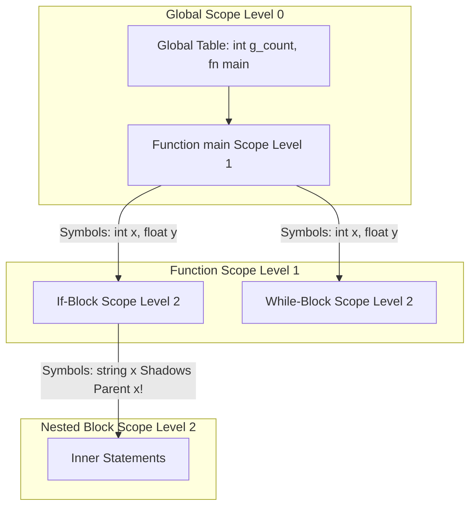

# Modul 118: Manajemen Memori Virtual Linux (Paging Bertingkat, Page Fault, Swap, Buddy Allocator, SLUB, OOM Killer)

**Navigasi**: [⬅️ Master Index](../../INDEX.md) | [Tingkat 7: Tingkat 7: Operating Systems Internals & Penguasaan Penuh Linux](./README.md)
*Sebelumnya*: [117. komunikasi-antar-proses-ipc](./117-komunikasi-antar-proses-ipc.md) | *Berikutnya*: [119. virtual-file-system-vfs-storage](./119-virtual-file-system-vfs-storage.md)

---

## 1. Intuisi Dasar Tanpa Jargon ("Seperti Bayi Baru Lahir")
Sebuah kalimat mungkin memenuhi aturan tata bahasa, namun tidak masuk akal secara akal sehat. Kalimat 'Gajah berwarna merah muda itu meminum batu karang' memiliki struktur subjek-predikat-objek yang sempurna, tetapi secara semantik tidak masuk akal di dunia nyata. Hal yang sama terjadi pada kode program: kode `int x = "halo" / 5;` secara sintaksis adalah deklarasi variabel yang sah, tetapi secara semantik adalah bencana: Anda tidak bisa membagi kalimat teks dengan angka integer! Analisis Semantik & Type Checking ([Semantic Analysis & Type Systems](https://www.cs.cornell.edu/courses/cs4120/)) adalah hakim logika kompilator: ia memelihara kamus besar (**Symbol Table**) yang melacak variabel apa saja yang hidup di setiap blok ruang lingkup (Scope), dan menegakkan hukum sistem jenis (**Type System**) untuk membuktikan secara matematis bahwa operasi yang dilakukan pada data tidak akan pernah memicu kesalahan interpretasi bit silikon saat runtime.

## 2. Fondasi Teoretis & Aksiomatik / Matematis
Formalisme Sistem Jenis dan Inferensi Jenis Hindley-Milner (Damas-Hindley-Milner Type System):

1. **Tabel Simbol Berlingkup (Scoped Symbol Table Stack)**:
   Dikelola sebagai rantai tumpukan kamus (*Lexical Scoping*). Pencarian simbol variabel melangkah dari lingkup terdalam (*Current Scope*)    naik ke induk penampungnya (*Enclosing Parent Scope*) hingga menyentuh Lingkup Global ($O(1)$ lookup per level):
   $$\text{Lookup}(x) = \begin{cases} S_i[x] & x \in S_i \\ \text{Lookup}_{S_{i-1}}(x) & x \notin S_i \land S_{i-1} \ne \emptyset \\ \text{Error: Undeclared Variable} & \text{otherwise} \end{cases}$$

2. **Inferensi Jenis Hindley-Milner (Algoritma W & Unifikasi Robinson)**:
   Mampu menebak tipe data paling umum (*Principal Type*) tanpa membutuhkan satu pun deklarasi tipe eksplisit dari programmer (fondasi Rust, Haskell, OCaml).
   Unifikasi Persamaan Jenis Robinson:
   $$\text{Unify}(\tau_1, \tau_2) \implies \text{Substitusi } \sigma \text{ sedemikian rupa sehingga } \sigma(\tau_1) \equiv \sigma(\tau_2)$$
   - Jika unifikasi variabel tipe $\alpha$ dengan ekspresi $\tau$ dilakukan, jalankan **Occurs Check**: pastikan $\alpha$ tidak muncul di dalam $\tau$ (mencegah jenis rekursif tak terhingga $\alpha = \text{List}[\alpha]$).

## 3. Anatomi Teknis & Cara Kerja Internal
Struktur Rantai Symbol Table Berhirarki dan Pohon Lingkup Leksikal (Lexical Scope Environment):



1. **Variable Shadowing**: Deklarasi variabel dengan nama yang sama di lingkup dalam menyembunyikan (*shadows*) variabel di lingkup luar. Symbol Table menyimpan riwayat rantai entri untuk mengembalikan visibilitas variabel luar saat blok dalam ditutup.
2. **Type Coercion & Promotion**: Aturan semantik kompilator untuk promosi tipe implisit (misal integer 32-bit otomatis dikonversi menjadi floating-point 64-bit pada operasi `int + double`).

## 4. Implementasi Praktis & Kode / Simulasi Riil
```python
# Robinson's First-Order Unification Algorithm for Type Inference in Python
from typing import Dict, Union

class TypeVar:
    def __init__(self, name: str): self.name = name
    def __repr__(self): return self.name

class TypeConstructor:
    def __init__(self, name: str, *args):
        self.name = name
        self.args = args
    def __repr__(self): return f"{self.name}[{', '.join(map(str, self.args))}]" if self.args else self.name

TypeTerm = Union[TypeVar, TypeConstructor]
Substitution = Dict[str, TypeTerm]

def occurs_check(v: TypeVar, term: TypeTerm) -> bool:
    if v == term: return True
    if isinstance(term, TypeConstructor):
        return any(occurs_check(v, arg) for arg in term.args)
    return False

def unify(t1: TypeTerm, t2: TypeTerm, subst: Substitution) -> Substitution:
    # Terapkan substitusi yang sudah ada
    while isinstance(t1, TypeVar) and t1.name in subst: t1 = subst[t1.name]
    while isinstance(t2, TypeVar) and t2.name in subst: t2 = subst[t2.name]

    if t1 == t2: return subst
    if isinstance(t1, TypeVar):
        if occurs_check(t1, t2): raise TypeError(f"Infinite type detected: {t1} in {t2}")
        subst[t1.name] = t2; return subst
    if isinstance(t2, TypeVar):
        if occurs_check(t2, t1): raise TypeError(f"Infinite type detected: {t2} in {t1}")
        subst[t2.name] = t1; return subst
    if isinstance(t1, TypeConstructor) and isinstance(t2, TypeConstructor):
        if t1.name != t2.name or len(t1.args) != len(t2.args):
            raise TypeError(f"Type mismatch: {t1} vs {t2}")
        for a1, a2 in zip(t1.args, t2.args):
            subst = unify(a1, a2, subst)
        return subst
    raise TypeError(f"Cannot unify {t1} and {t2}")
```

## 5. Miskonsepsi & Jebakan Industri
1. **Omitting the Occurs Check in Type Inference**: Menonaktifkan pemeriksaan occurs check demi kecepatan komputasi. Mencoba menyatukan variabel tipe $\alpha$ dengan fungsi $\alpha \to \beta$ akan menghasilkan struktur data pohon rekursif tak berujung yang memicu crash infinite loop pada compiler.
2. **Memory Leak in Symbol Table on Semantic Failure**: Mengalokasikan node lingkup simbol di heap namun tidak membersihkannya saat proses kompilasi dibatalkan akibat kesalahan semantik pengguna.
3. **Inappropriate Implicit Type Coercion**: Membiarkan konversi tipe implisit yang memangkas presisi tanpa peringatan (seperti konversi implisit nilai floating point `float` ke integer `int`), memicu bug pembulatan tersembunyi yang fatal pada sistem kendali roket/keuangan.

## 6. Proyek Latihan & Rubrik Penilaian Mandiri
1. **Tingkat Pemula**: Bangun kelas C++ atau struct C `SymbolTable` yang mendukung lingkup berjenjang (metode `enter_scope()`, `exit_scope()`, `define(name, type)`, dan `resolve(name)`). Uji penanganan variabel shadowing.
2. **Tingkat Menengah**: Terapkan Type Checker pada AST kalkulator sederhana yang memvalidasi bahwa ekspresi boolean (`true`, `false`, `>`, `==`) tidak dapat dijumlahkan dengan bilangan integer tanpa casting eksplisit.
3. **Tingkat Mahir**: Implementasikan inferensi jenis Hindley-Milner (Algoritma W) lengkap untuk Lambda Calculus bertipe dasar (integers, booleans, functions, dan let-polymorphism). Tunjukkan bagaimana fungsi identitas polimorfik `let id = \x -> x` dapat diterapkan secara aman pada tipe integer dan boolean sekaligus.

## 7. Rekomendasi Sumber Belajar Standar Emas
| Sumber Pembelajaran | Penulis / Institusi | Tautan Langsung | Fokus Materi |
| :--- | :--- | :--- | :--- |
| Types and Programming Languages (TAPL) | Benjamin C. Pierce (Univ. of Pennsylvania) | [MIT Press TAPL](https://www.cis.upenn.edu/~bcpierce/tapl/) | Type Systems, Simply Typed Lambda Calculus, Hindley-Milner & Subtyping |
| Cornell CS 4120: Introduction to Compilers | Dexter Kozen & Andrew Myers | [Cornell CS4120 Semantic Analysis](https://www.cs.cornell.edu/courses/cs4120/) | Symbol Tables, Static Semantics, Type Checking Rules & AST Typing |
| Principal Type-Schemes for Functional Programs | Luis Damas & Robin Milner | [ACM POPL 1982 Paper](https://dl.acm.org/doi/10.1145/582153.582176) | Penemuan Resmi Algoritma Inferensi Jenis Hindley-Milner W |
| Engineering a Compiler, 2nd Edition | Keith D. Cooper & Linda Torczon | [Elsevier Cooper Book](https://www.elsevier.com/books/engineering-a-compiler/cooper/978-0-12-088478-0) | Bab 4 & 5: Context-Sensitive Analysis, Symbol Table Implementations |

---
*Navigasi Cepat*: [Ke Tingkat 7](./README.md) | [Ke Master Index](../../INDEX.md) | *Sebelumnya*: [117. komunikasi-antar-proses-ipc](./117-komunikasi-antar-proses-ipc.md) | *Berikutnya*: [119. virtual-file-system-vfs-storage](./119-virtual-file-system-vfs-storage.md)
