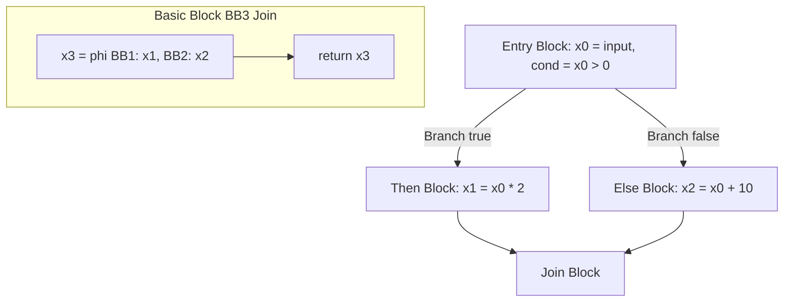

# Modul 119: Virtual File System / VFS & Storage (Superblock, Inode, Dentry, File Descriptors, ext4, XFS, Btrfs, ZFS)

**Navigasi**: [⬅️ Master Index](../../INDEX.md) | [Tingkat 7: Tingkat 7: Operating Systems Internals & Penguasaan Penuh Linux](./README.md)
*Sebelumnya*: [118. manajemen-memori-virtual-linux](./118-manajemen-memori-virtual-linux.md) | *Berikutnya*: [120. arsitektur-io-berkecepatan-tinggi](./120-arsitektur-io-berkecepatan-tinggi.md)

---

## 1. Intuisi Dasar Tanpa Jargon ("Seperti Bayi Baru Lahir")
Jika ada $M$ bahasa pemrograman di dunia (C, Rust, Swift, Go, Python) dan ada $N$ arsitektur prosesor fisik yang berbeda (x86-64, ARM64, RISC-V, WebAssembly, MIPS), apakah kita harus menulis $M \times N$ buah kompilator mandiri dari awal? Jika kita melakukannya, kita akan menghabiskan ribuan tahun menulis ulang optimasi yang sama berulang kali. Intermediate Representation (IR) ([Compiler Intermediate Representation](https://llvm.org/docs/LangRef.html)) adalah 'Bahasa Esperanto' universal kompilator modern: sebuah jembatan penghubung yang membelah dunia kompilator menjadi dua bagian terpisah. Frontend hanya bertugas menerjemahkan bahasa sumber ke kode IR universal ini ($M$ penerjemah), seluruh optimasi matematika dilakukan di atas kode IR tersebut, dan Backend hanya bertugas menerjemahkan IR tersebut ke kode mesin prosesor target ($N$ generator). Total pekerjaan menyusut drastis dari $M \times N$ menjadi hanya $M + N$!

## 2. Fondasi Teoretis & Aksiomatik / Matematis
Bentuk Penugasan Tunggal Statis (Static Single Assignment / SSA Form):

IR modern (seperti LLVM IR) distrukturkan dalam bentuk **SSA Form**.
Aturan Aksiomatik SSA:
$$\text{Setiap variabel wajib didefinisikan (diberi nilai) tepat satu kali!}$$

Konversi Kode Konvensional ke SSA Form:
Variabel lama dipecah menjadi variabel berindeks unik baru ($x \to x_1, x_2, \dots$):
$$\begin{array}{l|l}
\textbf{Kode Non-SSA} & \textbf{Bentuk SSA Form} \\
\hline
y = 1 & y_1 = 1 \\
y = y + 2 & y_2 = y_1 + 2 \\
x = y * 3 & x_1 = y_2 * 3 \\
\end{array}$$

Fungsi Phi ($\\phi$-Node) pada Titik Temu Percabangan Aliran Kontrol:
Ketika dua jalur percabangan IF-ELSE menyatu kembali pada Control Flow Graph (CFG), fungsi magis $\phi$ memilih nilai variabel berdasarkan blok dasar (*Basic Block*) mana yang baru saja dilalui eksekusi:
$$x_3 = \phi(x_1, x_2) \quad \implies x_3 = \begin{cases} x_1 & \text{jika datang dari Blok Then} \\ x_2 & \text{jika datang dari Blok Else} \end{cases}$$

## 3. Anatomi Teknis & Cara Kerja Internal
Struktur Control Flow Graph (CFG) Berbasis Basic Blocks dan $\phi$-Node Placement:



1. **Basic Block Invariant**: Barisan instruksi linier lurus yang memiliki tepat satu pintu masuk di awal (*Single Entry*) dan tepat satu pintu keluar di akhir (*Single Exit* via Branch/Jump/Return). Tidak boleh ada instruksi lompatan ke tengah blok.
2. **Dominator Tree & Dominance Frontiers**: Digunakan oleh Algoritma Cytron et al. untuk menentukan lokasi matematis paling efisien di mana $\phi$-node wajib disisipkan di dalam graf CFG ([Cytron SSA Placement Algorithm](https://dl.acm.org/doi/10.1145/115372.115320)).

## 4. Implementasi Praktis & Kode / Simulasi Riil
```llvm
; LLVM Intermediate Representation (LLVM IR) showing SSA Form and Phi Node
; Equivalent C: int compute(int x) { if (x > 0) return x * 2; else return x + 10; }

define dso_local i32 @compute(i32 %x) {
entry:
    ; Pemeriksaan kondisi perbandingan integer bertanda (signed greater than)
    %cmp = icmp sgt i32 %x, 0
    br i1 %cmp, label %then_block, label %else_block

then_block:
    %x_doubled = mul nsw i32 %x, 2
    br label %join_block

else_block:
    %x_offset = add nsw i32 %x, 10
    br label %join_block

join_block:
    ; Fungsi Phi: memilih nilai berdasarkan blok asal eksekusi!
    %result = phi i32 [ %x_doubled, %then_block ], [ %x_offset, %else_block ]
    ret i32 %result
}
```

## 5. Miskonsepsi & Jebakan Industri
1. **Broken SSA Invariant via Variable Reassignment**: Menginstruksikan modifikasi nilai variabel IR SSA yang sama lebih dari satu kali (`%x = add ...` lalu `%x = sub ...`). LLVM Verifier akan menolak biner IR seketika dengan pesan galat fatal `instruction defining existing value`.
2. **Missing $\phi$-Node on Divergent Paths**: Menggunakan nilai variabel dari blok percabangan tanpa menyatukannya melalui $\phi$-node di blok penggabungan, memicu eksekusi instruksi dengan status register yang belum terdefinisi (*Undefined Register State*).
3. **Basic Block Termination Violation**: Menempatkan instruksi non-terminator setelah instruksi jump/branch di dalam satu Basic Block. Instruksi setelah terminator tidak akan pernah dieksekusi (*Dead Instructions*) dan merusak topologi CFG.

## 6. Proyek Latihan & Rubrik Penilaian Mandiri
1. **Tingkat Pemula**: Konversikan potongan kode C berikut ke dalam bentuk SSA Form manual di atas kertas: `int a = 5; a = a + 1; int b = a * 2; if (b > 10) a = b; else a = 0; return a;`.
2. **Tingkat Menengah**: Gunakan Clang untuk mengompilasi program C menjadi LLVM IR teks (`clang -S -emit-llvm -O1 main.c -o main.ll`). Temukan di mana instruksi `%phi` ditempatkan dan bandingkan perbedaannya dengan kompilasi tanpa optimasi `-O0`.
3. **Tingkat Mahir**: Implementasikan algoritma pembangunan Control Flow Graph (CFG) dari AST program sederhana dalam Python atau C++. Pecah kode program menjadi Basic Blocks terisolasi, hubungkan tepi percabangan (`Predecessors` dan `Successors`), dan cetak representasi graf dalam format visual Graphviz DOT.

## 7. Rekomendasi Sumber Belajar Standar Emas
| Sumber Pembelajaran | Penulis / Institusi | Tautan Langsung | Fokus Materi |
| :--- | :--- | :--- | :--- |
| Efficiently Computing Static Single Assignment Form and the Control Dependence Graph | Cytron, Ferrante, Rosen, Wegman, Zadeck | [ACM TOPLAS 1991 Paper](https://dl.acm.org/doi/10.1145/115372.115320) | Makalah Orisinal Penemuan Algoritma SSA Form & Dominance Frontiers |
| LLVM Language Reference Manual | The LLVM Compiler Infrastructure | [LLVM IR Official Reference](https://llvm.org/docs/LangRef.html) | Spesifikasi Lengkap LLVM IR Syntax, SSA Types, Instructions & Attributes |
| Static Single Assignment Book | Matthias Braun et al. | [SSA Book Online Draft](http://ssabook.gforge.inria.fr/latest/book.pdf) | Teori Komprehensif SSA, Dominance, SSA Reconstruction & Destruction |
| Modern Compiler Implementation in ML / C (SSA Chapters) | Andrew W. Appel | [Appel SSA Guide](https://www.cs.princeton.edu/~appel/modern/) | Bab 19: Static Single-Assignment Form, Control Flow Graphs & Phi Nodes |

---
*Navigasi Cepat*: [Ke Tingkat 7](./README.md) | [Ke Master Index](../../INDEX.md) | *Sebelumnya*: [118. manajemen-memori-virtual-linux](./118-manajemen-memori-virtual-linux.md) | *Berikutnya*: [120. arsitektur-io-berkecepatan-tinggi](./120-arsitektur-io-berkecepatan-tinggi.md)
