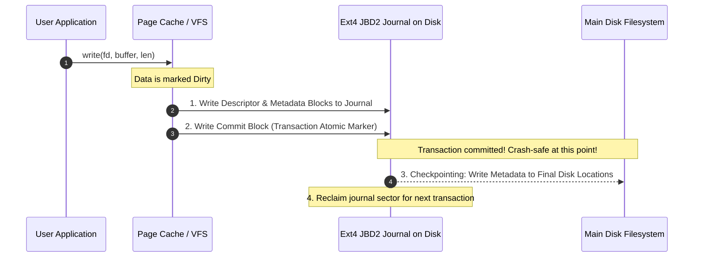

# Modul 119: Virtual File System / VFS & Storage (Superblock, Inode, Dentry, File Descriptors, ext4, XFS, Btrfs, ZFS)

**Navigasi**: [⬅️ Master Index](../../INDEX.md) | [Tingkat 7: Tingkat 7: Operating Systems Internals & Penguasaan Penuh Linux](./README.md)
*Sebelumnya*: [118. manajemen-memori-virtual-linux](./118-manajemen-memori-virtual-linux.md) | *Berikutnya*: [120. arsitektur-io-berkecepatan-tinggi](./120-arsitektur-io-berkecepatan-tinggi.md)

---

## 1. Intuisi Dasar Tanpa Jargon ("Seperti Bayi Baru Lahir")
### 1.1 Konsep Inti & Analogi Tanpa Jargon
Kapan pun komputer Anda dimatikan secara mendadak akibat pemadaman listrik darurat, mengapa file skripsi atau database perusahaan Anda tidak hancur berantakan menjadi bubur byte yang tak terbaca? File System Internals ([Linux File Systems & VFS](https://www.kernel.org/doc/html/latest/filesystems/vfs.html)) adalah arsitektur ketahanan data transaksional. Di lapisan teratas, sistem Linux menyediakan **Virtual File System (VFS)**—lapisan abstraksi universal yang memungkinkan program Anda menggunakan perintah `read()` dan `write()` yang identik untuk mengakses file lokal di SSD (Ext4), sistem file jaringan di awan (NFS), hingga sistem file buatan di memori RAM (`/proc` dan `/sys`). Di lapisan terbawah, teknologi **Journaling (Ext4, Btrfs, ZFS)** bertindak seperti buku kas akuntansi perbankan: sebelum mengubah struktur disk secara permanen, perubahan tersebut dicatat terlebih dahulu dalam jurnal khusus; jika listrik padam di tengah jalan, sistem operasi cukup membaca jurnal beberapa detik saat menyala kembali untuk memulihkan keutuhan data 100%!

### 1.2 Urgensi Rekayasa & Signifikansi Sistemik
Dalam rekayasa sistem modern, pemahaman mendalam tentang konsep ini membedakan arsitek sistem kelas dunia dari sekadar operator perkakas teknis.

## 2. Fondasi Teoretis & Aksiomatik / Matematis
### 2.1 Kerangka Teori Aksiomatik & Formulasi Matematis
Arsitektur Struktur Empat Serangkai VFS Linux dan Disk Ext4 Block Groups:

### 2.2 Penurunan Matematis Langkah-demi-Langkah
Lapisan VFS memodelkan setiap sistem file ke dalam empat objek inti:
1. **Superblock**: Menyimpan metadata global sistem file (ukuran blok, jumlah total inode, status mount).
2. **Inode (Index Node)**: Menyimpan metadata sebuah file fisik (hak akses, kepemilikan UID/GID, stempel waktu, ukuran byte, pointer blok data disk). **Nama file tidak disimpan di dalam inode!**
3. **Dentry (Directory Entry)**: Menghubungkan nama file dalam string teks dengan nomor inode yang bersesuaian, disimpan di cache memori RAM (**Dentry Cache / dcache**).
4. **File Object**: Merepresentasikan file yang sedang dibuka oleh proses (memegang offset baca-tulis saat ini).

Formulasi Ekstensi Struktur Ext4 Extent Tree:
Menggantikan pemetaan blok bertingkat lama (Direct/Indirect Pointers) dengan **Extents** kontinu:
$$\text{Extent} = \{\text{Logical Block Number}, \ \text{Length (hingga 32.768 blok)}, \ \text{Physical Block Start}\}$$
Memungkinkan satu entri extent 12-byte memetakan hingga 128 MB data disk kontinu dalam satu pemetaan tanpa overhead pointer berulang.

## 3. Anatomi Teknis & Cara Kerja Internal
Mekanisme Transaksi Jurnal Ext4 (JBD2 - Journaling Block Device 2):



1. **Mode Jurnal Ext4**:
   - `data=journal`: Metadata dan data muatan ditulis ke jurnal sebelum ke disk utama (paling aman, performa paling lambat).
   - `data=ordered` (Default): Data muatan ditulis langsung ke disk sebelum metadata di-commit ke jurnal (keseimbangan optimal antara integritas dan kecepatan).
   - `data=writeback`: Hanya metadata yang di-commit ke jurnal; tidak ada jaminan urutan data (performa maksimal, risiko data lama bocor setelah crash) ([Ext4 Kernel Documentation](https://www.kernel.org/doc/html/latest/filesystems/ext4/index.html)).
2. **Copy-on-Write File Systems (Btrfs & ZFS)**: Tidak pernah menimpa blok data yang ada di tempat (*no in-place overwrite*). Data baru selalu ditulis ke blok disk kosong baru, lalu pointer pohon B-tree diarahkan ke blok baru tersebut, memungkinkan fitur *Atomic Snapshots* instan.

#### Tabel Penelusuran Siklus Alokasi Inode VFS & Kehabisan Inode Sistem Berkas Ext4
| Siklus Operasi I/O | Operasi VFS Kernel | Permintaan Alokasi Disk | Status Blok Data Fisik (GB) | Status Tabel Inode Fisik | Status Hasil Operasi Berkas |
|---|---|---|---|---|---|
| Awal Sistem Berkas | Pembuatan Ext4 Filesystem | Format 100 GB Disk | Bebas: 100 GB (100%) | Total Inode: 6.553.600 (Bebas: 100%) | Siap beroperasi |
| Pembuatan 6.5 Juta File | Loop membuat file 1-byte | Tulis 1 byte teks per file | Terpakai: 26 GB (Sisa: 74 GB BEBAS!)| Terpakai: 6.553.599 (Sisa: 1 Inode!) | Berkas tersimpan normal |
| Pembuatan File Baru | `creat("critical_log.txt")`| Minta alokasi 1 inode baru | Kapasitas disk masih sisa 74 GB! | **INODE TABLE PENUH (0 INODE BEBAS)** | **ENOSPC: No space left on device!**|
| Kebingungan Operator | `df -h` menunjukkan 74% Free | Operator mengira disk masih lega | Penulisan file basis data gagal | File log drop, transaksi terhenti | Bencana Downtime Produksi! |
| Mitigasi Diagnostik | `df -i` (Cek Inode) | Terlihat: `Use% = 100% Inodes` | - | Reformat dengan `-N` atau bersihkan file sampah | Pemahaman mendalam VFS memulihkan sistem |

## 4. Implementasi Praktis & Kode / Simulasi Riil
```c
// Inspecting File Inode Metadata and Synchronizing Page Cache to Disk in C
#include <stdio.h>
#include <stdlib.h>
#include <unistd.h>
#include <fcntl.h>
#include <sys/stat.h>
#include <time.h>

void inspect_and_sync_file(const char *filepath) {
    struct stat file_stat;

    // 1. Ekstrak metadata inode dari kernel VFS
    if (stat(filepath, &file_stat) < 0) {
        perror("stat failed");
        return;
    }

    printf("File: %s\n", filepath);
    printf("Inode Number: %lu\n", (unsigned long)file_stat.st_ino);
    printf("Size: %ld bytes (Blocks allocated: %ld of 512B)\n", 
           file_stat.st_size, file_stat.st_blocks);
    printf("Hard Links Count: %lu\n", (unsigned long)file_stat.st_nlink);
    printf("Last Modified: %s", ctime(&file_stat.st_mtime));

    // 2. Demonstrasi penulisan aman dengan fsync
    int fd = open(filepath, O_WRONLY | O_APPEND);
    if (fd >= 0) {
        const char payload[] = "Critical transaction ledger entry\n";
        write(fd, payload, sizeof(payload) - 1);
        
        // Paksa flush dari Page Cache RAM ke piringan fisik storage SSD/HDD!
        // Menjamin integritas data sebelum fungsi return ke pemanggil
        if (fsync(fd) == 0) {
            printf("Successfully committed changes to disk hardware via fsync!\n");
        }
        close(fd);
    }
}
```

## 5. Miskonsepsi & Jebakan Industri
1. **Assuming `close()` Writes Data to Physical Storage**: Berasumsi bahwa setelah memanggil `close(fd)`, data sudah aman tersimpan di piringan fisik disk. `close()` hanya melepaskan file descriptor; data masih tertahan di Page Cache RAM kernel! Jika listrik mati sedetik kemudian, data hilang (wajib panggil `fsync(fd)` sebelum `close()` untuk data kritis seperti database) ([PostgreSQL fsync Fiasco](https://wiki.postgresql.org/wiki/Fsync_Errors)).
2. **Deleting Open Files via `unlink` (Orphan Inodes)**: Menghapus file menggunakan `unlink()` atau `rm` saat proses lain masih membuka file descriptor-nya. Inode dan blok disk tidak akan dibebaskan oleh sistem file sampai proses tersebut menutup FD atau mati, menghasilkan ruang disk yang 'hilang secara gaib'.
3. **Hard Link Limitations**: Mencoba membuat Hard Link antardisk atau antarpartisi sistem file yang berbeda (`ln file /mnt/other_disk/file`). Hard Link hanya menunjuk nomor inode numerik pada satu superblock sistem file lokal; melintasi batasan mount point akan menghasilkan error `EXDEV: Invalid cross-device link`.

### Studi Kasus Kegagalan Nyata: Kelumpuhan Kluster Basis Data Produksi Akibat Kehabisan Inode Ext4 Meskipun Disk Masih Kosong 70%
- **Kronologi & Konteks Kasus**: Pada platform analitik e-commerce global, seluruh kluster basis data utama mendadak menolak transaksi penulisan baru dan melempar error sistem operasi `ENOSPC: No space left on device`.
- **Akar Masalah Arsitektur Virtual Filesystem (VFS) & Tabel Inode Ext4**: Saat tim administrator memeriksa kapasitas disk menggunakan perintah standar `df -h`, disk menunjukkan bahwa kapasitas penyimpanan fisik masih tersisa lebih dari 500 GB (ruang bebas lebih dari 70%). Namun, tim tidak menyadari bahwa sistem berkas Linux berbasis Unix (seperti Ext4) memisahkan alokasi antara blok penyimpanan data fisik (*data blocks*) dan struktur metadata berkas (*inodes*). Jumlah inode ditentukan secara permanen pada saat sistem berkas diformat pertama kali. Sebuah mikroservis pelacak sesi pengguna secara keliru menuliskan jutaan file teks sementara berukuran 10 byte di dalam direktori `/tmp/sessions/`. Meskipun ukuran file sangat kecil, setiap file menghabiskan tepat 1 buah inode unik. Ketika 100% kuota tabel inode habis terpakai, sistem operasi menolak pembuatan berkas baru apapun di seluruh partisi penyimpanan, melumpuhkan seluruh transaksi basis data produksi.

- **Potongan Kode / Arsitektur Cacat (Vulnerable Implementation)**:
```c
// fs/ext4/ialloc.c - Mekanisme Alokasi Inode Baru pada Kernel Linux
struct inode *__ext4_new_inode(...) {
    struct ext4_group_desc *gdp;
    struct buffer_head *inode_bitmap_bh;
    
    // Cari grup blok yang masih memiliki alokasi inode bebas
    ino = ext4_find_next_zero_bit(inode_bitmap_bh->b_data, EXT4_INODES_PER_GROUP(sb), 0);
    
    // CACAT KAPASITAS: Jika seluruh bit pada seluruh grup bernilai 1 (Habis):
    if (ino >= EXT4_INODES_PER_GROUP(sb)) {
        // Melempar error 'No space left on device' meskipun sisa ratusan gigabyte block data!
        return ERR_PTR(-ENOSPC); 
    }
}
```

- **Analisis Forensik & Rekayasa Modern**: Insiden Inode Exhaustion menjadi acuan penting dalam rekayasa keandalan sistem (SRE). Tim pemantauan modern diwajibkan menyertakan metrik alarm inode (`node_filesystem_files_free`) bersamaan dengan metrik ruang disk (`node_filesystem_free_bytes`). Pada perancangan aplikasi berskala besar, penyimpanan jutaan objek kecil dialihkan ke basis data berorientasi objek (seperti RocksDB/BadgerDB) yang menggabungkan entitas ke dalam file log SST tunggal, mencegah pemborosan inode sistem berkas.

## 6. Proyek Latihan & Rubrik Penilaian Mandiri
1. **Tingkat Pemula**: Buktikan sifat Hard Link vs Soft (Symbolic) Link di Linux: buat sebuah file, buat hard link dan symlink ke file tersebut, periksa nomor inode keduanya via `ls -i`, lalu hapus file sumber asli dan amati perilaku kedua link tersebut.
2. **Tingkat Menengah**: Tuliskan program C yang membaca struktur direktori secara rekursif menggunakan fungsi POSIX `opendir()`, `readdir()`, dan `lstat()`. Hitung jumlah total pemakaian blok disk riil dan deteksi symlink yang rusak (*broken symlinks*).
3. **Tingkat Mahir**: Implementasikan sistem file sederhana di ruang pengguna (Filesystem in Userspace / FUSE) dalam bahasa C. Buat sistem file virtual read-only yang memetakan file-file fiktif di memori dan dapat di-mount di direktori `/mnt/myfs` serta diakses melalui perintah shell biasa.

### Tingkat 1: Dasar
- **Tugas**: Bangun program penjelajah metadata berkas (*Stat Inspector*) dalam C/Python yang menerima path berkas atau direktori, lalu membaca struktur data `struct stat` melalui system call `stat()` / `lstat()` untuk mencetak nomor Inode, jumlah Hard Links, ID Pemilik (UID/GID), Izin Akses Posix oktal, dan ukuran alokasi blok fisik (`st_blocks * 512 byte`) vs ukuran logika berkas (`st_size`).
- **Petunjuk Perancangan Arsitektur**:
  - Tangani kasus file sparse (*Sparse File*): buktikan bahwa ukuran fisik blok bisa jauh lebih kecil daripada ukuran logika berkas.
- **Test Vector & Kasus Uji Ekstrem**:
  - *Berkas Hard Link*: Buat satu hard link baru ke berkas yang sama; pastikan kedua berkas memiliki nomor Inode yang identik persis dan `st_nlink` bertambah menjadi `2`.
- **Rubrik Penilaian Mandiri**: 40% Pembedahan Struktur stat yang Lengkap, 30% Pemahaman Inode dan Hard Link yang Tepat, 30% Kerapian Logging Output.

### Tingkat 2: Menengah
- **Tugas**: Kembangkan implementasi VFS In-Memory File System sederhana (*RamFS*) dalam Python/C yang mendukung struktur pohon hierarkis direktori (`mkdir`), pembuatan berkas (`creat`), penulisan data (`write`), dan pembacaan (`read`) menggunakan pemisahan representasi *Dentry* (nama dan relasi hierarki) dan *Inode* (metadata dan pointer ke blok data).
- **Petunjuk Perancangan Arsitektur**:
  - Struktur Dentry memegang pointer ke Inode. Dua Dentry berbeda dapat menunjuk ke Inode yang sama untuk merepresentasikan hard link.
  - Sediakan operasi penghapusan berkas (`unlink`) yang hanya menghapus Inode saat pencacah referensi `nlink == 0`.
- **Test Vector & Kasus Uji Ekstrem**:
  - *Hard Link Unlink*: Buat file `A`, buat hard link `B -> A`, hapus `A`; buktikan data masih dapat dibaca secara utuh melalui `B` dan memori fisik baru dibebaskan saat `B` dihapus.
- **Rubrik Penilaian Mandiri**: 40% Pemisahan Arsitektur Dentry vs Inode yang Bersih, 30% Manajemen Siklus Hidup Hard Link & Unlink, 30% Kerapian Struktur Data In-Memory.

### Tingkat 3: Mahir
- **Tugas**: Rancang sistem deteksi dan peringatan dini kehabisan Inode dan Blok Ruang Berkas terotomasi (*VFS Health Telemetry Daemon*) dalam Linux C/Go yang menggunakan system call `statvfs()` untuk memantau seluruh titik mount sistem berkas, menghitung laju pembakaran inode (*inode burn rate*), dan memicu tindakan mitigasi otomatis (pembersihan folder sementara) saat proyeksi sisa waktu $< 30\text{ menit}$.
- **Petunjuk Perancangan Arsitektur**:
  - Baca field `f_favail` (inode bebas) dan `f_files` (total inode) dari `struct statvfs`.
  - Terapkan estimasi regresi linier untuk menghitung turunan laju konsumsi inode per detik.
- **Test Vector & Kasus Uji Ekstrem**:
  - *Simulasi Pembuatan File Massal*: Buat $10.000$ file per detik; buktikan daemon mendeteksi lonjakan burn-rate dalam $\le 2$ detik dan memicu peringatan kritis sebelum kuota inode mencapai 95%.
- **Rubrik Penilaian Mandiri**: 40% Penggunaan statvfs() untuk Telemetri Inode yang Akurat, 30% Algoritma Estimasi Burn-Rate Proaktif, 30% Tindakan Mitigasi Fail-Safe Otomatis.

## 7. Rekomendasi Sumber Belajar Standar Emas
| Sumber Pembelajaran | Penulis / Institusi | Tautan Langsung | Fokus Materi |
| :--- | :--- | :--- | :--- |
| Linux Kernel Virtual Filesystem (VFS) Documentation | The Linux Kernel Archives | [Linux Kernel VFS Docs](https://www.kernel.org/doc/html/latest/filesystems/vfs.html) | Superblock, Inode, Dentry, File Operations & dcache Mechanics |
| The Design and Implementation of the Ext4 Filesystem | Theodore Ts'o et al. | [Ext4 Research Paper](https://events.static.linuxfound.org/slides/2010/linuxcon-japan/ext4_paper.pdf) | Extents Architecture, JBD2 Journaling & Multiblock Allocation |
| Operating Systems: Three Easy Pieces (Persistence Section) | Remzi & Andrea Arpaci-Dusseau | [OSTEP Persistence Book](https://pages.cs.wisc.edu/~remzi/OSTEP/#persistence) | Bab 39-44: File Systems, Inodes, Crash Consistency & FSCK/Journaling |
| libfuse: The Reference Implementation for FUSE in Linux | libfuse GitHub Community | [libfuse Documentation](https://libfuse.github.io/doxygen/) | Userspace Filesystem Design, High-Level vs Low-Level FUSE API |

---
*Navigasi Cepat*: [Ke Tingkat 7](./README.md) | [Ke Master Index](../../INDEX.md) | *Sebelumnya*: [118. manajemen-memori-virtual-linux](./118-manajemen-memori-virtual-linux.md) | *Berikutnya*: [120. arsitektur-io-berkecepatan-tinggi](./120-arsitektur-io-berkecepatan-tinggi.md)
