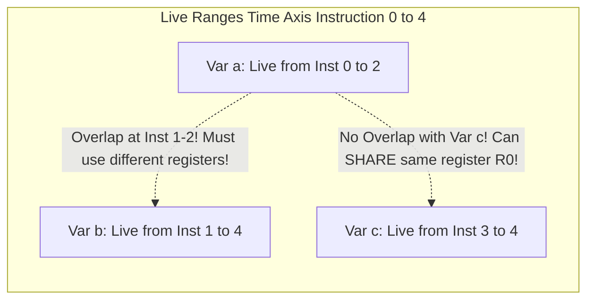

# Modul 120: Arsitektur I/O Berkecepatan Tinggi (Blocking vs Non-Blocking, epoll, Asinkron io_uring)

**Navigasi**: [⬅️ Master Index](../../INDEX.md) | [Tingkat 7: Tingkat 7: Operating Systems Internals & Penguasaan Penuh Linux](./README.md)
*Sebelumnya*: [119. virtual-file-system-vfs-storage](./119-virtual-file-system-vfs-storage.md) | *Berikutnya*: [121. penguasaan-shell-terminal-mahir](./121-penguasaan-shell-terminal-mahir.md)

---

## 1. Intuisi Dasar Tanpa Jargon ("Seperti Bayi Baru Lahir")
Sebelum seorang kompilator berani menghapus baris kode yang dianggap tidak berguna atau menentukan variabel mana yang berhak mendapatkan register prosesor paling cepat, ia harus menjadi detektif waktu yang sempurna. Analisis Aliran Data Kompilator (Compiler Data-Flow Analysis) ([Data-Flow Analysis Framework](https://www.cs.cmu.edu/~fp/courses/15411-f14/)) adalah seni matematika yang menelusuri bagaimana nilai data mengalir melintasi jalan raya Control Flow Graph. Analisis Keaktifan (**Liveness Analysis**) menjawab pertanyaan krusial: 'Apakah variabel ini masih akan dibaca di masa depan sebelum nilainya ditimpa?' Jika sebuah variabel sudah mati (*Dead*), memorinya dapat langsung disita untuk variabel lain. Dan Analisis Definisi Penjangkau (**Reaching Definitions**) melacak dari manakah asal mula nilai variabel tertentu berasal, memungkinkan kompilator mengganti variabel tersebut dengan nilai konstanta angka pastinya secara otomatis.

## 2. Fondasi Teoretis & Aksiomatik / Matematis
Kerangka Kerja Kisi Semilattice dan Teori Analisis Aliran Data Monoton (Kildall's Algorithm):

Analisis data-flow dimodelkan sebagai persamaan titik tetap (*Fixed-Point Equations*) di atas sebuah kisi aljabar (*Meet-Semilattice* $(\mathcal{L}, \sqcap)$):

1. **Analisis Keaktifan (Liveness Analysis - Backward Flow Analysis)**:
   Sebuah variabel berstatus **Live** (hidup) pada titik program $p$ jika terdapat jalur eksekusi dari $p$ ke suatu titik penggunaan variabel tersebut tanpa ada penimpaan nilai di tengah jalan.
   Persamaan Aliran Mundur per Basic Block $B$:
   $$\text{In}[B] = \text{Gen}[B] \cup (\text{Out}[B] \setminus \text{Kill}[B])$$
   $$\text{Out}[B] = \bigcup_{S \in \text{Succ}[B]} \text{In}[S]$$
   Di mana:
   - $\text{Gen}[B]$: Himpunan variabel yang dibaca di dalam blok $B$ sebelum didefinisikan ulang.
   - $\text{Kill}[B]$: Himpunan variabel yang nilainya ditulis/ditimpa di dalam blok $B$.

2. **Teorema Titik Tetap Tarski-Kleene (Fixed-Point Convergence)**:
   Karena himpunan variabel berhingga dan fungsi transfer bersifat monotonik, iterasi algoritma Worklist dijamin pasti konvergen ke solusi titik tetap unik terkecil (*Least Fixed-Point*) dalam maksimal $O(|V| \cdot |\text{Variables}|)$ langkah!

## 3. Anatomi Teknis & Cara Kerja Internal
Graf Alokasi Interval Keaktifan Variabel (Live Ranges) untuk Register Allocation:



1. **Interference Graph (Graf Interferensi)**: Simpul merepresentasikan variabel sementara (*virtual registers*), dan sisi menghubungkan dua variabel yang hidup bersamaan pada stempel waktu instruksi yang sama. Pewarnaan graf ini menentukan alokasi register hardware fisik.
2. **Dominance Frontiers & Iterated Dominance Frontiers ($IDF$)**: Digunakan untuk menempatkan $\phi$-node pada algoritma SSA. Blok $Y$ berada di batas dominasi blok $X$ ($Y \in DF(X)$) jika $X$ mendominasi pendahulu $Y$, namun tidak mendominasi $Y$ secara ketat.

## 4. Implementasi Praktis & Kode / Simulasi Riil
```python
# Iterative Fixed-Point Worklist Algorithm for Liveness Analysis in Python
from typing import Dict, Set, List

class BasicBlock:
    def __init__(self, name: str, gen: Set[str], kill: Set[str]):
        self.name = name
        self.gen = gen    # Variabel yang dibaca sebelum didefinisikan
        self.kill = kill  # Variabel yang ditulis/ditimpa di blok ini
        self.succ: List['BasicBlock'] = []
        self.live_in: Set[str] = set()
        self.live_out: Set[str] = set()

def run_liveness_analysis(blocks: List[BasicBlock]):
    # Inisialisasi worklist dengan seluruh blok (arah mundur)
    worklist = list(reversed(blocks))

    while worklist:
        b = worklist.pop(0)

        # Out[B] = Union(In[S] for S in Succ[B])
        new_out = set()
        for s in b.succ:
            new_out.update(s.live_in)
        b.live_out = new_out

        # In[B] = Gen[B] U (Out[B] - Kill[B])
        new_in = b.gen.union(b.live_out.difference(b.kill))

        # Jika nilai In[B] berubah, masukkan pendahulu kembali ke worklist
        if new_in != b.live_in:
            b.live_in = new_in
            # Tambahkan seluruh predecessor ke worklist
            for pred in blocks:
                if b in pred.succ and pred not in worklist:
                    worklist.append(pred)
```

## 5. Miskonsepsi & Jebakan Industri
1. **Assuming Forward Flow for Liveness Analysis**: Mengimplementasikan analisis keaktifan dengan iterasi maju dari Entry ke Exit. Keaktifan variabel ditentukan oleh apa yang akan dibaca di masa depan, sehingga wajib diiterasi secara mundur (*Backward Analysis*) dari Exit ke Entry.
2. **Infinite Looping in Non-Monotonic Transfer Functions**: Merancang fungsi transfer aliran data kustom yang melanggar sifat monotoni kisi aljabar. Algoritma worklist akan berputar tanpa batas waktu dan gagal mencapai titik tetap (*Infinite Convergence Loop*).
3. **Conservatism Overkill in Alias Analysis**: Mengasumsikan bahwa setiap penulisan pointer `*ptr = val` dapat mematikan (*kill*) semua variabel di memori karena kompilator tidak memiliki analisis alias pointer yang presisi, melumpuhkan optimasi register allocation.

## 6. Proyek Latihan & Rubrik Penilaian Mandiri
1. **Tingkat Pemula**: Diberikan barisan 4 instruksi: `1: a = 3; 2: b = a + 2; 3: c = b * a; 4: return c;`. Hitung himpunan variabel yang berstatus Live pada setiap batas antar-instruksi.
2. **Tingkat Menengah**: Bangun simulasi Analisis Definisi Penjangkau (Reaching Definitions Analysis) pada Control Flow Graph 3 blok dengan loop `while`. Tentukan definisi penugasan mana saja yang menjangkau instruksi di dalam badan loop.
3. **Tingkat Mahir**: Implementasikan kalkulasi Dominance Frontiers lengkap untuk Control Flow Graph berarah umum. Bangun pohon dominator (*Dominator Tree*) menggunakan Algoritma Lengauer-Tarjan dan buktikan titik penempatan $\phi$-node yang dihasilkan minimal.

## 7. Rekomendasi Sumber Belajar Standar Emas
| Sumber Pembelajaran | Penulis / Institusi | Tautan Langsung | Fokus Materi |
| :--- | :--- | :--- | :--- |
| Compilers: Principles, Techniques, and Tools (Dragon Book) | Aho, Lam, Sethi, Ullman | [Dragon Book Data-Flow](https://en.wikipedia.org/wiki/Compilers:_Principles,_Techniques,_and_Tools) | Bab 9: Machine-Independent Optimizations, Data-Flow Frameworks & Liveness |
| A Fast Algorithm for Computing Dominators in a Tree | Thomas Lengauer & Robert E. Tarjan | [ACM TOPLAS 1979 Paper](https://dl.acm.org/doi/10.1145/357062.357071) | Algoritma Lengauer-Tarjan Dominator Tree O(E alpha(V)) |
| CMU 15-411: Compiler Design - Dataflow Analysis | Frank Pfenning (Carnegie Mellon) | [CMU 15-411 Course Notes](https://www.cs.cmu.edu/~fp/courses/15411-f14/) | Kuliah Formal Semi-Lattices, Fixed-Point Iterations, Worklist & Invariants |
| Advanced Compiler Design and Implementation | Steven S. Muchnick | [Morgan Kaufmann Muchnick](https://www.elsevier.com/books/advanced-compiler-design-and-implementation/muchnick/978-1-55860-320-2) | Bab 8: Data-Flow Analysis, Available Expressions & Constant Propagation |

---
*Navigasi Cepat*: [Ke Tingkat 7](./README.md) | [Ke Master Index](../../INDEX.md) | *Sebelumnya*: [119. virtual-file-system-vfs-storage](./119-virtual-file-system-vfs-storage.md) | *Berikutnya*: [121. penguasaan-shell-terminal-mahir](./121-penguasaan-shell-terminal-mahir.md)
