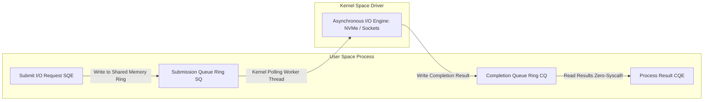

# Modul 120: Arsitektur I/O Berkecepatan Tinggi (Blocking vs Non-Blocking, epoll, Asinkron io_uring)

**Navigasi**: [⬅️ Master Index](../../INDEX.md) | [Tingkat 7: Tingkat 7: Operating Systems Internals & Penguasaan Penuh Linux](./README.md)
*Sebelumnya*: [119. virtual-file-system-vfs-storage](./119-virtual-file-system-vfs-storage.md) | *Berikutnya*: [121. penguasaan-shell-terminal-mahir](./121-penguasaan-shell-terminal-mahir.md)

---

## 1. Intuisi Dasar Tanpa Jargon ("Seperti Bayi Baru Lahir")
### 1.1 Konsep Inti & Analogi Tanpa Jargon
Bayangkan Anda adalah resepsionis sebuah hotel megah dengan 10.000 kamar tamu. Jika Anda menggunakan metode pemblokiran tradisional (Blocking I/O), Anda harus berjalan ke kamar tamu nomor 1, mengetuk pintu, dan berdiri menunggu di depan pintu selama berjam-jam hingga tamu tersebut membuka pintu. Selama Anda menunggu, 9.999 tamu lainnya diabaikan dan bisnis hotel lumpuh total. Solusi membuat satu pelayan untuk setiap kamar (Multi-threading) akan menghabiskan uang hotel karena gaji 10.000 pelayan (kehabisan RAM stack!). Manajemen I/O & Multiplexing Modern ([Linux epoll & io_uring Architecture](https://kernel.dk/io_uring.pdf)) adalah seni revolusioner: Anda memasang bel dering sentral di meja resepsionis (**`epoll`**); kamar mana pun yang tamunya siap berbicara akan membunyikan bel, dan Anda hanya melayani tamu yang belnya berbunyi! Dan pada evolusi tercanggihnya (**`io_uring`**), Anda bahkan tidak perlu bangun dari kursi: dua jalur ban berjalan memori bersama (Ring Buffers) mengantarkan pesanan dan hasil layanan secara otomatis tanpa Anda perlu melakukan satu pun syscall ke kernel!

### 1.2 Urgensi Rekayasa & Signifikansi Sistemik
Dalam rekayasa sistem modern, pemahaman mendalam tentang konsep ini membedakan arsitek sistem kelas dunia dari sekadar operator perkakas teknis.

## 2. Fondasi Teoretis & Aksiomatik / Matematis
### 2.1 Kerangka Teori Aksiomatik & Formulasi Matematis
Evolusi Matematis Algoritma I/O Multiplexing Linux:

### 2.2 Penurunan Matematis Langkah-demi-Langkah
$$\begin{array}{|l|c|c|c|c|}
\hline
\textbf{Teknologi} & \textbf{Skalabilitas Kompleksitas} & \textbf{Overhead Salin Kernel} & \textbf{Batas Max FD} & \textbf{Model Eksekusi} \\
\hline
\text{select()} & O(N) & \text{Salin array bit mask setiap loop} & 1024\text{ (FD\_SETSIZE)} & \text{Sinkron / Blocking Polling} \\
\text{poll()} & O(N) & \text{Salin array struct pollfd} & \text{Tak Terbatas} & \text{Sinkron / Polling Linier} \\
\text{epoll()} & \mathbf{O(1) \text{ amortized}} & \text{Daftar sekali di kernel (Red-Black Tree)} & \text{Jutaan FD} & \text{Event-Driven via Ready List} \\
\mathbf{io\_uring} & \mathbf{O(1) \text{ Zero-Syscall!}} & \mathbf{Zero-Copy Memori Bersama (SQ/CQ Ring)} & \text{Jutaan Operasi} & \mathbf{Asinkron Murni (True Async)} \\
\hline
\end{array}$$

Mekanisme Internal `epoll`:
- **Interest List**: Disimpan di kernel dalam struktur data **Red-Black Tree** ($O(\log N)$ penambahan/penghapusan file descriptor).
- **Ready List**: Ketika periferal jaringan menerima paket, driver hardware memicu callback interupsi yang memasukkan FD bersangkutan ke dalam **Doubly Linked List** (Ready List). Panggilan `epoll_wait()` hanya membaca Ready List dalam waktu $O(K)$, di mana $K$ adalah jumlah koneksi yang benar-benar aktif!

Arsitektur Dual Ring Buffer `io_uring` Jens Axboe (2019):
Dua antrean sirkular lockless dipetakan di memori bersama antara user space dan kernel:
1. **Submission Queue (SQ)**: Aplikasi memasukkan permintaan I/O (Read, Write, Accept) ke ring buffer SQ.
2. **Completion Queue (CQ)**: Kernel secara asinkron mengeksekusi operasi tersebut dan menuliskan hasilnya ke ring buffer CQ tanpa satupun transisi context switch jika kernel thread worker aktif (`IORING_SETUP_SQPOLL`).

## 3. Anatomi Teknis & Cara Kerja Internal
Arsitektur Pemetaan Memori Bersama Dual Ring Buffer Linux `io_uring`:



1. **Level-Triggered (LT) vs Edge-Triggered (ET) pada epoll**:
   - **Level-Triggered (Default)**: `epoll_wait` akan terus melaporkan status FD siap selama buffer data belum kosong melompong.
   - **Edge-Triggered (EPOLLET)**: `epoll_wait` HANYA melaporkan notifikasi satu kali saat transisi ada data baru masuk. Aplikasi wajib membaca buffer dalam non-blocking loop hingga menerima error `EAGAIN` / `EWOULDBLOCK`, jika tidak data sisa akan tertahan selamanya ([Edge-Triggered epoll Guide](https://man7.org/linux/man-pages/man7/epoll.7.html)).

#### Tabel Penelusuran I/O Berkecepatan Tinggi: Dari `select()` $\mathcal{O}(N)$ ke `epoll` $\mathcal{O}(1)$ dan `io_uring` Zero-Syscall
| Arsitektur Model I/O | Operasi Pendaftaran Event | Mekanisme Notifikasi Kesiapan Socket | Kompleksitas Periksa Kesiapan | Overhead Ruang Memori per Loop | Konsekuensi Skalabilitas C10K / C1000K |
|---|---|---|---|---|---|
| Model Klasik `select()` | Salin bitmask `fd_set` dari User ke Kernel | Kernel memindai array linier seluruh FD | $\mathcal{O}(N)$ per loop | Menyalin ulang seluruh bitmap FD per panggilan | Kolaps total jika koneksi $> 1024$! |
| Model Menengah `poll()` | Salin array `struct pollfd` | Kernel memindai seluruh array linked list | $\mathcal{O}(N)$ per loop | Menyalin array ratusan ribu struct per panggilan | Boros CPU, throughput menurun drastis |
| Model Modern `epoll` | Daftar 1 kali via RB-Tree kernel (`epoll_ctl`) | Driver menyuntikkan event siap ke Ready List | $\mathcal{O}(1)$ instan via wait queue | Mengembalikan hanya socket yang aktif saja! | Mampu melayani 1.000.000 koneksi bersamaan |
| Kerentanan Epoll | Edge-Triggered vs Level-Triggered | Thundering herd pada multithread accept | - | Banyak thread bangun untuk 1 koneksi | Lonjakan CPU saat lonjakan koneksi tiba |
| Model Mutakhir `io_uring` | Ring Buffer bersama di shared memory | Submission Queue (SQ) & Completion Queue (CQ) | **NOL SYSTEM CALL!** | Zero-copy kernel space sharing | Throughput I/O maksimal mendekati batas PCIe SSD |

## 4. Implementasi Praktis & Kode / Simulasi Riil
```c
// High-Performance Event-Driven TCP Server using Linux epoll in C
#include <stdio.h>
#include <stdlib.h>
#include <string.h>
#include <unistd.h>
#include <fcntl.h>
#include <sys/socket.h>
#include <netinet/in.h>
#include <sys/epoll.h>

#define MAX_EVENTS 64

static void set_nonblocking(int fd) {
    int flags = fcntl(fd, F_GETFL, 0);
    fcntl(fd, F_SETFL, flags | O_NONBLOCK);
}

void run_epoll_event_loop(int server_fd) {
    int epoll_fd = epoll_create1(0);
    struct epoll_event ev, events[MAX_EVENTS];

    // Daftarkan server socket ke interest list epoll
    ev.events = EPOLLIN;
    ev.data.fd = server_fd;
    epoll_ctl(epoll_fd, EPOLL_CTL_ADD, server_fd, &ev);

    printf("Event loop running via epoll...\n");
    for (;;) {
        int nfds = epoll_wait(epoll_fd, events, MAX_EVENTS, -1);
        for (int i = 0; i < nfds; i++) {
            if (events[i].data.fd == server_fd) {
                // Koneksi masuk baru dari klien
                int client_fd = accept(server_fd, NULL, NULL);
                set_nonblocking(client_fd);
                ev.events = EPOLLIN | EPOLLET; // Edge-Triggered mode
                ev.data.fd = client_fd;
                epoll_ctl(epoll_fd, EPOLL_CTL_ADD, client_fd, &ev);
            } else {
                // Data siap dibaca dari klien yang sudah terhubung
                char buf[512];
                ssize_t bytes = read(events[i].data.fd, buf, sizeof(buf));
                if (bytes <= 0) {
                    close(events[i].data.fd); // Tutup dan otomatis dihapus dari epoll
                } else {
                    write(events[i].data.fd, buf, bytes); // Echo balik data
                }
            }
        }
    }
}
```

## 5. Miskonsepsi & Jebakan Industri
1. **Starvation in Edge-Triggered epoll Loop**: Membaca socket Edge-Triggered tanpa membaca hingga `EAGAIN` atau membaca terlalu rakus pada satu koneksi besar sehingga mengabaikan ratusan koneksi klien lain di event loop yang sama.
2. **Blocking Calls Inside Event-Loop Threads**: Memanggil fungsi blocking seperti resolusi DNS sinkron `gethostbyname()` atau pembacaan file disk lambat di dalam thread epoll tunggal. Seluruh ribuan koneksi pengguna lain akan ikut membeku total selama pemanggilan berlangsung.
3. **File Descriptor Reuse Race in epoll**: Menutup FD dengan `close(fd)` di thread 1, lalu kernel mengalokasikan kembali angka FD yang sama untuk koneksi baru di thread 2 sebelum thread 1 sempat menghapusnya dari `epoll`. Notifikasi event lama dapat salah sasaran ke koneksi baru.

### Studi Kasus Kegagalan Nyata: Runtuhnya Skalabilitas Server Web Skala Besar Akibat Masalah Epoll Thundering Herd (C10M Pitfall)
- **Kronologi & Konteks Kasus**: Pada server aplikasi perpesanan instan berskala jutaan koneksi (C10M Problem), tim infrastruktur mengonfigurasi arsitektur multi-proses di mana 32 proses pekerja (worker processes) secara bersama-sama mendengarkan pada satu file descriptor listening socket yang sama menggunakan mekanisme `epoll`.
- **Akar Masalah Model I/O Event-Driven & Thundering Herd**: Ketika satu koneksi klien baru tiba pada listening socket, implementasi epoll lawas kernel Linux membangunkan (*wake up*) seluruh 32 proses pekerja sekaligus dari tidur panggilan `epoll_wait()`. Tiga puluh dua proses pekerja berlomba-lomba memanggil `accept()` pada soket tersebut. Namun hanya tepat 1 proses yang berhasil menerima koneksi, sementara 31 proses pekerja lainnya gagal dengan kode galat `EAGAIN` atau `EWOULDBLOCK` dan kembali tertidur. Fenomena *Thundering Herd* ini memicu ribuan *context switch* sia-sia per detik, melumpuhkan efisiensi cache CPU, memicu lonjakan latensi jabat tangan koneksi hingga hitungan detik, dan menurunkan throughput server hingga lebih dari 60%.

- **Potongan Kode / Arsitektur Cacat (Vulnerable Implementation)**:
```c
// Rekonstruksi Masalah Thundering Herd pada Multi-Worker Epoll Server
#include <sys/epoll.h>
#include <sys/socket.h>
#include <unistd.h>

void worker_process_flawed(int listen_fd) {
    int epoll_fd = epoll_create1(0);
    struct epoll_event ev, events[10];
    
    // CACAT: Mendaftarkan listening socket tanpa flag EPOLLEXCLUSIVE
    ev.events = EPOLLIN; // Level-Triggered atau Edge-Triggered standar
    ev.data.fd = listen_fd;
    epoll_ctl(epoll_fd, EPOLL_CTL_ADD, listen_fd, &ev);

    while (1) {
        // Ketika 1 koneksi baru tiba: SELURUH WORKER DIBANGUNKAN SERENTAK!
        int nfds = epoll_wait(epoll_fd, events, 10, -1);
        
        // 31 dari 32 proses pekerja akan gagal menerima koneksi:
        int client_fd = accept(listen_fd, NULL, NULL); 
        if (client_fd < 0) {
            // Membuang ribuan siklus CPU sia-sia dalam context switch massal!
        }
    }
}

// Mitigasi Defensif Modern: Flag EPOLLEXCLUSIVE (Kernel Linux 4.5+) atau SO_REUSEPORT
// ev.events = EPOLLIN | EPOLLEXCLUSIVE; // Hanya membangunkan tepat 1 worker!
```

- **Analisis Forensik & Rekayasa Modern**: Masalah Thundering Herd mendorong inovasi besar pada subsistem jaringan Linux. Solusi industri modern meliputi: (1) Penegakan flag `EPOLLEXCLUSIVE` pada panggilan `epoll_ctl` yang menjamin kernel hanya membangunkan tepat satu proses pekerja saat ada koneksi baru; (2) Adopsi opsi socket `SO_REUSEPORT` yang memungkinkan setiap proses pekerja memiliki antrean pendengar independen dengan penyeimbangan beban (*load balancing*) terdistribusi secara langsung di dalam perangkat keras kernel.

## 6. Proyek Latihan & Rubrik Penilaian Mandiri
1. **Tingkat Pemula**: Bangun server echo TCP sederhana yang mampu menangani 10 klien secara bersamaan menggunakan fungsi `select()` atau `poll()`. Amati penurunan efisiensi saat kapasitas FD dinaikkan.
2. **Tingkat Menengah**: Implementasikan server web HTTP non-blocking berbasis `epoll` di Linux yang mampu menyajikan file HTML statis ke ribuan koneksi konkuren simultan (C10K Problem benchmark menggunakan alat `wrk` atau `ab`).
3. **Tingkat Mahir**: Tuliskan program penyalin file ultra-cepat berbasis Linux `io_uring` menggunakan pustaka `liburing`. Gunakan fitur fixed-buffers (`io_uring_register_buffers`) dan polling kernel thread (`IORING_SETUP_SQPOLL`) untuk membuktikan throughput jutaan IOPS pada media penyimpanan NVMe SSD.

### Tingkat 1: Dasar
- **Tugas**: Bangun server TCP non-blocking berbasis *Echo Server* mandiri dalam C/Python menggunakan pemanggilan `epoll` (`epoll_create1`, `epoll_ctl`, `epoll_wait`) yang mampu melayani 100 klien simultan secara asynchronous dalam satu thread tunggal (*Single-Threaded Event Loop*).
- **Petunjuk Perancangan Arsitektur**:
  - Set seluruh socket klien ke mode non-blocking via `fcntl(fd, F_SETFL, O_NONBLOCK)`.
  - Tangani pembacaan parsial dan kode galat `EAGAIN` / `EWOULDBLOCK` secara elegan.
- **Test Vector & Kasus Uji Ekstrem**:
  - *Uji Klien Simultan*: Hubungkan 50 koneksi klien serentak, kirim pesan acak; buktikan server membalas seluruh pesan dengan latency $< 1\text{ ms}$ tanpa thread terblokir.
- **Rubrik Penilaian Mandiri**: 40% Penggunaan epoll Event-Driven yang Tepat, 30% Penanganan Socket Non-Blocking Bebas Starvation, 30% Kerapian Enkapsulasi Event Loop.

### Tingkat 2: Menengah
- **Tugas**: Kembangkan server web HTTP/1.1 minimalis berkinerja tinggi dalam C yang mengimplementasikan `epoll` dengan mode *Edge-Triggered* (`EPOLLET`), buktikan bahwa pembacaan data soket harus di-loop hingga tuntas (`read() == -1` dengan `errno == EAGAIN`) untuk mencegah pesan tertahan.
- **Petunjuk Perancangan Arsitektur**:
  - Pada mode Edge-Triggered, kernel hanya memberi sinyal satu kali saat data baru tiba.
  - Sediakan buffer melingkar per-koneksi untuk merangkai fragmen permintaan HTTP yang terpecah.
- **Test Vector & Kasus Uji Ekstrem**:
  - *Serangan Slowloris Sederhana*: Kirim permintaan HTTP byte demi byte dengan jeda waktu; buktikan server mengumpulkan data secara parsial tanpa memblokir klien lain yang mengirim request lengkap.
- **Rubrik Penilaian Mandiri**: 40% Kepatuhan Semantik Edge-Triggered (EPOLLET), 30% Penanganan Fragmen Paket HTTP Parsial, 30% Ketahanan Terhadap Klien Lambat.

### Tingkat 3: Mahir
- **Tugas**: Rancang server transfer berkas berkecepatan ultra-tinggi dalam C/Linux yang memanfaatkan antarmuka mutakhir `io_uring` (`io_uring_queue_init`, `io_uring_get_sqe`, `io_uring_submit`) untuk membaca file dari disk dan mengirimkannya ke socket jaringan tanpa ada overhead system call di dalam hot-path loop utama.
- **Petunjuk Perancangan Arsitektur**:
  - Manfaatkan submission queue ring buffer dan completion queue ring buffer di memori bersama kernel-user.
  - Terapkan fitur *Fixed Buffers* dan *Polled I/O* (`IORING_SETUP_SQPOLL`) untuk eliminasi total context switch CPU.
- **Test Vector & Kasus Uji Ekstrem**:
  - *Benchmark Throughput Jaringan*: Alirkan data file 10 GiB ke loopback socket; buktikan `io_uring` menghasilkan peningkatan throughput $\ge 25\%$ dibandingkan `epoll` standar dengan utilisasi CPU yang lebih rendah.
- **Rubrik Penilaian Mandiri**: 40% Arsitektur Ring Buffer io_uring SQ/CQ yang Presisi, 30% Eliminasi System Call dalam Hot-Path, 30% Pengukuran Throughput Komparatif Valid.

## 7. Rekomendasi Sumber Belajar Standar Emas
| Sumber Pembelajaran | Penulis / Institusi | Tautan Langsung | Fokus Materi |
| :--- | :--- | :--- | :--- |
| Efficient IO with io_uring | Jens Axboe (Linux Kernel IO Maintainer) | [Jens Axboe io_uring Paper](https://kernel.dk/io_uring.pdf) | Dual Ring Buffer Architecture, Zero-Syscall Polling & Async Operations |
| The C10K Problem: Handling Ten Thousand Concurrent Connections | Dan Kegel | [Dan Kegel C10K Classic Portal](http://www.kegel.com/c10k.html) | Sejarah Masalah C10K, I/O Multiplexing, Non-blocking Sockets & epoll |
| Linux man-pages: epoll(7), epoll_wait(2), io_uring_enter(2) | Michael Kerrisk | [Linux man7 epoll Manual](https://man7.org/linux/man-pages/man7/epoll.7.html) | Spesifikasi Resmi Level vs Edge-Triggered, EPOLLONESHOT & Flags |
| High Performance Browser Networking | Ilya Grigorik (Google) | [O'Reilly HPBN Online](https://hpbn.co/) | TCP Optimizations, Epoll Event Loops, WebSockets & Transport Layer |

---
*Navigasi Cepat*: [Ke Tingkat 7](./README.md) | [Ke Master Index](../../INDEX.md) | *Sebelumnya*: [119. virtual-file-system-vfs-storage](./119-virtual-file-system-vfs-storage.md) | *Berikutnya*: [121. penguasaan-shell-terminal-mahir](./121-penguasaan-shell-terminal-mahir.md)
