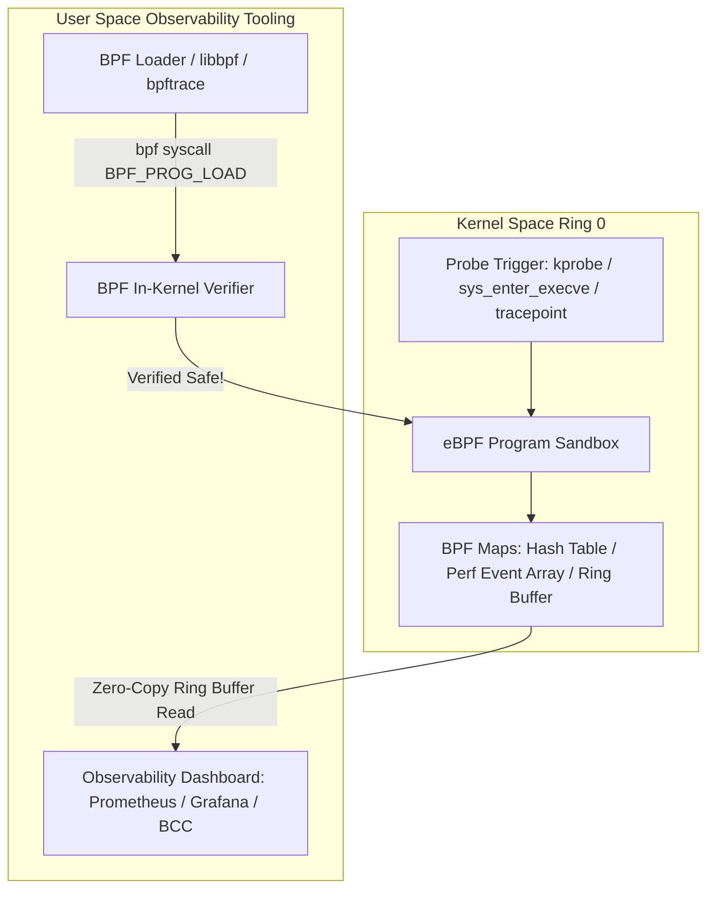

# Modul 123: Observabilitas Sistem & Rekayasa Performa (USE/RED Method, vmstat, strace, perf, FlameGraphs, eBPF)

**Navigasi**: [⬅️ Master Index](../../INDEX.md) | [Tingkat 7: Tingkat 7: Operating Systems Internals & Penguasaan Penuh Linux](./README.md)
*Sebelumnya*: [122. model-keamanan-izin-berkas-identitas](./122-model-keamanan-izin-berkas-identitas.md) | *Berikutnya*: [124. isolasi-kernel-kontainerisasi-dari-nol](./124-isolasi-kernel-kontainerisasi-dari-nol.md)

---

## 1. Intuisi Dasar Tanpa Jargon ("Seperti Bayi Baru Lahir")
### 1.1 Konsep Inti & Analogi Tanpa Jargon
Ketika sistem database produksi Anda di cloud tiba-tiba mengalami lonjakan latensi misterius setiap pukul dua pagi, Anda tidak bisa menghentikan sistem dengan debugger gdb atau menambahkan ratusan perintah `printk` lalu mengompilasi ulang kernel server. Tracing, Profiling & Kernel Observability ([Linux eBPF & Tracing Architecture](https://ebpf.io/)) adalah mesin sinar-X berdaya tembus tinggi yang memungkinkan Anda mengintip ke dalam perut terdalam kernel Linux pada kecepatan produksi nyata dengan overhead nyaris nol (<1%). Teknologi puncaknya—**eBPF (Extended Berkeley Packet Filter)**—adalah komputer mini revolusioner yang ditanamkan di dalam kernel Linux: ia memungkinkan Anda menyuntikkan program bytecode aman yang dapat dipasang pada sembarang pemanggilan fungsi kernel (kprobes), fungsi aplikasi pengguna (uprobes), atau paket jaringan, menyajikan metrik observabilitas telemetri secara real-time tanpa pernah memodifikasi satu baris pun kode sumber kernel!

### 1.2 Urgensi Rekayasa & Signifikansi Sistemik
Dalam rekayasa sistem modern, pemahaman mendalam tentang konsep ini membedakan arsitek sistem kelas dunia dari sekadar operator perkakas teknis.

## 2. Fondasi Teoretis & Aksiomatik / Matematis
### 2.1 Kerangka Teori Aksiomatik & Formulasi Matematis
Arsitektur Mesin Virtual eBPF dan Sistem Verifier Matematis Formal:

### 2.2 Penurunan Matematis Langkah-demi-Langkah
eBPF adalah mesin virtual RISC 64-bit berbasis register yang tertanam di dalam kernel Linux, memiliki 11 register 64-bit ($R0 - R10$) dan program counter $PC$. Program eBPF dikompilasi dari bahasa C menggunakan Clang/LLVM target `bpf`.

Jaminan Keamanan **eBPF Kernel In-Kernel Verifier**:
Sebelum program eBPF diizinkan dimuat dan dieksekusi di Ring 0, Verifier menganalisis grafik kontrol aliran (CFG):
1. **Jaminan Terminasi**: Memastikan program tidak mengandung loop tak berujung (unbounded loops). Seluruh loop wajib dibatasi secara statis.
2. **Keamanan Memori Mutlak**: Memvalidasi bahwa setiap pembacaan/penulisan pointer berada di dalam batas struktur yang valid (out-of-bounds check) dan tidak ada akses pointer liar yang belum diinisialisasi.
3. **Ukuran Program Maksimum**: Membatasi instruksi maksimum (hingga 1.000.000 instruksi terverifikasi) untuk mencegah monopoli CPU.

Setelah lolos verifikasi, **Just-In-Time (JIT) Compiler** menerjemahkan bytecode eBPF menjadi instruksi mesin asli x86-64 atau ARM64 untuk eksekusi pada kecepatan hardware penuh.

## 3. Anatomi Teknis & Cara Kerja Internal
Arsitektur Observabilitas eBPF: Dari Hook Titik Kernel ke Ruang Pengguna:



1. **Kategori Instrumen Penelusuran (Tracing Probes)**:
   - **Tracepoints**: Titik instrumentasi statis yang ditanamkan secara sengaja oleh developer kernel di lokasi kritis (stabil dan tidak berubah antarkernel release).
   - **Kprobes / Kretprobes**: Instrumentasi dinamis yang mampu mencangkok instruksi breakpoint pada *sembarang* alamat fungsi fungsi kernel Linux saat runtime.
   - **Uprobes / Uretprobes**: Mencangkok instruksi breakpoint pada fungsi di dalam biner aplikasi ruang pengguna (seperti melacak pemanggilan fungsi SSL `SSL_write` di openssl) ([Brendan Gregg eBPF Portal](https://www.brendangregg.com/ebpf.html)).

#### Tabel Penelusuran Profiling Sistem & Analisis Dampak Overhead Tracing: `strace` vs eBPF
| Mekanisme Observabilitas | Metodologi Intersepsi | Jumlah Context Switch per Panggilan | Dampak Latensi Eksekusi ($Latency$) | Utilisasi CPU Tambahan | Risiko Kelumpuhan Produksi |
|---|---|---|---|---|---|
| Eksekusi Normal (Basis) | System Call Native | 2 Switch (User $\to$ Kernel $\to$ User) | $\approx 100\text{ ns}$ | 0% | Nol risiko |
| Tracing via `strace` (`ptrace`)| Stop proses di syscall enter & exit | **4 Context Switch Ekstra per Syscall**| Melonjak ke $\approx 15.000\text{ ns}$ (**150x Lebih Lambat!**) | Lonjakan CPU 40% - 80% | **SANGAT TINGGI (Downtime Server)** |
| Tracing via `perf` | Sampling PMU Hardware | 0 Context Switch (Sampling Asinkron) | $< 1\%$ overhead | Minimal ($< 2\%$) | Aman untuk analisis berkala |
| Tracing Modern `eBPF` | Kernel In-Situ Probes (kprobe/tracepoint)| 0 Context Switch (Eksekusi JIT Ring 0)| $\approx 15\text{ ns}$ tambahan overhead | Diabaikan ($< 0.1\%$) | **NOL DOWNTIME (Production-Grade)**|

## 4. Implementasi Praktis & Kode / Simulasi Riil
```python
# High-Performance Disk I/O Latency Tracing using BCC (BPF Compiler Collection)
# Menelusuri latensi waktu eksekusi penulisan disk block I/O via eBPF kprobe
from bcc import BPF
from time import sleep

bpf_source = """
#include <uapi/linux/ptrace.h>
#include <linux/blkdev.h>

BPF_HASH(start_time, struct request *);
BPF_HISTOGRAM(io_latencies);

// 1. Hook saat request blok I/O diterbitkan ke driver disk hardware
void trace_req_start(struct pt_regs *ctx, struct request *req) {
    u64 ts = bpf_ktime_get_ns();
    start_time.update(&req, &ts);
}

// 2. Hook saat request blok I/O selesai dieksekusi (completion callback)
void trace_req_done(struct pt_regs *ctx, struct request *req) {
    u64 *tsp = start_time.lookup(&req);
    if (tsp != 0) {
        u64 delta_us = (bpf_ktime_get_ns() - *tsp) / 1000;
        io_latencies.increment(bpf_log2l(delta_us)); // Catat ke histogram log2 mikrodetik
        start_time.delete(&req);
    }
}
"""

b = BPF(text=bpf_source)
b.attach_kprobe(event="blk_account_io_start", fn_name="trace_req_start")
b.attach_kprobe(event="blk_account_io_done", fn_name="trace_req_done")

print("Tracing block I/O latency... Hit Ctrl-C to finish and view distribution histogram.")
try:
    sleep(999999)
except KeyboardInterrupt:
    print("\nDisk I/O Latency Histogram (microsecond logarithmic buckets):")
    b["io_latencies"].print_log2_hist("usecs")
```

## 5. Miskonsepsi & Jebakan Industri
1. **BPF Verifier Rejection via Complex Pointers**: Menulis program eBPF yang melakukan pembacaan memori pointer bertingkat tanpa menggunakan pembantu kernel `bpf_probe_read_kernel()`. Verifier akan menolak memuat program dengan pesan galat `R1 invalid mem access 'inv'`.
2. **Overhead on High-Frequency Uprobes**: Memasang uprobe pada fungsi aplikasi pengguna yang dipanggil jutaan kali per detik (misal fungsi pembanding `strcmp`). Konteks trap breakpoint x86 (`int3`) memicu overhead context switch kernel yang memperlambat aplikasi hingga puluhan persen.
3. **Perf Event Buffer Dropped Samples**: Menggunakan buffer event penelusuran yang terlalu kecil saat melacak peristiwa jaringan dengan rate tinggi (seperti 100.000 paket per detik). Kernel akan membuang sampel (*dropped events*), menghasilkan metrik telemetri yang tidak akurat.

### Studi Kasus Kegagalan Nyata: Pemadaman Kluster Basis Data Produksi Akibat Pemasangan `strace` Tanpa Pengawasan
- **Kronologi & Konteks Kasus**: Pada jam sibuk transaksi sebuah bank digital, seorang insinyur operasi berusaha menyelidiki kelambatan kueri pada server basis data PostgreSQL produksi berkinerja tinggi yang menangani lebih dari 80.000 transaksi kueri per detik. Insinyur tersebut menempelkan perkakas pelacak `strace -p <pid>` langsung pada proses utama basis data.
- **Akar Masalah Observabilitas Sistem & Overhead Mekanisme Ptrace**: Perkakas `strace` mengandalkan system call `ptrace(PTRACE_SYSCALL)`. Setiap kali proses yang dipantau melakukan satu panggilan sistem (seperti `epoll_wait`, `read`, atau `futex`), kernel Linux menghentikan proses tersebut (*process pause*), melakukan context switch ke proses `strace` untuk mencatat argumen, mengembalikan kontrol ke target, lalu menghentikannya lagi saat syscall selesai untuk mencatat nilai kembalian. Hal ini menggandakan jumlah context switch dan memperlambat waktu eksekusi setiap transaksi hingga 150 kali lipat. Ribuan antrean koneksi klien menumpuk dalam hitungan detik, kehabisan memori socket buffer, dan memicu kegagalan berantai (*cascading failure*) yang mematikan seluruh layanan perbankan online selama 45 menit.

- **Potongan Kode / Arsitektur Cacat (Vulnerable Implementation)**:
```c
// Analisis Mekanisme Perlambatan Ekstrem Ptrace Syscall Hooking
// kernel/ptrace.c
void ptrace_report_syscall(struct pt_regs *regs) {
    // CACAT PERFORMA PRODUKSI:
    // 1. Bekukan proses target (State: TASK_TRACED)
    // 2. Bangunkan proses tracer (Context Switch 1)
    // 3. Salin data register ke memori tracer
    // 4. Tunggu tracer memanggil PTRACE_CONT (Context Switch 2)
    // 5. Ulangi proses ini DUA KALI untuk setiap 1 syscall!
    
    // Pada throughput 80.000 syscall/detik:
    // Menghasilkan > 320.000 context switch per detik, melumpuhkan CPU sepenuhnya!
}
```

- **Analisis Forensik & Rekayasa Modern**: Insiden kelumpuhan akibat `strace` melahirkan revolusi observabilitas sistem berbasis *eBPF* (Extended Berkeley Packet Filter). Industri modern melarang keras penggunaan perkakas berbasis ptrace interaktif di lingkungan produksi. Sebagai gantinya, observabilitas modern menggunakan probe eBPF (BCC / bpftrace) yang berjalan langsung di dalam kernel space dengan kompilasi JIT, mengeksekusi agregasi metrik in-situ tanpa context switch, dan dijamin keamanannya oleh verifier kernel Linux.

## 6. Proyek Latihan & Rubrik Penilaian Mandiri
1. **Tingkat Pemula**: Gunakan utilitas baris perintah `bpftrace` untuk melacak setiap pemanggilan syscall `sys_enter_openat` secara global di sistem Linux Anda dan cetak nama file yang sedang dibuka secara real-time.
2. **Tingkat Menengah**: Gunakan alat profiling Linux `perf record -F 99 -a -g -- sleep 10` dan `perf script` untuk mengumpulkan tumpukan panggilan fungsi (stack traces). Hasilkan visualisasi grafik api interaktif (**FlameGraph**) untuk mengidentifikasi bottleneck CPU utama pada aplikasi Anda.
3. **Tingkat Mahir**: Tulis program eBPF lengkap menggunakan kerangka modern CO-RE (Compile Once - Run Everywhere) dengan pustaka `libbpf`. Pasang probe pada titik masuk paket jaringan (XDP - eXpress Data Path) untuk memfilter dan membuang paket serangan DDoS pada lapisan driver jaringan sebelum paket sempat menyentuh kernel network stack.

### Tingkat 1: Dasar
- **Tugas**: Bangun program pemantau kesehatan sistem mandiri dalam Python/C yang membaca dan membedah metrik langsung dari sistem berkas semu Linux `/proc/stat` (penggunaan CPU per core: user, nice, system, idle, iowait), `/proc/meminfo` (MemTotal, MemFree, Buffers, Cached), dan `/proc/loadavg` setiap 1 detik.
- **Petunjuk Perancangan Arsitektur**:
  - Hitung persentase utilisasi CPU diferensial: $\Delta \text{busy} / \Delta \text{total} \times 100\%$.
  - Hindari membaca file dengan memanggil shell eksternal (`exec`); gunakan pembacaan file C langsung.
- **Test Vector & Kasus Uji Ekstrem**:
  - *Verifikasi Metrik*: Jalankan beban komputasi stres pada 1 core CPU; pastikan metrik CPU core tersebut menunjukkan utilisasi $\approx 100\%$ sementara core lain tetap normal.
- **Rubrik Penilaian Mandiri**: 40% Dekomposisi File Semu /proc yang Tepat, 30% Kalkulasi Diferensial Beban CPU Akurat, 30% Kerapian Logging Telemetri.

### Tingkat 2: Menengah
- **Tugas**: Kembangkan program profiler waktu eksekusi fungsi menggunakan antarmuka *Linux Perf Event* (`perf_event_open`) dalam C yang membaca counter perangkat keras PMU (*Hardware Performance Monitoring Unit*) untuk menghitung siklus CPU aktual (*CPU Cycles*) dan instruksi yang berhasil dipensiunkan (*Instructions Retired*) guna mengukur rasio *Instructions Per Cycle* (IPC).
- **Petunjuk Perancangan Arsitektur**:
  - Konfigurasi `struct perf_event_attr` dengan tipe `PERF_TYPE_HARDWARE`.
  - Ukur rasio IPC pada dua fungsi: (1) Loop komputasi aritmatika murni (IPC tinggi $> 2.0$), dan (2) Loop pencarian pointer dereferensi linked-list acak (IPC rendah $< 0.5$ akibat cache stall).
- **Test Vector & Kasus Uji Ekstrem**:
  - *Akurasi PMU*: Buktikan secara empiris bahwa algoritma ramah cache memiliki IPC $\ge 3\times$ lebih tinggi dibandingkan algoritma yang memicu banyak L3 cache miss.
- **Rubrik Penilaian Mandiri**: 40% Integrasi System Call perf_event_open yang Benar, 30% Kalkulasi Rasio IPC yang Presisi, 30% Analisis Hardware Performance PMU.

### Tingkat 3: Mahir
- **Tugas**: Rancang program pelacak latensi system call produksi menggunakan *eBPF Tracepoints* (melalui libbpf atau bpftrace) yang menempel pada event `sys_enter_read` dan `sys_exit_read` untuk mengukur distribusi latensi pembacaan file I/O dalam histogram logaritmik daya dua (*Power-of-2 Histogram*) langsung di dalam ruang memori kernel tanpa menyalin data mentah ke User Space.
- **Petunjuk Perancangan Arsitektur**:
  - Simpan stempel waktu awal di eBPF BPF_MAP_TYPE_HASH berbasis `bpf_ktime_get_ns()`.
  - Hitung durasi saat `sys_exit` dan akumulasikan ke dalam BPF_MAP_TYPE_HISTOGRAM.
- **Test Vector & Kasus Uji Ekstrem**:
  - *Overhead Benchmark*: Lakukan $500.000$ operasi I/O pembacaan berkas; buktikan penempelan probe eBPF hanya menambah overhead $< 1\%$ (dibandingkan strace yang memperlambat $> 1000\%$).
- **Rubrik Penilaian Mandiri**: 40% Penyusunan Kode eBPF Kernel Probe & BPF Maps yang Tepat, 30% Agregasi Histogram In-Situ di Kernel Space, 30% Verifikasi Overhead Super Rendah.

## 7. Rekomendasi Sumber Belajar Standar Emas
| Sumber Pembelajaran | Penulis / Institusi | Tautan Langsung | Fokus Materi |
| :--- | :--- | :--- | :--- |
| BPF Performance Tools: Linux System and Application Observability | Brendan Gregg (Intel/Netflix) | [Brendan Gregg BPF Book](https://www.brendangregg.com/bpf-performance-tools-book.html) | eBPF, BCC, bpftrace, CPU/Memory/Disk/Network Profiling Tools |
| eBPF Official Documentation & Architecture Portal | eBPF Foundation / Linux Foundation | [eBPF Official Portal](https://ebpf.io/) | In-Kernel Verifier, JIT Compiler, BPF Maps & XDP Architecture |
| Systems Performance: Enterprise and the Cloud, 2nd Edition | Brendan Gregg | [Addison-Wesley Gregg](https://www.brendangregg.com/systems-performance-2nd-edition-book.html) | Metodologi USE, Profiling, Latensi Analisis & Kernel Tracing |
| Linux Kernel ftrace Documentation | Steven Rostedt (Linux Kernel Tracing Maintainer) | [Linux ftrace Documentation](https://www.kernel.org/doc/html/latest/trace/ftrace.html) | Function Tracer, Function Graph, Event Tracing & Dynamic Probes |

---
*Navigasi Cepat*: [Ke Tingkat 7](./README.md) | [Ke Master Index](../../INDEX.md) | *Sebelumnya*: [122. model-keamanan-izin-berkas-identitas](./122-model-keamanan-izin-berkas-identitas.md) | *Berikutnya*: [124. isolasi-kernel-kontainerisasi-dari-nol](./124-isolasi-kernel-kontainerisasi-dari-nol.md)
