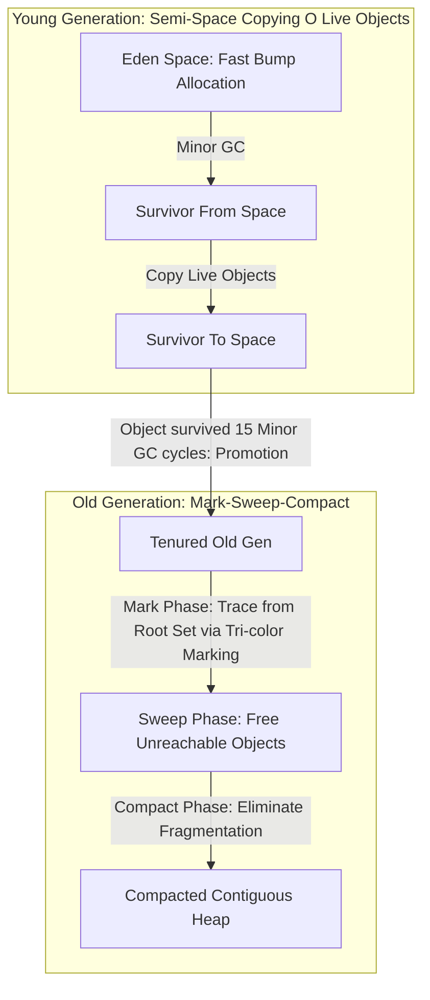

# Modul 124: Isolasi Kernel & Kontainerisasi dari Nol (Namespaces, cgroups v2, chroot/pivot_root, OverlayFS, OCI runc)

**Navigasi**: [⬅️ Master Index](../../INDEX.md) | [Tingkat 7: Tingkat 7: Operating Systems Internals & Penguasaan Penuh Linux](./README.md)
*Sebelumnya*: [123. observabilitas-sistem-rekayasa-performa](./123-observabilitas-sistem-rekayasa-performa.md) | *Berikutnya*: [125. sinyal-sistem-waktu-kontinu-diskrit](../08-dsp-telekomunikasi-jaringan/125-sinyal-sistem-waktu-kontinu-diskrit.md)

---

## 1. Intuisi Dasar Tanpa Jargon ("Seperti Bayi Baru Lahir")
Tidak semua bahasa pemrograman berakhir sebagai biner kode mesin statis yang kaku di disk. Bahasa-bahasa modern yang menggerakkan internet—seperti JavaScript (V8), Java (JVM), Python (CPython), dan C# (.NET CLR)—berjalan di atas lapisan perangkat lunak sakti yang disebut **Runtime System & Virtual Machine** ([Virtual Machines & Garbage Collection](https://craftinginterpreters.com/a-virtual-machine.html)). Di dalam Virtual Machine, terdapat CPU perangkat lunak tiruan yang mengeksekusi instruksi khusus (Bytecode); terdapat kompilator kilat (**Just-In-Time / JIT Compiler**) yang memantau bagian kode mana yang paling sering dieksekusi (*Hotspots*) dan mengubahnya menjadi kode mesin asli secepat kilat saat aplikasi sedang berlari kencang; dan terdapat petugas kebersihan memori otomatis (**Garbage Collector**) yang memungut sampah-sampah objek yang sudah tidak terpakai lagi tanpa mengharuskan programmer memanggil `free()` manual.

## 2. Fondasi Teoretis & Aksiomatik / Matematis
Arsitektur Bytecode VM dan Teori Pengumpulan Sampah (Garbage Collection Algorithms):

1. **Stack-Based VM vs Register-Based VM**:
   - **Stack-Based (JVM, CPython, WASM)**: Operasi mengambil operand dari puncak stack dan mendorong hasil kembali (`push`, `pop`, `add`). Kode bytecode sangat padat dan ringkas, implementasi mesin virtual sangat sederhana, namun membutuhkan instruksi pengalihan memori lebih banyak.
   - **Register-Based (LuaJIT, Dalvik/ART Android)**: Menggunakan register virtual berindeks (`ADD R1, R2, R3`). Menghasilkan instruksi per frame eksekusi lebih sedikit ($30-50\%$ pengurangan loop dispatch overhead), namun ukuran bytecode lebih besar.

2. **Kompilasi Just-In-Time (JIT) dan Deoptimasi Berspekulasi**:
   $$\text{Bytecode Interpreter} \xrightarrow{\text{Profiler: Loop Counter} > \theta} \text{Baseline JIT} \xrightarrow{\text{Type Feedback}} \text{Optimizing JIT (Tracer / Sea-of-Nodes)}$$
   Jika optimasi berspekulasi mengasumsikan input selalu integer tetapi tiba-tiba menerima string objek, JIT memicu **Deoptimization (Bailout)**: membuang kode mesin teroptimasi dan mengembalikan eksekusi kembali ke interpreter secara mulus!

3. **Teori Generational Garbage Collection (The Weak Generational Hypothesis)**:
   $$\text{Sebagian besar objek mati sesaat setelah dilahirkan! } (P(\text{Death}) > 90\% \text{ in Young Gen})$$
   Memori heap dibagi menjadi dua generasi:
   - **Young Generation (Eden + Survivor Spaces)**: Dibersihkan dengan cepat menggunakan algoritma penyalinan linier (*Minor GC / Cheneys Copying Collector*).
   - **Old Generation**: Menampung objek-objek senior yang selamat dari beberapa siklus Minor GC, dibersihkan menggunakan *Major GC (Mark-Sweep-Compact)*.

## 3. Anatomi Teknis & Cara Kerja Internal
Siklus Pengumpulan Sampah Generational GC (Mark-Sweep-Compact vs Cheney's Copying):



1. **Tri-Color Marking Algorithm (Dijkstra et al., 1978)**:
   - **White**: Objek belum terjangkau (kandidat sampah yang akan dimusnahkan).
   - **Grey**: Objek terjangkau dari root set, namun anak-anak pointernya belum dipindai.
   - **Black**: Objek terjangkau dan seluruh anak-anaknya telah selesai dipindai. Memungkinkan pengumpul sampah berjalan secara bersamaan dengan mutator aplikasi (*Concurrent Garbage Collection*) menggunakan Write Barrier ([Tri-color Marking Paper](https://dl.acm.org/doi/10.1145/359642.359655)).

## 4. Implementasi Praktis & Kode / Simulasi Riil
```c
// Minimal Stack-Based Bytecode Virtual Machine with Dispatch Loop in C
#include <stdio.h>
#include <stdint.h>
#include <stdbool.h>

typedef enum {
    OP_CONSTANT, // Dorong nilai konstanta ke stack
    OP_ADD,      // Ambil 2 nilai, jumlahkan, dorong hasil
    OP_SUB,
    OP_PRINT,    // Cetak nilai puncak stack
    OP_HALT      // Hentikan mesin virtual
} opcode_t;

#define STACK_MAX 256

void run_bytecode_vm(const uint8_t *bytecode) {
    int64_t stack[STACK_MAX];
    int     sp = -1; // Stack Pointer
    const uint8_t *ip = bytecode; // Instruction Pointer

    for (;;) {
        uint8_t instruction = *ip++;
        switch (instruction) {
            case OP_CONSTANT:
                stack[++sp] = *ip++; // Baca nilai 1-byte berikutnya
                break;
            case OP_ADD: {
                int64_t b = stack[sp--];
                int64_t a = stack[sp--];
                stack[++sp] = a + b;
                break;
            }
            case OP_PRINT:
                printf("[VM Output] Result: %ld\n", stack[sp--]);
                break;
            case OP_HALT:
                return;
            default:
                printf("Unknown opcode: 0x%02X\n", instruction);
                return;
        }
    }
}
```

## 5. Miskonsepsi & Jebakan Industri
1. **Stop-The-World (STW) Pauses Freezing Real-Time Systems**: Menggunakan algoritma Tracing Garbage Collector naif pada aplikasi trading keuangan atau game grafis 120 FPS. Fase pembersihan Major GC dapat menghentikan seluruh thread aplikasi selama puluhan hingga ratusan milidetik (*STW Jitter*).
2. **Circular Reference Memory Leaks in Reference Counting**: Menggunakan Reference Counting sederhana (seperti `std::shared_ptr` atau model lama Python) tanpa siklus detektor (*Cycle Detector*). Dua objek yang saling menunjuk satu sama lain tidak akan pernah dibebaskan meskipun seluruh aplikasi sudah kehilangan akses ke kedua objek tersebut.
3. **JIT Thrashing / Deopt Loops**: Menulis fungsi JavaScript atau Python yang menerima tipe data argumen yang berubah-ubah secara liar (polimorfik ekstrim). JIT akan terus mengompilasi kode ke biner, mengalami bailout deoptimasi, lalu mengompilasi ulang berulang kali, membuat aplikasi berjalan jauh lebih lambat daripada interpreter biasa.

## 6. Proyek Latihan & Rubrik Penilaian Mandiri
1. **Tingkat Pemula**: Perluas bytecode virtual machine C di atas untuk mendukung operasi perkalian (`OP_MUL`), pembagian (`OP_DIV`), dan percabangan kondisional sederhana (`OP_JUMP_IF_ZERO`).
2. **Tingkat Menengah**: Implementasikan Mark-and-Sweep Garbage Collector sederhana dalam bahasa C untuk heap simulasi 100 node. Tandai simpul yang terjangkau dari pointer root set, dan bebaskan simpul putih yang tidak terjangkau.
3. **Tingkat Mahir**: Bangun mesin JIT Compiler mini untuk arsitektur x86-64 di Linux menggunakan alokasi memori biner `mmap(PROT_READ | PROT_WRITE | PROT_EXEC)`. Terjemahkan bytecode penjumlahan aritmatika menjadi instruksi mesin asli x86-64 (`mov`, `add`, `ret`), lalu panggil blok memori tersebut sebagai fungsi pointer C untuk dieksekusi langsung oleh CPU.

## 7. Rekomendasi Sumber Belajar Standar Emas
| Sumber Pembelajaran | Penulis / Institusi | Tautan Langsung | Fokus Materi |
| :--- | :--- | :--- | :--- |
| The Garbage Collection Handbook: The Art of Automatic Memory Management | Richard Jones, Antony Hosking, Eliot Moss | [GC Handbook Official Site](https://gchandbook.org/) | Mark-Sweep, Copying, Generational, Concurrent & Real-Time GC Algorithms |
| Crafting Interpreters (Part III: A Bytecode Virtual Machine) | Robert Nystrom | [Crafting Interpreters VM](https://craftinginterpreters.com/a-virtual-machine.html) | Bytecode Disassembly, Stack-based VM, Hash Tables & Mark-Sweep GC |
| Java Virtual Machine Specification (Java SE Edition) | Tim Lindholm, Frank Yellin, Gilad Bracha | [Oracle JVM Specification](https://docs.oracle.com/javase/specs/jvms/se17/html/index.html) | Class File Format, Bytecode Instruction Set & Frame Execution |
| V8 JavaScript Engine Architecture & Sea-of-Nodes JIT | Google V8 Team | [V8 Official Developer Blog](https://v8.dev/blog) | TurboFan Compiler, Ignition Interpreter, Hidden Classes & Deoptimizations |

---
*Navigasi Cepat*: [Ke Tingkat 7](./README.md) | [Ke Master Index](../../INDEX.md) | *Sebelumnya*: [123. observabilitas-sistem-rekayasa-performa](./123-observabilitas-sistem-rekayasa-performa.md) | *Berikutnya*: [125. sinyal-sistem-waktu-kontinu-diskrit](../08-dsp-telekomunikasi-jaringan/125-sinyal-sistem-waktu-kontinu-diskrit.md)
