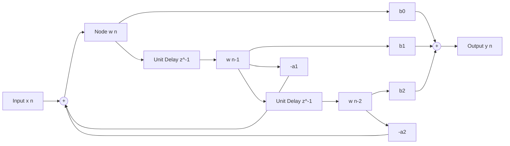

# Modul 125: Sinyal & Sistem Waktu Kontinu vs Diskrit (Sistem LTI, Fungsi Impuls, Konvolusi)

**Navigasi**: [⬅️ Master Index](../../INDEX.md) | [Tingkat 8: Tingkat 8: Pemrosesan Sinyal Digital, Telekomunikasi & Network Engineering](./README.md)
*Sebelumnya*: [124. isolasi-kernel-kontainerisasi-dari-nol](../07-os-internals-linux/124-isolasi-kernel-kontainerisasi-dari-nol.md) | *Berikutnya*: [126. transformasi-domain-frekuensi](./126-transformasi-domain-frekuensi.md)

---

## 1. Intuisi Dasar Tanpa Jargon ("Seperti Bayi Baru Lahir")
### 1.1 Konsep Inti & Analogi Tanpa Jargon
Dunia fisik di sekitar kita bersifat analog dan kontinu: suara petikan gitar akustik, getaran gempa bumi, atau gelombang radio di udara mengalir mulus tanpa patahan. Namun komputer digital hanya mengerti angka-angka diskrit yang dibekukan pada interval waktu tertentu. Pemrosesan Sinyal Digital (Digital Signal Processing / DSP) ([DSP Foundations & Filters](https://www.dspguide.com/)) adalah jembatan matematika yang mengubah deretan angka diskrit tersebut menjadi musik yang jernih atau citra radar yang tajam. Dua pilar utamanya adalah: **Filter FIR (Finite Impulse Response)** yang bertindak seperti penyaring yang sangat stabil dan memiliki fase linier sempurna (seperti kaca optik tanpa distorsi) namun membutuhkan banyak komputasi; dan **Filter IIR (Infinite Impulse Response)** yang cerdas dan hemat komputasi karena memanfaatkan umpan balik (feedback loop) dari masa lalu, meniru sirkuit analog klasik dengan sedikit koefisien filter.

### 1.2 Urgensi Rekayasa & Signifikansi Sistemik
Dalam rekayasa sistem modern, pemahaman mendalam tentang konsep ini membedakan arsitek sistem kelas dunia dari sekadar operator perkakas teknis.

## 2. Fondasi Teoretis & Aksiomatik / Matematis
### 2.1 Kerangka Teori Aksiomatik & Formulasi Matematis
Formulasi Matematis Konvolusi Diskrit, Transformasi Z, dan Persamaan Beda Filter:

### 2.2 Penurunan Matematis Langkah-demi-Langkah
1. **Konvolusi Waktu Diskrit (Discrete Convolution)**:
   Output sinyal $y[n]$ dari sistem Linear Time-Invariant (LTI) dengan respons impuls $h[n]$:
   $$y[n] = x[n] * h[n] = \sum_{k=-\infty}^{\infty} x[k] \cdot h[n - k]$$

2. **Transformasi Z (Z-Transform)**:
   Memetakan sinyal domain waktu diskrit ke bidang kompleks $z \in \mathbb{C}$ ($z = r e^{j\omega}$):
   $$X(z) = \mathcal{Z}\{x[n]\} = \sum_{n=-\infty}^{\infty} x[n] \, z^{-n}$$
   Fungsi Transfer Sistem $H(z)$:
   $$H(z) = \frac{Y(z)}{X(z)} = \frac{\sum_{k=0}^M b_k z^{-k}}{1 + \sum_{k=1}^N a_k z^{-k}}$$

3. **Perbedaan Fundamental FIR vs IIR**:
   - **FIR Filter ($a_k = 0$)**: $y[n] = \sum_{k=0}^M b_k x[n-k]$. Semua kutub (*poles*) berada di $z = 0$. **Selalu stabil mutlak** dan dapat memiliki respons fase linier murni ($-\alpha \omega$).
   - **IIR Filter ($a_k \ne 0$)**: $y[n] = \sum_{k=0}^M b_k x[n-k] - \sum_{k=1}^N a_k y[n-k]$. Memiliki kutub di luar titik pusat. **Stabil jika dan hanya jika semua kutub berada di dalam lingkaran satuan ($|p_i| < 1$).**

## 3. Anatomi Teknis & Cara Kerja Internal
Struktur Diagram Blok Filter Digital Direct Form II (IIR Filter Transposed):



1. **Biquad Cascade Direct Form II Transposed**: Meminimalkan jumlah register delay memory dari $2N$ menjadi hanya $N$. Struktur transposed meminimalkan kesalahan akumulasi derau pembulatan (*Round-off Noise*) dan limit cycles pada implementasi fixed-point DSP hardware ([Biquad Filters Audio EQ Cookbook](https://www.w3.org/TR/audio-eq-cookbook/)).
2. **Teorema Stabilitas Lingkaran Satuan**: Jika satu kutub IIR bergeser ke luar lingkaran satuan ($|z| \ge 1.0$) akibat kuantisasi koefisien float-ke-fixed, filter akan berosilasi tak terkendali menuju saturasi tak terhingga.

#### Tabel Penelusuran Akumulasi Galat Pembulatan Biner 24-bit Rudal Patriot (Dhahran, 1991)
| Waktu Operasi Riil ($t$) | Waktu Jam Internal ($100\text{ jam}$) | Nilai Pembulatan $1/10$ Biner 24-bit | Akumulasi Galat Waktu ($\Delta t$) | Deviasi Posisi Gerak Rudal ($\Delta x = v \cdot \Delta t$) | Status Deteksi Radar Target Scud |
|---|---|---|---|---|---|
| $t = 0\text{ jam}$ | 0 detik | `0.00011001100110011001100` | $0.000000\text{ detik}$ | $0\text{ meter}$ | Jendela jangkauan radar sinkron sempurna |
| $t = 1\text{ jam}$ | 36.000 tick | Galat: $-9.5367 \times 10^{-8}$ per tick | $-0.003433\text{ detik}$ | $5.7\text{ meter}$ | Target masih dalam jendela toleransi |
| $t = 24\text{ jam}$ | 864.000 tick | Akumulasi linier bertambah | $-0.082400\text{ detik}$ | $138\text{ meter}$ | Posisi jendela radar mulai tergeser |
| $t = 100\text{ jam}$ | 3.600.000 tick | Akumulasi $100$ jam kontinu | $-0.343300\text{ detik}$ | **687 METER!** | **RADAR MELIHAT AREA KOSONG!** |
| Serangan Scud Tiba | Kecepatan Scud: $2.000\text{ m/s}$ | Radar memindai area salah | Rudal gagal mendeteksi | Gerbang pelacakan meleset | Rudal Scud menghantam barak di Dhahran |

## 4. Implementasi Praktis & Kode / Simulasi Riil
```python
# Low-Pass Finite Impulse Response (FIR) Filter Design using Sinc Function & Hamming Window
import numpy as np
import matplotlib.pyplot as plt

def design_fir_lowpass(num_taps: int, cutoff_hz: float, sample_rate_hz: float) -> np.ndarray:
    """
    Mendesain koefisien filter FIR fase-linier menggunakan metode Windowed-Sinc.
    num_taps wajib bernilai ganjil untuk Symmetric Type-I FIR Filter.
    """
    assert num_taps % 2 == 1, "Number of taps must be odd"
    M = num_taps - 1
    fc = cutoff_hz / sample_rate_hz # Frekuensi cutoff ternormalisasi (0 s.d. 0.5)

    n = np.arange(num_taps) - (M / 2)
    # Respons impuls ideal: fungsi Sinc ternormalisasi
    # sinc(0) ditangani secara khusus via np.where
    h_ideal = np.where(n == 0, 2 * fc, np.sin(2 * np.pi * fc * n) / (np.pi * n))

    # Jendela Hamming: menekan side-lobes spektral hingga -53 dB
    window = 0.54 - 0.46 * np.cos(2 * np.pi * np.arange(num_taps) / M)
    h_windowed = h_ideal * window

    # Normalisasi agar gain pada frekuensi DC (0 Hz) tepat bernilai 1.0 (0 dB)
    return h_windowed / np.sum(h_windowed)
```

## 5. Miskonsepsi & Jebakan Industri
1. **Aliasing Distortion via Sub-Nyquist Sampling**: Melakukan sampling sinyal frekuensi $f$ dengan sampling rate $f_s < 2f$. Frekuensi tinggi akan terlipat (*fold back*) menjadi frekuensi rendah palsu yang merusak sinyal (solusi: pasang analog anti-aliasing low-pass filter sebelum ADC) ([Analog Devices ADC Aliasing](https://www.analog.com/en/analog-dialogue/articles/dsp-digital-signal-processing-basics.html)).
2. **IIR Filter Instability Due to Fixed-Point Coefficient Quantization**: Mengonversi koefisien floating-point filter IIR orde tinggi ($N \ge 4$) langsung ke bilangan fixed-point integer tanpa memecahnya menjadi rantai kaskade Second-Order Sections (Biquads). Pergeseran kutub akan memicu osilasi limit-cycle destruktif.
3. **Linear Phase Assumption in IIR Filters**: Berasumsi bahwa filter IIR memiliki delay konstan untuk semua frekuensi. IIR memperkenalkan distorsi fase (*non-linear group delay*) yang dapat merusak bentuk pulsa sinyal radar atau transmisi data biner.

### Studi Kasus Kegagalan Nyata: Tragedi Kegagalan Baterai Rudal Patriot di Dhahran Akibat Akumulasi Galat Pembulatan 24-bit (1991)
- **Kronologi & Konteks Sejarah**: Pada 25 Februari 1991 selama Perang Teluk, sebuah rudal Scud Irak ditembakkan ke arah pangkalan militer AS di Dhahran, Arab Saudi. Baterai rudal pertahanan Patriot gagal meluncurkan intersepsi, mengakibatkan hancurnya barak militer, menewaskan 28 tentara dan melukai lebih dari 100 orang.
- **Akar Masalah Sinyal Diskret & Presisi Representasi Waktu**: Komputer pengendali senjata Patriot menggunakan pencacah waktu internal integer dengan resolusi 0,1 detik (10 Hz). Untuk menghitung waktu dalam detik, nilai pencacah dikalikan dengan konstanta $1/10$. Namun, pecahan desimal $1/10$ adalah bilangan berulang tak terhingga dalam biner ($0.0001100110011..._2$). Register komputer hanya memiliki panjang 24-bit, sehingga bilangan tersebut dipotong (*truncated*). Pemotongan ini menghasilkan galat kecil sebesar $0.000000095$ detik per $0.1$ detik. Ketika sistem dioperasikan terus-menerus selama lebih dari 100 jam tanpa reboot, akumulasi galat mencapai 0,3433 detik. Pada kecepatan rudal Scud sebesar 2.000 meter per detik, gerbang pelacakan radar (*range gate*) bergeser lebih dari 687 meter ke area kosong. Radar menyimpulkan target Scud adalah false alarm dan tidak meluncurkan rudal pencegat.

- **Potongan Kode / Arsitektur Cacat (Vulnerable Implementation)**:
```c
// Rekonstruksi Galat Pembulatan Waktu 24-bit Rudal Patriot (1991)
#include <stdio.h>

void calculate_patriot_clock_drift(double hours_running) {
    // 0.1 dalam representasi pecahan biner 24-bit (terpotong):
    // Nilai riil: 1/10 = 0.1000000000000000055...
    // Nilai 24-bit: 0.099999904632568359375
    double true_dt = 0.1;
    double fixed24_dt = 0.099999904632568359375;
    double drift_per_tick = true_dt - fixed24_dt; // ~9.5367e-8 detik

    double total_ticks = hours_running * 3600.0 * 10.0;
    double total_drift_seconds = total_ticks * drift_per_tick;
    double scud_velocity = 2000.0; // m/s
    double tracking_error_meters = total_drift_seconds * scud_velocity;

    printf("Durasi Operasi: %.1f jam\n", hours_running);
    printf("Total Pergeseran Waktu: %.6f detik\n", total_drift_seconds);
    printf("Deviasi Jarak Pelacakan: %.2f meter (Sasaran Meleset!)\n", tracking_error_meters);
}
```

- **Analisis Forensik & Rekayasa Modern**: Tragedi Dhahran menjadi pelajaran paling mendalam dalam pemrosesan sinyal digital dan komputasi waktu nyata. Sistem perangkat lunak modern melarang keras konversi nilai fraksional biner berulang pada loop akumulator waktu. Sistem navigasi dan telekomunikasi modern menggunakan representasi waktu integer murni (seperti Unix epoch nanodetik dalam integer 64-bit) untuk menjamin nol akumulasi galat pembulatan berapapun lamanya durasi sistem berjalan.

## 6. Proyek Latihan & Rubrik Penilaian Mandiri
1. **Tingkat Pemula**: Hitung konvolusi diskrit manual dari sinyal input $x[n] = [1, 2, 3]$ dengan respons impuls $h[n] = [1, -1]$. Tentukan panjang sinyal keluaran $y[n]$.
2. **Tingkat Menengah**: Tuliskan implementasi filter IIR Second-Order Section (Biquad) dalam bahasa C menggunakan representasi Direct Form II Transposed. Verifikasi filtering sinyal audio 44.1 kHz untuk memotong derau 60 Hz hum.
3. **Tingkat Mahir**: Rancang filter adaptif LMS (Least Mean Squares) di Python/C untuk pembatalan derau aktif (Active Noise Cancellation). Buktikan bahwa koefisien filter $w[n]$ konvergen meminimalkan mean squared error dan mampu melenyapkan sinyal derau interferensi periodik.

### Tingkat 1: Dasar
- **Tugas**: Bangun fungsi konvolusi diskret 1 dimensi linier (*Discrete Linear Convolution*) mandiri dalam Python/C untuk dua sinyal masukan $x[n]$ berukuran $N$ dan respon impuls $h[n]$ berukuran $M$ menggunakan rumus langsung: $y[n] = \sum_{k=-\infty}^{\infty} x[k] h[n-k]$, dan buktikan panjang sinyal hasil konvolusi tepat $N + M - 1$.
- **Petunjuk Perancangan Arsitektur**:
  - Tangani batas indeks: $x[k] = 0$ jika $k < 0$ atau $k \ge N$, dan $h[n-k] = 0$ jika $(n-k) < 0$ atau $(n-k) \ge M$.
- **Test Vector & Kasus Uji Ekstrem**:
  - *Data Uji*: $x = [1, 2, 3]$, $h = [1, 1]$.
  - *Keluaran yang Diharapkan*: $y = [1, 3, 5, 3]$ dengan panjang $3 + 2 - 1 = 4$.
- **Rubrik Penilaian Mandiri**: 40% Implementasi Konvolusi Diskret Sesuai Definisi Formal, 30% Penanganan Batas Indeks Sinyal yang Presisi, 30% Kerapian Enkapsulasi Kode.

### Tingkat 2: Menengah
- **Tugas**: Kembangkan simulator sistem Linear Time-Invariant (LTI) yang memvalidasi sifat Linieritas (Superposisi: $T\{a x_1 + b x_2\} = a T\{x_1\} + b T\{x_2\}$) dan Invarian Waktu (Time-Invariance: $x[n-k] \implies y[n-k]$) secara empiris menggunakan sinyal uji acak dan ambang batas toleransi numerik floating-point $\epsilon = 10^{-7}$.
- **Petunjuk Perancangan Arsitektur**:
  - Buat dua model sistem: Sistem LTI sejati (Filter Moving Average) dan Sistem Non-LTI (Sistem Kuadratik $y[n] = (x[n])^2$ atau Time-Varying $y[n] = n \cdot x[n]$).
- **Test Vector & Kasus Uji Ekstrem**:
  - *Uji Superposisi*: Buktikan bahwa simulator meloloskan Sistem Moving Average sebagai LTI valid, dan mendeteksi serta menolak Sistem Kuadratik sebagai Non-LTI.
- **Rubrik Penilaian Mandiri**: 40% Metodologi Pengujian Aksiomatis Superposisi dan Time-Invariance, 30% Deteksi Cacat Non-Linier yang Akurat, 30% Presisi Numerik.

### Tingkat 3: Mahir
- **Tugas**: Rancang sistem deteksi pergeseran jam (*Clock Drift Detector*) berbasis Filter Kalman 1 Dimensi dalam C yang mengestimasi laju offset dan drift osilator kuarsa lokal terhadap sinyal referensi waktu presisi (seperti pulsa 1-PPS GPS), mampu mengoreksi akumulasi galat pembulatan fraksional secara kontinu dalam waktu riil.
- **Petunjuk Perancangan Arsitektur**:
  - Modelkan state vector $X = [\text{Offset}, \text{Drift Rate}]^T$.
  - Terapkan pembaruan kovarian pengukuran dan kalibrasi frekuensi sintetis tanpa lompatan waktu diskontinu (*smooth slewing*).
- **Test Vector & Kasus Uji Ekstrem**:
  - *Simulasi Drift Patriot*: Simulasikan drift osilator Dhahran selama $100$ jam virtual; buktikan estimator Kalman mempertahankan deviasi waktu sistem $< 1\text{ mikrodetik}$ sepanjang durasi uji.
- **Rubrik Penilaian Mandiri**: 40% Formulasi State-Space Filter Kalman Estimasi Waktu, 30% Penyelarasan Waktu Halus (Slewing) Bebas Lompatan, 30% Stabilitas Jangka Panjang Terverifikasi.

## 7. Rekomendasi Sumber Belajar Standar Emas
| Sumber Pembelajaran | Penulis / Institusi | Tautan Langsung | Fokus Materi |
| :--- | :--- | :--- | :--- |
| Discrete-Time Signal Processing | Alan V. Oppenheim & Ronald W. Schafer (MIT) | [Pearson Oppenheim DSP](https://www.pearson.com/en-us/subject-catalog/p/discrete-time-signal-processing/P200000003264) | Alkitab DSP: Z-Transform, LTI Systems, Filter Design & Sampling |
| The Scientist and Engineer's Guide to Digital Signal Processing | Steven W. Smith | [DSP Guide Online Book](https://www.dspguide.com/) | Buku DSP Gratis Terlengkap: Konvolusi, FIR vs IIR, Windowing & ADC/DAC |
| Audio EQ Cookbook Formulas | Robert Bristow-Johnson | [W3C Audio EQ Cookbook](https://www.w3.org/TR/audio-eq-cookbook/) | Biquad Transfer Function, Peaking, Shelving & Notch Filter Coefficients |
| Analog Devices Digital Signal Processing Education Portal | Analog Devices Inc. | [Analog Devices DSP Portal](https://www.analog.com/en/analog-dialogue/articles/dsp-digital-signal-processing-basics.html) | Real-world Hardware DSP, Quantization Noise & MAC Units |

---
*Navigasi Cepat*: [Ke Tingkat 8](./README.md) | [Ke Master Index](../../INDEX.md) | *Sebelumnya*: [124. isolasi-kernel-kontainerisasi-dari-nol](../07-os-internals-linux/124-isolasi-kernel-kontainerisasi-dari-nol.md) | *Berikutnya*: [126. transformasi-domain-frekuensi](./126-transformasi-domain-frekuensi.md)
