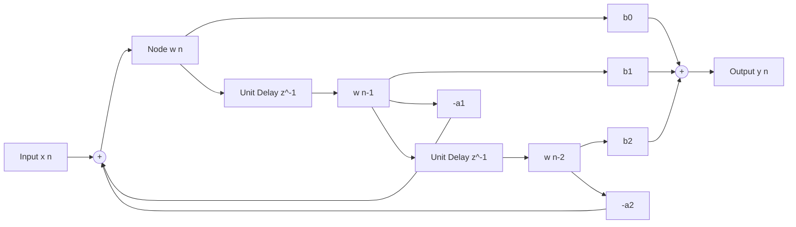

# Modul 125: Sinyal & Sistem Waktu Kontinu vs Diskrit (Sistem LTI, Fungsi Impuls, Konvolusi)

**Navigasi**: [⬅️ Master Index](../../INDEX.md) | [Tingkat 8: Tingkat 8: Pemrosesan Sinyal Digital, Telekomunikasi & Network Engineering](./README.md)
*Sebelumnya*: [124. isolasi-kernel-kontainerisasi-dari-nol](../07-os-internals-linux/124-isolasi-kernel-kontainerisasi-dari-nol.md) | *Berikutnya*: [126. transformasi-domain-frekuensi](./126-transformasi-domain-frekuensi.md)

---

## 1. Intuisi Dasar Tanpa Jargon ("Seperti Bayi Baru Lahir")
Dunia fisik di sekitar kita bersifat analog dan kontinu: suara petikan gitar akustik, getaran gempa bumi, atau gelombang radio di udara mengalir mulus tanpa patahan. Namun komputer digital hanya mengerti angka-angka diskrit yang dibekukan pada interval waktu tertentu. Pemrosesan Sinyal Digital (Digital Signal Processing / DSP) ([DSP Foundations & Filters](https://www.dspguide.com/)) adalah jembatan matematika yang mengubah deretan angka diskrit tersebut menjadi musik yang jernih atau citra radar yang tajam. Dua pilar utamanya adalah: **Filter FIR (Finite Impulse Response)** yang bertindak seperti penyaring yang sangat stabil dan memiliki fase linier sempurna (seperti kaca optik tanpa distorsi) namun membutuhkan banyak komputasi; dan **Filter IIR (Infinite Impulse Response)** yang cerdas dan hemat komputasi karena memanfaatkan umpan balik (feedback loop) dari masa lalu, meniru sirkuit analog klasik dengan sedikit koefisien filter.

## 2. Fondasi Teoretis & Aksiomatik / Matematis
Formulasi Matematis Konvolusi Diskrit, Transformasi Z, dan Persamaan Beda Filter:

1. **Konvolusi Waktu Diskrit (Discrete Convolution)**:
   Output sinyal $y[n]$ dari sistem Linear Time-Invariant (LTI) dengan respons impuls $h[n]$:
   $$y[n] = x[n] * h[n] = \sum_{k=-\infty}^{\infty} x[k] \cdot h[n - k]$$

2. **Transformasi Z (Z-Transform)**:
   Memetakan sinyal domain waktu diskrit ke bidang kompleks $z \in \mathbb{C}$ ($z = r e^{j\omega}$):
   $$X(z) = \mathcal{Z}\{x[n]\} = \sum_{n=-\infty}^{\infty} x[n] \, z^{-n}$$
   Fungsi Transfer Sistem $H(z)$:
   $$H(z) = \frac{Y(z)}{X(z)} = \frac{\sum_{k=0}^M b_k z^{-k}}{1 + \sum_{k=1}^N a_k z^{-k}}$$

3. **Perbedaan Fundamental FIR vs IIR**:
   - **FIR Filter ($a_k = 0$)**: $y[n] = \sum_{k=0}^M b_k x[n-k]$. Semua kutub (*poles*) berada di $z = 0$. **Selalu stabil mutlak** dan dapat memiliki respons fase linier murni ($-\alpha \omega$).
   - **IIR Filter ($a_k \ne 0$)**: $y[n] = \sum_{k=0}^M b_k x[n-k] - \sum_{k=1}^N a_k y[n-k]$. Memiliki kutub di luar titik pusat. **Stabil jika dan hanya jika semua kutub berada di dalam lingkaran satuan ($|p_i| < 1$).**

## 3. Anatomi Teknis & Cara Kerja Internal
Struktur Diagram Blok Filter Digital Direct Form II (IIR Filter Transposed):



1. **Biquad Cascade Direct Form II Transposed**: Meminimalkan jumlah register delay memory dari $2N$ menjadi hanya $N$. Struktur transposed meminimalkan kesalahan akumulasi derau pembulatan (*Round-off Noise*) dan limit cycles pada implementasi fixed-point DSP hardware ([Biquad Filters Audio EQ Cookbook](https://www.w3.org/TR/audio-eq-cookbook/)).
2. **Teorema Stabilitas Lingkaran Satuan**: Jika satu kutub IIR bergeser ke luar lingkaran satuan ($|z| \ge 1.0$) akibat kuantisasi koefisien float-ke-fixed, filter akan berosilasi tak terkendali menuju saturasi tak terhingga.

## 4. Implementasi Praktis & Kode / Simulasi Riil
```python
# Low-Pass Finite Impulse Response (FIR) Filter Design using Sinc Function & Hamming Window
import numpy as np
import matplotlib.pyplot as plt

def design_fir_lowpass(num_taps: int, cutoff_hz: float, sample_rate_hz: float) -> np.ndarray:
    """
    Mendesain koefisien filter FIR fase-linier menggunakan metode Windowed-Sinc.
    num_taps wajib bernilai ganjil untuk Symmetric Type-I FIR Filter.
    """
    assert num_taps % 2 == 1, "Number of taps must be odd"
    M = num_taps - 1
    fc = cutoff_hz / sample_rate_hz # Frekuensi cutoff ternormalisasi (0 s.d. 0.5)

    n = np.arange(num_taps) - (M / 2)
    # Respons impuls ideal: fungsi Sinc ternormalisasi
    # sinc(0) ditangani secara khusus via np.where
    h_ideal = np.where(n == 0, 2 * fc, np.sin(2 * np.pi * fc * n) / (np.pi * n))

    # Jendela Hamming: menekan side-lobes spektral hingga -53 dB
    window = 0.54 - 0.46 * np.cos(2 * np.pi * np.arange(num_taps) / M)
    h_windowed = h_ideal * window

    # Normalisasi agar gain pada frekuensi DC (0 Hz) tepat bernilai 1.0 (0 dB)
    return h_windowed / np.sum(h_windowed)
```

## 5. Miskonsepsi & Jebakan Industri
1. **Aliasing Distortion via Sub-Nyquist Sampling**: Melakukan sampling sinyal frekuensi $f$ dengan sampling rate $f_s < 2f$. Frekuensi tinggi akan terlipat (*fold back*) menjadi frekuensi rendah palsu yang merusak sinyal (solusi: pasang analog anti-aliasing low-pass filter sebelum ADC) ([Analog Devices ADC Aliasing](https://www.analog.com/en/analog-dialogue/articles/dsp-digital-signal-processing-basics.html)).
2. **IIR Filter Instability Due to Fixed-Point Coefficient Quantization**: Mengonversi koefisien floating-point filter IIR orde tinggi ($N \ge 4$) langsung ke bilangan fixed-point integer tanpa memecahnya menjadi rantai kaskade Second-Order Sections (Biquads). Pergeseran kutub akan memicu osilasi limit-cycle destruktif.
3. **Linear Phase Assumption in IIR Filters**: Berasumsi bahwa filter IIR memiliki delay konstan untuk semua frekuensi. IIR memperkenalkan distorsi fase (*non-linear group delay*) yang dapat merusak bentuk pulsa sinyal radar atau transmisi data biner.

## 6. Proyek Latihan & Rubrik Penilaian Mandiri
1. **Tingkat Pemula**: Hitung konvolusi diskrit manual dari sinyal input $x[n] = [1, 2, 3]$ dengan respons impuls $h[n] = [1, -1]$. Tentukan panjang sinyal keluaran $y[n]$.
2. **Tingkat Menengah**: Tuliskan implementasi filter IIR Second-Order Section (Biquad) dalam bahasa C menggunakan representasi Direct Form II Transposed. Verifikasi filtering sinyal audio 44.1 kHz untuk memotong derau 60 Hz hum.
3. **Tingkat Mahir**: Rancang filter adaptif LMS (Least Mean Squares) di Python/C untuk pembatalan derau aktif (Active Noise Cancellation). Buktikan bahwa koefisien filter $w[n]$ konvergen meminimalkan mean squared error dan mampu melenyapkan sinyal derau interferensi periodik.

## 7. Rekomendasi Sumber Belajar Standar Emas
| Sumber Pembelajaran | Penulis / Institusi | Tautan Langsung | Fokus Materi |
| :--- | :--- | :--- | :--- |
| Discrete-Time Signal Processing | Alan V. Oppenheim & Ronald W. Schafer (MIT) | [Pearson Oppenheim DSP](https://www.pearson.com/en-us/subject-catalog/p/discrete-time-signal-processing/P200000003264) | Alkitab DSP: Z-Transform, LTI Systems, Filter Design & Sampling |
| The Scientist and Engineer's Guide to Digital Signal Processing | Steven W. Smith | [DSP Guide Online Book](https://www.dspguide.com/) | Buku DSP Gratis Terlengkap: Konvolusi, FIR vs IIR, Windowing & ADC/DAC |
| Audio EQ Cookbook Formulas | Robert Bristow-Johnson | [W3C Audio EQ Cookbook](https://www.w3.org/TR/audio-eq-cookbook/) | Biquad Transfer Function, Peaking, Shelving & Notch Filter Coefficients |
| Analog Devices Digital Signal Processing Education Portal | Analog Devices Inc. | [Analog Devices DSP Portal](https://www.analog.com/en/analog-dialogue/articles/dsp-digital-signal-processing-basics.html) | Real-world Hardware DSP, Quantization Noise & MAC Units |

---
*Navigasi Cepat*: [Ke Tingkat 8](./README.md) | [Ke Master Index](../../INDEX.md) | *Sebelumnya*: [124. isolasi-kernel-kontainerisasi-dari-nol](../07-os-internals-linux/124-isolasi-kernel-kontainerisasi-dari-nol.md) | *Berikutnya*: [126. transformasi-domain-frekuensi](./126-transformasi-domain-frekuensi.md)
