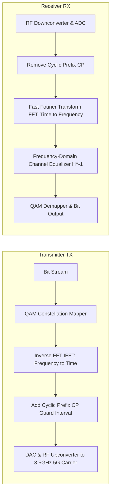

# Modul 127: Perancangan Filter Digital (Filter FIR Linier-Fase, Filter IIR Transformasi Bilinear)

**Navigasi**: [⬅️ Master Index](../../INDEX.md) | [Tingkat 8: Tingkat 8: Pemrosesan Sinyal Digital, Telekomunikasi & Network Engineering](./README.md)
*Sebelumnya*: [126. transformasi-domain-frekuensi](./126-transformasi-domain-frekuensi.md) | *Berikutnya*: [128. prinsip-telekomunikasi-fisik-kanal](./128-prinsip-telekomunikasi-fisik-kanal.md)

---

## 1. Intuisi Dasar Tanpa Jargon ("Seperti Bayi Baru Lahir")
Jika Anda mencoba berteriak menyampaikan pesan melintasi jarak 50 kilometer, suara Anda akan lenyap ditelan angin dalam beberapa puluh meter karena energi frekuensi audio (20 Hz - 20 kHz) tidak mampu merambat efisien melalui atmosfer bumi. Namun jika suara tersebut 'ditumpangkan' ke atas gelombang radio berfrekuensi gigahertz yang perkasa, ia dapat melesat dengan kecepatan cahaya menembus awan dan gedung-gedung bertingkat. Teori Modulasi & Telekomunikasi Nirkabel ([Wireless Communications & Modulation](https://www.cambridge.org/highereducation/books/wireless-communications/)) adalah seni menumpangkan informasi: dari modulasi analog klasik (AM yang mengubah tinggi gelombang, FM yang mengubah kerapatan frekuensi), modulasi digital modern (QAM yang memanipulasi amplitudo dan fase sekaligus seperti kisi-kisi bintang konstelasi), hingga teknologi mutakhir 5G/Wi-Fi (**OFDM & Massive MIMO**) yang membelah saluran radio menjadi ribuan sub-pembawa paralel ortogonal dan mengarahkan berkas gelombang radio langsung ke antena ponsel Anda (Beamforming).

## 2. Fondasi Teoretis & Aksiomatik / Matematis
Formulasi Matematis Modulasi Digital QAM dan Orthogonal Frequency Division Multiplexing (OFDM):

1. **Quadrature Amplitude Modulation ($M$-QAM)**:
   Sinyal RF dimodelkan sebagai kombinasi linear dari dua pembawa ortogonal: In-Phase ($I$) dan Quadrature ($Q$):
   $$s(t) = I(t) \cos(2\pi f_c t) - Q(t) \sin(2\pi f_c t)$$
   Setiap titik pada diagram konstelasi merepresentasikan $\log_2 M$ bit data biner (misal 256-QAM mentransmisikan 8 bit per simbol).
   Probabilitas Galat Simbol (Symbol Error Rate) Gaussian AWGN untuk QAM persegi:
   $$P_s \approx 4 \left(1 - \frac{1}{\sqrt{M}}\right) Q\left(\sqrt{\frac{3 E_s}{(M - 1) N_0}}\right)$$

2. **Ortogonalitas Spektral OFDM (Orthogonal Frequency-Division Multiplexing)**:
   Sub-pembawa frekuensi ke-$k$ ditempatkan pada jarak frekuensi tepat $\Delta f = 1/T_s$:
   $$\int_0^{T_s} e^{j 2\pi f_k t} \cdot e^{-j 2\pi f_m t} \, dt = \begin{cases} T_s & k = m \\ 0 & k \ne m \end{cases} \quad (\text{Ortogonalitas Sempurna!})$$
   OFDM meniadakan interferensi antarsimbol (ISI) akibat multipath fading menggunakan **Cyclic Prefix (CP)**: salinan ujung ekor simbol yang disematkan di awal simbol pelindung ($T_{CP} > \tau_{max\_delay\_spread}$).

## 3. Anatomi Teknis & Cara Kerja Internal
Arsitektur Pemancar dan Penerima OFDM Digital Berbasis IFFT / FFT:



1. **MIMO (Multiple-Input Multiple-Output) & Spatial Multiplexing**:
   Menggunakan $N_T$ antena pemancar dan $N_R$ antena penerima secara serentak ($y = Hx + n$). SVD decomposition ($H = U \Sigma V^*$) memungkinkan transfer data pada $r = \text{rank}(H)$ saluran spasial paralel independen tanpa menambah spektrum frekuensi ([Tse & Viswanath Wireless Communications](https://web.stanford.edu/~dntse/book.html)).
2. **PAPR (Peak-to-Average Power Ratio) Problem**: Sinyal OFDM memiliki lonjakan daya puncak transien ekstrem ketika ribuan sub-pembawa berada dalam fase yang sama, menuntut amplifier daya RF yang memiliki linearitas tinggi agar tidak terdistorsi.

## 4. Implementasi Praktis & Kode / Simulasi Riil
```python
# 16-QAM Constellation Modulation & Demodulation Simulation with AWGN Channel
import numpy as np
import matplotlib.pyplot as plt

def simulate_16qam(num_bits: int, snr_db: float):
    assert num_bits % 4 == 0, "Bits must be multiple of 4 for 16-QAM"
    bits = np.random.randint(0, 2, num_bits)

    # Petakan 4 bit biner menjadi simbol kompleks I-Q (Gray Code Mapping)
    # Nilai I dan Q bernilai diskrit: -3, -1, +1, +3
    bit_groups = bits.reshape(-1, 4)
    table = {-3: [0, 0], -1: [0, 1], 1: [1, 1], 3: [1, 0]}
    rev_table = {tuple(v): k for k, v in table.items()}

    i_symbols = np.array([rev_table[(b[0], b[1])] for b in bit_groups])
    q_symbols = np.array([rev_table[(b[2], b[3])] for b in bit_groups])
    tx_complex = (i_symbols + 1j * q_symbols) / np.sqrt(10) # Normalisasi daya rata-rata = 1

    # Saluran Derau Gaussian Putih (AWGN Channel)
    snr_linear = 10 ** (snr_db / 10.0)
    noise_sigma = np.sqrt(1.0 / (2.0 * snr_linear))
    noise = noise_sigma * (np.random.randn(len(tx_complex)) + 1j * np.random.randn(len(tx_complex)))
    rx_complex = tx_complex + noise

    return tx_complex, rx_complex
```

## 5. Miskonsepsi & Jebakan Industri
1. **Carrier Frequency Offset (CFO) Destroying OFDM Orthogonality**: Ketidakcocokan frekuensi osilator lokal penerima sekecil beberapa puluh Hertz memicu pergeseran frekuensi yang menghancurkan ortogonalitas sub-pembawa, menghasilkan Inter-Carrier Interference (ICI) fatal yang meruntuhkan SNR.
2. **Multipath Delay Spread Exceeding Cyclic Prefix**: Jika delay pantulan sinyal dari gedung melebihi durasi Cyclic Prefix ($T_{CP}$), simbol OFDM sebelumnya akan tumpah tindih ke simbol saat ini, memicu Inter-Symbol Interference (ISI) yang tidak dapat diperbaiki oleh equalizer frekuensi.
3. **Power Amplifier Non-Linear Saturation**: Mengirimkan sinyal OFDM dengan PAPR tinggi melalui amplifier RF yang saturasi memicu *Spectral Regrowth*: daya bocor ke pita frekuensi tetangga melanggar batas regulasi spektrum FCC/kominfo.

## 6. Proyek Latihan & Rubrik Penilaian Mandiri
1. **Tingkat Pemula**: Gambarkan 16 titik koordinat diagram konstelasi 16-QAM di atas kertas. Beri label setiap titik dengan 4 bit biner menggunakan pengkodean Gray (Gray Code) di mana dua titik berdampingan hanya berbeda tepat 1 bit.
2. **Tingkat Menengah**: Bangun simulator rantai transmisi OFDM lengkap di Python (64 sub-carrier, IFFT modulator, Cyclic Prefix 16 sampel, simulasi saluran multipath fading Rayleigh 3-tap, dan koreksi zero-forcing equalizer).
3. **Tingkat Mahir**: Implementasikan dekomposisi Singular Value Decomposition (SVD) pada matriks saluran MIMO $4 \times 4$. Buktikan bahwa melalui precoding matriks $V$ di pemancar dan combining matriks $U^*$ di penerima, saluran multipath dapat diubah menjadi 4 sub-saluran spasial paralel bebas interferensi.

## 7. Rekomendasi Sumber Belajar Standar Emas
| Sumber Pembelajaran | Penulis / Institusi | Tautan Langsung | Fokus Materi |
| :--- | :--- | :--- | :--- |
| Fundamentals of Wireless Communication | David Tse & Pramod Viswanath (UC Berkeley) | [Tse & Viswanath Book](https://web.stanford.edu/~dntse/book.html) | Alkitab Wireless: Multipath Fading, Capacity of Wireless Channels & MIMO |
| Wireless Communications: Principles and Practice | Theodore S. Rappaport | [Prentice Hall Rappaport](https://www.pearson.com/en-us/subject-catalog/p/wireless-communications-principles-and-practice/P200000003266) | Propagasi Gelombang, Modulasi Digital QAM, Seluler & Standar 5G |
| OFDM and Multi-Channel Communication Systems | John A. C. Bingham | [IEEE Communications Magazine 1990](https://ieeexplore.ieee.org/document/54415) | Makalah Klasik Penemuan Prinsip Modulasi Multicarrier OFDM |
| 3GPP 5G NR Physical Layer Specifications | 3GPP Standards Organization | [3GPP Release 16 Specs](https://www.3gpp.org/specifications-technologies/specifications-by-series) | Standar Fisik 5G NR, Numerologi Subcarrier Spacing & Beamforming |

---
*Navigasi Cepat*: [Ke Tingkat 8](./README.md) | [Ke Master Index](../../INDEX.md) | *Sebelumnya*: [126. transformasi-domain-frekuensi](./126-transformasi-domain-frekuensi.md) | *Berikutnya*: [128. prinsip-telekomunikasi-fisik-kanal](./128-prinsip-telekomunikasi-fisik-kanal.md)
