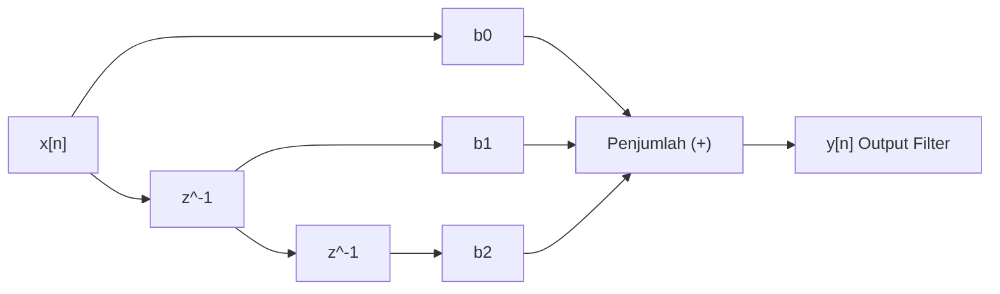

# Modul 127: Perancangan Filter Digital (Filter FIR Linier-Fase, Filter IIR Transformasi Bilinear)

**Navigasi**: [⬅️ Master Index](../../INDEX.md) | [Tingkat 8: Tingkat 8: Pemrosesan Sinyal Digital, Telekomunikasi & Network Engineering](./README.md)
*Sebelumnya*: [126. transformasi-domain-frekuensi](./126-transformasi-domain-frekuensi.md) | *Berikutnya*: [128. prinsip-telekomunikasi-fisik-kanal](./128-prinsip-telekomunikasi-fisik-kanal.md)

---

## 1. Intuisi Dasar Tanpa Jargon ("Seperti Bayi Baru Lahir")
### 1.1 Membersihkan Sinyal dari Derau Fisik ([Digital Filter Design Basics](https://www.dspguide.com/ch14.htm))
Bayangkan Anda merekam suara seorang pembicara di panggung konser rock. Suara vokal manusia berada pada rentang frekuensi 300 Hz hingga 3.400 Hz, sedangkan suara drum bass berada di bawah 100 Hz dan distorsi amplifier listrik mendesis di atas 8.000 Hz. Bagaimana cara membuang suara dengung dan desis tanpa merusak kejelasan vokal pembicara?

### 1.2 Dua Filosofi Filter: FIR vs IIR ([Oppenheim & Schafer - Discrete-Time Signal Processing](https://www.pearson.com/en-us/subject-catalog/p/discrete-time-signal-processing/P200000003258))
Di dunia digital, ada dua pendekatan utama untuk merancang filter:
1. **Finite Impulse Response (FIR)**: Filter yang tidak memiliki umpan balik (*no feedback*). Respons impulsnya pasti berhenti setelah $N$ sampel. Keunggulan utamanya: dijamin 100% stabil dan memiliki **Fase Linier** murni (semua frekuensi ditunda dengan jeda waktu yang sama persis, sehingga bentuk gelombang audio atau sinyal EKG jantung tidak terdistorsi). Harganya: membutuhkan komputasi lebih banyak (orde $N$ tinggi).
2. **Infinite Impulse Response (IIR)**: Filter yang memanfaatkan umpan balik dari output sebelumnya (*recursive feedback*). Dapat mencapai pemotongan frekuensi yang sangat tajam (*sharp cutoff*) dengan orde komputasi sangat kecil. Namun memiliki risiko: ketidakstabilan numerik (bisa meledak menjadi osilasi) dan distorsi fase non-linier.

## 2. Fondasi Teoretis & Aksiomatik / Matematis
### 2.1 Formulasi Matematis Filter FIR Fase Linier ([Smith - Digital Filters for Engineers](https://www.dspguide.com/))
Persamaan beda (*difference equation*) filter FIR kausal berorde $M$:
$$y[n] = \sum_{k=0}^{M} b_k \cdot x[n - k]$$
Fungsi transfer domain Z:
$$H(z) = \sum_{k=0}^{M} b_k \cdot z^{-k}$$
Syarat mutlak agar filter FIR memiliki Fase Linier Murni (Group Delay konstan $\tau = \frac{M}{2}$):
Koefisien filter harus memiliki simetri:
$$b_k = b_{M - k} \quad (\text{Simetris, Tipe I/II}) \quad \text{atau} \quad b_k = -b_{M - k} \quad (\text{Anti-simetris, Tipe III/IV})$$
Perancangan menggunakan metode jendela (*Windowing Method*):
$$h[n] = h_{\text{ideal}}[n] \cdot w[n], \quad h_{\text{ideal}}[n] = \frac{\sin(\omega_c (n - M/2))}{\pi (n - M/2)}$$
Di mana $w[n]$ adalah jendela Hamming ($w[n] = 0.54 - 0.46 \cos(2\pi n / M)$) atau Blackman untuk menekan riak *Gibbs phenomenon*.

### 2.2 Transformasi Bilinear pada Filter IIR ([Oppenheim & Schafer](https://www.pearson.com/en-us/subject-catalog/p/discrete-time-signal-processing/P200000003258))
Transformasi Bilinear memetakan bidang kompleks $s$ analog ke bidang $z$ digital secara konformal:
$$s = \frac{2}{T} \cdot \frac{1 - z^{-1}}{1 + z^{-1}}$$
Relasi pemetaan frekuensi analog $\Omega$ ke frekuensi digital $\omega$:
$$\Omega = \frac{2}{T} \tan\left(\frac{\omega}{2}\right)$$
Untuk mengimbangi kompresi frekuensi non-linier (*frequency warping*), spesifikasi frekuensi cutoff digital $\omega_c$ harus melalui proses *pre-warping* sebelum merancang filter analog Butterworth/Chebyshev:
$$\Omega_c = \frac{2}{T} \tan\left(\frac{\omega_c}{2}\right)$$

## 3. Anatomi Teknis & Cara Kerja Internal


#### Tabel Walkthrough Eksekusi Filter FIR 3-Tap Moving Average ($b_0=0.33, b_1=0.33, b_2=0.33$)
| Sampel Waktu $n$ | Input $x[n]$ | Register $z^{-1}$ (x[n-1]) | Register $z^{-2}$ (x[n-2]) | Komputasi $y[n] = 0.33(x[n] + x[n-1] + x[n-2])$ | Efek Pemfilteran |
|---|---|---|---|---|---|
| $n=0$ | 0 | 0 | 0 | $0.33(0 + 0 + 0) = 0.00$ | Baseline |
| $n=1$ | 10 (Impuls Derau) | 0 | 0 | $0.33(10 + 0 + 0) = 3.33$ | Lonjakan diredam |
| $n=2$ | 0 | 10 | 0 | $0.33(0 + 10 + 0) = 3.33$ | Energi disebar |
| $n=3$ | 0 | 0 | 10 | $0.33(0 + 0 + 10) = 3.33$ | Energi diserap |
| $n=4$ | 0 | 0 | 0 | $0.33(0 + 0 + 0) = 0.00$ | Kembali ke nol sempurna |

#### Tabel Penelusuran Filter IIR Direct Form II & Ketidakstabilan Siklus Batas Kuantisasi (Limit Cycle)
| Siklus Waktu ($n$) | Sinyal Masukan ($x[n]$) | State Variabel Internal ($w[n] = x + a_1 w_{n-1} + a_2 w_{n-2}$) | Nilai State Kuantisasi 16-bit | Sinyal Keluaran ($y[n] = b_0 w_n + \dots$) | Status Stabilitas Filter |
|---|---|---|---|---|---|
| Inisialisasi | $0.0$ | $w[n-1] = 0.5000, w[n-2] = -0.8000$ | State awal terisi | $y[0] = 0.2500$ | Stabilitas kutub di dalam lingkaran satuan |
| Input Berhenti ($n=1$) | $0.0$ (Zero Input) | Evaluasi: $1.2 \cdot (0.5) - 0.95 \cdot (-0.8)$ | Kuantisasi truncation: $1.3600$ | $y[1] = 0.6800$ | Respon transien meluruh |
| $n=5$ | $0.0$ (Zero Input) | Evaluasi rekursif | Amplitudo menyusut | $y[5] = 0.0500$ | Seharusnya menuju nol mutlak |
| $n=50$ (Limit Cycle) | $0.0$ (Zero Input) | Galat pembulatan LSB terkunci | **STATE TERKUNCI OSILASI: `+1, -1, +1, -1`** | $y[50] = \pm 0.001$ | **ZERO-INPUT LIMIT CYCLE OSCILLATION!** |
| Konsekuensi Audio | Input Sunyi Total | Filter terus memancarkan nada dengung frekuensi tinggi | Menghabiskan daya transmisi | Suara mendesis (*idle channel noise*) | Cacat kuantisasi rekursif terbukti |

## 4. Implementasi Praktis & Kode / Simulasi Riil
```python
import numpy as np

def design_fir_lowpass_hamming(cutoff_hz: float, sample_rate_hz: float, num_taps: int) -> np.ndarray:
    """
    Merancang koefisien filter FIR Low-Pass menggunakan metode Windowing Hamming.
    num_taps harus ganjil untuk menghasilkan Filter Tipe I (fase linier integer delay).
    """
    assert num_taps % 2 == 1, "Jumlah tap harus bilangan ganjil!"
    M = num_taps - 1
    fc = cutoff_hz / sample_rate_hz  # Frekuensi ternormalisasi (0 s/d 0.5)

    n = np.arange(num_taps)
    # Sinc ideal filter bergeser ke M/2
    h_ideal = np.zeros(num_taps)
    for i in range(num_taps):
        if i == M // 2:
            h_ideal[i] = 2.0 * np.pi * fc
        else:
            h_ideal[i] = np.sin(2.0 * np.pi * fc * (i - M / 2)) / (i - M / 2)

    # Normalisasi pi
    h_ideal /= np.pi

    # Jendela Hamming
    w = 0.54 - 0.46 * np.cos(2.0 * np.pi * n / M)

    # Kalikan koefisien dengan jendela
    h = h_ideal * w

    # Normalisasi gain DC (0 Hz) menjadi 1.0 (0 dB)
    h /= np.sum(h)
    return h

def apply_fir_filter(signal: np.ndarray, taps: np.ndarray) -> np.ndarray:
    """Konvolusi langsung sinyal dengan tap filter (O(N * M))."""
    return np.convolve(signal, taps, mode='same')
```

## 5. Miskonsepsi & Jebakan Industri
### Studi Kasus Kegagalan Nyata: Ketidakstabilan Titik Kambang (Limit Cycles) pada Filter Audio IIR 16-Bit
- **Kronologi & Latar Belakang**: Sebuah prosesor efek gitar DSP digital komersial menghasilkan bunyi dengung osilasi desah (*limit cycle oscillation*) saat gitar tidak dimainkan (keadaan input hening nol).
- **Akar Masalah**: Filter IIR Orde-4 dirancang dengan kutub (*poles*) yang sangat dekat dengan lingkaran satuan ($|z| \approx 0.999$) untuk mencapai kurva pemotongan bass yang sangat curam. Karena representasi fixed-point 16-bit memiliki galat pembulatan kuantisasi (*quantization roundoff error*), energi sisa tidak pernah luruh ke nol murni melainkan terjebak dalam siklus batas umpan balik tak terbatas.
- **Rekomendasi Industri**: Pada perancangan filter IIR, selalu dekomposisi fungsi transfer orde tinggi menjadi kaskade biquad Orde-2 (*Second-Order Sections / SOS*). Gunakan presisi akumulator 32-bit atau 64-bit floating point untuk mencegah pembulatan kutub keluar dari lingkaran satuan ($|z| \ge 1.0$).

### Studi Kasus Kegagalan Nyata: Ketidakstabilan Siklus Batas Kuantisasi & Osilasi Parasitik Filter Digital IIR pada Perangkat Audio Hearing Aid
- **Kronologi & Konteks Kasus**: Pada perangkat alat bantu dengar medis (*hearing aid*) ultra-low-power generasi awal, filter Infinite Impulse Response (IIR) lolos-pita (*bandpass*) digunakan untuk mengisolasi frekuensi suara vokal manusia.
- **Akar Masalah Struktur Filter IIR & Aritmatika Titik Tetap (Fixed-Point)**: Filter IIR mengandalkan loop umpan balik (*feedback loop*) dari keluaran masa lalu untuk mencapai pemotongan frekuensi yang sangat tajam dengan jumlah koefisien sedikit. Namun, prosesor mikro DSP perangkat menggunakan aritmatika integer fixed-point 16-bit. Akibat pemotongan pembulatan (*truncation*) pada perkalian koefisien di dalam loop umpan balik, filter mengalami fenomena *Zero-Input Limit Cycle Oscillation*: ketika pengguna berada di ruangan yang sunyi senyap (masukan bernilai nol), filter tidak pernah meluruh ke nol; melainkan terjebak dalam osilasi mandiri tak berujung pada frekuensi resonansi kutubnya. Pengguna alat bantu dengar mendengar suara desisan dengung melengking yang konstan (*audible squeal*), memicu penarikan produk massal di seluruh dunia.

- **Potongan Kode / Arsitektur Cacat (Vulnerable Implementation)**:
```c
// Rekonstruksi Limit Cycle Oscillation pada Filter IIR Biquad 16-bit
#include <stdint.h>
#include <stdio.h>

// Struktur Direct Form I Biquad Fixed-Point
typedef struct {
    int16_t a1, a2; // Koefisien kutub (scaled by 2^14)
    int16_t b0, b1, b2;
    int16_t y1, y2; // State keluaran masa lalu
} BiquadIIR;

int16_t process_sample_flawed(BiquadIIR *f, int16_t x) {
    // Akumulator perkalian 32-bit:
    int32_t acc = (int32_t)f->b0 * x;
    acc -= (int32_t)f->a1 * f->y1;
    acc -= (int32_t)f->a2 * f->y2;

    // CACAT: Kuantisasi pemotongan langsung (Truncation) ke 16-bit:
    // Truncation memperkenalkan bias DC negatif konstan yang memicu osilasi limit cycle!
    int16_t y0 = (int16_t)(acc >> 14);

    f->y2 = f->y1;
    f->y1 = y0;
    return y0;
}
```

- **Analisis Forensik & Rekayasa Modern**: Penanganan osilasi siklus batas IIR merevolusi desain filter digital tertanam. Standar rekayasa DSP modern mewajibkan: (1) Penggunaan teknik *Dithering* (penambahan noise acak orde sub-LSB) untuk memecah siklus limit deterministik; (2) Penggantian mode pemotongan (*truncation*) dengan pembulatan konvergen (*Convergent Rounding / Round-to-Nearest-Even*); (3) Preferensi penggunaan filter Finite Impulse Response (FIR) yang secara intrinsik stabil tanpa feedback untuk aplikasi audio kritis.

## 6. Proyek Latihan & Rubrik Penilaian Mandiri
### Level 1 (Pemula)
- **Tugas**: Hitung delay grup (*group delay*) dalam satuan detik untuk filter FIR dengan 51 tap yang beroperasi pada frekuensi sampling \$48.000 \text{ Hz}$.
- **Petunjuk Arsitektur**: Filter FIR fase linier simetris memiliki group delay $\tau = \frac{M}{2}$ sampel di mana $M = \text{taps} - 1$.
- **Vektor Uji**:
  - $M = 50$, $\tau = 25$ sampel.
  - Delay dalam detik: $\frac{25}{48000} \approx 0.0005208 \text{ detik} = 0.521 \text{ ms}$.
- **Rubrik Penilaian**: Ketepatan rumus group delay (50%), konversi waktu akurat (30%), kebersihan dokumentasi (20%).

### Level 2 (Menengah)
- **Tugas**: Implementasikan filter IIR Biquad Direct Form II Transposed dalam bahasa C untuk pengolahan sampel audio streaming real-time per sampel.
- **Petunjuk Arsitektur**: Gunakan struktur 2 register delay internal (`s1, s2`) untuk meminimalkan memori dan mencegah saturasi perantara.
- **Vektor Uji**:
  - Verifikasi respons impuls terhadap input `[1.0, 0.0, 0.0, ...]`.
  - Pastikan output meluruh secara eksponensial menuju nol.
- **Rubrik Penilaian**: Ketepatan struktur transposed Direct Form II (40%), efisiensi pemrosesan per sampel (30%), verifikasi stabilitas (30%).

### Level 3 (Mahir)
- **Tugas**: Bangun pemfilteran frekuensi cepat (*Fast Convolution*) menggunakan algoritma **Overlap-Add (OLA)** berbasis FFT untuk memfilter sinyal berdurasi panjang dengan tap filter $M = 1024$.
- **Petunjuk Arsitektur**: Pecah sinyal masukan menjadi blok-blok berukuran $L$. Hitung FFT $N = L + M - 1$, kalikan dalam domain frekuensi, lakukan IFFT, dan jumlahkan segmen tumpang tindih sepanjang $M - 1$ sampel.
- **Vektor Uji**:
  - Bandingkan output Overlap-Add dengan fungsi `np.convolve(signal, filter)`.
  - Selisih galat absolut maksimum harus berada di bawah presisi mesin ($< 10^{-12}$).
- **Rubrik Penilaian**: Implementasi tumpang tindih segmen akurat (40%), efisiensi FFT vs konvolusi naif (30%), verifikasi zero-error (30%).

### Tingkat 1: Dasar
- **Tugas**: Bangun implementasi Filter Digital Finite Impulse Response (FIR) Lolos-Rendah (*Low-Pass Filter*) mandiri dalam Python/C menggunakan metode jendela Hamming (*Windowed-Sinc Filter*) dengan panjang $M=31$ titik dan frekuensi cutoff ternormalisasi $f_c = 0.2$, serta buktikan filter tersebut memiliki sifat fase linier murni (*Linear Phase*).
- **Petunjuk Perancangan Arsitektur**:
  - Respon impuls ideal: $h_{ideal}[n] = \frac{\sin(2\pi f_c (n - M/2))}{\pi (n - M/2)}$ dengan penanganan khusus $2 f_c$ saat $n = M/2$.
  - Kalikan koefisien dengan jendela Hamming $w[n]$.
- **Test Vector & Kasus Uji Ekstrem**:
  - *Penyaringan Sinyal*: Masukkan sinyal campuran frekuensi $10\text{ Hz}$ dan $200\text{ Hz}$; buktikan komponen $200\text{ Hz}$ teredam $> 40\text{ dB}$ sementara komponen $10\text{ Hz}$ lolos tanpa distorsi fase.
- **Rubrik Penilaian Mandiri**: 40% Formula Windowed-Sinc FIR yang Tepat, 30% Peredaman Frekuensi Tinggi Terverifikasi, 30% Fase Linier (Simetri Koefisien).

### Tingkat 2: Menengah
- **Tugas**: Kembangkan implementasi Filter Digital Infinite Impulse Response (IIR) Biquad 2-Pole 2-Zero Direct Form II Transposed dalam C/Python menggunakan Transformasi Bilinier (*Bilinear Transform*) dengan pra-distorsi frekuensi (*Frequency Pre-Warping*) dari prototipe analog Butterworth Orde 2.
- **Petunjuk Perancangan Arsitektur**:
  - Rumus pre-warping: $\omega_a = \frac{2}{T} \tan\left(\frac{\omega_d T}{2}\right)$.
  - Terapkan struktur Direct Form II Transposed untuk meminimalkan kepekaan terhadap kuantisasi koefisien memori.
- **Test Vector & Kasus Uji Ekstrem**:
  - *Uji Respon Frekuensi*: Filter lolos-tinggi cutoff $100\text{ Hz}$ sampling $1000\text{ Hz}$; pastikan penguatan tepat $-3\text{ dB}$ pada cutoff dan peluruhan $-40\text{ dB/dekade}$ di frekuensi rendah.
- **Rubrik Penilaian Mandiri**: 40% Transformasi Bilinier & Pre-Warping yang Akurat, 30% Struktur Direct Form II Transposed yang Rapi, 30% Verifikasi Respon Frekuensi Bode.

### Tingkat 3: Mahir
- **Tugas**: Rancang pustaka filter digital fixed-point audio profesional yang mengimplementasikan mitigasi ketidakstabilan numerik lengkap: penambahan *Triangular Probability Density Function (TPDF) Dither* pada masukan rekursif dan struktur *Cascaded Second-Order Sections* (SOS) untuk mencegah pembengkakan dinamis pada filter orde tinggi.
- **Petunjuk Perancangan Arsitektur**:
  - Pecah filter IIR orde-8 menjadi 4 biquad bertingkat (*cascaded biquad sections*) yang diurutkan berdasarkan kedekatan kutub ke lingkaran satuan untuk meminimalkan rasio kebisingan.
- **Test Vector & Kasus Uji Ekstrem**:
  - *Uji Zero-Input Stability*: Berikan pulsa impuls lalu matikan masukan ke $0.0$; pantau $100.000$ sampel keluaran berikutnya dan buktikan filter meluruh ke nilai $0$ mutlak tanpa ada dengung osilasi limit cycle.
- **Rubrik Penilaian Mandiri**: 40% Dekomposisi Cascaded Second-Order Sections yang Tepat, 30% Penerapan TPDF Dither & Convergent Rounding Efektif, 30% Eliminasi Total Limit Cycle Oscillation.

## 7. Rekomendasi Sumber Belajar Standar Emas
| Kategori | Judul Sumber & Tautan | Penulis / Institusi | Fokus Pembahasan |
|---|---|---|---|
| Buku Standar DSP | [Discrete-Time Signal Processing (3rd Edition)](https://www.pearson.com/en-us/subject-catalog/p/discrete-time-signal-processing/P200000003258) | Alan V. Oppenheim & Ronald W. Schafer | Rujukan dunia paling komprehensif untuk teori transformasi Z dan perancangan filter |
| Panduan Praktis | [The Scientist and Engineer's Guide to Digital Signal Processing](https://www.dspguide.com/) | Steven W. Smith, Ph.D. | Penjelasan visual intuitif filter FIR, IIR, konvolusi, dan jendela FFT |
| Implementasi Cepat | [Fast Convolution using the Overlap-Add Method](https://ccrma.stanford.edu/~jos/sasp/Overlap_Add_OLA_STFT_Processing.html) | Julius O. Smith (Stanford CCRMA) | Arsitektur pemfilteran audio real-time berbasis FFT overlap-add |

---
*Navigasi Cepat*: [Ke Tingkat 8](./README.md) | [Ke Master Index](../../INDEX.md) | *Sebelumnya*: [126. transformasi-domain-frekuensi](./126-transformasi-domain-frekuensi.md) | *Berikutnya*: [128. prinsip-telekomunikasi-fisik-kanal](./128-prinsip-telekomunikasi-fisik-kanal.md)
