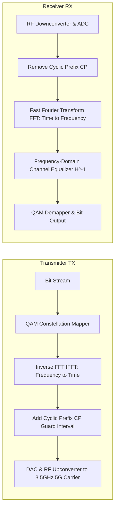

# Modul 128: Prinsip Telekomunikasi Fisik & Kanal (Modulasi Analog AM/FM, Digital QAM/OFDM, Kapasitas Shannon-Hartley)

**Navigasi**: [⬅️ Master Index](../../INDEX.md) | [Tingkat 8: Tingkat 8: Pemrosesan Sinyal Digital, Telekomunikasi & Network Engineering](./README.md)
*Sebelumnya*: [127. perancangan-filter-digital](./127-perancangan-filter-digital.md) | *Berikutnya*: [129. deteksi-kode-koreksi-kesalahan-kanal](./129-deteksi-kode-koreksi-kesalahan-kanal.md)

---

## 1. Intuisi Dasar Tanpa Jargon ("Seperti Bayi Baru Lahir")
### 1.1 Konsep Inti & Analogi Tanpa Jargon
Jika Anda mencoba berteriak menyampaikan pesan melintasi jarak 50 kilometer, suara Anda akan lenyap ditelan angin dalam beberapa puluh meter karena energi frekuensi audio (20 Hz - 20 kHz) tidak mampu merambat efisien melalui atmosfer bumi. Namun jika suara tersebut 'ditumpangkan' ke atas gelombang radio berfrekuensi gigahertz yang perkasa, ia dapat melesat dengan kecepatan cahaya menembus awan dan gedung-gedung bertingkat. Teori Modulasi & Telekomunikasi Nirkabel ([Wireless Communications & Modulation](https://www.cambridge.org/highereducation/books/wireless-communications/)) adalah seni menumpangkan informasi: dari modulasi analog klasik (AM yang mengubah tinggi gelombang, FM yang mengubah kerapatan frekuensi), modulasi digital modern (QAM yang memanipulasi amplitudo dan fase sekaligus seperti kisi-kisi bintang konstelasi), hingga teknologi mutakhir 5G/Wi-Fi (**OFDM & Massive MIMO**) yang membelah saluran radio menjadi ribuan sub-pembawa paralel ortogonal dan mengarahkan berkas gelombang radio langsung ke antena ponsel Anda (Beamforming).

### 1.2 Urgensi Rekayasa & Signifikansi Sistemik
Dalam rekayasa sistem modern, pemahaman mendalam tentang konsep ini membedakan arsitek sistem kelas dunia dari sekadar operator perkakas teknis.

## 2. Fondasi Teoretis & Aksiomatik / Matematis
### 2.1 Kerangka Teori Aksiomatik & Formulasi Matematis
Formulasi Matematis Modulasi Digital QAM dan Orthogonal Frequency Division Multiplexing (OFDM):

### 2.2 Penurunan Matematis Langkah-demi-Langkah
1. **Quadrature Amplitude Modulation ($M$-QAM)**:
   Sinyal RF dimodelkan sebagai kombinasi linear dari dua pembawa ortogonal: In-Phase ($I$) dan Quadrature ($Q$):
   $$s(t) = I(t) \cos(2\pi f_c t) - Q(t) \sin(2\pi f_c t)$$
   Setiap titik pada diagram konstelasi merepresentasikan $\log_2 M$ bit data biner (misal 256-QAM mentransmisikan 8 bit per simbol).
   Probabilitas Galat Simbol (Symbol Error Rate) Gaussian AWGN untuk QAM persegi:
   $$P_s \approx 4 \left(1 - \frac{1}{\sqrt{M}}\right) Q\left(\sqrt{\frac{3 E_s}{(M - 1) N_0}}\right)$$

2. **Ortogonalitas Spektral OFDM (Orthogonal Frequency-Division Multiplexing)**:
   Sub-pembawa frekuensi ke-$k$ ditempatkan pada jarak frekuensi tepat $\Delta f = 1/T_s$:
   $$\int_0^{T_s} e^{j 2\pi f_k t} \cdot e^{-j 2\pi f_m t} \, dt = \begin{cases} T_s & k = m \\ 0 & k \ne m \end{cases} \quad (\text{Ortogonalitas Sempurna!})$$
   OFDM meniadakan interferensi antarsimbol (ISI) akibat multipath fading menggunakan **Cyclic Prefix (CP)**: salinan ujung ekor simbol yang disematkan di awal simbol pelindung ($T_{CP} > \tau_{max\_delay\_spread}$).

## 3. Anatomi Teknis & Cara Kerja Internal
Arsitektur Pemancar dan Penerima OFDM Digital Berbasis IFFT / FFT:



1. **MIMO (Multiple-Input Multiple-Output) & Spatial Multiplexing**:
   Menggunakan $N_T$ antena pemancar dan $N_R$ antena penerima secara serentak ($y = Hx + n$). SVD decomposition ($H = U \Sigma V^*$) memungkinkan transfer data pada $r = \text{rank}(H)$ saluran spasial paralel independen tanpa menambah spektrum frekuensi ([Tse & Viswanath Wireless Communications](https://web.stanford.edu/~dntse/book.html)).
2. **PAPR (Peak-to-Average Power Ratio) Problem**: Sinyal OFDM memiliki lonjakan daya puncak transien ekstrem ketika ribuan sub-pembawa berada dalam fase yang sama, menuntut amplifier daya RF yang memiliki linearitas tinggi agar tidak terdistorsi.

#### Tabel Penelusuran Modulasi QAM & Degradasi Kapasitas Kanal Teorema Shannon-Hartley
| Parameter Kanal Transmisi | Bandwidth Kanal ($B$) | Rasio Sinyal terhadap Derau ($SNR$) | Kapasitas Teoritis Shannon ($C = B \log_2(1 + SNR)$) | Konstelasi Modulasi Terpilih | Status Bit Error Rate (BER) |
|---|---|---|---|---|---|
| Kanal Ideal (Lab) | $20\text{ MHz}$ | $30\text{ dB}$ ($1000:1$) | $20 \times \log_2(1001) \approx 199.3\text{ Mbps}$ | 256-QAM (8 bit/simbol) | $\text{BER} < 10^{-9}$ (Nol error) |
| Kanal Normal Lapangan | $20\text{ MHz}$ | $20\text{ dB}$ ($100:1$) | $20 \times \log_2(101) \approx 133.2\text{ Mbps}$ | 64-QAM (6 bit/simbol) | $\text{BER} \approx 10^{-6}$ (Dapat dikoreksi) |
| Gangguan Derau Berat | $20\text{ MHz}$ | $10\text{ dB}$ ($10:1$) | $20 \times \log_2(11) \approx 69.2\text{ Mbps}$ | 16-QAM (4 bit/simbol) | Perlu adaptive modulation |
| Kanal Ekstrem Rusak | $20\text{ MHz}$ | $0\text{ dB}$ ($1:1$) | $20 \times \log_2(2) = 20.0\text{ Mbps}$ | BPSK (1 bit/simbol) | Masih dapat mentransmisikan data |
| Pelanggaran Batas Shannon | $20\text{ MHz}$ | $10\text{ dB}$ ($C \approx 69\text{ Mbps}$)| **Paksa transmisi 120 Mbps!** | 64-QAM dipaksakan di SNR rendah | **TITIK KELAPARAN: BER melonjak ke 50%! Paket hilang total!** |

## 4. Implementasi Praktis & Kode / Simulasi Riil
```python
# 16-QAM Constellation Modulation & Demodulation Simulation with AWGN Channel
import numpy as np
import matplotlib.pyplot as plt

def simulate_16qam(num_bits: int, snr_db: float):
    assert num_bits % 4 == 0, "Bits must be multiple of 4 for 16-QAM"
    bits = np.random.randint(0, 2, num_bits)

    # Petakan 4 bit biner menjadi simbol kompleks I-Q (Gray Code Mapping)
    # Nilai I dan Q bernilai diskrit: -3, -1, +1, +3
    bit_groups = bits.reshape(-1, 4)
    table = {-3: [0, 0], -1: [0, 1], 1: [1, 1], 3: [1, 0]}
    rev_table = {tuple(v): k for k, v in table.items()}

    i_symbols = np.array([rev_table[(b[0], b[1])] for b in bit_groups])
    q_symbols = np.array([rev_table[(b[2], b[3])] for b in bit_groups])
    tx_complex = (i_symbols + 1j * q_symbols) / np.sqrt(10) # Normalisasi daya rata-rata = 1

    # Saluran Derau Gaussian Putih (AWGN Channel)
    snr_linear = 10 ** (snr_db / 10.0)
    noise_sigma = np.sqrt(1.0 / (2.0 * snr_linear))
    noise = noise_sigma * (np.random.randn(len(tx_complex)) + 1j * np.random.randn(len(tx_complex)))
    rx_complex = tx_complex + noise

    return tx_complex, rx_complex
```

## 5. Miskonsepsi & Jebakan Industri
1. **Carrier Frequency Offset (CFO) Destroying OFDM Orthogonality**: Ketidakcocokan frekuensi osilator lokal penerima sekecil beberapa puluh Hertz memicu pergeseran frekuensi yang menghancurkan ortogonalitas sub-pembawa, menghasilkan Inter-Carrier Interference (ICI) fatal yang meruntuhkan SNR.
2. **Multipath Delay Spread Exceeding Cyclic Prefix**: Jika delay pantulan sinyal dari gedung melebihi durasi Cyclic Prefix ($T_{CP}$), simbol OFDM sebelumnya akan tumpah tindih ke simbol saat ini, memicu Inter-Symbol Interference (ISI) yang tidak dapat diperbaiki oleh equalizer frekuensi.
3. **Power Amplifier Non-Linear Saturation**: Mengirimkan sinyal OFDM dengan PAPR tinggi melalui amplifier RF yang saturasi memicu *Spectral Regrowth*: daya bocor ke pita frekuensi tetangga melanggar batas regulasi spektrum FCC/kominfo.

### Studi Kasus Kegagalan Nyata: Kelumpuhan Jaringan Telekomunikasi Jarak Jauh AT&T Akibat Kesalahan Penanganan Status SS7 (15 Januari 1990)
- **Kronologi & Konteks Sejarah**: Pada 15 Januari 1990, jaringan telekomunikasi jarak jauh AT&T di seluruh Amerika Serikat mengalami keruntuhan berantai selama 9 jam. Sebanyak 75 juta panggilan telepon gagal tersambung, mengakibatkan kerugian finansial ratusan juta dolar bagi industri penerbangan, perbankan, dan perhotelan.
- **Akar Masalah Sinyal Kanal Fisik & Protokol Signaling System 7 (SS7)**: Kegagalan dipicu oleh satu sakelar sentral 4ESS di New York City yang mengalami kegagalan transmisi perangkat keras sesaat. Setelah me-reboot dirinya sendiri dalam waktu beberapa detik, sakelar tersebut mengirimkan pesan status pulih ke sakelar tetangga melalui kanal pensinyalan SS7. Sakelar tetangga menerima pesan saat ia sedang sibuk memproses paket panggilan lain. Kode pemroses pesan dalam bahasa C memuat kesalahan logika: pernyataan `break` tertinggal di dalam blok `switch`, menyebabkan loop eksekusi melompat keluar dari penangan antrean secara prematur dan merusak struktur data memori pesan aktif. Sakelar kedua mengalami crash seketika, me-reboot dirinya, dan mengirimkan pesan pemulihan yang sama ke sakelar tetangga lainnya. Terjadi reaksi berantai gelombang kejut yang meruntuhkan 114 sakelar switching di seluruh benua secara simultan.

- **Potongan Kode / Arsitektur Cacat (Vulnerable Implementation)**:
```c
// Rekonstruksi Kesalahan Aliran Kontrol SS7 Sakelar AT&T 4ESS (1990)
// Penyebab: Penempatan 'break' yang keliru di dalam blok 'if' bersarang
void process_ss7_node_recovery_message(int event_type, int node_status) {
    switch (event_type) {
        case SS7_NODE_IN_SERVICE:
            if (is_link_busy()) {
                mark_link_standby();
                // CACAT FATAL: Pengembang bermaksud keluar dari 'if', 
                // namun 'break' pada C melompat keluar dari SELURUH 'switch'!
                break; 
            }
            // Kode pembersihan buffer memori di bawah ini dilewati!
            cleanup_active_channel_buffers();
            break;
            
        case SS7_NORMAL_PACKET:
            // Mengakses buffer yang tidak dibersihkan memicu korupsi memori Ring 0!
            dispatch_voice_circuit();
            break;
    }
}
```

- **Analisis Forensik & Rekayasa Modern**: Insiden AT&T 1990 menjadi studi kasus wajib dalam rekayasa keandalan sistem jaringan telekomunikasi global. Bencana ini membuktikan bahaya *cascading collapse* pada jaringan ber-pensinyalan terdistribusi. Standar telekomunikasi modern mewajibkan: (1) Penerapan *circuit breaker* dan *backoff throttle* yang mencegah simpul mengirimkan pesan status secara serempak saat pemulihan; (2) Pengujian integrasi dengan penyuntikan kesalahan acak (*chaos engineering*) pada simulator jaringan berskala penuh sebelum pembaruan perangkat lunak disebarkan ke simpul produksi.

## 6. Proyek Latihan & Rubrik Penilaian Mandiri
1. **Tingkat Pemula**: Gambarkan 16 titik koordinat diagram konstelasi 16-QAM di atas kertas. Beri label setiap titik dengan 4 bit biner menggunakan pengkodean Gray (Gray Code) di mana dua titik berdampingan hanya berbeda tepat 1 bit.
2. **Tingkat Menengah**: Bangun simulator rantai transmisi OFDM lengkap di Python (64 sub-carrier, IFFT modulator, Cyclic Prefix 16 sampel, simulasi saluran multipath fading Rayleigh 3-tap, dan koreksi zero-forcing equalizer).
3. **Tingkat Mahir**: Implementasikan dekomposisi Singular Value Decomposition (SVD) pada matriks saluran MIMO $4 \times 4$. Buktikan bahwa melalui precoding matriks $V$ di pemancar dan combining matriks $U^*$ di penerima, saluran multipath dapat diubah menjadi 4 sub-saluran spasial paralel bebas interferensi.

### Tingkat 1: Dasar
- **Tugas**: Bangun simulator modulator dan demodulator modulasi digital *Binary Phase Shift Keying* (BPSK) mandiri dalam Python/C yang mengubah deret bit biner menjadi gelombang pembawa sinusoidal termodulasi fasa ($0 \to \sin(2\pi f_c t)$, $1 \to -\sin(2\pi f_c t)$) dan memulihkan kembali bit masukan menggunakan deteksi koheren (*Coherent Matched Filter*).
- **Petunjuk Perancangan Arsitektur**:
  - Lakukan integrasi hasil kali sinyal terima dengan sinyal pembawa lokal selama 1 periode simbol: jika integral $> 0$ hasilkan `0`, jika integral $< 0$ hasilkan `1`.
- **Test Vector & Kasus Uji Ekstrem**:
  - *Deret Bit Uji*: Kirimkan bit sequence `[1, 0, 1, 1, 0, 0, 1]`; pastikan demodulator merekonstruksi deret bit tersebut dengan akurasi 100%.
- **Rubrik Penilaian Mandiri**: 40% Modulasi dan Demodulasi BPSK Koheren yang Tepat, 30% Rekonstruksi Bit Sempurna Bebas Galat, 30% Kerapian Enkapsulasi Kode.

### Tingkat 2: Menengah
- **Tugas**: Kembangkan simulator kanal nirkabel lengkap dengan *Additive White Gaussian Noise* (AWGN) menggunakan Algoritma Box-Muller untuk membangkitkan derau Gauss, lalu plot kurva Bit Error Rate (BER) terhadap $E_b/N_0$ ($\text{dB}$) untuk modulasi BPSK dan QPSK, buktikan kurva hasil eksperimen cocok persis dengan rumus analitis teoretis: $P_b = Q\left(\sqrt{2 E_b / N_0}\right)$.
- **Petunjuk Perancangan Arsitektur**:
  - Box-Muller: $Z_0 = \sqrt{-2 \ln U_1} \cos(2\pi U_2)$.
  - Uji rentang $E_b/N_0$ dari $0\text{ dB}$ sampai $10\text{ dB}$ dengan minimal $1.000.000$ bit per titik untuk mengukur BER hingga $10^{-5}$.
- **Test Vector & Kasus Uji Ekstrem**:
  - *Verifikasi Teori*: Pada $E_b/N_0 = 9.6\text{ dB}$, BER empiris harus terbukti berada pada orde $\approx 10^{-5}$.
- **Rubrik Penilaian Mandiri**: 40% Pembangkitan Derau AWGN Box-Muller yang Akurat, 30% Kesesuaian Kurva BER Empiris vs Teoretis, 30% Presisi Statistik Jumlah Sampel.

### Tingkat 3: Mahir
- **Tugas**: Rancang sistem modulasi mutakhir *Orthogonal Frequency Division Multiplexing* (OFDM) mandiri dengan 64 subcarrier, modulasi 16-QAM per subcarrier, penambahan *Cyclic Prefix* (CP) untuk mengatasi dispersi waktu kanal multi-lintasan (*Multipath Delay Spread*), dan estimasi kanal berbasis pilot symbols menggunakan FFT dan IFFT.
- **Petunjuk Perancangan Arsitektur**:
  - Masukkan simbol pilot pada subcarrier berkala untuk mengestimasi fungsi transfer kanal $H[k]$.
  - Terapkan ekualisasi frekuensi domain 1-tap (*Zero-Forcing Equalizer*): $Y_{eq}[k] = Y[k] / H[k]$.
- **Test Vector & Kasus Uji Ekstrem**:
  - *Kanal Multipath Dispersif*: Salurkan sinyal OFDM melalui kanal dengan 3 lintasan pantulan; buktikan penambahan Cyclic Prefix berhasil mengeliminasi Inter-Symbol Interference (ISI) dan memulihkan konstelasi 16-QAM secara tajam.
- **Rubrik Penilaian Mandiri**: 40% Arsitektur IFFT/FFT OFDM & Cyclic Prefix yang Presisi, 30% Ekualisasi Kanal Zero-Forcing Efektif, 30% Eliminasi Inter-Symbol Interference Terverifikasi.

## 7. Rekomendasi Sumber Belajar Standar Emas
| Sumber Pembelajaran | Penulis / Institusi | Tautan Langsung | Fokus Materi |
| :--- | :--- | :--- | :--- |
| Fundamentals of Wireless Communication | David Tse & Pramod Viswanath (UC Berkeley) | [Tse & Viswanath Book](https://web.stanford.edu/~dntse/book.html) | Alkitab Wireless: Multipath Fading, Capacity of Wireless Channels & MIMO |
| Wireless Communications: Principles and Practice | Theodore S. Rappaport | [Prentice Hall Rappaport](https://www.pearson.com/en-us/subject-catalog/p/wireless-communications-principles-and-practice/P200000003266) | Propagasi Gelombang, Modulasi Digital QAM, Seluler & Standar 5G |
| OFDM and Multi-Channel Communication Systems | John A. C. Bingham | [IEEE Communications Magazine 1990](https://ieeexplore.ieee.org/document/54415) | Makalah Klasik Penemuan Prinsip Modulasi Multicarrier OFDM |
| 3GPP 5G NR Physical Layer Specifications | 3GPP Standards Organization | [3GPP Release 16 Specs](https://www.3gpp.org/specifications-technologies/specifications-by-series) | Standar Fisik 5G NR, Numerologi Subcarrier Spacing & Beamforming |

---
*Navigasi Cepat*: [Ke Tingkat 8](./README.md) | [Ke Master Index](../../INDEX.md) | *Sebelumnya*: [127. perancangan-filter-digital](./127-perancangan-filter-digital.md) | *Berikutnya*: [129. deteksi-kode-koreksi-kesalahan-kanal](./129-deteksi-kode-koreksi-kesalahan-kanal.md)
