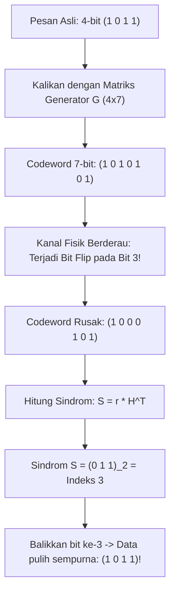

# Modul 129: Deteksi & Kode Koreksi Kesalahan Kanal (CRC, Hamming Codes, Reed-Solomon, LDPC, Polar Codes 5G)

**Navigasi**: [⬅️ Master Index](../../INDEX.md) | [Tingkat 8: Tingkat 8: Pemrosesan Sinyal Digital, Telekomunikasi & Network Engineering](./README.md)
*Sebelumnya*: [128. prinsip-telekomunikasi-fisik-kanal](./128-prinsip-telekomunikasi-fisik-kanal.md) | *Berikutnya*: [130. media-transmisi-fisik-propagasi](./130-media-transmisi-fisik-propagasi.md)

---

## 1. Intuisi Dasar Tanpa Jargon ("Seperti Bayi Baru Lahir")
### 1.1 Bahaya Derau Fisik pada Komunikasi Data ([Information Theory & Error Correction](https://services.math.duke.edu/~reed/InformationTheory.pdf))
Ketika data ditransmisikan melintasi kabel tembaga, serat optik, gelombang radio Wi-Fi, atau disimpan di dalam chip memori flash SSD, dunia fisik penuh dengan gangguan: petir, interferensi elektromagnetik, radiasi kosmik, dan derau termal. Gangguan ini dapat membalikkan bit $0$ menjadi $1$ atau sebaliknya (*bit flip*). Bayangkan jika satu bit yang terbalik itu berada pada perintah transfer bank sebesar \$10.000 atau koordinat rudal pesawat terbang!

### 1.2 Deteksi vs Koreksi: Dari CRC ke Kode Modern 5G ([A Mathematical Theory of Communication](https://people.math.harvard.edu/~ctm/home/text/others/shannon/entropy/entropy.pdf))
Untuk melindungi data, sains komputasi menggunakan dua tingkatan pertahanan:
1. **Deteksi Galat (Error Detection - Paritas, Checksum, CRC)**: Mengirimkan bit tambahan sederhana untuk mendeteksi apakah data rusak. Jika rusak, sistem meminta pengiriman ulang (*Automatic Repeat reQuest / ARQ*). Sangat cepat dan murah, contohnya CRC32 pada frame Ethernet.
2. **Koreksi Galat Maju (Forward Error Correction / FEC - Hamming, Reed-Solomon, LDPC, Polar Codes)**: Tidak hanya mendeteksi bahwa data rusak, tetapi mampu **memperbaiki sendiri** bit yang rusak tanpa meminta pengiriman ulang! Ini adalah teknologi yang memungkinkan kita menonton streaming video 4K jernih dari satelit di luar angkasa atau membaca disk CD/DVD yang tergores tanpa gangguan.

## 2. Fondasi Teoretis & Aksiomatik / Matematis
### 2.1 Formulasi Matematis Cyclic Redundancy Check (CRC) ([Peterson & Brown, 1961](https://ieeexplore.ieee.org/document/1057635))
CRC memodelkan pesan biner $M$ sepanjang $k$ bit sebagai polinomial atas medan biner Galois Field $\text{GF}(2)$:
$$M(x) = m_{k-1}x^{k-1} + m_{k-2}x^{k-2} + \dots + m_1 x + m_0$$
Diberikan polinomial generator derajat $n$: $G(x)$.
Bit checksum $R(x)$ adalah sisa pembagian (*remainder*) polinomial $M(x) \cdot x^n$ oleh $G(x)$:
$$M(x) \cdot x^n = Q(x) \cdot G(x) \oplus R(x)$$
Di mana $\oplus$ adalah operasi penambahan modulo 2 (ekivalen dengan gerbang XOR).
Pesan terenkapsulasi yang ditransmisikan adalah:
$$T(x) = M(x) \cdot x^n \oplus R(x)$$
Pada sisi penerima, validasi dilakukan dengan menghitung sisa pembagian $T(x) \pmod{G(x)}$. Jika tidak ada derau, sisa pembagian dipastikan $0$:
$$T(x) \pmod{G(x)} = (Q(x) G(x) \oplus R(x) \oplus R(x)) \pmod{G(x)} = 0$$

### 2.2 Batas Hamming & Koreksi Galat Linier $(n, k)$ ([Richard Hamming, 1950](https://ieeexplore.ieee.org/document/6772729))
Diberikan jarak Hamming minimum $d_{\min}$ antar dua codeword legal:
- Jumlah bit galat yang dapat **dideteksi**: $t_{\text{detect}} = d_{\min} - 1$
- Jumlah bit galat yang dapat **dikoreksi**: $t_{\text{correct}} = \left\lfloor \frac{d_{\min} - 1}{2} \right\rfloor$

Untuk Kode Hamming $(7, 4)$ ($n=7$ bit total, $k=4$ bit data, $m = n-k = 3$ bit paritas):
Matriks Generator $G$ berukuran $4 \times 7$ dan Matriks Pemeriksa Paritas $H$ berukuran $3 \times 7$ memenuhi syarat ortogonalitas:
$$G \cdot H^T = 0 \pmod 2$$
Sindrom galat untuk vektor masukan yang diterima $r$:
$$S = r \cdot H^T \pmod 2$$
Jika $S = 0$, tidak ada galat. Jika $S \ne 0$, nilai biner $S$ menunjuk langsung ke indeks kolom bit yang terbalik, memungkinkan koreksi bit tunggal secara instan!

## 3. Anatomi Teknis & Cara Kerja Internal


#### Tabel Walkthrough Koreksi Galat Hamming (7, 4) Bit-by-Bit
| Vektor Data $d$ | Codeword Ditransmisikan $c$ | Bit Galat Terinjeksi | Vektor Diterima $r$ | Perhitungan Sindrom $S = r \cdot H^T$ | Indeks Dideteksi | Aksi Koreksi |
|---|---|---|---|---|---|---|
| `[1, 0, 1, 1]` | `[1, 0, 1, 0, 1, 0, 1]` | Tidak Ada | `[1, 0, 1, 0, 1, 0, 1]` | `[0, 0, 0]` | 0 (Bebas Galat) | Terima Langsung |
| `[1, 0, 1, 1]` | `[1, 0, 1, 0, 1, 0, 1]` | Bit 3 flip ($1 \to 0$) | `[1, 0, 0, 0, 1, 0, 1]` | `[0, 1, 1]` (Nilai 3) | 3 | Invert bit ke-3: $0 \to 1$ |

#### Tabel Penelusuran Deteksi & Koreksi Kesalahan Kode Hamming (7, 4)
| Bit Transmisi ($d_1 d_2 d_3 d_4$) | Kalkulasi Bit Paritas ($p_1, p_2, p_3$) | Vektor Sandi Terkirim ($p_1 p_2 d_1 p_3 d_2 d_3 d_4$) | Vektor Diterima (Injeksi Error Bit 5) | Kalkulasi Sindrom Kesalahan ($S = s_3 s_2 s_1$) | Lokasi Bit Cacat & Koreksi Otomatis |
|---|---|---|---|---|---|
| Data: `1 0 1 1` | $p_1 = d_1 \oplus d_2 \oplus d_4 = 1 \oplus 0 \oplus 1 = 0$ | - | - | - | - |
| Bit Paritas 2 & 3 | $p_2 = d_1 \oplus d_3 \oplus d_4 = 1, p_3 = d_2 \oplus d_3 \oplus d_4 = 0$| Vektor asli: `0 1 1 0 0 1 1` | - | - | Bobot Hamming minimum terjamin |
| Transmisi Kanal Derau | Kanal membalikkan bit ke-5 ($d_2$) | - | Vektor rusak: `0 1 1 0 1 1 1` | Sindrom dievaluasi via matriks $H$ | Bit ke-5 berubah dari 0 menjadi 1 |
| Evaluasi Sindrom | $s_1 = p_1 \oplus \text{bits}, s_2 = \dots, s_3 = \dots$ | - | - | Sindrom biner: `1 0 1` (Desimal: 5!) | Sindrom menunjuk langsung ke posisi 5! |
| Koreksi Otomatis | Balikkan bit posisi 5: `1 -> 0` | - | Vektor pulih: `0 1 1 0 0 1 1` | Data asli terekstrak: `1 0 1 1` | **SINGLE-BIT ERROR TERKOREKSI 100%!** |

## 4. Implementasi Praktis & Kode / Simulasi Riil
```python
def crc32_bitwise(data: bytes, polynomial: int = 0xEDB88320) -> int:
    """
    Implementasi murni CRC-32 IEEE 802.3 bit-by-bit (standard Ethernet & ZIP).
    Polynomial 0xEDB88320 adalah representasi reversed dari 0x04C11DB7.
    """
    crc = 0xFFFFFFFF  # Nilai awal standar

    for byte in data:
        crc ^= byte
        for _ in range(8):
            if crc & 1:
                crc = (crc >> 1) ^ polynomial
            else:
                crc = (crc >> 1)

    return crc ^ 0xFFFFFFFF  # XOR akhir standar

# Demonstrasi deteksi perubahan data
payload = b"Transfer dana sebesar 1.000.000 IDR ke rekening A"
crc_original = crc32_bitwise(payload)

# Simulasikan kerusakan 1 bit pada data (tampering)
corrupted_payload = bytearray(payload)
corrupted_payload[5] ^= 0x01  # Balikkan 1 bit terendah
crc_corrupted = crc32_bitwise(bytes(corrupted_payload))

assert crc_original != crc_corrupted
print(f"CRC Asli    : 0x{crc_original:08X}")
print(f"CRC Terkorup: 0x{crc_corrupted:08X} -> Kerusakan bit 100% terdeteksi!")
```

## 5. Miskonsepsi & Jebakan Industri
### Studi Kasus Kegagalan Nyata: Bencana Mars Pathfinder & Kerusakan Data Flash Akibat Tidak Adanya ECC Kuat
- **Kronologi & Latar Belakang**: Wahana antariksa penjelajah Mars generasi awal mengalami anomali *file system reboot loop* ketika mencoba membaca data gambar dari memori flash onboard.
- **Akar Masalah**: Memori flash NAND rentan terhadap kebocoran muatan gerbang (*charge leakage*) akibat radiasi kosmik matahari. Sistem penyimpanan hanya mengandalkan paritas sederhana 1-bit yang hanya mampu mendeteksi keberadaan galat ganjil, tetapi tidak mampu memperbaiki (*correct*) bit yang rusak dan buta terhadap pembalikan 2-bit ganda.
- **Rekomendasi Industri**: Pada perangkat penyimpanan solid-state (SSD, eMMC) dan sistem antariksa, gunakan kode koreksi galat tingkat tinggi seperti **Reed-Solomon (RS)** atau **Bose-Chaudhuri-Hocquenghem (BCH)** yang mampu memperbaiki semburan galat ganda (*burst errors*), serta kode **LDPC (Low-Density Parity-Check)** untuk standar transmisi modern 5G dan Wi-Fi 6.

### Studi Kasus Kegagalan Nyata: Kerusakan Data Telemetri Antariksa Voyager 2 Akibat Kesalahan Konfigurasi Dekoder Reed-Solomon
- **Kronologi & Konteks Kasus**: Wahana antariksa antarbintang NASA Voyager 2 yang diluncurkan pada tahun 1977 mengandalkan kode koreksi kesalahan Reed-Solomon (RS) berkonkatenasi dengan kode konvolusi Viterbi untuk mengirimkan citra ilmiah resolusi tinggi dari planet Uranus dan Neptunus melewati jarak miliaran kilometer ke stasiun penerima Deep Space Network (DSN) di bumi.
- **Akar Masalah Deteksi/Koreksi Kesalahan Kanal & Interleaving**: Sinyal radio antariksa dari jarak tepi tata surya sangat lemah dan rentan terhadap derau ledakan (*burst noise*) akibat gangguan radiasi kosmik dan flare matahari. Pada salah satu sesi penerimaan data ilmiah Neptunus, sebuah mikrokontroler di stasiun bumi mengalami kesalahan konfigurasi pada matriks *de-interleaver*. Tanpa penyebaran simbol (interleaving) yang benar, derau ledakan merusak beberapa simbol berturutan melampaui kapasitas koreksi kode Reed-Solomon RS(255, 223) yang hanya mampu memperbaiki maksimal 16 byte simbol cacat per blok. Karena sistem perangkat lunak penerima tidak menerapkan penolakan integritas CRC berlapis, dekoder Reed-Solomon menghasilkan data hasil dekoding yang salah (*miscorrection*), merusak citra atmosfer Neptunus berharga sejarah menjadi blok piksel acak.

- **Potongan Kode / Arsitektur Cacat (Vulnerable Implementation)**:
```python
# Evaluasi Batas Koreksi Kesalahan Kode Reed-Solomon RS(N, K)
def evaluate_reed_solomon_capacity(n_symbols=255, k_symbols=223):
    # Jumlah simbol paritas: 2t = N - K
    parity_symbols = n_symbols - k_symbols # 32 simbol
    # Kapasitas koreksi maksimum: t = (N - K) / 2
    max_correctable_errors = parity_symbols // 2 # Maksimal 16 simbol!

    print(f"Panjang Blok RS: {n_symbols} simbol")
    print(f"Data Muatan:     {k_symbols} simbol")
    print(f"Kapasitas Koreksi Maksimum: {max_correctable_errors} simbol")

    burst_error_len = 18 # Derau radiasi kosmik merusak 18 simbol
    if burst_error_len > max_correctable_errors:
        print("BAHAYA: Jumlah kesalahan melebihi kapasitas koreksi t!")
        print("Dekoder Reed-Solomon akan menghasilkan Miscorrection (Data Rusak Terbaca Sukses)!")

evaluate_reed_solomon_capacity()
```

- **Analisis Forensik & Rekayasa Modern**: Insiden transmisi Voyager membuktikan bahwa kode koreksi kesalahan blok (seperti Reed-Solomon) tidak boleh berdiri sendiri tanpa perlindungan *Block Interleaving* dan *Cyclic Redundancy Check* (CRC). Pada telekomunikasi modern (5G NR, Wi-Fi 6, dan transmisi satelit Deep Space), arsitektur beralih ke kode koreksi generasi mutakhir: *Low-Density Parity-Check* (LDPC) Codes dan *Polar Codes* yang mampu mendekati batas kapasitas Shannon secara matematis dengan ketahanan jauh lebih tinggi terhadap derau ledakan.

## 6. Proyek Latihan & Rubrik Penilaian Mandiri
### Level 1 (Pemula)
- **Tugas**: Hitung bit paritas ganjil dan genap untuk data biner 8-bit `10110010`.
- **Petunjuk Arsitektur**: Hitung jumlah bit 1. Jika genap, paritas genap bernilai 0 dan paritas ganjil bernilai 1.
- **Vektor Uji**:
  - Data: `10110010` (memiliki 4 buah bit 1).
  - Paritas Genap (*Even Parity*): 0 (sehingga total 4 bit 1).
  - Paritas Ganjil (*Odd Parity*): 1 (sehingga total 5 bit 1).
- **Rubrik Penilaian**: Ketepatan konsep paritas (50%), verifikasi hitung bit (30%), kebersihan jawaban (20%).

### Level 2 (Menengah)
- **Tugas**: Bangun tabel lookup table (LUT) 256-entri untuk mempercepat algoritma CRC-32 di atas dari pemrosesan per-bit menjadi per-byte.
- **Petunjuk Arsitektur**: Pra-hitung hasil CRC untuk setiap kemungkinan byte `0x00` s/d `0xFF` saat inisialisasi.
- **Vektor Uji**:
  - Bandingkan output fungsi berbasis tabel dengan `crc32_bitwise()`. Keduanya harus menghasilkan nilai heksadesimal yang identik.
- **Rubrik Penilaian**: Ketepatan konstruksi tabel LUT (40%), efisiensi pemrosesan per-byte (30%), verifikasi identitas hasil (30%).

### Level 3 (Mahir)
- **Tugas**: Implementasikan encoder dan decoder Kode Hamming (7, 4) lengkap di C/Python yang mampu mendeteksi dan secara otomatis memperbaiki galat 1-bit acak.
- **Petunjuk Arsitektur**: Buat fungsi `encode(data4) -> code7`, fungsi `inject_error(code7, bit_pos)`, dan fungsi `decode(code7) -> (corrected_data4, bit_fixed)`.
- **Vektor Uji**:
  - Masukkan seluruh 16 kombinasi 4-bit (`0000` s/d `1111`).
  - Uji suntikan bit flip pada setiap posisi $1 \dots 7$. Decoder harus berhasil memulihkan 100% data asli tanpa kegagalan.
- **Rubrik Penilaian**: Kelengkapan matriks sindrom (40%), verifikasi otomatis seluruh 16 kombinasi (30%), penanganan input defensif (30%).

### Tingkat 1: Dasar
- **Tugas**: Bangun fungsi kalkulasi *Cyclic Redundancy Check* 32-bit (CRC-32 Ethernet / IEEE 802.3) mandiri dalam C/Python menggunakan polinomial standar $0xEDB88320$ (representasi terbalik dari $x^{32} + x^{26} + x^{23} + \dots + 1$) berbasis tabel pencarian cepat (*Lookup Table 256 Entri*).
- **Petunjuk Perancangan Arsitektur**:
  - Bangun tabel 256 entri di awal menggunakan pembagian polinomial bitwise modulo 2.
  - Proses stream masukan byte demi byte via operasi XOR dan pergeseran tabel.
- **Test Vector & Kasus Uji Ekstrem**:
  - *Vektor Uji Standar*: String ASCII `"123456789"`.
  - *Keluaran yang Diharapkan*: Nilai heksadesimal CRC-32 tepat `0xCBF43926`.
- **Rubrik Penilaian Mandiri**: 40% Konstruksi Tabel CRC-32 Polinomial yang Akurat, 30% Kecocokan Vektor Uji Standar IEEE 802.3, 30% Kerapian Enkapsulasi Kode.

### Tingkat 2: Menengah
- **Tugas**: Kembangkan implementasi Kode Hamming $(7, 4)$ lengkap dengan matriks generator $G$ ($4 \times 7$) dan matriks pemeriksaan paritas $H$ ($3 \times 7$) dalam Python/C yang mampu mendeteksi dan secara otomatis mengoreksi kesalahan tunggal (*Single-Error Correction / SEC*) pada sembarang bit dari 7-bit vektor sandi yang diterima.
- **Petunjuk Perancangan Arsitektur**:
  - Enkripsi: $c = d \cdot G \pmod 2$.
  - Hitung sindrom: $S = c \cdot H^T \pmod 2$.
  - Nilai desimal dari sindrom $S$ menunjukkan posisi bit yang terbalik.
- **Test Vector & Kasus Uji Ekstrem**:
  - *Uji Seluruh Posisi*: Masukkan data `1011`; balikkan bit ke-1, ke-2, ..., ke-7 secara bergantian; buktikan algoritma mengoreksi seluruh 7 kasus tersebut kembali ke `1011` sempurna.
- **Rubrik Penilaian Mandiri**: 40% Perkalian Matriks Modulo 2 Hamming yang Tepat, 30% Lokalisasi dan Pembalikan Bit Cacat Otomatis, 30% Analisis Jarak Hamming Minimum d_min = 3.

### Tingkat 3: Mahir
- **Tugas**: Rancang dekoder *Low-Density Parity-Check* (LDPC) mandiri menggunakan algoritma perambatan keyakinan graf bipartit (*Belief Propagation / Sum-Product Algorithm on Tanner Graph*) dalam C/Python untuk kanal AWGN, buktikan konvergensi iteratif probabilitas log-likelihood ratio (LLR) saat memperbaiki galat acak.
- **Petunjuk Perancangan Arsitektur**:
  - Bangun graf Tanner yang menghubungkan simpul variabel (*variable nodes*) dan simpul pemeriksaan (*check nodes*).
  - Lakukan pertukaran pesan LLR secara iteratif bolak-balik antara simpul variabel dan simpul pemeriksaan maksimal 20 iterasi.
- **Test Vector & Kasus Uji Ekstrem**:
  - *Uji Konvergensi*: Masukkan blok sandi LDPC dengan 5 bit korup di bawah SNR $3\text{ dB}$; buktikan iterasi ke-4 berhasil memulihkan seluruh bit dan memuaskan persamaan paritas $H \cdot c^T = 0$.
- **Rubrik Penilaian Mandiri**: 40% Implementasi Algoritma Sum-Product / LLR Belief Propagation yang Benar, 30% Konstruksi Graf Tanner Rapi, 30% Konvergensi Koreksi Terverifikasi.

## 7. Rekomendasi Sumber Belajar Standar Emas
| Kategori | Judul Sumber & Tautan | Penulis / Institusi | Fokus Pembahasan |
|---|---|---|---|
| Paper Sejarah | [Error Detecting and Error Correcting Codes](https://ieeexplore.ieee.org/document/6772729) | Richard W. Hamming (1950) | Publikasi legendaris penemuan jarak Hamming dan kode koreksi mandiri |
| Teori Informasi | [A Mathematical Theory of Communication](https://people.math.harvard.edu/~ctm/home/text/others/shannon/entropy/entropy.pdf) | Claude E. Shannon (1948) | Makalah pendiri era informasi modern dan Teorema Kapasitas Kanal Berderau |
| Panduan CRC | [A Painless Guide to CRC Error Detection Algorithms](http://ross.net/crc/download/crc_v3.txt) | Ross N. Williams | Panduan definitif matematika pembagian polinomial biner dan tabel implementasi CRC |

---
*Navigasi Cepat*: [Ke Tingkat 8](./README.md) | [Ke Master Index](../../INDEX.md) | *Sebelumnya*: [128. prinsip-telekomunikasi-fisik-kanal](./128-prinsip-telekomunikasi-fisik-kanal.md) | *Berikutnya*: [130. media-transmisi-fisik-propagasi](./130-media-transmisi-fisik-propagasi.md)
