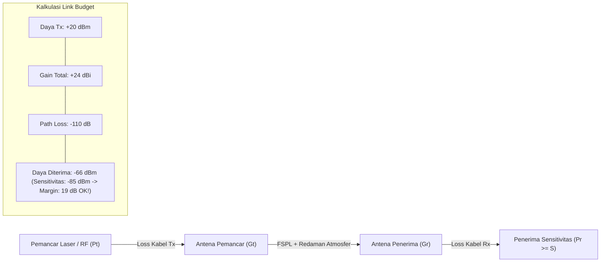

# Modul 130: Media Transmisi Fisik & Propagasi (Kabel Tembaga Twisted Pair, Serat Optik WDM, Gelombang RF, Link Budget)

**Navigasi**: [⬅️ Master Index](../../INDEX.md) | [Tingkat 8: Tingkat 8: Pemrosesan Sinyal Digital, Telekomunikasi & Network Engineering](./README.md)
*Sebelumnya*: [129. deteksi-kode-koreksi-kesalahan-kanal](./129-deteksi-kode-koreksi-kesalahan-kanal.md) | *Berikutnya*: [131. teknologi-komunikasi-nirkabel-lanjut](./131-teknologi-komunikasi-nirkabel-lanjut.md)

---

## 1. Intuisi Dasar Tanpa Jargon ("Seperti Bayi Baru Lahir")
### 1.1 Sinyal yang Merambat Melintasi Alam Fisik ([Fiber Optic Principles - Corning](https://www.corning.com/optical-communications/worldwide/en/home.html))
Data biner di komputer tidak berpindah secara gaib. Setiap bit data harus dikonversi menjadi fenomena gelombang fisik nyata: tegangan elektron yang mengalir di kawat tembaga, pulsa foton cahaya di dalam serat kaca tipis, atau gelombang elektromagnetik radio yang menembus atmosfer udara menuju menara BTS seluler.

### 1.2 Mengapa Sinyal Menjadi Lemah dan Rusak? ([Microwave Engineering - David M. Pozar](https://www.wiley.com/en-us/Microwave+Engineering%2C+4th+Edition-p-9780470631553))
Begitu gelombang meninggalkan pemancar (*transmitter*), dunia fisik mulai menghancurkannya:
- **Redaman (Attenuation)**: Energi gelombang diserap oleh material medium dan memudar seiring kuadrat jarak.
- **Dispersi (Dispersion)**: Pada serat optik, warna cahaya yang berbeda merambat dengan kecepatan sedikit berbeda, menyebabkan pulsa cahaya yang tajam melebar dan saling bertabrakan (*Inter-Symbol Interference / ISI*).
- **Refleksi Impedansi**: Jika impedansi kabel tembaga tidak serasi (\$50\, \Omega$ vs \$75\, \Omega$), sebagian gelombang memantul kembali ke pemancar, merusak sinyal berikutnya.
Insinyur jaringan menggunakan perhitungan **Link Budget** untuk menghitung secara presisi: berapa daya pemancar yang dibutuhkan, berapa redaman kabel, dan berapa sensitivitas minimum penerima agar data dapat dibaca tanpa galat.

## 2. Fondasi Teoretis & Aksiomatik / Matematis
### 2.1 Persamaan Transmisi Friis & Persamaan Link Budget Nirkabel ([Harald T. Friis, 1946](https://ieeexplore.ieee.org/document/1697284))
Daya sinyal yang diterima antena penerima $P_r$ pada propagasi ruang bebas berjarak $d$ dengan panjang gelombang $\lambda$:
$$P_r = P_t \cdot G_t \cdot G_r \cdot \left( \frac{\lambda}{4\pi d} \right)^2$$
Dalam satuan desibel-miliwatt ($\text{dBm}$), Persamaan Link Budget dirumuskan sebagai neraca linier:
$$P_r\,[\text{dBm}] = P_t\,[\text{dBm}] + G_t\,[\text{dBi}] + G_r\,[\text{dBi}] - \text{FSPL}\,[\text{dB}] - L_{\text{misc}}\,[\text{dB}]$$
Di mana Redaman Ruang Bebas (*Free-Space Path Loss / FSPL*):
$$\text{FSPL}\,[\text{dB}] = 20 \log_{10}(d) + 20 \log_{10}(f) + 20 \log_{10}\left(\frac{4\pi}{c}\right)$$
Batas aman operasi jaringan (*Fade Margin* $M_f$):
$$M_f = P_r - S_{\text{receiver}} \ge 15\, \text{dB}$$
Di mana $S_{\text{receiver}}$ adalah ambang batas sensitivitas penerima.

### 2.2 Atenuasi Serat Optik & Hukum Beer-Lambert ([Agrawal - Fiber-Optic Communication Systems](https://www.wiley.com/en-us/Fiber+Optic+Communication+Systems%2C+5th+Edition-p-9781119737384))
Intensitas optik $I(z)$ melintasi serat kaca sepanjang $z$ kilometer meluruh secara eksponensial:
$$I(z) = I_0 \cdot e^{-\alpha z}$$
Koefisien atenuasi serat optik modern berbasis silika mencapai titik minimum teoretis akibat Hamburan Rayleigh (*Rayleigh Scattering*) pada jendela panjang gelombang inframerah $\lambda = 1550 \text{ nm}$:
$$\alpha_{1550} \approx 0.18\, \text{dB/km}$$
Kapasitas serat dilipatgandakan ribuan kali menggunakan teknik **Dense Wavelength Division Multiplexing (DWDM)** yang menggabungkan hingga 96 kanal frekuensi laser optik berbeda ke dalam satu helai kaca sehelai rambut.

## 3. Anatomi Teknis & Cara Kerja Internal


#### Tabel Komparasi Karakteristik Fisik Media Transmisi
| Media Transmisi | Bandwidth Maksimal | Redaman Tipikal | Jarak Maksimum Tanpa Repeater | Kerentanan EMI |
|---|---|---|---|---|
| Kabel Tembaga Twisted Pair (Cat 6A) | 10 Gbps | $\approx 20\, \text{dB / 100 m}$ pada 500 MHz | 100 meter | Tinggi (Cross-talk) |
| Kabel Koaksial (RG-6) | 1 Gbps | $\approx 5\, \text{dB / 100 m}$ pada 100 MHz | 500 meter | Sedang (Perisai Tembaga) |
| Serat Optik Single-Mode (SMF-28) | > 100 Tbps (DWDM) | $0.2\, \text{dB / km}$ pada 1550 nm | 80–120 kilometer | Kebal 100% (Non-logam) |
| Nirkabel Gelombang Mikro (Free Space) | 1–10 Gbps | Bergantung Cuaca / Hujan | 10–50 kilometer (Line of Sight) | Rentan Cuaca & Halangan |

#### Tabel Penelusuran Atenuasi & Dispersi Kromatik Kabel Serat Optik Bawah Laut
| Jarak Transmisi Fiber ($L$) | Panjang Gelombang Laser ($\lambda$) | Koefisien Dispersi ($D$) | Pelebaran Pulsa Optik ($\Delta \tau = D \cdot L \cdot \Delta \lambda$) | Atenuasi Daya Optik ($-0.2\text{ dB/km}$) | Status Kualitas Sinyal (Q-Factor) |
|---|---|---|---|---|---|
| $0\text{ km}$ (Transmitter) | $1550\text{ nm}$ (Jendela C-Band) | $17\text{ ps/(nm}\cdot\text{km)}$ | $\Delta \tau = 0\text{ ps}$ (Pulsa tajam $100\text{ ps}$) | $0\text{ dB}$ ($P_{in} = 10\text{ mW}$) | Sangat Bersih |
| $40\text{ km}$ | $1550\text{ nm}$ | $17\text{ ps/(nm}\cdot\text{km)}$ | $\Delta \tau = 6.8\text{ ps}$ pelebaran | $-8.0\text{ dB}$ (Sisa 1.58 mW) | Lolos deteksi fotodioda |
| $80\text{ km}$ (Titik EDFA) | $1550\text{ nm}$ | Akumulasi dispersi | $\Delta \tau = 13.6\text{ ps}$ pelebaran | $-16.0\text{ dB}$ | Penguat optik EDFA memulihkan daya |
| $500\text{ km}$ (Tanpa Kompensasi)| $1550\text{ nm}$ | Dispersi tak terkelola | **$\Delta \tau > 85\text{ ps}$ (Melebihi durasi simbol!)** | Pulsa melebar meluber ke pulsa tetangga | **INTER-SYMBOL INTERFERENCE (ISI) PARAH!** |
| Hasil Transmisi Rusak | Bit `1` menyatu dengan bit `0` | Fotodioda membaca noise | Paket data optik drop 100% | Kabel transmisi lumpuh | Laju data turun dari 100G ke nol |
| Mitigasi Kompensasi | Pemasangan Fiber DCF | Nilai $D_{negatif} = -85\text{ ps}$ | Dispersi netral kembali ke $0\text{ ps}$ | Pulsa optik kembali tajam | Transmisi 100 Gbps pulih stabil |

## 4. Implementasi Praktis & Kode / Simulasi Riil
```python
import math

def calculate_link_budget(
    power_tx_dbm: float,
    gain_tx_dbi: float,
    gain_rx_dbi: float,
    frequency_hz: float,
    distance_meters: float,
    receiver_sensitivity_dbm: float,
    misc_losses_db: float = 2.0
) -> dict:
    """
    Menghitung Free Space Path Loss (FSPL) dan Fade Margin Link Budget nirkabel.
    """
    c = 299792458.0  # Kecepatan cahaya m/s
    wavelength = c / frequency_hz

    # FSPL = 20*log10(4*pi*d / lambda)
    fspl_db = 20.0 * math.log10(4.0 * math.pi * distance_meters / wavelength)

    # Daya yang diterima pada input receiver
    power_rx_dbm = power_tx_dbm + gain_tx_dbi + gain_rx_dbi - fspl_db - misc_losses_db

    fade_margin_db = power_rx_dbm - receiver_sensitivity_dbm
    is_link_viable = fade_margin_db >= 10.0  # Standar margin aman industri minimal 10 dB

    return {
        "fspl_db": round(fspl_db, 2),
        "received_power_dbm": round(power_rx_dbm, 2),
        "fade_margin_db": round(fade_margin_db, 2),
        "is_viable": is_link_viable
    }

# Contoh Kasus: Link Wi-Fi 5 GHz jarak 500 meter
res = calculate_link_budget(
    power_tx_dbm=20.0,          # 100 mW
    gain_tx_dbi=12.0,           # Antena Directional
    gain_rx_dbi=12.0,           # Antena Directional
    frequency_hz=5.8e9,         # 5.8 GHz
    distance_meters=500.0,
    receiver_sensitivity_dbm=-82.0
)
print(f"Path Loss      : {res['fspl_db']} dB")
print(f"Daya Diterima  : {res['received_power_dbm']} dBm")
print(f"Fade Margin    : {res['fade_margin_db']} dB (Layak: {res['is_viable']})")
```

## 5. Miskonsepsi & Jebakan Industri
### Studi Kasus Kegagalan Nyata: Kerusakan Kabel Bawah Laut Akibat Jangkar Kapal & Kegagalan Link Proteksi Ring
- **Kronologi & Latar Belakang**: Pada tahun 2008, kabel komunikasi bawah laut SEA-ME-WE-4 di Laut Mediterania putus terpotong oleh jangkar kapal kargo, memutus \$75\%$ konektivitas internet antara Eropa, Timur Tengah, dan India.
- **Akar Masalah**: Operator jaringan telekomunikasi tidak mengonfigurasi jalur transmisi alternatif (*Optical Protection Switching Ring*) dengan diversitas geografis nyata. Kedua sirkuit optik redundan ternyata disewa dari penyedia berbeda yang menggelar kabel di parit bawah laut yang sama persis, menciptakan *Single Point of Failure (SPOF)* fisik tersembunyi.
- **Rekomendasi Industri**: Terapkan prinsip **Shared Risk Link Group (SRLG)**. Pastikan jalur kabel cadangan memiliki jalur fisik mandiri (rute darat vs rute laut terpisah) untuk menjamin kelangsungan transmisi saat bencana fisik terjadi.

### Studi Kasus Kegagalan Nyata: Keruntuhan Laju Data Kabel Optik Bawah Laut Transatlantik Akibat Mengabaikan Dispersi Kromatik
- **Kronologi & Konteks Sejarah**: Pada era ekspansi awal internet pita lebar antar-benua, operator konsorsium telekomunikasi meningkatkan laju data laser pada kabel serat optik bawah laut transatlantik dari 2,5 Gbps per kanal menjadi 10 Gbps dan 40 Gbps untuk memenuhi lonjakan trafik internet global.
- **Akar Masalah Media Transmisi Fisik & Dispersi Kromatik**: Serat optik standar single-mode (SMF-28) memiliki dispersi kromatik positif pada jendela panjang gelombang $1550\text{ nm}$ sebesar sekitar $17\text{ ps/(nm}\cdot\text{km)}$. Pada laju 2,5 Gbps, durasi satu bit data adalah $400\text{ ps}$, sehingga pelebaran pulsa cahaya sepanjang kabel masih dapat ditoleransi. Namun ketika laju dinaikkan menjadi 10 Gbps (durasi bit $100\text{ ps}$) dan 40 Gbps (durasi bit $25\text{ ps}$), dampak dispersi kromatik meningkat secara kuadratik terhadap laju data ($(\text{Bitrate})^2$). Pulsa optik yang mewakili bit '1' melebar sedemikian rupa melintasi ribuan kilometer dasar samudera hingga tumpang tindih secara masif dengan pulsa bit tetangganya (*Inter-Symbol Interference / ISI*). Penerima fotodioda di stasiun pendaratan pantai tidak dapat lagi membedakan bit 1 dan 0, memicu keruntuhan konektivitas internet antar-benua.

- **Potongan Kode / Arsitektur Cacat (Vulnerable Implementation)**:
```python
# Kalkulasi Pelebaran Pulsa Akibat Dispersi Kromatik Serat Optik
def calculate_fiber_dispersion(distance_km, bitrate_gbps, chromatic_dispersion_coeff=17.0, laser_linewidth_nm=0.1):
    bit_duration_ps = (1.0 / (bitrate_gbps * 1e9)) * 1e12 # ps
    
    # Formula pelebaran pulsa: Delta_t = D * L * Delta_lambda
    pulse_broadening_ps = chromatic_dispersion_coeff * distance_km * laser_linewidth_nm
    broadening_ratio = pulse_broadening_ps / bit_duration_ps

    print(f"Jarak Transmisi:     {distance_km} km")
    print(f"Laju Data:           {bitrate_gbps} Gbps (Durasi Bit: {bit_duration_ps:.1f} ps)")
    print(f"Pelebaran Pulsa:     {pulse_broadening_ps:.1f} ps")
    print(f"Rasio Pelebaran/Bit: {broadening_ratio:.2%}")

    if broadening_ratio > 0.5:
        print("KRITIS: Pulsa optik meluber melebihi 50% slot bit! Terjadi Inter-Symbol Interference (ISI) Total!")

calculate_fiber_dispersion(distance_km=1000, bitrate_gbps=10.0)
```

- **Analisis Forensik & Rekayasa Modern**: Krisis dispersi kabel transatlantik melahirkan teknologi modulasi optik koheren modern (*Coherent Optical Transmission*). Sistem transmisi serat optik berkecepatan tinggi modern (100G s/d 800G per kanal panjang gelombang) kini menggunakan fotodetektor koheren berbasis polarisasi ganda (*DP-QPSK / DP-16QAM*) yang dipadukan dengan prosesor DSP berkecepatan tinggi di sisi penerima yang melakukan kompensasi dispersi kromatik dan dispersi mode polarisasi (PMD) secara digital (*Digital Signal Processing Equalization*), mengeliminasi kebutuhan serat kompensasi fisik yang mahal di dasar laut.

## 6. Proyek Latihan & Rubrik Penilaian Mandiri
### Level 1 (Pemula)
- **Tugas**: Konversikan daya pemancar \$100 \text{ mW}$ dan $1 \text{ W}$ ke dalam satuan desibel-miliwatt ($\text{dBm}$).
- **Petunjuk Arsitektur**: Terapkan rumus $\text{dBm} = 10 \log_{10}(P_{\text{mW}})$.
- **Vektor Uji**:
  - \$100 \text{ mW} \to 10 \log_{10}(100) = +20 \text{ dBm}$.
  - \$1000 \text{ mW} (1 \text{ W}) \to 10 \log_{10}(1000) = +30 \text{ dBm}$.
- **Rubrik Penilaian**: Ketepatan aljabar logaritma (50%), pemahaman acuan $1 \text{ mW}$ (30%), kebersihan format (20%).

### Level 2 (Menengah)
- **Tugas**: Hitung jarak maksimum yang dapat ditempuh pulsa cahaya laser pada serat optik single-mode dengan daya kirim $+3 \text{ dBm}$, redaman kabel $0.22 \text{ dB/km}$, loss konektor total $1.5 \text{ dB}$, dan sensitivitas receiver $-28 \text{ dBm}$ (target fade margin $3 \text{ dB}$).
- **Petunjuk Arsitektur**: Susun persamaan link budget optik: $P_t - (\alpha \cdot D + L_{\text{konektor}}) - M_f = S_{\text{rx}}$. Selesaikan nilai $D$.
- **Vektor Uji**:
  - Anggaran redaman yang tersedia: $+3 - (-28) - 1.5 - 3 = 26.5 \text{ dB}$.
  - Jarak maksimum $D = \frac{26.5}{0.22} \approx 120.45 \text{ km}$.
- **Rubrik Penilaian**: Penyusunan neraca redaman optik (40%), ketepatan perhitungan jarak (30%), verifikasi margin (30%).

### Level 3 (Mahir)
- **Tugas**: Rancang simulator profil indeks bias serat optik Multi-Mode vs Single-Mode di Python yang menghitung **Modal Dispersion Delay** per kilometer menggunakan Hukum Snellius.
- **Petunjuk Arsitektur**: Hitung perbedaan waktu tempuh sinar yang merambat lurus di sumbu inti (*axial ray*) vs sinar yang memantul pada sudut kritis (*marginal ray*): $\Delta \tau = \frac{n_1}{c} \left(\frac{n_1 - n_2}{n_2}\right)$.
- **Vektor Uji**:
  - $n_1 = 1.48$ (core), $n_2 = 1.46$ (cladding).
  - Delay dispersi modal tipikal: $\approx 68 \text{ nanodetik per kilometer}$.
- **Rubrik Penilaian**: Penurunan optik geometris (40%), implementasi simulasi numerik (30%), analisis batas bandwidth (30%).

### Tingkat 1: Dasar
- **Tugas**: Bangun kalkulator analitis anggaran daya optik (*Optical Power Budget Calculator*) dalam Python/C yang menghitung margin daya sistem transmisi serat optik berdasarkan daya pemancar ($P_{tx}$ dalam dBm), sensitivitas fotodioda penerima ($P_{rx\_sens}$ dalam dBm), redaman serat per kilometer ($-0.2\text{ dB/km}$ pada $1550\text{ nm}$), kerugian konektor ($0.5\text{ dB}$ per pasang), kerugian sambungan las fusion splice ($0.1\text{ dB}$ per splice), dan menentukan jarak transmisi maksimum yang aman dengan margin cadangan $3\text{ dB}$.
- **Petunjuk Perancangan Arsitektur**:
  - Rumus margin daya: $\text{Margin} = (P_{tx} - P_{rx\_sens}) - (\alpha \cdot L + N_c \cdot L_c + N_s \cdot L_s)$.
- **Test Vector & Kasus Uji Ekstrem**:
  - *Data Uji*: $P_{tx} = 0\text{ dBm}$, $P_{rx\_sens} = -28\text{ dBm}$, 4 Konektor, 10 Splice, Redaman $0.2\text{ dB/km}$; hitung jarak maksimum $L$ agar margin cadangan tetap $\ge 3\text{ dB}$.
- **Rubrik Penilaian Mandiri**: 40% Formula Anggaran Daya Optik yang Presisi, 30% Perhitungan Kerugian Komponen Rinci, 30% Validasi Margin Keamanan.

### Tingkat 2: Menengah
- **Tugas**: Kembangkan simulator saluran transmisi kawat tembaga frekuensi tinggi yang memodelkan efek impedansi karakteristik ($Z_0 = \sqrt{L/C}$), fenomena pantulan gelombang akibat ketidakcocokan impedansi (*Impedance Mismatch*), dan koefisien pantulan $\Gamma = \frac{Z_L - Z_0}{Z_L + Z_0}$ beserta pembentukan *Voltage Standing Wave Ratio* (VSWR).
- **Petunjuk Perancangan Arsitektur**:
  - Simulasikan 3 kondisi beban: (1) Beban cocok ($Z_L = Z_0 \implies \Gamma = 0$), (2) Beban hubung singkat ($Z_L = 0 \implies \Gamma = -1$), (3) Beban rangkaian terbuka ($Z_L = \infty \implies \Gamma = +1$).
- **Test Vector & Kasus Uji Ekstrem**:
  - *Uji Pantulan*: Saluran kabel koaksial $50\ \Omega$ dengan terminasi beban $150\ \Omega$; buktikan $\Gamma = 0.5$ dan $\text{VSWR} = 2.0$.
- **Rubrik Penilaian Mandiri**: 40% Model Pantulan Saluran Transmisi Elektromagnetik yang Benar, 30% Kalkulasi Koefisien Pantulan dan VSWR Akurat, 30% Visualisasi Gelombang Berdiri.

### Tingkat 3: Mahir
- **Tugas**: Rancang simulator ekualisasi digital dispersi kromatik optik (*Digital Chromatic Dispersion Equalizer*) dalam domain frekuensi menggunakan Fast Fourier Transform (FFT) yang membalikkan pergeseran fase dispersi kuadratik: $H_{disp}(\omega) = \exp\left(-j \frac{D \lambda^2 L}{4\pi c} \omega^2\right)$, mampu memulihkan pulsa optik yang melebar melintasi $1.000\text{ km}$ kembali ke bentuk aslinya.
- **Petunjuk Perancangan Arsitektur**:
  - Transformasikan sinyal terdispersi ke domain frekuensi via FFT.
  - Kalikan dengan filter transfer terbalik $H_{disp}^*(\omega)$ dan transformasikan kembali via IFFT.
- **Test Vector & Kasus Uji Ekstrem**:
  - *Pemulihan Pulsa Gaussian*: Alirkan pulsa Gaussian $100\text{ ps}$ melewati simulasi serat $1.000\text{ km}$; buktikan ekualizer digital berhasil memulihkan lebar pulsa kembali ke $100\text{ ps}$ dengan korelasi silang $> 99\%$.
- **Rubrik Penilaian Mandiri**: 40% Implementasi Filter Ekualisasi Fase Domain Frekuensi yang Tepat, 30% Kompensasi Dispersi Serat Optik 1000 km Sempurna, 30% Evaluasi Kualitas Sinyal Terpulihkan.

## 7. Rekomendasi Sumber Belajar Standar Emas
| Kategori | Judul Sumber & Tautan | Penulis / Institusi | Fokus Pembahasan |
|---|---|---|---|
| Paper Propagasi | [A Note on a Simple Transmission Formula](https://ieeexplore.ieee.org/document/1697284) | Harald T. Friis (1946) | Makalah asli penemuan Persamaan Transmisi Friis untuk antena nirkabel |
| Buku Standar RF | [Microwave Engineering (4th Edition)](https://www.wiley.com/en-us/Microwave+Engineering%2C+4th+Edition-p-9780470631553) | David M. Pozar | Rujukan akademik dunia untuk transmisi gelombang mikro, saluran transmisi, dan S-parameters |
| Buku Serat Optik | [Fiber-Optic Communication Systems](https://www.wiley.com/en-us/Fiber+Optic+Communication+Systems%2C+5th+Edition-p-9781119737384) | Govind P. Agrawal | Panduan komprehensif dispersi kromatik, laser DWDM, dan penguat optik EDFA |

---
*Navigasi Cepat*: [Ke Tingkat 8](./README.md) | [Ke Master Index](../../INDEX.md) | *Sebelumnya*: [129. deteksi-kode-koreksi-kesalahan-kanal](./129-deteksi-kode-koreksi-kesalahan-kanal.md) | *Berikutnya*: [131. teknologi-komunikasi-nirkabel-lanjut](./131-teknologi-komunikasi-nirkabel-lanjut.md)
