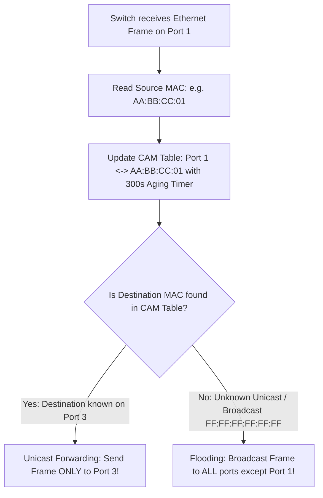

# Modul 130: Media Transmisi Fisik & Propagasi (Kabel Tembaga Twisted Pair, Serat Optik WDM, Gelombang RF, Link Budget)

**Navigasi**: [⬅️ Master Index](../../INDEX.md) | [Tingkat 8: Tingkat 8: Pemrosesan Sinyal Digital, Telekomunikasi & Network Engineering](./README.md)
*Sebelumnya*: [129. deteksi-kode-koreksi-kesalahan-kanal](./129-deteksi-kode-koreksi-kesalahan-kanal.md) | *Berikutnya*: [131. teknologi-komunikasi-nirkabel-lanjut](./131-teknologi-komunikasi-nirkabel-lanjut.md)

---

## 1. Intuisi Dasar Tanpa Jargon ("Seperti Bayi Baru Lahir")
Ketika dua komputer terhubung ke kabel switch jaringan yang sama di dalam satu kantor, bagaimana komputer A tahu dengan pasti bahwa data yang ia kirimkan hanya akan ditangkap oleh komputer B, bukan oleh komputer C di meja sebelah? Lapisan Fisik & Data Link ([Ethernet & IEEE 802.3 Architecture](https://standards.ieee.org/ieee/802.3/7091/)) adalah pengatur lalu lintas lokal di dalam satu lingkungan tetangga (Local Area Network / LAN). Setiap kartu jaringan fisik di dunia memiliki 'sidik jari silikon' permanen yang dibakar di pabrik: alamat **MAC (Media Access Control)** berukuran 48-bit. Switch jaringan bertindak seperti petugas pos lokal yang sangat cerdas: ia membaca frame data Ethernet, mempelajari dari port mana sinyal tersebut masuk, dan menyimpannya ke dalam tabel memori CAM (**MAC Address Table**), memastikan setiap frame hanya dialirkan ke kabel komputer penerima tanpa pernah menimbulkan tabrakan tabrakan data (Collision-Free Switching)!

## 2. Fondasi Teoretis & Aksiomatik / Matematis
Anatomi Frame Standar Ethernet IEEE 802.3 dan Enkapsulasi VLAN 802.1Q:

Struktur Frame Ethernet II (DIX Standard):

$$\begin{array}{|c|c|c|c|c|c|}
\hline
\text{Preamble + SFD} & \text{Destination MAC} & \text{Source MAC} & \text{EtherType / Length} & \text{Payload (Data)} & \text{FCS (CRC-32)} \\
\hline
7\text{B} + 1\text{B} & 6\text{ Bytes} & 6\text{ Bytes} & 2\text{ Bytes} & 46 - 1500\text{ Bytes} & 4\text{ Bytes} \\
\hline
\end{array}$$

Format Tagging VLAN IEEE 802.1Q (Virtual Local Area Network):
Disisipkan tepat di antara Source MAC dan EtherType asli (menambah 4 byte):
$$\text{802.1Q Tag} = \underbrace{\text{TPID (0x8100)}}_{16\text{-bit}} \mid \underbrace{\text{PCP (Prioritas QoS)}}_{3\text{-bit}} \mid \underbrace{\text{DEI (Drop Eligible)}}_{1\text{-bit}} \mid \underbrace{\text{VID (VLAN ID 1 s.d. 4094)}}_{12\text{-bit}}$$

Algoritma Cyclic Redundancy Check (CRC-32 Ethernet Polynomial):
Field Frame Check Sequence (FCS) dihitung di tingkat hardware untuk memvalidasi ketiadaan bit yang terkorupsi menggunakan polinomial pembagi generator biner:
$$G(x) = x^{32} + x^{26} + x^{23} + x^{22} + x^{16} + x^{12} + x^{11} + x^{10} + x^8 + x^7 + x^5 + x^4 + x^2 + x + 1$$
$$\text{FCS} = (x^{32} \cdot M(x)) \pmod{G(x)}$$

## 3. Anatomi Teknis & Cara Kerja Internal
Mekanisme Pembelajaran Mandiri Tabel CAM Switch Jaringan (MAC Learning & Forwarding):



1. **Spanning Tree Protocol (STP IEEE 802.1D)**: Mencegah terjadinya badai broadcast (*Broadcast Storm*) dan kehancuran jaringan akibat adanya kabel switch yang terpasang melingkar (Looping Topology). STP secara otomatis memblokir salah satu port cadangan menjadi status *Blocking* dan mengaktifkannya kembali jika kabel utama putus ([Cisco Spanning Tree Guide](https://www.cisco.com/c/en/us/support/docs/lan-switching/spanning-tree-protocol/5232-17.html)).
2. **Address Resolution Protocol (ARP)**: Jembatan antara Lapisan 3 (IP) dan Lapisan 2 (MAC). Jika komputer ingin mengirim data ke IP `192.168.1.10`, ia menyiarkan broadcast: *'Siapakah pemilik IP ini? Beritahu MAC Anda ke saya!'*.

## 4. Implementasi Praktis & Kode / Simulasi Riil
```c
// Pure C Bitwise CRC-32 Calculation matching Ethernet IEEE 802.3 Hardware Standard
#include <stdint.h>
#include <stddef.h>

#define ETHERNET_CRC32_POLY 0xEDB88320u // Polinomial bit-reversed

uint32_t compute_ethernet_crc32(const uint8_t *data, size_t length) {
    uint32_t crc = 0xFFFFFFFFu;
    for (size_t i = 0; i < length; i++) {
        crc ^= data[i];
        for (int bit = 0; bit < 8; bit++) {
            if (crc & 1) {
                crc = (crc >> 1) ^ ETHERNET_CRC32_POLY;
            } else {
                crc = (crc >> 1);
            }
        }
    }
    return crc ^ 0xFFFFFFFFu; // Inversi bit hasil akhir
}
```

## 5. Miskonsepsi & Jebakan Industri
1. **Broadcast Storm Meltdown Due to Physical Switching Loop**: Menghubungkan dua switch dengan dua kabel LAN tanpa mengaktifkan protokol Spanning Tree (STP). Satu paket broadcast ARP akan digandakan tak terhingga di dalam loop, menghabiskan 100% bandwidth gigabit dalam hitungan detik dan melumpuhkan seluruh kantor.
2. **ARP Spoofing / Poisoning Attack**: Penyerang di jaringan LAN menyiarkan pesan balasan ARP palsu yang mengklaim bahwa alamat IP Gateway Router adalah miliknya. Seluruh lalu lintas internet korban akan dibelokkan ke laptop penyerang (*Man-in-the-Middle*).
3. **CAM Table Overflow Attack**: Penyerang membanjiri switch dengan jutaan frame beralamat MAC palsu secara acak. Ketika memori CAM switch penuh, switch akan terdegradasi menjadi Hub bodoh yang mem-flood seluruh paket ke semua port, membocorkan data rahasia.

## 6. Proyek Latihan & Rubrik Penilaian Mandiri
1. **Tingkat Pemula**: Buka terminal shell Linux dan jalankan perintah `ip link show` serta `arp -a`. Identifikasi alamat MAC fisik kartu jaringan Anda dan daftar pasangan IP-MAC yang tersimpan di cache ARP lokal.
2. **Tingkat Menengah**: Bangun skrip Python yang mem-parse struktur paket frame Ethernet mentah: verifikasi apakah checksum CRC-32 yang diterima cocok dengan perhitungan rumus generator polinomial IEEE 802.3.
3. **Tingkat Mahir**: Rancang emulator switch jaringan 4-port sederhana di C/Python: kelola struktur data CAM Table dengan aging timeout 300 detik. Implementasikan logika Unicast Forwarding, Flooding, dan mekanisme deteksi topologi loop Spanning Tree Bridge Protocol Data Units (BPDU).

## 7. Rekomendasi Sumber Belajar Standar Emas
| Sumber Pembelajaran | Penulis / Institusi | Tautan Langsung | Fokus Materi |
| :--- | :--- | :--- | :--- |
| IEEE 802.3 Ethernet Working Group Standard | IEEE Standards Association | [IEEE 802.3 Standards](https://standards.ieee.org/ieee/802.3/7091/) | Standar Resmi Ethernet, Frame Structure, CSMA/CD, 1G/10G/100G PHY |
| Understanding Spanning Tree Protocol (STP) | Cisco Systems Networking | [Cisco STP Configuration Guide](https://www.cisco.com/c/en/us/support/docs/lan-switching/spanning-tree-protocol/5232-17.html) | Root Bridge Election, Port States (Blocking, Forwarding) & BPDU |
| Computer Networks, 5th Edition | Andrew S. Tanenbaum & David J. Wetherall | [Pearson Tanenbaum](https://www.pearson.com/en-us/subject-catalog/p/computer-networks/P200000003268) | Bab 4: The Medium Access Control Sublayer (Ethernet, VLANs, Switches) |
| RFC 826: An Ethernet Address Resolution Protocol (ARP) | David C. Plummer | [IETF RFC 826](https://datatracker.ietf.org/doc/html/rfc826) | Spesifikasi Resmi Standar Translasi Alamat Internet ke Alamat Hardware Ethernet |

---
*Navigasi Cepat*: [Ke Tingkat 8](./README.md) | [Ke Master Index](../../INDEX.md) | *Sebelumnya*: [129. deteksi-kode-koreksi-kesalahan-kanal](./129-deteksi-kode-koreksi-kesalahan-kanal.md) | *Berikutnya*: [131. teknologi-komunikasi-nirkabel-lanjut](./131-teknologi-komunikasi-nirkabel-lanjut.md)
