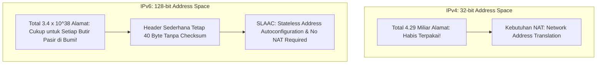

# Modul 131: Teknologi Komunikasi Nirkabel Lanjut (Massive MIMO, Beamforming, Jaringan Seluler 4G/5G NR, Satelit LEO)

**Navigasi**: [⬅️ Master Index](../../INDEX.md) | [Tingkat 8: Tingkat 8: Pemrosesan Sinyal Digital, Telekomunikasi & Network Engineering](./README.md)
*Sebelumnya*: [130. media-transmisi-fisik-propagasi](./130-media-transmisi-fisik-propagasi.md) | *Berikutnya*: [132. jaringan-komputer-model-osi-tcp-ip](./132-jaringan-komputer-model-osi-tcp-ip.md)

---

## 1. Intuisi Dasar Tanpa Jargon ("Seperti Bayi Baru Lahir")
Alamat MAC hanya berguna di dalam satu ruangan atau gedung yang sama. Namun ketika data Anda harus melintasi ribuan kilometer melewati samudra dan gurun untuk mencapai server di negara lain, switch lokal tidak tahu harus mengirimkannya ke mana. Lapisan Jaringan & Pengalamatan IP ([Internet Protocol & Subnetting](https://www.cloudflare.com/learning/network-layer/what-is-the-network-layer/)) adalah sistem pos logis global yang menghubungkan seluruh planet bumi menjadi satu jaringan raksasa: **Internet**. Setiap perangkat diberi alamat logis hierarkis (**Alamat IP**)—seperti alamat rumah lengkap dengan kode pos negara dan provinsi. Dengan teknik pembagian subnet (**CIDR**), router di perbatasan tidak perlu menghafal setiap rumah individu; ia cukup membaca awalan rute (*Prefix*) dan meneruskannya ke kota yang tepat, sementara protokol kendali **ICMP** bertindak seperti telegram darurat yang melaporkan jika ada jalan tol jaringan yang putus.

## 2. Fondasi Teoretis & Aksiomatik / Matematis
Anatomi Header IPv4 dan Formulasi Matematika Subnetting CIDR (Classless Inter-Domain Routing):

Struktur Header Paket Standar IPv4 (Panjang Minimum 20 Byte Tanpa Options):

$$\begin{array}{|c|c|c|c|c|}
\hline
\text{Version (4b)} \mid \text{IHL (4b)} & \text{DSCP / ECN (8b)} & \multicolumn{3}{|c|}{\text{Total Length (16b)}} \\
\hline
\multicolumn{2}{|c|}{\text{Identification (16b)}} & \text{Flags (3b)} & \multicolumn{2}{|c|}{\text{Fragment Offset (13b)}} \\
\hline
\text{Time to Live / TTL (8b)} & \text{Protocol (8b)} & \multicolumn{3}{|c|}{\text{Header Checksum (16b)}} \\
\hline
\multicolumn{5}{|c|}{\text{Source IP Address (32b)}} \\
\hline
\multicolumn{5}{|c|}{\text{Destination IP Address (32b)}} \\
\hline
\end{array}$$

Perhitungan Aljabar Biner Subnetting CIDR (`/prefix`):
Diberikan blok IP dengan awalan panjang prefix $P$ bit (misal `192.168.10.0/24`):
$$\text{Subnet Mask} = \underbrace{11111111 \dots 11111111}_{P \text{ buah bit 1}} \underbrace{00000000 \dots 00000000}_{(32 - P) \text{ buah bit 0}}$$
$$\text{Jumlah Alamat Total} = 2^{32 - P}$$
$$\text{Jumlah Alamat Host Valid} = 2^{32 - P} - 2 \quad (\text{dikurangi Network ID } 0 \text{ dan Broadcast ID } 255)$$
Operasi Bitwise untuk Menguji Apakah Host $H$ Berada di Jaringan Lokal yang Sama:
$$\text{Same Local Network} \iff (H_1 \ \& \ \text{Mask}) == (H_2 \ \& \ \text{Mask})$$

## 3. Anatomi Teknis & Cara Kerja Internal
Perbandingan Arsitektur Ruang Alamat IPv4 vs IPv6:



1. **Peran Header TTL (Time To Live)**: Setiap kali paket melewati sebuah router, router mengurangkan nilai TTL sebanyak 1 (`TTL = TTL - 1`). Jika TTL menyentuh angka 0, router membuang paket dan mengirimkan pesan balik `ICMP Time Exceeded` ke pengirim. Mekanisme ini mencegah paket tersesat berputar selamanya di internet dan merupakan dasar kerja utilitas `traceroute` ([How Traceroute Works](https://www.cloudflare.com/learning/network-layer/what-is-traceroute/)).

## 4. Implementasi Praktis & Kode / Simulasi Riil
```python
# Subnet Calculator and CIDR IPv4 Range Validator in Python
import ipaddress

def analyze_cidr_network(cidr_str: str):
    net = ipaddress.IPv4Network(cidr_str, strict=False)
    print(f"--- CIDR Analysis for: {net} ---")
    print(f"Network Address  : {net.network_address}")
    print(f"Broadcast Address: {net.broadcast_address}")
    print(f"Netmask          : {net.netmask}")
    print(f"Wildcard Mask    : {net.hostmask}")
    print(f"Total Addresses  : {net.num_addresses}")
    print(f"Usable Host Range: {net.network_address + 1} - {net.broadcast_address - 1}")
    print(f"Is Private Space : {net.is_private}")

# Contoh eksekusi untuk subnet kantor /26
analyze_cidr_network("192.168.1.130/26")
```

## 5. Miskonsepsi & Jebakan Industri
1. **IP Overlapping Subnets in VPN / Cloud Routing**: Mengalokasikan rentang subnet privat yang sama (`10.0.0.0/16`) di dua data center atau VPC cloud yang berbeda, lalu mencoba menyambungkannya via VPN peering. Router tidak dapat membedakan rute karena kedua sisi memiliki tabel rute yang bertabrakan (*Routing Ambiguity*).
2. **Broadcast Address Assignment**: Mencoba menetapkan alamat IP host pertama (`.0`) atau alamat terakhir (`.255` pada `/24`) ke kartu jaringan server. Sistem operasi akan menolaknya karena kedua alamat tersebut dipesan khusus untuk Network ID dan Subnet Directed Broadcast.
3. **Blocking All ICMP Messages Breaking Connectivity**: Memblokir seluruh jenis paket ICMP di firewall dengan dalih keamanan paranoid. Menghilangkan `ICMP Type 3 Code 4` (Fragmentation Needed) akan merusak penemuan Path MTU (PMTUD), membekukan transfer file besar.

## 6. Proyek Latihan & Rubrik Penilaian Mandiri
1. **Tingkat Pemula**: Hitung alamat Network ID, Broadcast ID, dan jumlah host yang dapat digunakan untuk subnet `10.20.30.0/27` secara manual menggunakan aritmatika biner.
2. **Tingkat Menengah**: Tuliskan implementasi kalkulasi Checksum Header IPv4 dalam bahasa C (algoritma *One's Complement Sum* 16-bit). Buktikan bahwa memverifikasi paket yang valid menghasilkan nilai checksum `0x0000` atau `0xFFFF`.
3. **Tingkat Mahir**: Implementasikan utilitas mandiri `my_traceroute` di Python/C menggunakan Raw Socket: kirim paket UDP/ICMP dengan nilai TTL yang dinaikkan bertahap dari 1 hingga 30. Tangkap balasan `ICMP Time Exceeded` dari setiap router hop di sepanjang jalur dan hitung round-trip time (RTT).

## 7. Rekomendasi Sumber Belajar Standar Emas
| Sumber Pembelajaran | Penulis / Institusi | Tautan Langsung | Fokus Materi |
| :--- | :--- | :--- | :--- |
| RFC 791: Internet Protocol (IPv4) Specification | Jon Postel (DARPA) | [IETF RFC 791](https://datatracker.ietf.org/doc/html/rfc791) | Spesifikasi Resmi IPv4 Header, Addressing, Fragmentation & TTL Rules |
| RFC 4632: Classless Inter-domain Routing (CIDR) | V. Fuller & T. Li | [IETF RFC 4632](https://datatracker.ietf.org/doc/html/rfc4632) | Standar Pembagian Subnet CIDR, Prefix Aggregation & Address Efficiency |
| RFC 8200: Internet Protocol, Version 6 (IPv6) Specification | S. Deering & R. Hinden | [IETF RFC 8200](https://datatracker.ietf.org/doc/html/rfc8200) | Standar Resmi Internet Standard IPv6 Architecture & Extension Headers |
| Cloudflare Learning Center: Network Layer Architecture | Cloudflare Inc. | [Cloudflare Network Layer](https://www.cloudflare.com/learning/network-layer/what-is-the-network-layer/) | Subnetting, Routers, CIDR Notation & IP Routing Mechanics |

---
*Navigasi Cepat*: [Ke Tingkat 8](./README.md) | [Ke Master Index](../../INDEX.md) | *Sebelumnya*: [130. media-transmisi-fisik-propagasi](./130-media-transmisi-fisik-propagasi.md) | *Berikutnya*: [132. jaringan-komputer-model-osi-tcp-ip](./132-jaringan-komputer-model-osi-tcp-ip.md)
