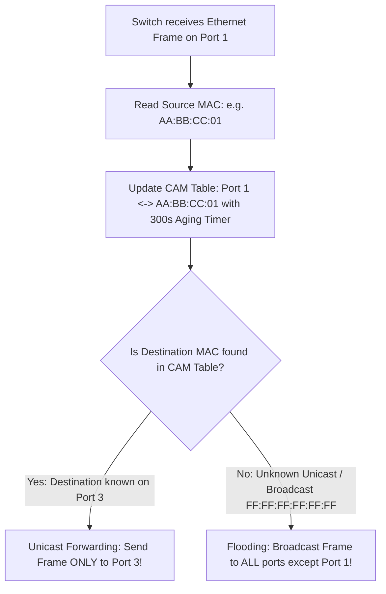

# Modul 133: Layer 2 Data Link: Switching & LAN (Ethernet Frames, MAC Learning, Spanning Tree STP/RSTP, VLAN 802.1Q)

**Navigasi**: [⬅️ Master Index](../../INDEX.md) | [Tingkat 8: Tingkat 8: Pemrosesan Sinyal Digital, Telekomunikasi & Network Engineering](./README.md)
*Sebelumnya*: [132. jaringan-komputer-model-osi-tcp-ip](./132-jaringan-komputer-model-osi-tcp-ip.md) | *Berikutnya*: [134. layer-3-network-pengalamatan-subnetting](./134-layer-3-network-pengalamatan-subnetting.md)

---

## 1. Intuisi Dasar Tanpa Jargon ("Seperti Bayi Baru Lahir")
### 1.1 Konsep Inti & Analogi Tanpa Jargon
Ketika dua komputer terhubung ke kabel switch jaringan yang sama di dalam satu kantor, bagaimana komputer A tahu dengan pasti bahwa data yang ia kirimkan hanya akan ditangkap oleh komputer B, bukan oleh komputer C di meja sebelah? Lapisan Fisik & Data Link ([Ethernet & IEEE 802.3 Architecture](https://standards.ieee.org/ieee/802.3/7091/)) adalah pengatur lalu lintas lokal di dalam satu lingkungan tetangga (Local Area Network / LAN). Setiap kartu jaringan fisik di dunia memiliki 'sidik jari silikon' permanen yang dibakar di pabrik: alamat **MAC (Media Access Control)** berukuran 48-bit. Switch jaringan bertindak seperti petugas pos lokal yang sangat cerdas: ia membaca frame data Ethernet, mempelajari dari port mana sinyal tersebut masuk, dan menyimpannya ke dalam tabel memori CAM (**MAC Address Table**), memastikan setiap frame hanya dialirkan ke kabel komputer penerima tanpa pernah menimbulkan tabrakan tabrakan data (Collision-Free Switching)!

### 1.2 Urgensi Rekayasa & Signifikansi Sistemik
Dalam rekayasa sistem modern, pemahaman mendalam tentang konsep ini membedakan arsitek sistem kelas dunia dari sekadar operator perkakas teknis.

## 2. Fondasi Teoretis & Aksiomatik / Matematis
### 2.1 Kerangka Teori Aksiomatik & Formulasi Matematis
Anatomi Frame Standar Ethernet IEEE 802.3 dan Enkapsulasi VLAN 802.1Q:

### 2.2 Penurunan Matematis Langkah-demi-Langkah
Struktur Frame Ethernet II (DIX Standard):

$$\begin{array}{|c|c|c|c|c|c|}
\hline
\text{Preamble + SFD} & \text{Destination MAC} & \text{Source MAC} & \text{EtherType / Length} & \text{Payload (Data)} & \text{FCS (CRC-32)} \\
\hline
7\text{B} + 1\text{B} & 6\text{ Bytes} & 6\text{ Bytes} & 2\text{ Bytes} & 46 - 1500\text{ Bytes} & 4\text{ Bytes} \\
\hline
\end{array}$$

Format Tagging VLAN IEEE 802.1Q (Virtual Local Area Network):
Disisipkan tepat di antara Source MAC dan EtherType asli (menambah 4 byte):
$$\text{802.1Q Tag} = \underbrace{\text{TPID (0x8100)}}_{16\text{-bit}} \mid \underbrace{\text{PCP (Prioritas QoS)}}_{3\text{-bit}} \mid \underbrace{\text{DEI (Drop Eligible)}}_{1\text{-bit}} \mid \underbrace{\text{VID (VLAN ID 1 s.d. 4094)}}_{12\text{-bit}}$$

Algoritma Cyclic Redundancy Check (CRC-32 Ethernet Polynomial):
Field Frame Check Sequence (FCS) dihitung di tingkat hardware untuk memvalidasi ketiadaan bit yang terkorupsi menggunakan polinomial pembagi generator biner:
$$G(x) = x^{32} + x^{26} + x^{23} + x^{22} + x^{16} + x^{12} + x^{11} + x^{10} + x^8 + x^7 + x^5 + x^4 + x^2 + x + 1$$
$$\text{FCS} = (x^{32} \cdot M(x)) \pmod{G(x)}$$

## 3. Anatomi Teknis & Cara Kerja Internal
Mekanisme Pembelajaran Mandiri Tabel CAM Switch Jaringan (MAC Learning & Forwarding):



1. **Spanning Tree Protocol (STP IEEE 802.1D)**: Mencegah terjadinya badai broadcast (*Broadcast Storm*) dan kehancuran jaringan akibat adanya kabel switch yang terpasang melingkar (Looping Topology). STP secara otomatis memblokir salah satu port cadangan menjadi status *Blocking* dan mengaktifkannya kembali jika kabel utama putus ([Cisco Spanning Tree Guide](https://www.cisco.com/c/en/us/support/docs/lan-switching/spanning-tree-protocol/5232-17.html)).
2. **Address Resolution Protocol (ARP)**: Jembatan antara Lapisan 3 (IP) dan Lapisan 2 (MAC). Jika komputer ingin mengirim data ke IP `192.168.1.10`, ia menyiarkan broadcast: *'Siapakah pemilik IP ini? Beritahu MAC Anda ke saya!'*.

#### Tabel Penelusuran Penetrasi Keamanan Jaringan VLAN Hopping (Double Tagging 802.1Q)
| Tahap Perjalanan Frame | Frame Tag Luar (*Outer VLAN Tag*) | Frame Tag Dalam (*Inner VLAN Tag*) | Posisi di Sakelar Jaringan | Status Strip Tag pada Port Trunk Asli | Aksi Penyerobotan Paket ke VLAN Korban |
|---|---|---|---|---|---|
| Penyerang di VLAN 10 | Tag Luar: `VLAN ID = 1` (Native) | Tag Dalam: `VLAN ID = 20` (Target)| Mengirim frame crafted ke switch akses | Port trunk menganggap Native VLAN | - |
| Sakelar Akses Menerima | Cek Tag Luar: `VLAN 1` | Menahan Tag Dalam | Sakelar melihat tag cocok dengan Native VLAN port | **STRIP TAG LUAR (Aturan 802.1Q Native)!** | Tag luar dilepas, menyisakan tag dalam |
| Diteruskan ke Trunk Link | **TAG LUAR TELAH HILANG!** | `VLAN ID = 20` kini berada di depan! | Frame melintasi trunk link antar sakelar | Frame tampak seperti frame VLAN 20 sah! | Sakelar kedua tertipu mutlak |
| Sakelar Tujuan Menerima | - | Tag: `VLAN ID = 20` | Membaca tag terdepan: `VLAN 20` | Forwarding frame ke port anggota VLAN 20 | Frame disuntikkan ke jaringan privat korban! |
| Hasil Pelanggaran | Isolasi VLAN Bobol | Komunikasi sepihak (Unidirectional) | Penyerang mengirim paket ke server korban | Menembus batas segmentasi Lapisan 2 | **VLAN HOPPING BERHASIL!** |

## 4. Implementasi Praktis & Kode / Simulasi Riil
```c
// Pure C Bitwise CRC-32 Calculation matching Ethernet IEEE 802.3 Hardware Standard
#include <stdint.h>
#include <stddef.h>

#define ETHERNET_CRC32_POLY 0xEDB88320u // Polinomial bit-reversed

uint32_t compute_ethernet_crc32(const uint8_t *data, size_t length) {
    uint32_t crc = 0xFFFFFFFFu;
    for (size_t i = 0; i < length; i++) {
        crc ^= data[i];
        for (int bit = 0; bit < 8; bit++) {
            if (crc & 1) {
                crc = (crc >> 1) ^ ETHERNET_CRC32_POLY;
            } else {
                crc = (crc >> 1);
            }
        }
    }
    return crc ^ 0xFFFFFFFFu; // Inversi bit hasil akhir
}
```

## 5. Miskonsepsi & Jebakan Industri
1. **Broadcast Storm Meltdown Due to Physical Switching Loop**: Menghubungkan dua switch dengan dua kabel LAN tanpa mengaktifkan protokol Spanning Tree (STP). Satu paket broadcast ARP akan digandakan tak terhingga di dalam loop, menghabiskan 100% bandwidth gigabit dalam hitungan detik dan melumpuhkan seluruh kantor.
2. **ARP Spoofing / Poisoning Attack**: Penyerang di jaringan LAN menyiarkan pesan balasan ARP palsu yang mengklaim bahwa alamat IP Gateway Router adalah miliknya. Seluruh lalu lintas internet korban akan dibelokkan ke laptop penyerang (*Man-in-the-Middle*).
3. **CAM Table Overflow Attack**: Penyerang membanjiri switch dengan jutaan frame beralamat MAC palsu secara acak. Ketika memori CAM switch penuh, switch akan terdegradasi menjadi Hub bodoh yang mem-flood seluruh paket ke semua port, membocorkan data rahasia.

### Studi Kasus Kegagalan Nyata: Eksploitasi Penembusan Isolasi Jaringan VLAN Hopping Double Tagging pada Infrastruktur Pusat Data Multi-Tenant
- **Kronologi & Konteks Kasus**: Pada sebuah pusat data komputasi awan yang mengandalkan segmentasi Virtual Local Area Network (VLAN / IEEE 802.1Q) untuk memisahkan lalu lintas jaringan antar penyewa (*tenants*), seorang peneliti keamanan mendemonstrasikan serangan penembusan partisi jaringan dari VLAN publik ke VLAN database privat perbankan.
- **Akar Masalah Protokol Lapisan 2 & Fitur 802.1Q Native VLAN**: Standar IEEE 802.1Q menetapkan bahwa paket yang berada pada *Native VLAN* (secara default adalah VLAN 1) tidak diberi tag saat melewati trunk link. Penyerang menyusun paket khusus dengan dua lapis tag VLAN (*Double Tagging*): tag luar disetel ke Native VLAN (VLAN 1), dan tag dalam disetel ke VLAN korban (VLAN 20). Ketika switch pertama menerima paket, ia melepas tag luar karena cocok dengan Native VLAN port trunk, lalu meneruskan sisa paket ke switch berikutnya. Switch kedua membaca paket yang kini memiliki tag terdepan VLAN 20, dan tanpa curiga meneruskan paket tersebut langsung ke mesin korban di VLAN 20. Penyerang berhasil membobol isolasi segmentasi Lapisan 2 dan menyuntikkan paket kendali berbahaya ke jaringan terisolasi.

- **Potongan Kode / Arsitektur Cacat (Vulnerable Implementation)**:
```c
// Rekonstruksi Struktur Frame Ethernet Double-Tagged 802.1Q (QinQ)
#include <stdint.h>

struct vlan_tag {
    uint16_t vlan_tpid; // 0x8100 untuk standar 802.1Q
    uint16_t vlan_tci;  // 3 bit Prioritas, 1 bit CFI, 12 bit VLAN ID
} __attribute__((packed));

struct double_tagged_frame {
    uint8_t  dest_mac[6];
    uint8_t  src_mac[6];
    struct vlan_tag outer_tag; // CACAT: Outer Tag disetel ke Native VLAN (misal VLAN 1)
    struct vlan_tag inner_tag; // Inner Tag disetel ke Target Victim VLAN (misal VLAN 20)
    uint16_t ether_type;       // 0x0800 (IPv4)
    uint8_t  payload[1500];
} __attribute__((packed));

// Mitigasi Defensif: Ubah Native VLAN ke ID yang tidak digunakan (misal VLAN 999) 
// dan aktifkan 'vlan dot1q tag native' untuk memaksa pemberian tag pada Native VLAN!
```

- **Analisis Forensik & Rekayasa Modern**: Kerentanan VLAN Hopping membuktikan bahwa fitur bawaan standar jaringan lawas (*backward compatibility*) sering kali menjadi celah keamanan serius. Rekayasa keamanan jaringan modern mewajibkan: (1) Mengubah Native VLAN dari nilai default VLAN 1 ke VLAN terisolasi yang tidak memuat port akses pengguna; (2) Penegakan tag eksplisit pada seluruh lalu lintas native (`vlan dot1q tag native`); (3) Penonaktifan negosiasi trunk otomatis (*Dynamic Trunking Protocol / DTP*) pada seluruh port akses.

## 6. Proyek Latihan & Rubrik Penilaian Mandiri
1. **Tingkat Pemula**: Buka terminal shell Linux dan jalankan perintah `ip link show` serta `arp -a`. Identifikasi alamat MAC fisik kartu jaringan Anda dan daftar pasangan IP-MAC yang tersimpan di cache ARP lokal.
2. **Tingkat Menengah**: Bangun skrip Python yang mem-parse struktur paket frame Ethernet mentah: verifikasi apakah checksum CRC-32 yang diterima cocok dengan perhitungan rumus generator polinomial IEEE 802.3.
3. **Tingkat Mahir**: Rancang emulator switch jaringan 4-port sederhana di C/Python: kelola struktur data CAM Table dengan aging timeout 300 detik. Implementasikan logika Unicast Forwarding, Flooding, dan mekanisme deteksi topologi loop Spanning Tree Bridge Protocol Data Units (BPDU).

### Tingkat 1: Dasar
- **Tugas**: Bangun parser frame Ethernet biner dalam Python/C yang mampu mendeteksi keberadaan tag VLAN IEEE 802.1Q (`EtherType == 0x8100`), mengekstrak field *Priority Code Point* (PCP 3-bit), *Drop Eligible Indicator* (DEI 1-bit), dan *VLAN Identifier* (VID 12-bit) dari 16-bit Tag Control Information (TCI).
- **Petunjuk Perancangan Arsitektur**:
  - Gunakan bitwise shift dan mask: `vid = tci & 0x0FFF`, `pcp = (tci >> 13) & 0x07`.
- **Test Vector & Kasus Uji Ekstrem**:
  - *Data Uji*: Dua byte TCI biner bernilai heksadesimal `0xA064`.
  - *Keluaran yang Diharapkan*: PCP = 5 (Prioritas Suara), DEI = 0, VLAN ID = 100 desimal.
- **Rubrik Penilaian Mandiri**: 40% Ekstraksi Bitwise Field PCP/DEI/VID yang Tepat, 30% Kepatuhan Spesifikasi IEEE 802.1Q, 30% Penanganan Frame Bertag vs Tanpa Tag.

### Tingkat 2: Menengah
- **Tugas**: Kembangkan generator paket kustom dalam Python (menggunakan raw socket atau Scapy) yang merakit frame Ethernet *Double-Tagged 802.1Q* dengan tag ganda terencana, serta bangun fungsi filter pencegah (*Ingress VLAN Filter*) pada sisi penerima yang menolak frame bertag ganda yang datang dari port akses pengguna.
- **Petunjuk Perancangan Arsitektur**:
  - Periksa apakah setelah tag 802.1Q pertama terdapat tag 802.1Q kedua (`0x8100` berulang).
  - Jika port dikonfigurasi sebagai port akses, tolak dan buang (*drop*) paket yang memiliki tag ganda seketika.
- **Test Vector & Kasus Uji Ekstrem**:
  - *Verifikasi Filter*: Kirim paket bertag tunggal yang sah $\implies$ Diterima; Kirim paket bertag ganda $\implies$ Ditolak dan dicatat di log alarm keamanan.
- **Rubrik Penilaian Mandiri**: 40% Konstruksi Frame Double-Tagged yang Valid, 30% Logika Filter Ingress Port Akses yang Efektif, 30% Pelaporan Log Keamanan.

### Tingkat 3: Mahir
- **Tugas**: Rancang simulator sakelar jaringan multi-VLAN (*Multi-VLAN Switch Engine*) mandiri dalam C yang mengisolasi tabel forwarding MAC per-VLAN (*Independent VLAN Learning / IVL*), di mana satu alamat MAC yang sama dapat muncul di VLAN berbeda tanpa menimbulkan konflik forwarding, dan lalu lintas antar-VLAN wajib melewati antarmuka routing L3 terisolasi (*Router-on-a-Stick*).
- **Petunjuk Perancangan Arsitektur**:
  - Kunci pencarian tabel MAC: pasangan `(VLAN_ID, MAC_Address)`.
  - Terapkan pemfilteran broadcast: paket broadcast di VLAN A hanya diteruskan ke port yang menjadi anggota VLAN A.
- **Test Vector & Kasus Uji Ekstrem**:
  - *Uji Isolasi Siaran*: Suntikkan paket broadcast ARP di VLAN 10; buktikan secara terverifikasi bahwa port yang terhubung ke VLAN 20 tidak menerima paket tersebut sedikitpun.
- **Rubrik Penilaian Mandiri**: 40% Arsitektur Independent VLAN Learning (IVL) yang Benar, 30% Isolasi Siaran Multi-VLAN Mutlak, 30% Kinerja Forwarding.

## 7. Rekomendasi Sumber Belajar Standar Emas
| Sumber Pembelajaran | Penulis / Institusi | Tautan Langsung | Fokus Materi |
| :--- | :--- | :--- | :--- |
| IEEE 802.3 Ethernet Working Group Standard | IEEE Standards Association | [IEEE 802.3 Standards](https://standards.ieee.org/ieee/802.3/7091/) | Standar Resmi Ethernet, Frame Structure, CSMA/CD, 1G/10G/100G PHY |
| Understanding Spanning Tree Protocol (STP) | Cisco Systems Networking | [Cisco STP Configuration Guide](https://www.cisco.com/c/en/us/support/docs/lan-switching/spanning-tree-protocol/5232-17.html) | Root Bridge Election, Port States (Blocking, Forwarding) & BPDU |
| Computer Networks, 5th Edition | Andrew S. Tanenbaum & David J. Wetherall | [Pearson Tanenbaum](https://www.pearson.com/en-us/subject-catalog/p/computer-networks/P200000003268) | Bab 4: The Medium Access Control Sublayer (Ethernet, VLANs, Switches) |
| RFC 826: An Ethernet Address Resolution Protocol (ARP) | David C. Plummer | [IETF RFC 826](https://datatracker.ietf.org/doc/html/rfc826) | Spesifikasi Resmi Standar Translasi Alamat Internet ke Alamat Hardware Ethernet |

---
*Navigasi Cepat*: [Ke Tingkat 8](./README.md) | [Ke Master Index](../../INDEX.md) | *Sebelumnya*: [132. jaringan-komputer-model-osi-tcp-ip](./132-jaringan-komputer-model-osi-tcp-ip.md) | *Berikutnya*: [134. layer-3-network-pengalamatan-subnetting](./134-layer-3-network-pengalamatan-subnetting.md)
