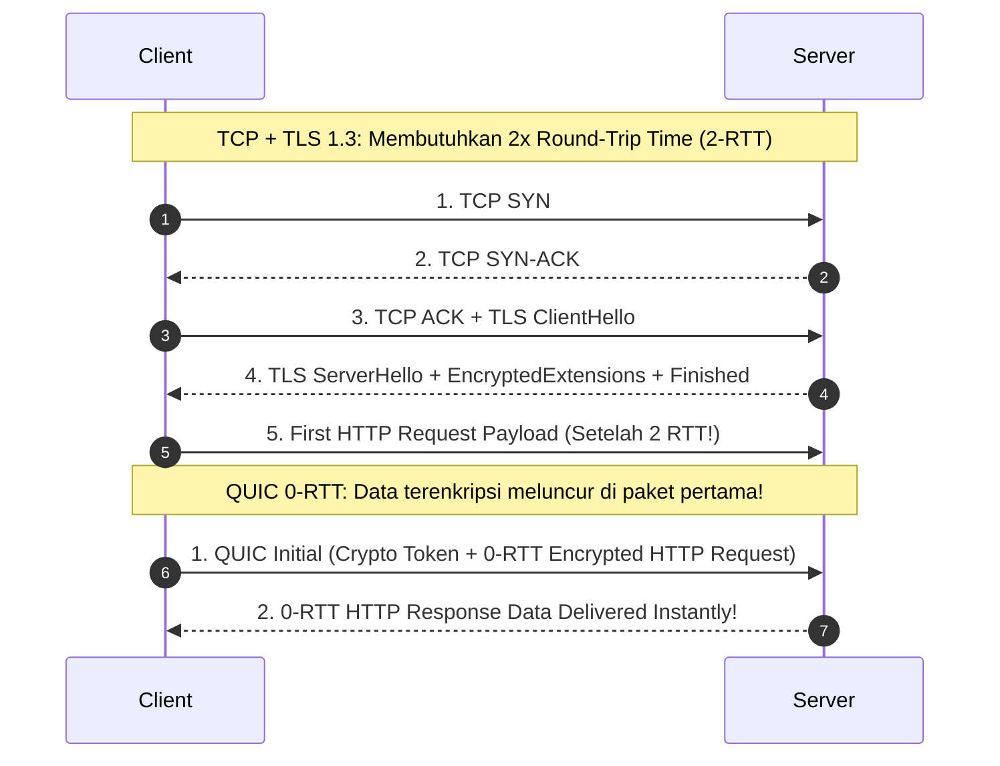

# Modul 134: Layer 3 Network: Pengalamatan & Subnetting (IPv4 Header, CIDR, VLSM, ARP, ICMP, NAT, IPv6 Dual-Stack)

**Navigasi**: [⬅️ Master Index](../../INDEX.md) | [Tingkat 8: Tingkat 8: Pemrosesan Sinyal Digital, Telekomunikasi & Network Engineering](./README.md)
*Sebelumnya*: [133. layer-2-data-link-switching-lan](./133-layer-2-data-link-switching-lan.md) | *Berikutnya*: [135. layer-3-routing-algoritma-protokol-global](./135-layer-3-routing-algoritma-protokol-global.md)

---

## 1. Intuisi Dasar Tanpa Jargon ("Seperti Bayi Baru Lahir")
Meskipun TCP sangat andal, keandalannya menuntut harga yang sangat mahal: jika satu paket kecil hilang di tengah jalan, seluruh aliran data dibekukan dan harus menunggu paket tersebut dikirim ulang (fenomena mimpi buruk yang disebut **Head-of-Line Blocking**). Untuk game online kompetitif, panggilan video real-time (Zoom), dan streaming audio langsung, Anda tidak butuh jaminan kesempurnaan masa lalu; jika satu frame suara hilang, Anda ingin melanjutkan ke suara detik ini juga! Lapisan Transpor: UDP & QUIC ([QUIC RFC 9000 & HTTP/3](https://www.cloudflare.com/learning/performance/what-is-http3/)) adalah jalan tol tanpa hambatan: **UDP (User Datagram Protocol)** adalah kurir balap tanpa basa-basi: tanpa jabat tangan, tanpa garansi, cukup lempar paket ke jaringan dengan kecepatan maksimal. Dan evolusi tercanggihnya—**QUIC (pondasi HTTP/3)**—adalah keajaiban arsitektur Google: ia meminjam kecepatan kilat UDP di kernel, namun membangun keandalan, enkripsi TLS 1.3 bawaan, dan multiplexing multi-aliran sejati langsung di ruang pengguna (userspace), menghadirkan jabat tangan instan 0-RTT dan melenyapkan Head-of-Line Blocking untuk selamanya!

## 2. Fondasi Teoretis & Aksiomatik / Matematis
Anatomi Datagram UDP dan Formulasi Arsitektur Protokol QUIC (RFC 9000):

1. **Header UDP Minimalis (Tepat 8 Byte!)**:
   $$\text{UDP Header} = \underbrace{\text{Source Port (16b)}}_{2\text{B}} \mid \underbrace{\text{Dest Port (16b)}}_{2\text{B}} \mid \underbrace{\text{Length (16b)}}_{2\text{B}} \mid \underbrace{\text{Checksum (16b)}}_{2\text{B}}$$
   Sangat ringan, stateless, tanpa handshake, tanpa retransmission, tanpa flow control.

2. **Arsitektur Protokol QUIC (Quick UDP Internet Connections)**:
   QUIC berjalan di atas UDP di user space, menggabungkan lapisan Transport dan Enkripsi menjadi satu kesatuan:

   $$\begin{array}{|c|c|}
   \hline
   \textbf{Model Klasik (HTTP/2 over TCP)} & \textbf{Model Modern (HTTP/3 over QUIC)} \\
   \hline
   \text{HTTP/2 Application} & \text{HTTP/3 Application} \\
   \text{TLS 1.2 / 1.3 Encryption Layer} & \multirow{2}{*}{\mathbf{QUIC \text{ (Transport + Integrated TLS 1.3)}}} \\
   \text{TCP Transport Layer} & \\
   \hline
   \text{IP Network Layer} & \text{UDP / IP Network Layer} \\
   \hline
   \end{array}$$

3. **Inovasi Inti QUIC**:
   - **0-RTT Handshake**: Klien yang pernah terhubung sebelumnya dapat mengirim data terenkripsi pada paket pertama tanpa menunggu jabat tangan selesai.
   - **Eliminasi Head-of-Line Blocking**: Banyak aliran data independen (*Streams*) diangkut dalam satu koneksi QUIC. Jika paket dari Stream A hilang, Stream B tetap mengalir tanpa jeda!
   - **Connection Migration**: Koneksi diidentifikasi oleh **Connection ID (CID) 64-bit**, bukan 4-tuple IP/Port. Jika ponsel Anda beralih dari Wi-Fi ke 4G/5G (alamat IP berubah), download file atau panggilan suara tidak akan terputus sama sekali!

## 3. Anatomi Teknis & Cara Kerja Internal
Perbandingan Latensi Jabat Tangan Sambungan: TCP + TLS 1.3 (2-RTT) vs QUIC 0-RTT:



1. **WebRTC Internals (Web Real-Time Communication)**:
   Protokol audio/video peer-to-peer browser yang menggunakan UDP. Menggabungkan **SRTP** (Secure Real-time Transport Protocol) untuk enkripsi media, **ICE / STUN / TURN** untuk penembusan firewall NAT transversal, dan **SCTP over DTLS** untuk transfer data kanal paralel.

## 4. Implementasi Praktis & Kode / Simulasi Riil
```python
# High-Speed UDP Echo Server and Client with Loss Simulation in Python
import socket
import random

def run_udp_echo_server(port=9999, simulated_loss_rate=0.2):
    sock = socket.socket(socket.AF_INET, socket.SOCK_DGRAM)
    sock.bind(('127.0.0.1', port))
    print(f"UDP Server listening on port {port} (Simulating {simulated_loss_rate*100}% loss)...")

    while True:
        data, addr = sock.recvfrom(2048) # Tanpa handshake, langsung terima datagram!
        
        # Simulasikan packet loss nirkabel acak
        if random.random() < simulated_loss_rate:
            print(f"[Dropped] Simulated packet drop from {addr}")
            continue

        # Echo balik paket secara instan
        sock.sendto(b"ECHO: " + data, addr)
```

## 5. Miskonsepsi & Jebakan Industri
1. **UDP Amplification DDoS Vulnerability**: Layanan UDP publik (seperti NTP, DNS, atau Memcached) yang membalas permintaan kecil dengan muatan data raksasa tanpa otentikasi handshake. Penyerang memalsukan IP sumber (IP Spoofing) menjadi IP korban, memicu amplifikasi traffic ratusan gigabit per detik yang melumpuhkan korban ([Cloudflare UDP Amplification Attacks](https://www.cloudflare.com/learning/ddos/udp-amplification-ddos-attack/)).
2. **UDP Packet Reordering & Duplicate Chaos**: Mengasumsikan urutan paket UDP akan sama dengan urutan pengiriman. Jaringan internet dapat merutekan paket melalui jalur berbeda, menghasilkan urutan paket yang teracak dan duplikasi paket liar yang wajib diurutkan manual di aplikasi.
3. **Aggressive UDP Packet Dropping by Corporate Firewalls**: Beberapa firewall perusahaan dan ISP memblokir port UDP 443 karena tidak dapat menginspeksi lalu lintas TLS yang terenkripsi di dalam QUIC, memaksa browser melakukan *Fallback* lambat kembali ke TCP HTTP/2.

## 6. Proyek Latihan & Rubrik Penilaian Mandiri
1. **Tingkat Pemula**: Bangun klien dan server UDP sederhana di Python. Kirim 100 paket angka urut dan hitung berapa persen paket yang berhasil sampai tanpa kehilangan.
2. **Tingkat Menengah**: Implementasikan protokol transfer file andal mini di atas UDP (seperti TFTP - Trivial File Transfer Protocol): tambahkan nomor urut blok data 16-bit, timeout retransmisi (Stop-and-Wait ARQ), dan pesan konfirmasi ACK.
3. **Tingkat Mahir**: Gunakan pustaka open-source QUIC (seperti `aioquic` di Python atau `quiche` di Rust) untuk membangun server HTTP/3 mandiri. Tunjukkan demonstrasi fitur *Connection Migration*: putuskan antarmuka Wi-Fi dan beralih ke tethering seluler tanpa memutus streaming video yang sedang berjalan.

## 7. Rekomendasi Sumber Belajar Standar Emas
| Sumber Pembelajaran | Penulis / Institusi | Tautan Langsung | Fokus Materi |
| :--- | :--- | :--- | :--- |
| RFC 9000: QUIC: A UDP-Based Multiplexed and Secure Transport | J. Iyengar & M. Thomson (IETF) | [IETF RFC 9000](https://datatracker.ietf.org/doc/html/rfc9000) | Standar Resmi QUIC: Streams, Connection IDs, Packet Formats & Security |
| RFC 768: User Datagram Protocol (UDP) | David P. Reed | [IETF RFC 768](https://datatracker.ietf.org/doc/html/rfc768) | Dokumen Standar Resmi Asli Protokol UDP 1980 (Hanya 3 Halaman!) |
| Cloudflare Learning Center: What is HTTP/3? | Cloudflare Engineering | [Cloudflare HTTP/3 & QUIC](https://www.cloudflare.com/learning/performance/what-is-http3/) | Head-of-Line Blocking Elimination, 0-RTT Handshakes & Performance |
| WebRTC: APIs and RTCDataChannel Architecture | W3C / IETF WebRTC Working Group | [WebRTC Official Portal](https://webrtc.org/) | Peer-to-Peer Audio/Video Streaming, ICE NAT Traversal & SRTP Encryption |

---
*Navigasi Cepat*: [Ke Tingkat 8](./README.md) | [Ke Master Index](../../INDEX.md) | *Sebelumnya*: [133. layer-2-data-link-switching-lan](./133-layer-2-data-link-switching-lan.md) | *Berikutnya*: [135. layer-3-routing-algoritma-protokol-global](./135-layer-3-routing-algoritma-protokol-global.md)
