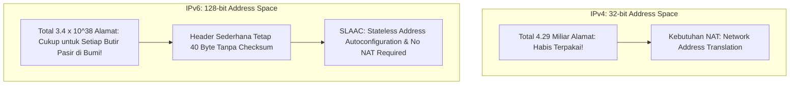

# Modul 134: Layer 3 Network: Pengalamatan & Subnetting (IPv4 Header, CIDR, VLSM, ARP, ICMP, NAT, IPv6 Dual-Stack)

**Navigasi**: [⬅️ Master Index](../../INDEX.md) | [Tingkat 8: Tingkat 8: Pemrosesan Sinyal Digital, Telekomunikasi & Network Engineering](./README.md)
*Sebelumnya*: [133. layer-2-data-link-switching-lan](./133-layer-2-data-link-switching-lan.md) | *Berikutnya*: [135. layer-3-routing-algoritma-protokol-global](./135-layer-3-routing-algoritma-protokol-global.md)

---

## 1. Intuisi Dasar Tanpa Jargon ("Seperti Bayi Baru Lahir")
### 1.1 Konsep Inti & Analogi Tanpa Jargon
Alamat MAC hanya berguna di dalam satu ruangan atau gedung yang sama. Namun ketika data Anda harus melintasi ribuan kilometer melewati samudra dan gurun untuk mencapai server di negara lain, switch lokal tidak tahu harus mengirimkannya ke mana. Lapisan Jaringan & Pengalamatan IP ([Internet Protocol & Subnetting](https://www.cloudflare.com/learning/network-layer/what-is-the-network-layer/)) adalah sistem pos logis global yang menghubungkan seluruh planet bumi menjadi satu jaringan raksasa: **Internet**. Setiap perangkat diberi alamat logis hierarkis (**Alamat IP**)—seperti alamat rumah lengkap dengan kode pos negara dan provinsi. Dengan teknik pembagian subnet (**CIDR**), router di perbatasan tidak perlu menghafal setiap rumah individu; ia cukup membaca awalan rute (*Prefix*) dan meneruskannya ke kota yang tepat, sementara protokol kendali **ICMP** bertindak seperti telegram darurat yang melaporkan jika ada jalan tol jaringan yang putus.

### 1.2 Urgensi Rekayasa & Signifikansi Sistemik
Dalam rekayasa sistem modern, pemahaman mendalam tentang konsep ini membedakan arsitek sistem kelas dunia dari sekadar operator perkakas teknis.

## 2. Fondasi Teoretis & Aksiomatik / Matematis
### 2.1 Kerangka Teori Aksiomatik & Formulasi Matematis
Anatomi Header IPv4 dan Formulasi Matematika Subnetting CIDR (Classless Inter-Domain Routing):

### 2.2 Penurunan Matematis Langkah-demi-Langkah
Struktur Header Paket Standar IPv4 (Panjang Minimum 20 Byte Tanpa Options):

$$\begin{array}{|c|c|c|c|c|}
\hline
\text{Version (4b)} \mid \text{IHL (4b)} & \text{DSCP / ECN (8b)} & \multicolumn{3}{|c|}{\text{Total Length (16b)}} \\
\hline
\multicolumn{2}{|c|}{\text{Identification (16b)}} & \text{Flags (3b)} & \multicolumn{2}{|c|}{\text{Fragment Offset (13b)}} \\
\hline
\text{Time to Live / TTL (8b)} & \text{Protocol (8b)} & \multicolumn{3}{|c|}{\text{Header Checksum (16b)}} \\
\hline
\multicolumn{5}{|c|}{\text{Source IP Address (32b)}} \\
\hline
\multicolumn{5}{|c|}{\text{Destination IP Address (32b)}} \\
\hline
\end{array}$$

Perhitungan Aljabar Biner Subnetting CIDR (`/prefix`):
Diberikan blok IP dengan awalan panjang prefix $P$ bit (misal `192.168.10.0/24`):
$$\text{Subnet Mask} = \underbrace{11111111 \dots 11111111}_{P \text{ buah bit 1}} \underbrace{00000000 \dots 00000000}_{(32 - P) \text{ buah bit 0}}$$
$$\text{Jumlah Alamat Total} = 2^{32 - P}$$
$$\text{Jumlah Alamat Host Valid} = 2^{32 - P} - 2 \quad (\text{dikurangi Network ID } 0 \text{ dan Broadcast ID } 255)$$
Operasi Bitwise untuk Menguji Apakah Host $H$ Berada di Jaringan Lokal yang Sama:
$$\text{Same Local Network} \iff (H_1 \ \& \ \text{Mask}) == (H_2 \ \& \ \text{Mask})$$

## 3. Anatomi Teknis & Cara Kerja Internal
Perbandingan Arsitektur Ruang Alamat IPv4 vs IPv6:



1. **Peran Header TTL (Time To Live)**: Setiap kali paket melewati sebuah router, router mengurangkan nilai TTL sebanyak 1 (`TTL = TTL - 1`). Jika TTL menyentuh angka 0, router membuang paket dan mengirimkan pesan balik `ICMP Time Exceeded` ke pengirim. Mekanisme ini mencegah paket tersesat berputar selamanya di internet dan merupakan dasar kerja utilitas `traceroute` ([How Traceroute Works](https://www.cloudflare.com/learning/network-layer/what-is-traceroute/)).

#### Tabel Penelusuran Penetrasi Firewall NAT Slipstreaming (CVE-2020-8554 / Samy Kamkar)
| Langkah Eksploitasi Klien | Perilaku Browser Pengguna | Protokol Jaringan Terlibat | Intersepsi Application Layer Gateway (ALG) | Aksi Lubang Jarum Firewall (*Pinholing*) | Status Keamanan Jaringan Privat |
|---|---|---|---|---|---|
| Kunjungan Web | Korban membuka situs web berbahaya | HTTP/WebSocket | Browser mengirim TCP beacon | NAT memetakan port biasa | Terisolasi di balik NAT |
| Manipulasi Ukuran Paket | JS memicu fragmentasi paket TCP | MTU sengaja dipecah | Mengatur offset payload agar tepat di batas paket | Penyerang mengontrol potongan data | Persiapan injeksi header |
| Ekstraksi IP Privat | WebRTC membaca IP lokal: `192.168.1.50` | SIP / H.323 Packet Crafting | Payload HTTP memuat string perintah SIP buatan | Paket melintasi router NAT | Router mengira ini panggilan SIP sah |
| Pemicuan Algoritma ALG | Router NAT membaca perintah SIP `INVITE` | Perintah: `Contact: sip:192.168.1.50:5060` | **ROUTER NAT TERTIPU!** | **NAT MEMBUKA PORT INBOUND KE HOST LOKAL!** | Firewall membuka lubang jarum (*pinhole*) |
| Akses Tak Terbatas | Penyerang dari internet publik | TCP langsung ke IP lokal | Menghubungkan langsung ke perangkat di balik NAT | Melewati seluruh aturan blokir firewall! | Port privat korban terekspos ke dunia luar |

## 4. Implementasi Praktis & Kode / Simulasi Riil
```python
# Subnet Calculator and CIDR IPv4 Range Validator in Python
import ipaddress

def analyze_cidr_network(cidr_str: str):
    net = ipaddress.IPv4Network(cidr_str, strict=False)
    print(f"--- CIDR Analysis for: {net} ---")
    print(f"Network Address  : {net.network_address}")
    print(f"Broadcast Address: {net.broadcast_address}")
    print(f"Netmask          : {net.netmask}")
    print(f"Wildcard Mask    : {net.hostmask}")
    print(f"Total Addresses  : {net.num_addresses}")
    print(f"Usable Host Range: {net.network_address + 1} - {net.broadcast_address - 1}")
    print(f"Is Private Space : {net.is_private}")

# Contoh eksekusi untuk subnet kantor /26
analyze_cidr_network("192.168.1.130/26")
```

## 5. Miskonsepsi & Jebakan Industri
1. **IP Overlapping Subnets in VPN / Cloud Routing**: Mengalokasikan rentang subnet privat yang sama (`10.0.0.0/16`) di dua data center atau VPC cloud yang berbeda, lalu mencoba menyambungkannya via VPN peering. Router tidak dapat membedakan rute karena kedua sisi memiliki tabel rute yang bertabrakan (*Routing Ambiguity*).
2. **Broadcast Address Assignment**: Mencoba menetapkan alamat IP host pertama (`.0`) atau alamat terakhir (`.255` pada `/24`) ke kartu jaringan server. Sistem operasi akan menolaknya karena kedua alamat tersebut dipesan khusus untuk Network ID dan Subnet Directed Broadcast.
3. **Blocking All ICMP Messages Breaking Connectivity**: Memblokir seluruh jenis paket ICMP di firewall dengan dalih keamanan paranoid. Menghilangkan `ICMP Type 3 Code 4` (Fragmentation Needed) akan merusak penemuan Path MTU (PMTUD), membekukan transfer file besar.

### Studi Kasus Kegagalan Nyata: Eksploitasi Penembusan Firewall & NAT Slipstreaming Melalui Celah Application Level Gateway (CVE-2020-8554)
- **Kronologi & Konteks Sejarah**: Pada akhir tahun 2020, peneliti keamanan Samy Kamkar mempublikasikan teknik serangan spektakuler bernama *NAT Slipstreaming*. Serangan ini memungkinkan penyerang jarak jauh di internet publik untuk menembus firewall NAT router pengguna dan membuka koneksi TCP/UDP inbound langsung ke perangkat apapun di dalam jaringan lokal privat korban, hanya dengan memancing korban mengunjungi sebuah halaman web biasa.
- **Akar Masalah Pengalamatan IPv4, NAT, & Application Layer Gateway (ALG)**: Karena kelangkaan alamat IPv4 publik, sebagian besar jaringan rumah dan enterprise menggunakan Network Address Translation (NAT) untuk memetakan ribuan IP privat ke satu IP publik. Protokol multimedia lawas (seperti SIP untuk VoIP atau FTP pasif) menanamkan alamat IP dan port privat di dalam payload data aplikasinya. Untuk memungkinkan panggilan suara masuk, router NAT dilengkapi fitur *Application Layer Gateway* (ALG) yang secara otomatis memindai isi paket jaringan dan secara otomatis membuka 'lubang jarum' (*pinhole*) pada firewall untuk mengizinkan koneksi dari luar masuk ke IP privat tersebut. Penyerang menyusun paket HTTP/WebRTC dari JavaScript browser yang secara presisi dipotong (*packet fragmentation*) sehingga menyerupai paket pensinyalan SIP. Router NAT tertipu dan membuka port firewall secara otomatis, memberikan penyerang akses langsung ke port internal korban di balik NAT.

- **Potongan Kode / Arsitektur Cacat (Vulnerable Implementation)**:
```c
// Rekonstruksi Logika Cacat Pemindaian SIP ALG pada Router NAT
#include <string.h>
#include <stdbool.h>

// Modul Kernel NAT ALG: Memindai payload TCP port 80/any untuk mendeteksi perintah SIP
void inspect_packet_for_sip_pinhole(const char *tcp_payload, int payload_len) {
    // CACAT FATAL: ALG memindai teks 'INVITE sip:' tanpa memverifikasi 
    // apakah koneksi tersebut benar-benar sesi VoIP SIP yang terotentikasi,
    // atau sekadar payload HTTP POST yang dikirimkan oleh browser JavaScript!
    const char *sip_invite = strstr(tcp_payload, "INVITE sip:");
    if (sip_invite != NULL) {
        // Ekstrak IP dan port target dari teks:
        char target_ip[16];
        int target_port;
        parse_sip_contact_header(sip_invite, target_ip, &target_port);

        // BUKA FIREWALL INBOUND SECARA OTOMATIS:
        create_nat_inbound_pinhole(target_ip, target_port);
        // Penyerang dari internet publik kini dapat langsung menyerang target_ip:target_port!
    }
}
```

- **Analisis Forensik & Rekayasa Modern**: Insiden NAT Slipstreaming membuktikan bahwa ketergantungan pada inspeksi konten lapisan aplikasi (*Deep Packet Inspection*) di dalam router NAT adalah cacat arsitektur. Vendor browser (Google Chrome, Firefox, Apple Safari) merilis patch darurat yang memblokir total akses JavaScript ke port-port berbahaya yang sering dipantau ALG (seperti port 5060 untuk SIP). Sementara di sisi operator jaringan, solusinya adalah penonaktifan total modul ALG pada router dan percepatan migrasi ke IPv6 murni di mana setiap perangkat memiliki alamat publik global dengan kebijakan firewall berbasis identitas yang jelas.

## 6. Proyek Latihan & Rubrik Penilaian Mandiri
1. **Tingkat Pemula**: Hitung alamat Network ID, Broadcast ID, dan jumlah host yang dapat digunakan untuk subnet `10.20.30.0/27` secara manual menggunakan aritmatika biner.
2. **Tingkat Menengah**: Tuliskan implementasi kalkulasi Checksum Header IPv4 dalam bahasa C (algoritma *One's Complement Sum* 16-bit). Buktikan bahwa memverifikasi paket yang valid menghasilkan nilai checksum `0x0000` atau `0xFFFF`.
3. **Tingkat Mahir**: Implementasikan utilitas mandiri `my_traceroute` di Python/C menggunakan Raw Socket: kirim paket UDP/ICMP dengan nilai TTL yang dinaikkan bertahap dari 1 hingga 30. Tangkap balasan `ICMP Time Exceeded` dari setiap router hop di sepanjang jalur dan hitung round-trip time (RTT).

### Tingkat 1: Dasar
- **Tugas**: Bangun kalkulator subnetting IPv4 (CIDR / VLSM Calculator) mandiri dalam Python/C yang menerima alamat IPv4 dan panjang prefix (misal `192.168.10.130/26`), lalu menghitung Netmask biner, Alamat Jaringan (*Network Address*), Alamat Siaran (*Broadcast Address*), Rentang Alamat Host Valid Pertama dan Terakhir, serta Jumlah Host Maksimum yang Dapat Ditampung.
- **Petunjuk Perancangan Arsitektur**:
  - Ubah string IP ke integer 32-bit tanpa tanda (*uint32_t*).
  - Terapkan bitmask: $\text{Netmask} = \sim((1 \ll (32 - \text{prefix})) - 1)$.
- **Test Vector & Kasus Uji Ekstrem**:
  - *Data Uji*: `10.50.128.0/19`.
  - *Keluaran yang Diharapkan*: Netmask `255.255.224.0`, Network `10.50.128.0`, Broadcast `10.50.159.255`, Rentang Host `10.50.128.1` s/d `10.50.159.254`, Total Host $= 8190$.
- **Rubrik Penilaian Mandiri**: 40% Aritmatika Bitwise Masking IPv4 yang Tepat, 30% Perhitungan Rentang VLSM Akurat, 30% Kerapian Enkapsulasi Kode.

### Tingkat 2: Menengah
- **Tugas**: Kembangkan implementasi penerjemah alamat jaringan *Network Address Translation* (NAPT / Port Address Translation) mandiri dalam Python/C menggunakan antarmuka Linux `TUN/TAP` yang menerima paket IPv4 privat dari interface lokal, memetakan alamat asal ke IP publik dan nomor port unik dalam *NAT Translation Table*, lalu mengarahkan paket kembali ke klien yang tepat saat menerima balasan.
- **Petunjuk Perancangan Arsitektur**:
  - Rekalkulasi checksum header IPv4 dan TCP/UDP setelah melakukan modifikasi IP dan Port (gunakan aritmatika one's complement addition).
  - Kelola tabel status koneksi 5-tupel: `(Protocol, SrcIP, SrcPort, TransPort, DestIP)`.
- **Test Vector & Kasus Uji Ekstrem**:
  - *Siklus NAPT Lengkap*: 2 Host lokal mengirim kueri DNS ke `8.8.8.8` menggunakan port asal yang sama; buktikan NAT menerjemahkan ke dua port publik berbeda dan memetakan respon balasan kembali ke masing-masing host tanpa tertukar.
- **Rubrik Penilaian Mandiri**: 40% Pengelolaan Tabel Status NAPT Dinamis, 30% Rekalkulasi Checksum IP/TCP yang Akurat, 30% Isolasi Koneksi Multi-Klien.

### Tingkat 3: Mahir
- **Tugas**: Rancang parser dan generator paket pengalamatan *IPv6 Neighbor Discovery Protocol* (NDP) mandiri yang mengimplementasikan pesan *Neighbor Solicitation* (NS) dan *Neighbor Advertisement* (NA) dengan alamat *Solicited-Node Multicast* (`FF02::1:FFxx:xxxx`) untuk menggantikan fungsi ARP IPv4 lama, lengkap dengan deteksi konflik alamat ganda (*Duplicate Address Detection / DAD*).
- **Petunjuk Perancangan Arsitektur**:
  - Bentuk header ICMPv6 Tipe 135 (Neighbor Solicitation) dan Tipe 136 (Neighbor Advertisement).
  - Terapkan pemetaan opsi Target Link-Layer Address (TLLA / SLLA).
- **Test Vector & Kasus Uji Ekstrem**:
  - *Simulasi DAD*: Kirim paket Neighbor Solicitation untuk alamat IPv6 baru sebelum mengikat interface; jika ada balasan Advertisement dari host lain, gagalkan inisialisasi antarmuka dengan error konflik DAD.
- **Rubrik Penilaian Mandiri**: 40% Kepatuhan Spesifikasi RFC 4861 NDP ICMPv6, 30% Konstruksi Alamat Solicited-Node Multicast yang Benar, 30% Mekanisme Duplicate Address Detection Efektif.

## 7. Rekomendasi Sumber Belajar Standar Emas
| Sumber Pembelajaran | Penulis / Institusi | Tautan Langsung | Fokus Materi |
| :--- | :--- | :--- | :--- |
| RFC 791: Internet Protocol (IPv4) Specification | Jon Postel (DARPA) | [IETF RFC 791](https://datatracker.ietf.org/doc/html/rfc791) | Spesifikasi Resmi IPv4 Header, Addressing, Fragmentation & TTL Rules |
| RFC 4632: Classless Inter-domain Routing (CIDR) | V. Fuller & T. Li | [IETF RFC 4632](https://datatracker.ietf.org/doc/html/rfc4632) | Standar Pembagian Subnet CIDR, Prefix Aggregation & Address Efficiency |
| RFC 8200: Internet Protocol, Version 6 (IPv6) Specification | S. Deering & R. Hinden | [IETF RFC 8200](https://datatracker.ietf.org/doc/html/rfc8200) | Standar Resmi Internet Standard IPv6 Architecture & Extension Headers |
| Cloudflare Learning Center: Network Layer Architecture | Cloudflare Inc. | [Cloudflare Network Layer](https://www.cloudflare.com/learning/network-layer/what-is-the-network-layer/) | Subnetting, Routers, CIDR Notation & IP Routing Mechanics |

---
*Navigasi Cepat*: [Ke Tingkat 8](./README.md) | [Ke Master Index](../../INDEX.md) | *Sebelumnya*: [133. layer-2-data-link-switching-lan](./133-layer-2-data-link-switching-lan.md) | *Berikutnya*: [135. layer-3-routing-algoritma-protokol-global](./135-layer-3-routing-algoritma-protokol-global.md)
