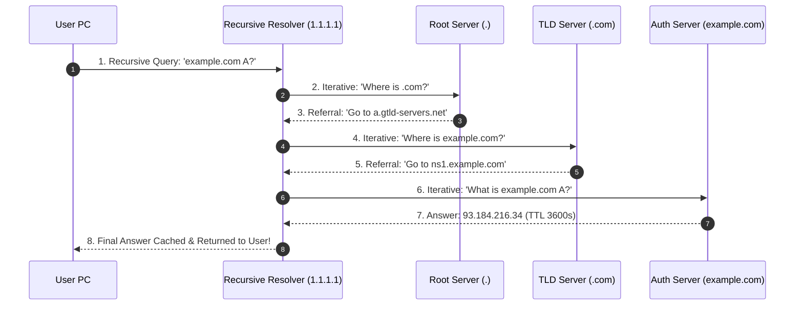

# Modul 135: Layer 3 Routing: Algoritma & Protokol Global (OSPF Link-State, BGP-4 Internet Backbone, MPLS)

**Navigasi**: [⬅️ Master Index](../../INDEX.md) | [Tingkat 8: Tingkat 8: Pemrosesan Sinyal Digital, Telekomunikasi & Network Engineering](./README.md)
*Sebelumnya*: [134. layer-3-network-pengalamatan-subnetting](./134-layer-3-network-pengalamatan-subnetting.md) | *Berikutnya*: [136. layer-4-transport-protokol-end-to-end](./136-layer-4-transport-protokol-end-to-end.md)

---

## 1. Intuisi Dasar Tanpa Jargon ("Seperti Bayi Baru Lahir")
Manusia mengingat nama orang dan merek dagang seperti `google.com` atau `wikipedia.org`, tetapi router internet hanya mengerti deretan angka biner heksadesimal seperti `142.250.190.46` atau `2a00:1450:4001:830::200e`. Sistem Nama Domain (Domain Name System / DNS) ([How DNS Works](https://www.cloudflare.com/learning/dns/what-is-dns/)) adalah buku telepon raksasa terdesentralisasi terbesar di jagat maya. Ketika Anda mengetik sebuah alamat web, komputer Anda memulai petualangan detektif kilat dalam hitungan milidetik: bertanya ke Recursive Resolver lokal; jika belum tahu, bertanya ke 13 gugus Root Name Servers dunia ('.'); lalu diarahkan ke Top-Level Domain ('.com'); hingga akhirnya menyentuh Authoritative Name Server milik pemilik web asli. Dan untuk mencegah hacker memalsukan alamat bank Anda di tengah jalan, perisai kriptografi **DNSSEC** membubuhkan tanda tangan digital anti-pemalsuan pada setiap jawaban domain.

## 2. Fondasi Teoretis & Aksiomatik / Matematis
Hierarki Pohon DNS Terdistribusi dan Formalisme Catatan Sumber Daya (Resource Records):

Format Struktur Catatan DNS Standar (RFC 1035):
$$\text{Resource Record (RR)} = \{\text{NAME}, \ \text{TYPE}, \ \text{CLASS (IN)}, \ \text{TTL (detik)}, \ \text{RDATA}\}$$

Tipe Catatan DNS Utama:
- **`A`**: Memetakan domain ke alamat IPv4 32-bit (misal `93.184.216.34`).
- **`AAAA`**: Memetakan domain ke alamat IPv6 128-bit.
- **`CNAME` (Canonical Name)**: Alias yang mengarahkan satu nama domain ke nama domain kanonikal lain (tidak boleh berdampingan dengan catatan lain pada level apex!).
- **`MX` (Mail Exchange)**: Menentukan server penerima email dengan nomor prioritas integer.
- **`TXT`**: Menyimpan teks bebas untuk verifikasi kepemilikan domain (SPF, DKIM, DMARC).

Rantai Kepercayaan Kriptografi **DNSSEC (DNS Security Extensions - RFC 4033)**:
Menegakkan integritas data tanpa enkripsi kerahasiaan:
$$\text{Root Trust Anchor} \xrightarrow{\text{DS Record}} \text{TLD KSK} \xrightarrow{\text{DS Record}} \text{Domain KSK} \xrightarrow{\text{ZSK}} \text{RRSIG (Tanda Tangan ECDSA / RSA)}$$
Resolving DNS resolver memverifikasi bahwa hash publik pada `DS` cocok dengan kunci publik `DNSKEY`, membuktikan jawaban 100% otentik dari pemilik aslinya.

## 3. Anatomi Teknis & Cara Kerja Internal
Alur Kerja Resolusi DNS: Recursive Query vs Iterative Query Resolution:



1. **DNS Cache Poisoning / Kaminsky Attack (2008)**: Penyerang membanjiri Recursive Resolver dengan ribuan tebakan Transaction ID (16-bit) dan port acak UDP secara serentak untuk menyuntikkan catatan IP palsu ke dalam cache resolver sebelum jawaban asli tiba ([Dan Kaminsky DNS Flaw Analysis](https://www.cloudflare.com/learning/dns/dns-cache-poisoning/)).
2. **DNS over HTTPS (DoH) / DNS over TLS (DoT)**: Mengenkripsi kueri DNS pengguna melalui tunnel TLS port 443 / 853, mencegah ISP atau hacker di jaringan Wi-Fi publik memata-matai situs apa saja yang sedang Anda kunjungi.

## 4. Implementasi Praktis & Kode / Simulasi Riil
```python
# Raw DNS Query Construction and UDP Resolution in Pure Python (RFC 1035)
import socket
import struct

def build_dns_query(domain_name: str, query_type_a=1) -> bytes:
    # Header: ID=0x1337, Flags=0x0100 (Standard Query, Recursion Desired)
    # QDCOUNT=1, ANCOUNT=0, NSCOUNT=0, ARCOUNT=0
    header = struct.pack('!HHHHHH', 0x1337, 0x0100, 1, 0, 0, 0)

    # Format QNAME: 'example.com' -> \x07example\x03com\x00
    qname = b''
    for label in domain_name.split('.'):
        qname += struct.pack('B', len(label)) + label.encode('ascii')
    qname += b'\x00'

    # Question: QTYPE=1 (A), QCLASS=1 (IN)
    question = qname + struct.pack('!HH', query_type_a, 1)
    return header + question

def query_dns_server(domain: str, dns_ip="1.1.1.1") -> bytes:
    sock = socket.socket(socket.AF_INET, socket.SOCK_DGRAM)
    sock.settimeout(3.0)
    query_packet = build_dns_query(domain)
    sock.sendto(query_packet, (dns_ip, 53))
    response_data, _ = sock.recvfrom(1024)
    sock.close()
    return response_data
```

## 5. Miskonsepsi & Jebakan Industri
1. **CNAME at Apex / Zone Apex Problem**: Mencoba membuat catatan `CNAME` pada domain utama telanjang (`example.com`). Spesifikasi RFC melarang catatan CNAME hidup berdampingan dengan catatan `SOA` dan `NS` pada zone apex (solusi: gunakan catatan alias buatan vendor seperti Cloudflare CNAME Flattening atau ANAME).
2. **Excessively Long TTL Stalling Emergency Failover**: Menetapkan durasi Time-to-Live (TTL) sebesar 86.400 detik (24 jam) untuk catatan IP server produksi. Ketika server crash dan Anda harus mengalihkan IP ke data center cadangan, ribuan resolver internet akan tetap mengarahkan pengguna ke server yang mati selama 24 jam.
3. **Negative Caching Black Hole**: Menanyakan subdomain yang belum terdaftar sehingga resolver meng-cache balasan `NXDOMAIN` (Non-Existent Domain) sesuai waktu TTL SOA. Meskipun Anda langsung mendaftarkan domain tersebut sedetik kemudian, resolver akan terus melaporkan domain tidak ada hingga TTL negatif kadaluarsa.

## 6. Proyek Latihan & Rubrik Penilaian Mandiri
1. **Tingkat Pemula**: Gunakan utilitas baris perintah `dig` atau `nslookup` untuk menanyakan catatan `A`, `AAAA`, `MX`, dan `TXT` dari domain `google.com`. Catat nilai TTL dan IP server resolver yang menjawab.
2. **Tingkat Menengah**: Tulis parser balasan DNS di Python yang mem-parse byte biner keluaran `query_dns_server()` di atas. Tangani dekompresi pointer DNS (*DNS Pointer Compression* offset `0xC0`) dan cetak alamat IP akhir yang diekstrak dari RDATA.
3. **Tingkat Mahir**: Bangun server proxy DNS lokal berkemampuan DNS-over-HTTPS (DoH). Terima kueri UDP standar port 53 dari sistem operasi lokal, bungkus kueri ke dalam payload HTTP/2 POST berformat `application/dns-message` ke Cloudflare DoH (`https://1.1.1.1/dns-query`), dan kembalikan balasannya ke OS.

## 7. Rekomendasi Sumber Belajar Standar Emas
| Sumber Pembelajaran | Penulis / Institusi | Tautan Langsung | Fokus Materi |
| :--- | :--- | :--- | :--- |
| RFC 1035: Domain Names - Implementation and Specification | Paul Mockapetris (ISI) | [IETF RFC 1035](https://datatracker.ietf.org/doc/html/rfc1035) | Standar Spesifikasi Asli DNS: Message Formats, RR Types & Compression |
| RFC 4033: DNS Security Introduction and Requirements (DNSSEC) | R. Arends et al. | [IETF RFC 4033](https://datatracker.ietf.org/doc/html/rfc4033) | Arsitektur Kriptografi DNSSEC, RRSIG, DS Records & Chain of Trust |
| Cloudflare Learning Center: What is DNS? | Cloudflare Engineering | [Cloudflare DNS Learning](https://www.cloudflare.com/learning/dns/what-is-dns/) | DNS Recursion, Anycast Routing, DNS Poisoning & DoH/DoT Security |
| DNS and BIND, 5th Edition | Cricket Liu & Paul Albitz (O'Reilly) | [O'Reilly DNS and BIND](https://www.oreilly.com/library/view/dns-and-bind/0596100574/) | Panduan Konfigurasi Praktis Server BIND, Zone Transfers & Split-Horizon |

---
*Navigasi Cepat*: [Ke Tingkat 8](./README.md) | [Ke Master Index](../../INDEX.md) | *Sebelumnya*: [134. layer-3-network-pengalamatan-subnetting](./134-layer-3-network-pengalamatan-subnetting.md) | *Berikutnya*: [136. layer-4-transport-protokol-end-to-end](./136-layer-4-transport-protokol-end-to-end.md)
