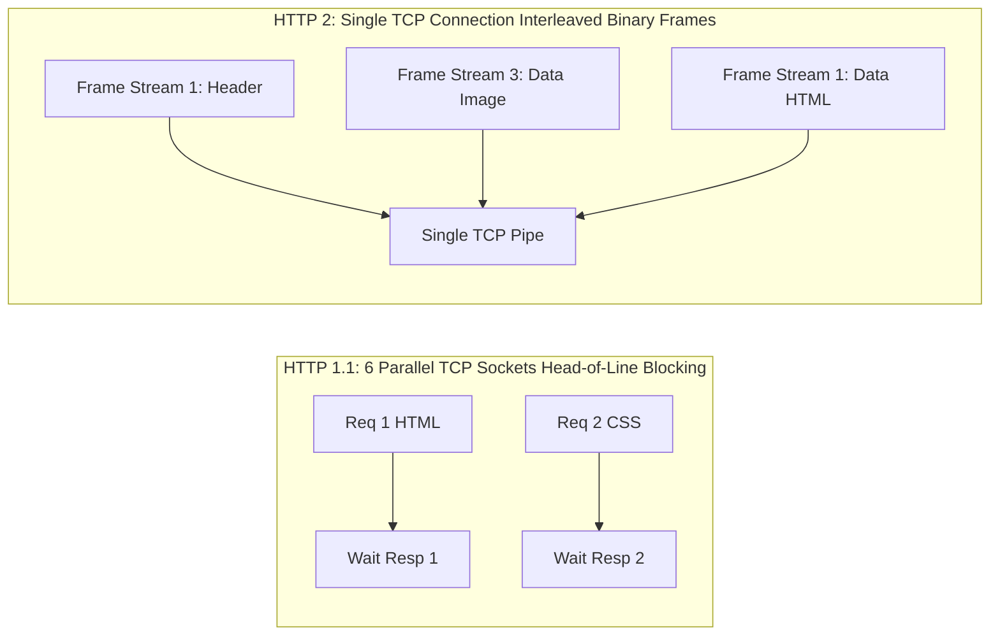

# Modul 136: Layer 4 Transport: Protokol End-to-End (UDP Rendah-Latensi, TCP Handshake, Flow Control, CUBIC, BBR, QUIC)

**Navigasi**: [⬅️ Master Index](../../INDEX.md) | [Tingkat 8: Tingkat 8: Pemrosesan Sinyal Digital, Telekomunikasi & Network Engineering](./README.md)
*Sebelumnya*: [135. layer-3-routing-algoritma-protokol-global](./135-layer-3-routing-algoritma-protokol-global.md) | *Berikutnya*: [137. layer-7-application-protokol-layanan-internet](./137-layer-7-application-protokol-layanan-internet.md)

---

## 1. Intuisi Dasar Tanpa Jargon ("Seperti Bayi Baru Lahir")
World Wide Web dimulai pada tahun 1991 sebagai dokumen teks sederhana yang dihubungkan dengan hyperlink biru. Protokol aslinya, HTTP/1.0 dan HTTP/1.1, dirancang dengan model yang sangat lugu: satu permintaan dikirim, dan browser harus menunggu jawaban kembali sebelum bisa meminta file gambar berikutnya (antre satu per satu di kasir toko). Ketika halaman web modern membengkak menjadi ratusan skrip JavaScript dan gambar, HTTP/1.1 tercekik kehabisan napas. Protokol Aplikasi Web Modern ([HTTP/1 vs HTTP/2 vs HTTP/3](https://web.dev/articles/performance-http2)) adalah revolusi kecepatan data: **HTTP/2** memecah percakapan menjadi frame-frame biner kecil yang dapat diselipkan secara simultan dalam satu koneksi tunggal (**Multiplexing**); **WebSocket** mendobrak batasan web request-response menjadi saluran radio percakapan dua arah (Full-Duplex) untuk obrolan real-time; dan **gRPC Protocol Buffers** menghadirkan komunikasi antar-microservice ultra-cepat berbasis biner terkompresi ketat yang membuat format teks JSON terasa sangat lambat.

## 2. Fondasi Teoretis & Aksiomatik / Matematis
Evolusi Arsitektur Protokol Web dan Komparasi Kinerja Teknis:

$$\begin{array}{|l|c|c|c|c|}
\hline
\textbf{Fitur} & \textbf{HTTP/1.1} & \textbf{HTTP/2} & \textbf{HTTP/3} & \textbf{gRPC} \\
\hline
\text{Transport} & \text{TCP} & \text{TCP + TLS} & \mathbf{QUIC \text{ (UDP)}} & \text{HTTP/2 / HTTP/3} \\
\text{Format Framing} & \text{Teks ASCII mentah} & \text{Biner (Frames)} & \text{Biner (QUIC Frames)} & \mathbf{Protocol Buffers (Biner)} \\
\text{Multiplexing} & \text{Tidak (Pipelining rentan HoL)} & \text{Ya (Multi-Stream di 1 TCP)} & \mathbf{Ya (Multi-Stream True Independent)} & \text{Ya} \\
\text{Kompresi Header} & \text{Tidak Ada} & \text{HPACK (Huffman + Table)} & \text{QPACK (Out-of-order safe)} & \text{HPACK} \\
\text{Model Interaksi} & \text{Request-Response} & \text{Request-Response + Server Push} & \text{Request-Response} & \text{Unary, Client/Server/Bidi Streaming} \\
\hline
\end{array}$$

Efisiensi Kompresi Serialisasi Biner Protocol Buffers (Varint Encoding):

Setiap field integer dienkode menggunakan skema **Variable-Length Quantity (Varint)** 7-bit per byte:
- Bit ke-7 (MSB): *Continuation Bit* (1 = ada byte berikutnya, 0 = byte terakhir).
- Bit [6:0]: Muatan data integer sesungguhnya.
Nilai integer kecil seperti `int32 x = 5;` hanya memakan **1 byte** biner di Protobuf (dibandingkan `"x": 5` yang memakan 6 byte teks ASCII di JSON!).

## 3. Anatomi Teknis & Cara Kerja Internal
Arsitektur Multiplexing Aliran Biner HTTP/2 vs Penanganan Head-of-Line Blocking:



1. **Protokol WebSocket Handshake**: Dimulai sebagai HTTP/1.1 request biasa dengan header `Upgrade: websocket` dan `Connection: Upgrade`. Server membalas dengan status `HTTP/101 Switching Protocols` dan hash SHA-1 dari `Sec-WebSocket-Key`, mengubah socket TCP seketika menjadi saluran full-duplex tanpa overhead header HTTP lagi ([RFC 6455 WebSocket Spec](https://datatracker.ietf.org/doc/html/rfc6455)).

## 4. Implementasi Praktis & Kode / Simulasi Riil
```python
# Protocol Buffers Minimal Varint Encoder and Decoder in Python
from typing import Tuple

def encode_varint(value: int) -> bytes:
    """Mengompresi integer tak bertanda menjadi barisan byte Varint Protobuf."""
    result = bytearray()
    while value >= 0x80:
        result.append((value & 0x7F) | 0x80) # Set MSB continuation bit
        value >>= 7
    result.append(value & 0x7F)
    return bytes(result)

def decode_varint(buffer: bytes, offset: int = 0) -> Tuple[int, int]:
    """Mendekode integer dari barisan byte Varint. Mengembalikan (nilai, panjang_byte)."""
    value = 0
    shift = 0
    read_bytes = 0
    while True:
        byte = buffer[offset + read_bytes]
        read_bytes += 1
        value |= (byte & 0x7F) << shift
        if not (byte & 0x80): break # MSB == 0 menandakan akhir integer
        shift += 7
    return value, read_bytes

assert decode_varint(encode_varint(300))[0] == 300
print("Protobuf Varint encoder/decoder validated!")
```

## 5. Miskonsepsi & Jebakan Industri
1. **HTTP/2 TCP Head-of-Line Blocking on Lossy Networks**: Pada jaringan seluler dengan packet loss 2%, seluruh aliran multiplexing di dalam koneksi tunggal HTTP/2 akan tertahan bersamaan saat satu segmen TCP hilang, membuat HTTP/2 berjalan lebih lambat daripada 6 koneksi paralel HTTP/1.1 (solusi: migrasi ke HTTP/3 QUIC).
2. **WebSocket Memory Leaks on Stale Connections**: Mengabaikan mekanisme Ping/Pong Heartbeat pada server WebSocket. Jutaan koneksi klien zombie yang telah kehilangan koneksi internet tanpa mengirim FIN akan tetap menghuni RAM server selamanya.
3. **HPACK Bomb (Decompression Bomb Attack)**: Menggunakan tabel dinamis HPACK HTTP/2 untuk memperluas header berulang kali hingga memicu pemborosan memori gigabyte di reverse proxy server.

## 6. Proyek Latihan & Rubrik Penilaian Mandiri
1. **Tingkat Pemula**: Kirimkan permintaan manual HTTP/1.1 mentah menggunakan utilitas `curl -v http://example.com` atau terminal `nc example.com 80`. Identifikasi header request, response code, dan Transfer-Encoding.
2. **Tingkat Menengah**: Bangun aplikasi chat ruang publik multi-klien sederhana di Python menggunakan library `websockets`. Tangani broadcast pesan ke seluruh klien aktif dan bersihkan koneksi saat klien disconnect.
3. **Tingkat Mahir**: Definisikan skema Protocol Buffers (`.proto`) untuk layanan microservice telemetri sensor (ID, timestamp int64, array float sensor). Kompilasi menggunakan `protoc`, buat server gRPC di C++/Go/Python yang mengimplementasikan Server-Streaming RPC, dan ukur throughput pesan per detik melawan REST/JSON.

## 7. Rekomendasi Sumber Belajar Standar Emas
| Sumber Pembelajaran | Penulis / Institusi | Tautan Langsung | Fokus Materi |
| :--- | :--- | :--- | :--- |
| RFC 9113: HTTP/2 Specification | M. Thomson & C. Benfield (IETF) | [IETF RFC 9113](https://datatracker.ietf.org/doc/html/rfc9113) | Standar Resmi HTTP/2 Binary Framing, Streams, Multiplexing & HPACK |
| RFC 9114: HTTP/3 (HTTP over QUIC) | Mike Bishop (Akamai / IETF) | [IETF RFC 9114](https://datatracker.ietf.org/doc/html/rfc9114) | Standar Resmi HTTP/3, QPACK Header Compression & QUIC Stream Mapping |
| gRPC Core Architecture and Concepts | Google Cloud / gRPC Authors | [gRPC Official Documentation](https://grpc.io/docs/what-is-grpc/core-concepts/) | Protocol Buffers, HTTP/2 Transport, Streaming RPC Models & CodeGen |
| RFC 6455: The WebSocket Protocol | I. Fette & A. Melnikov (Google) | [IETF RFC 6455](https://datatracker.ietf.org/doc/html/rfc6455) | Opening Handshake, Data Framing, Masking & Heartbeat PING/PONG |

---
*Navigasi Cepat*: [Ke Tingkat 8](./README.md) | [Ke Master Index](../../INDEX.md) | *Sebelumnya*: [135. layer-3-routing-algoritma-protokol-global](./135-layer-3-routing-algoritma-protokol-global.md) | *Berikutnya*: [137. layer-7-application-protokol-layanan-internet](./137-layer-7-application-protokol-layanan-internet.md)
