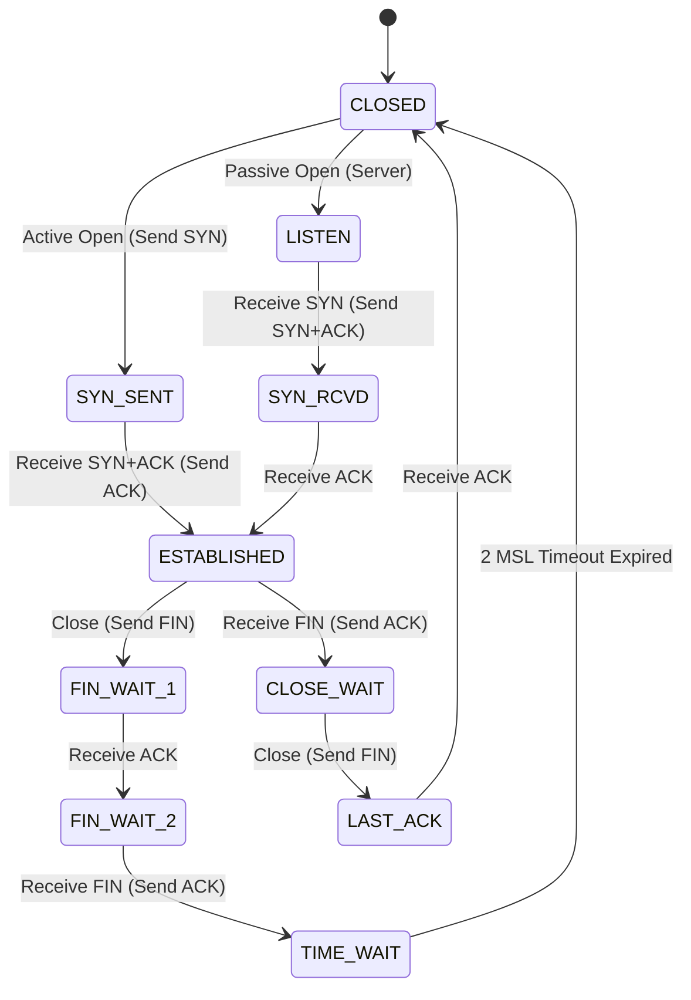

# Modul 136: Layer 4 Transport: Protokol End-to-End (UDP Rendah-Latensi, TCP Handshake, Flow Control, CUBIC, BBR, QUIC)

**Navigasi**: [⬅️ Master Index](../../INDEX.md) | [Tingkat 8: Tingkat 8: Pemrosesan Sinyal Digital, Telekomunikasi & Network Engineering](./README.md)
*Sebelumnya*: [135. layer-3-routing-algoritma-protokol-global](./135-layer-3-routing-algoritma-protokol-global.md) | *Berikutnya*: [137. layer-7-application-protokol-layanan-internet](./137-layer-7-application-protokol-layanan-internet.md)

---

## 1. Intuisi Dasar Tanpa Jargon ("Seperti Bayi Baru Lahir")
### 1.1 Konsep Inti & Analogi Tanpa Jargon
Internet pada dasarnya adalah sistem pos yang ceroboh dan tidak bertanggung jawab: protokol IP di bawah sana tidak peduli apakah paket data Anda hilang tenggelam di kabel bawah laut, tiba dalam keadaan rusak, atau sampai dengan urutan yang terbalik. Transmission Control Protocol (TCP) ([TCP Congestion Control & Architecture](https://datatracker.ietf.org/doc/html/rfc9293)) adalah insinyur jenius yang menyulap jalan tol liar tersebut menjadi koneksi yang 100% andal, teratur, dan beradab. Sebelum mengirim data, TCP melakukan jabat tangan santun tiga langkah (**Three-Way Handshake**); ia memberi nomor urut pada setiap byte data (**Sequence Numbers**) agar dapat disusun rapi kembali; ia mengatur laju aliran data agar penerima tidak kebanjiran (**Sliding Window**); dan ia memiliki indera peraba ajaib yang mendeteksi kemacetan lalu lintas internet (**Congestion Control Reno & BBR**) untuk memeras kecepatan transfer maksimal tanpa pernah meruntuhkan jaringan.

### 1.2 Urgensi Rekayasa & Signifikansi Sistemik
Dalam rekayasa sistem modern, pemahaman mendalam tentang konsep ini membedakan arsitek sistem kelas dunia dari sekadar operator perkakas teknis.

## 2. Fondasi Teoretis & Aksiomatik / Matematis
### 2.1 Kerangka Teori Aksiomatik & Formulasi Matematis
Arsitektur Kendali Aliran (Flow Control) dan Algoritma Kendali Kongesti TCP (Congestion Control):

### 2.2 Penurunan Matematis Langkah-demi-Langkah
1. **Mekanisme Jabat Tangan 3-Langkah (Three-Way Handshake) & Penutupan 4-Langkah**:
   $$\text{Koneksi: } \text{Client} \xrightarrow{\text{SYN (seq}=x\text{)}} \text{Server} \xrightarrow{\text{SYN-ACK (seq}=y, \text{ack}=x+1\text{)}} \text{Client} \xrightarrow{\text{ACK (seq}=x+1, \text{ack}=y+1\text{)}} \text{Server}$$
   $$\text{Terminasi: } \text{FIN} \to \text{ACK} \to \text{FIN} \to \text{ACK} \implies \text{Status } \texttt{TIME\_WAIT} \text{ (2 MSL } \approx 60-120\text{ detik)}$$

2. **Jendela Geser dan Kendali Aliran (Sliding Window Flow Control)**:
   Jumlah byte maksimal yang diizinkan mengudara tanpa konfirmasi (*Bytes in Flight*) dibatasi oleh:
   $$\text{Send Window} = \min(\text{CWND}, \ \text{RWND})$$
   Di mana $\text{CWND}$ adalah Congestion Window (estimasi kapasitas jaringan) dan $\text{RWND}$ adalah Receiver Advertised Window (kapasitas buffer penerima).

3. **Evolusi Algoritma Kendali Kongesti TCP**:
   - **TCP Reno (Loss-Based AIMD)**:
     Additive Increase Multiplicative Decrease: menaikkan CWND sebesar 1 MSS per RTT saat sukses, dan memotong CWND menjadi \$50\%$ seketika saat terdeteksi *Packet Loss*.
   - **Google TCP BBR (Bottleneck Bandwidth and RTT, 2016)**:
     Model berbasis laju transfer murni (*Model-based Congestion Control*). BBR mengukur secara simultan bandwidth bottleneck maksimum ($BtlBw$) dan delay propagasi bolak-balik minimum ($RTprop$):
     $$\text{Target CWND} = BtlBw \times RTprop \quad (\text{Bandwidth-Delay Product / BDP})$$
     BBR tidak memotong kecepatan hanya karena packet loss acak di radio nirkabel, melipatgandakan kecepatan internet di jaringan seluler!

## 3. Anatomi Teknis & Cara Kerja Internal
Mesin Status Sambungan TCP (TCP State Machine) dan Transisi Status:



1. **Tujuan Status `TIME_WAIT` (2 MSL)**: Menjamin bahwa paket ACK penutup terakhir benar-benar diterima oleh pihak lawan, dan membiarkan paket-paket tua yang tersesat di internet (*duplicate delayed packets*) mati secara alami sebelum nomor port yang sama dialokasikan kembali untuk koneksi baru ([Vincent Bernat TCP TIME_WAIT Guide](https://vincent.bernat.ch/en/blog/2014-tcp-time-wait-state-linux)).
2. **Algoritma Nagle vs TCP_NODELAY**: Algoritma Nagle menahan transmisi paket kecil hingga paket sebelumnya di-ACK atau data terkumpul 1 MSS penuh. Pada aplikasi interaktif (game online, SSH), Nagle memicu delay 40-200 ms fatal; wajib dinonaktifkan menggunakan socket option `setsockopt(fd, IPPROTO_TCP, TCP_NODELAY, &one, sizeof(one))`.

#### Tabel Penelusuran State Machine Jabat Tangan 3-Arah TCP & Mitigasi SYN Flood (SYN Cookies)
| Aksi Pertukaran Paket | State Klien (Client) | State Server Tradisional | State Server Modern (SYN Cookie) | Alokasi Tumpukan Memori TCB | Status Ketahanan Terhadap Serangan |
|---|---|---|---|---|---|
| Klien Kirim `SYN` (Seq: $x$) | `SYN_SENT` | Menerima SYN | Menerima SYN | Server biasa: Alokasi 280 byte TCB di memori | Menunggu `ACK` klien |
| Serangan: 1 Juta SYN Palsu| Penyerang palsukan IP | Masuk ke antrean `SYN_RECV` | - | **SYN QUEUE PENUH (MEMORY EXHAUSTION)!**| Server menolak koneksi sah baru! |
| Mitigasi SYN Cookie | - | - | **NOL ALOKASI TCB MEMORI DI AWAL!** | Server menghitung cookie kriptografis $y$ | Bebas dari serangan kejenuhan memori |
| Respon: `SYN-ACK` (Seq: $y$)| Membaca $y$ | Menunggu $ACK$ | $y = \text{Hash}(IP_s, IP_d, Port_s, Port_d, Time) \oplus MSS$ | Tidak ada state yang disimpan di server! | Respon terkirim instan |
| Klien Kirim `ACK` (Ack: $y+1$)| `ESTABLISHED` | - | Server memverifikasi: $\text{Cookie Valid}?$ | Jika cookie valid: Alokasi TCB baru dibuat | Koneksi sah terbentuk sempurna! |

## 4. Implementasi Praktis & Kode / Simulasi Riil
```c
// Demonstrating TCP Socket Tuning for High-Performance Networking in C
#include <stdio.h>
#include <stdlib.h>
#include <unistd.h>
#include <netinet/in.h>
#include <netinet/tcp.h>
#include <sys/socket.h>

void tune_tcp_socket_performance(int socket_fd) {
    int optval = 1;
    
    // 1. Nonaktifkan Algoritma Nagle untuk melenyapkan latensi transmisi paket kecil
    if (setsockopt(socket_fd, IPPROTO_TCP, TCP_NODELAY, &optval, sizeof(optval)) < 0) {
        perror("Failed to set TCP_NODELAY");
    }

    // 2. Perbesar ukuran buffer transmisi dan penerimaan kernel (SDR BDP Tuning)
    int buffer_size = 4 * 1024 * 1024; // 4 MB Buffer untuk link berkecepatan tinggi
    setsockopt(socket_fd, SOL_SOCKET, SO_RCVBUF, &buffer_size, sizeof(buffer_size));
    setsockopt(socket_fd, SOL_SOCKET, SO_SNDBUF, &buffer_size, sizeof(buffer_size));

    // 3. Aktifkan TCP Quick ACK (lewati delayed ACK penundaan 40ms)
    setsockopt(socket_fd, IPPROTO_TCP, TCP_QUICKACK, &optval, sizeof(optval));

    printf("TCP Socket successfully tuned for ultra-low latency & high throughput!\n");
}
```

## 5. Miskonsepsi & Jebakan Industri
1. **SYN Flood Denial of Service Attack**: Penyerang membanjiri server dengan jutaan paket SYN beralamat IP palsu tanpa pernah mengirim ACK balasan. Antrean koneksi setengah jadi kernel (**SYN Backlog Queue**) akan penuh, menolak seluruh koneksi pengguna asli (solusi: aktifkan fitur kernel `net.ipv4.tcp_syncookies = 1`).
2. **TCP TIME_WAIT Port Exhaustion on Load Balancers**: Reverse proxy membuka dan menutup ribuan koneksi TCP ke backend server per detik. Karena setiap socket tertahan dalam status `TIME_WAIT` selama 60 detik, sistem kehabisan port lokal sementara (*Ephemeral Ports*), menghasilkan error `EADDRNOTAVAIL` (solusi: gunakan HTTP Keep-Alive connection pooling).
3. **Bufferbloat Disaster in Loss-Based Congestion Control**: Router jaringan memiliki buffer antrean paket raksasa. TCP Reno akan terus memompa data hingga buffer penuh sesak sebelum terjadi loss, meningkatkan latensi ping dari 20 ms melonjak hingga 2000 ms (solusi: gunakan algoritma antrean modern CoDel / FQ-CoDel dan TCP BBR).

### Studi Kasus Kegagalan Nyata: Serangan TCP SYN Flood Pertama di Dunia yang Melumpuhkan ISP Panix New York (September 1996)
- **Kronologi & Konteks Sejarah**: Pada awal September 1996, Panix (salah satu penyedia layanan internet / ISP komersial tertua di dunia yang berbasis di New York City) menjadi korban salah satu serangan Denial of Service terkoordinasi paling bersejarah: serangan TCP SYN Flood massal pertama di internet publik.
- **Akar Masalah Protokol Transport TCP & Alokasi State Memori TCB**: Jabat tangan tiga arah TCP (*3-Way Handshake*) mengharuskan server mengalokasikan blok kontrol transmisi memori (*Transmission Control Block / TCB*) berukuran ratusan byte di kernel saat menerima paket `SYN` pertama, lalu menunggu paket `ACK` balasan dari klien dalam antrean status setengah-terbuka (*Half-Open Connection Queue*). Penyerang mengirimkan ribuan paket `SYN` per detik dengan memalsukan alamat IP asal (*IP Spoofing*) ke alamat acak yang tidak ada. Server Panix merespons dengan paket `SYN-ACK` ke alamat palsu tersebut dan menunggu konfirmasi `ACK` yang tidak akan pernah datang hingga batas waktu timeout ($75\text{ detik}$). Dalam hitungan menit, antrean koneksi setengah terbuka penuh terisi, menyebabkan kernel menolak seluruh koneksi pelanggan sah dan melumpuhkan layanan email, web, dan akses dial-up seluruh kota New York selama lebih dari satu minggu.

- **Potongan Kode / Arsitektur Cacat (Vulnerable Implementation)**:
```c
// Rekonstruksi Mekanisme Penanganan TCP SYN Cookie (net/ipv4/syncookies.c)
#include <stdint.h>

// Formula Matematika Pembangkitan SYN Cookie Kriptografis (Dan Bernstein)
// Menyandikan status koneksi langsung ke dalam 32-bit Sequence Number awal:
uint32_t generate_tcp_syn_cookie(uint32_t saddr, uint32_t daddr, 
                                 uint16_t sport, uint16_t dport, 
                                 uint32_t sseq, uint8_t mss_index) {
    uint32_t count = get_current_time_counter_minute(); // 5 bit (berubah tiap 60 detik)
    uint32_t hash = compute_siphash_24(saddr, daddr, sport, dport, count);
    
    // 32-bit Initial Sequence Number (ISN) dipecah menjadi:
    // [Bit 31..27]: Waktu Counter (5 bit)
    // [Bit 26..24]: Indeks MSS (3 bit)
    // [Bit 23..0]:  Hash Rahasia Server (24 bit)
    uint32_t cookie = (count << 27) | ((mss_index & 0x07) << 24) | (hash & 0x00FFFFFF);
    return cookie; // Nol alokasi memori heap di kernel server!
}
```

- **Analisis Forensik & Rekayasa Modern**: Serangan terhadap Panix melahirkan salah satu inovasi pertahanan paling elegan dalam sejarah jaringan: *SYN Cookies* yang dirancang oleh Daniel J. Bernstein dan Eric Schenk. Dengan menyandikan seluruh informasi status koneksi dan indeks MSS langsung ke dalam nomor urut awal (*Sequence Number*) paket respons, server tidak perlu menyimpan state memori sedikitpun di kernel hingga jabat tangan selesai, mengeliminasi serangan kehabisan memori SYN Flood secara tuntas dan diadopsi oleh seluruh sistem operasi modern.

## 6. Proyek Latihan & Rubrik Penilaian Mandiri
1. **Tingkat Pemula**: Gunakan utilitas baris perintah `ss -tan` atau `netstat -tan` untuk melihat seluruh status koneksi TCP di komputer Anda. Identifikasi koneksi dalam status `ESTABLISHED`, `LISTEN`, dan `TIME_WAIT`.
2. **Tingkat Menengah**: Tulis skrip simulasi di Python yang memodelkan grafik pertambahan dan pemotongan ukuran `CWND` algoritma TCP Reno AIMD (Additive Increase, Multiplicative Decrease) selama 50 putaran RTT dengan asumsi terjadi packet loss pada putaran ke-20 dan ke-35.
3. **Tingkat Mahir**: Implementasikan pengontrol kongesti BBR mini atau baca modul kernel Linux BBR (`net/ipv4/tcp_bbr.c`). Aktifkan modul BBR di sistem Linux Anda (`sysctl net.ipv4.tcp_congestion_control=bbr`) dan uji benchmark throughput transfer data melawan TCP CUBIC pada jaringan dengan loss rate 5% menggunakan alat `iperf3`.

### Tingkat 1: Dasar
- **Tugas**: Bangun implementasi simulasi jabat tangan 3-arah TCP (*TCP 3-Way Handshake State Machine*) mandiri dalam Python/C yang memodelkan transisi state sisi klien (`CLOSED` $\to$ `SYN_SENT` $\to$ `ESTABLISHED`) dan sisi server (`LISTEN` $\to$ `SYN_RCVD` $\to$ `ESTABLISHED`), lengkap dengan pelacakan nomor urut *Sequence Number* dan *Acknowledgment Number*.
- **Petunjuk Perancangan Arsitektur**:
  - Klien memilih ISN acak $x$; Server memilih ISN acak $y$.
  - Paket balasan server menyertakan $Ack = x + 1$; Paket balasan akhir klien menyertakan $Ack = y + 1$.
- **Test Vector & Kasus Uji Ekstrem**:
  - *Jabat Tangan Sempurna*: Klien memulai dengan Seq 5000; server merespons dengan Seq 9000, Ack 5001; klien mengirim Ack 9001; buktikan kedua pihak bertransisi ke state `ESTABLISHED`.
- **Rubrik Penilaian Mandiri**: 40% Mesin State Jabat Tangan TCP yang Akurat, 30% Perhitungan Sequence/Ack Number yang Tepat, 30% Kerapian Enkapsulasi Kode.

### Tingkat 2: Menengah
- **Tugas**: Kembangkan algoritma kendali kemacetan TCP *Sliding Window & Congestion Control* (Tahap *Slow Start*, *Congestion Avoidance*, *Fast Retransmit*, dan *Fast Recovery* mirip TCP Reno) dalam simulator paket diskret sederhana.
- **Petunjuk Perancangan Arsitektur**:
  - Pada Slow Start: gandakan Congestion Window ($CWND = CWND \times 2$) setiap Round Trip Time (RTT).
  - Saat $CWND \ge SSTHRESH$: naikkan secara linier ($CWND = CWND + 1$ per RTT).
  - Saat menerima 3 duplikasi ACK (*3 Duplicate ACKs*): picu Fast Retransmit dan potong $CWND$ menjadi separuhnya ($CWND = CWND / 2$).
- **Test Vector & Kasus Uji Ekstrem**:
  - *Simulasi Kehilangan Paket*: Suntikkan kehilangan paket pada $CWND = 32$; buktikan jendela dipotong menjadi 16 (Multiplicative Decrease) tanpa kembali ke 1.
- **Rubrik Penilaian Mandiri**: 40% Siklus Algoritma TCP Reno Lengkap, 30% Logika Deteksi 3 Duplicate ACKs yang Benar, 30% Visualisasi Grafik Pertumbuhan Jendela CWND.

### Tingkat 3: Mahir
- **Tugas**: Rancang implementasi validator dan pembangkit *TCP SYN Cookies* mandiri dalam C yang mengompresi alamat IP 4-tupel, stempel waktu modulo 32 menit, dan indeks tabel Maximum Segment Size (MSS) ke dalam integer 32-bit tanpa alokasi memori heap, mampu memverifikasi keaslian paket ACK balasan dengan toleransi waktu kadaluarsa presisi.
- **Petunjuk Perancangan Arsitektur**:
  - Gunakan fungsi hash cepat (SipHash atau MurmurHash) dengan kunci rahasia per-boot.
  - Verifikasi integritas hash dan selisih waktu counter saat paket final ACK tiba.
- **Test Vector & Kasus Uji Ekstrem**:
  - *Serangan Spoofing Palsu*: Masukkan paket ACK dengan sequence number acak palsu; verifikasi fungsi menolak paket dengan `false`; Masukkan paket ACK balasan dari SYN cookie sah; verifikasi fungsi menerima dengan `true` dan merekonstruksi nilai MSS yang benar.
- **Rubrik Penilaian Mandiri**: 40% Algoritma Kriptografis Pembangkitan SYN Cookie yang Benar, 30% Verifikasi ACK Statless Bebas State Heap, 30% Validasi Batas Waktu Kadaluarsa.

## 7. Rekomendasi Sumber Belajar Standar Emas
| Sumber Pembelajaran | Penulis / Institusi | Tautan Langsung | Fokus Materi |
| :--- | :--- | :--- | :--- |
| RFC 9293: Transmission Control Protocol (TCP) Specification | IETF Standards Track | [IETF RFC 9293](https://datatracker.ietf.org/doc/html/rfc9293) | Spesifikasi Resmi Modern TCP: State Machine, Header Format & Handshake |
| BBR: Congestion-Based Congestion Control | Neal Cardwell, Yuchung Cheng et al. (Google) | [ACM Queue BBR Paper](https://queue.acm.org/detail.cfm?id=3022184) | Makalah Orisinal Penemuan Algoritma Google TCP BBR Congestion Control |
| TCP/IP Illustrated, Volume 1 (TCP Chapters) | W. Richard Stevens | [Stevens TCP/IP Volume 1](https://www.pearson.com/en-us/subject-catalog/p/tcp-ip-illustrated-volume-1-the-protocols/P200000003267) | Bab 17 s.d. 24: TCP Connection Setup, Timeout, Retransmission, Reno |
| Coping with the TCP TIME_WAIT State | Vincent Bernat | [Vincent Bernat Blog](https://vincent.bernat.ch/en/blog/2014-tcp-time-wait-state-linux) | Analisis Mendalam Siklus TIME_WAIT, SO_REUSEADDR & Kernel TCB Cleanup |

---
*Navigasi Cepat*: [Ke Tingkat 8](./README.md) | [Ke Master Index](../../INDEX.md) | *Sebelumnya*: [135. layer-3-routing-algoritma-protokol-global](./135-layer-3-routing-algoritma-protokol-global.md) | *Berikutnya*: [137. layer-7-application-protokol-layanan-internet](./137-layer-7-application-protokol-layanan-internet.md)
