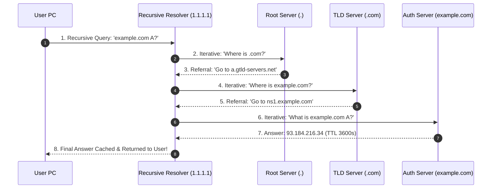

# Modul 137: Layer 7 Application: Protokol Layanan Internet (DHCP, DNS/DNSSEC, NTP, HTTP/1.1 s/d HTTP/3, gRPC, WebSockets)

**Navigasi**: [⬅️ Master Index](../../INDEX.md) | [Tingkat 8: Tingkat 8: Pemrosesan Sinyal Digital, Telekomunikasi & Network Engineering](./README.md)
*Sebelumnya*: [136. layer-4-transport-protokol-end-to-end](./136-layer-4-transport-protokol-end-to-end.md) | *Berikutnya*: [138. keamanan-infrastruktur-jaringan-lanjut](./138-keamanan-infrastruktur-jaringan-lanjut.md)

---

## 1. Intuisi Dasar Tanpa Jargon ("Seperti Bayi Baru Lahir")
### 1.1 Konsep Inti & Analogi Tanpa Jargon
Manusia mengingat nama orang dan merek dagang seperti `google.com` atau `wikipedia.org`, tetapi router internet hanya mengerti deretan angka biner heksadesimal seperti `142.250.190.46` atau `2a00:1450:4001:830::200e`. Sistem Nama Domain (Domain Name System / DNS) ([How DNS Works](https://www.cloudflare.com/learning/dns/what-is-dns/)) adalah buku telepon raksasa terdesentralisasi terbesar di jagat maya. Ketika Anda mengetik sebuah alamat web, komputer Anda memulai petualangan detektif kilat dalam hitungan milidetik: bertanya ke Recursive Resolver lokal; jika belum tahu, bertanya ke 13 gugus Root Name Servers dunia ('.'); lalu diarahkan ke Top-Level Domain ('.com'); hingga akhirnya menyentuh Authoritative Name Server milik pemilik web asli. Dan untuk mencegah hacker memalsukan alamat bank Anda di tengah jalan, perisai kriptografi **DNSSEC** membubuhkan tanda tangan digital anti-pemalsuan pada setiap jawaban domain.

### 1.2 Urgensi Rekayasa & Signifikansi Sistemik
Dalam rekayasa sistem modern, pemahaman mendalam tentang konsep ini membedakan arsitek sistem kelas dunia dari sekadar operator perkakas teknis.

## 2. Fondasi Teoretis & Aksiomatik / Matematis
### 2.1 Kerangka Teori Aksiomatik & Formulasi Matematis
Hierarki Pohon DNS Terdistribusi dan Formalisme Catatan Sumber Daya (Resource Records):

### 2.2 Penurunan Matematis Langkah-demi-Langkah
Format Struktur Catatan DNS Standar (RFC 1035):
$$\text{Resource Record (RR)} = \{\text{NAME}, \ \text{TYPE}, \ \text{CLASS (IN)}, \ \text{TTL (detik)}, \ \text{RDATA}\}$$

Tipe Catatan DNS Utama:
- **`A`**: Memetakan domain ke alamat IPv4 32-bit (misal `93.184.216.34`).
- **`AAAA`**: Memetakan domain ke alamat IPv6 128-bit.
- **`CNAME` (Canonical Name)**: Alias yang mengarahkan satu nama domain ke nama domain kanonikal lain (tidak boleh berdampingan dengan catatan lain pada level apex!).
- **`MX` (Mail Exchange)**: Menentukan server penerima email dengan nomor prioritas integer.
- **`TXT`**: Menyimpan teks bebas untuk verifikasi kepemilikan domain (SPF, DKIM, DMARC).

Rantai Kepercayaan Kriptografi **DNSSEC (DNS Security Extensions - RFC 4033)**:
Menegakkan integritas data tanpa enkripsi kerahasiaan:
$$\text{Root Trust Anchor} \xrightarrow{\text{DS Record}} \text{TLD KSK} \xrightarrow{\text{DS Record}} \text{Domain KSK} \xrightarrow{\text{ZSK}} \text{RRSIG (Tanda Tangan ECDSA / RSA)}$$
Resolving DNS resolver memverifikasi bahwa hash publik pada `DS` cocok dengan kunci publik `DNSKEY`, membuktikan jawaban 100% otentik dari pemilik aslinya.

## 3. Anatomi Teknis & Cara Kerja Internal
Alur Kerja Resolusi DNS: Recursive Query vs Iterative Query Resolution:



1. **DNS Cache Poisoning / Kaminsky Attack (2008)**: Penyerang membanjiri Recursive Resolver dengan ribuan tebakan Transaction ID (16-bit) dan port acak UDP secara serentak untuk menyuntikkan catatan IP palsu ke dalam cache resolver sebelum jawaban asli tiba ([Dan Kaminsky DNS Flaw Analysis](https://www.cloudflare.com/learning/dns/dns-cache-poisoning/)).
2. **DNS over HTTPS (DoH) / DNS over TLS (DoT)**: Mengenkripsi kueri DNS pengguna melalui tunnel TLS port 443 / 853, mencegah ISP atau hacker di jaringan Wi-Fi publik memata-matai situs apa saja yang sedang Anda kunjungi.

#### Tabel Penelusuran Serangan Kaminsky DNS Cache Poisoning (CVE-2008-1447)
| Langkah Penyerangan | Transaksi Kueri DNS Dikirim | Domain Ditanyakan (*Random Subdomain*) | 16-Bit Transaction ID ($TXID$) | Port Sumber Kueri UDP ($Port_{src}$) | Status Cache DNS Resolver Server |
|---|---|---|---|---|---|
| Resolver Normal | Kueri Domain Sah | `bank.com` | Acak (16 bit: 0..65535) | Port tetap: `Port 53` (Cacat Klasik!)| Bersih |
| Serangan Kaminsky 1 | Memicu resolver kueri | `sub1.bank.com` (Subdomain unik acak!) | Resolver kirim kueri ke Authoritative | Tetap pada Port 53 statis | Menunggu jawaban resmi |
| Serbuan Paket Palsu | Penyerang membanjiri jawaban | Menjawab untuk `sub1.bank.com` | Tebak acak: kirim ribuan paket palsu | Membidik Port 53 statis | Mencari kecocokan 1 dari 65.536 TXID |
| Sisipkan Otoritas Palsu| Jawaban palsu menyertakan: | Field Authority: `NS = ns.evil.com` | Jika salah: Kueri gagal, TAPI TIDAK DI-CACHE!| Penyerang coba lagi via `sub2`, `sub3`... | Ruang tebakan dicoba tanpa henti! |
| Tebakan Cocok (Hit!) | TXID cocok dalam 10 detik! | Resolver menerima jawaban palsu | **TXID COCOK DENGAN KUERI ASLI!** | Resolver memperbarui Authoritative NS! | **SELURUH DOMAIN `bank.com` TERBAJAK DI CACHE!** |
| Mitigasi Dan Kaminsky | Sumber Port Acak (SPR) | Port sumber diacak penuh (16 bit) | Total kombinasi: $65.536 \times 65.536 \approx 4.29$ Miliar! | Tebakan brute force butuh waktu bertahun-tahun | Serangan digagalkan secara mutlak |

## 4. Implementasi Praktis & Kode / Simulasi Riil
```python
# Raw DNS Query Construction and UDP Resolution in Pure Python (RFC 1035)
import socket
import struct

def build_dns_query(domain_name: str, query_type_a=1) -> bytes:
    # Header: ID=0x1337, Flags=0x0100 (Standard Query, Recursion Desired)
    # QDCOUNT=1, ANCOUNT=0, NSCOUNT=0, ARCOUNT=0
    header = struct.pack('!HHHHHH', 0x1337, 0x0100, 1, 0, 0, 0)

    # Format QNAME: 'example.com' -> \x07example\x03com\x00
    qname = b''
    for label in domain_name.split('.'):
        qname += struct.pack('B', len(label)) + label.encode('ascii')
    qname += b'\x00'

    # Question: QTYPE=1 (A), QCLASS=1 (IN)
    question = qname + struct.pack('!HH', query_type_a, 1)
    return header + question

def query_dns_server(domain: str, dns_ip="1.1.1.1") -> bytes:
    sock = socket.socket(socket.AF_INET, socket.SOCK_DGRAM)
    sock.settimeout(3.0)
    query_packet = build_dns_query(domain)
    sock.sendto(query_packet, (dns_ip, 53))
    response_data, _ = sock.recvfrom(1024)
    sock.close()
    return response_data
```

## 5. Miskonsepsi & Jebakan Industri
1. **CNAME at Apex / Zone Apex Problem**: Mencoba membuat catatan `CNAME` pada domain utama telanjang (`example.com`). Spesifikasi RFC melarang catatan CNAME hidup berdampingan dengan catatan `SOA` dan `NS` pada zone apex (solusi: gunakan catatan alias buatan vendor seperti Cloudflare CNAME Flattening atau ANAME).
2. **Excessively Long TTL Stalling Emergency Failover**: Menetapkan durasi Time-to-Live (TTL) sebesar 86.400 detik (24 jam) untuk catatan IP server produksi. Ketika server crash dan Anda harus mengalihkan IP ke data center cadangan, ribuan resolver internet akan tetap mengarahkan pengguna ke server yang mati selama 24 jam.
3. **Negative Caching Black Hole**: Menanyakan subdomain yang belum terdaftar sehingga resolver meng-cache balasan `NXDOMAIN` (Non-Existent Domain) sesuai waktu TTL SOA. Meskipun Anda langsung mendaftarkan domain tersebut sedetik kemudian, resolver akan terus melaporkan domain tidak ada hingga TTL negatif kadaluarsa.

### Studi Kasus Kegagalan Nyata: Bencana Kerentanan Keracunan Tembolok Global Kaminsky DNS Cache Poisoning (CVE-2008-1447)
- **Kronologi & Konteks Sejarah**: Pada Juli 2008, peneliti keamanan Dan Kaminsky menemukan kerentanan fundamental yang melumpuhkan fondasi kepercayaan seluruh sistem nama domain internet (Domain Name System / DNS) di dunia.
- **Akar Masalah Protokol Lapisan Aplikasi DNS & Ruang Entropi UDP**: Protokol DNS berjalan di atas UDP tanpa koneksi. Untuk mencocokkan respon dengan permintaan yang dikirim, DNS mengandalkan field 16-bit *Transaction ID* (TXID) yang hanya memiliki $65.536$ kemungkinan nilai. Pada serangan DNS poisoning lama, jika penyerang gagal menebak TXID, server DNS lokal akan menyimpan jawaban negatif (*negative cache*) selama durasi TTL, mencegah penyerang mencoba lagi. Namun, Dan Kaminsky menemukan trik cerdas: penyerang meminta resolver mencari subdomain acak yang tidak pernah ada (misal `random123.bank.com`, `random124.bank.com`). Setiap kali kueri baru dikirim, resolver dipaksa melakukan lookup baru ke internet. Penyerang membanjiri resolver dengan ribuan jawaban palsu yang tidak hanya menjawab kueri subdomain tersebut, tetapi juga menyisipkan delegasi server nama otoritatif palsu (*Additional Authority Records*) untuk seluruh domain induk `bank.com`. Karena server resolver hanya menggunakan nomor port sumber UDP statis (port 53), penyerang berhasil menebak TXID dalam waktu kurang dari 10 detik, membajak seluruh lalu lintas perbankan dan email domain target secara permanen di cache resolver.

- **Potongan Kode / Arsitektur Cacat (Vulnerable Implementation)**:
```python
# Simulasi Probabilitas Keberhasilan Serangan Kaminsky DNS Cache Poisoning
import math

def calculate_kaminsky_poisoning_time(queries_per_sec=1000, spoofed_responses_per_query=50):
    # Ruang entropi TXID 16-bit: 65.536 kemungkinan
    # Ruang port UDP statis: 1 kemungkinan (Port 53)
    total_entropy_classic = 65536
    
    # Peluang sukses menebak TXID pada 1 percobaan kueri:
    # Menggunakan pendekatan paradoks ulang tahun: P(sukses) ~ 1 - exp(- (q * r) / N)
    print("ANALISIS ENTROPI DNS KLASIK (Port Statis 53):")
    attempts_needed_50_percent = int(total_entropy_classic / spoofed_responses_per_query * 0.693)
    time_seconds = attempts_needed_50_percent / queries_per_sec
    print(f"Percobaan Dibutuhkan (P=50%): {attempts_needed_50_percent} kueri")
    print(f"Waktu Penyerangan Dibutuhkan: {time_seconds:.2f} detik (Sangat Cepat & Fatal!)")
    
    print("\nMITIGASI DENGAN SOURCE PORT RANDOMIZATION (SPR):")
    # Entropi digabungkan: 16-bit TXID * 16-bit Port (sekitar 60.000 port dinamis)
    total_entropy_modern = 65536 * 60000 # ~3.93 Miliar kemungkinan!
    attempts_modern = int(total_entropy_modern / spoofed_responses_per_query * 0.693)
    time_modern_days = (attempts_modern / queries_per_sec) / 86400
    print(f"Percobaan Dibutuhkan: {attempts_modern} kueri")
    print(f"Waktu Penyerangan Dibutuhkan: {time_modern_days:.1f} hari (Mustahil secara praktis!)")

calculate_kaminsky_poisoning_time()
```

- **Analisis Forensik & Rekayasa Modern**: Kerentanan Kaminsky memicu operasi penambalan terkoordinasi paling rahasia dan terbesar dalam sejarah internet global, melibatkan Microsoft, Cisco, ISC (BIND), dan vendor sistem operasi dunia. Mitigasi daruratnya adalah *Source Port Randomization* (SPR) yang mengacak nomor port sumber UDP klien secara independen dari 60.000 port dinamis, melipatgandakan ruang entropi tebakan menjadi miliaran. Solusi keamanan permanen jangka panjangnya adalah adopsi *DNSSEC* (Domain Name System Security Extensions) yang menggunakan tanda tangan kriptografi asimetris untuk memverifikasi keaslian setiap rekor DNS secara matematis.

## 6. Proyek Latihan & Rubrik Penilaian Mandiri
1. **Tingkat Pemula**: Gunakan utilitas baris perintah `dig` atau `nslookup` untuk menanyakan catatan `A`, `AAAA`, `MX`, dan `TXT` dari domain `google.com`. Catat nilai TTL dan IP server resolver yang menjawab.
2. **Tingkat Menengah**: Tulis parser balasan DNS di Python yang mem-parse byte biner keluaran `query_dns_server()` di atas. Tangani dekompresi pointer DNS (*DNS Pointer Compression* offset `0xC0`) dan cetak alamat IP akhir yang diekstrak dari RDATA.
3. **Tingkat Mahir**: Bangun server proxy DNS lokal berkemampuan DNS-over-HTTPS (DoH). Terima kueri UDP standar port 53 dari sistem operasi lokal, bungkus kueri ke dalam payload HTTP/2 POST berformat `application/dns-message` ke Cloudflare DoH (`https://1.1.1.1/dns-query`), dan kembalikan balasannya ke OS.

### Tingkat 1: Dasar
- **Tugas**: Bangun pembuat dan pengurai kueri DNS (*DNS Query Builder & Parser*) mandiri dalam Python/C menggunakan socket UDP mentah (`SOCK_DGRAM`) yang mengemas pesan kueri DNS Tipe A (IPv4) standar RFC 1035 untuk domain tertentu, mengirimkannya ke resolver publik (seperti `1.1.1.1` atau `8.8.8.8`), dan membongkar alamat IP dari rekor jawaban (*Answer Resource Record*).
- **Petunjuk Perancangan Arsitektur**:
  - Format nama domain berlabel: string `"google.com"` dikodekan menjadi `[6, 'g', 'o', 'o', 'g', 'l', 'e', 3, 'c', 'o', 'm', 0]`.
  - Atur field Header DNS: `ID (16 bit)`, `Flags (0x0100 untuk Recursion Desired)`, `QDCOUNT = 1`.
- **Test Vector & Kasus Uji Ekstrem**:
  - *Kueri Riil*: Kirim kueri untuk `"one.one.one.one"`; buktikan parser membaca alamat IP `1.1.1.1` dari paket balasan UDP.
- **Rubrik Penilaian Mandiri**: 40% Pengemasan Header dan Pertanyaan DNS Sesuai RFC 1035, 30% Pembongkaran Rekor Jawaban IP yang Benar, 30% Kerapian Enkapsulasi Socket.

### Tingkat 2: Menengah
- **Tugas**: Kembangkan server proksi DNS tembolok (*Caching DNS Forwarder*) dalam Python/C yang mengimplementasikan mitigasi pertahanan *Source Port Randomization* (mengacak port lokal UDP antara 1024 dan 65535 pada setiap kueri keluar), melacak TTL rekor, dan menyimpan jawaban di cache in-memory untuk melayani kueri berulang tanpa menanyakan kembali ke internet.
- **Petunjuk Perancangan Arsitektur**:
  - Buka soket UDP baru dengan `bind(0)` untuk setiap kueri upstream agar port lokal dipilih secara acak oleh kernel OS.
  - Hapus entri cache secara otomatis saat durasi TTL kedaluwarsa.
- **Test Vector & Kasus Uji Ekstrem**:
  - *Audit Entropi*: Catat 100 kueri berurutan; pastikan tidak ada port UDP sumber yang berulang dan seluruh nilai Transaction ID terdistribusi secara seragam (*uniform entropy*).
- **Rubrik Penilaian Mandiri**: 40% Penerapan Source Port Randomization dan TXID Acak yang Kuat, 30% Manajemen Kedaluwarsa TTL Cache yang Benar, 30% Throughput Proksi Cepat.

### Tingkat 3: Mahir
- **Tugas**: Rancang validator tanda tangan kriptografis *DNSSEC Validator* mandiri dalam Python yang membaca dan memverifikasi rantai kepercayaan (*Chain of Trust*): memverifikasi tanda tangan digital `RRSIG` pada rekor DNS menggunakan kunci publik `DNSKEY`, serta memverifikasi delegasi signer `DS` (Delegation Signer) dari zona akar (*Root Zone*) hingga zona target menggunakan algoritma RSA / ECDSA SHA-256.
- **Petunjuk Perancangan Arsitektur**:
  - Urutkan dan kanonikalisasi rekor DNS sebelum melakukan hash kriptografi sesuai RFC 4034.
  - Bangun rantai kepercayaan hirarkis: `Root Anchor -> TLD .com DS -> Domain DS -> DNSKEY -> RRSIG`.
- **Test Vector & Kasus Uji Ekstrem**:
  - *Uji Integritas DNSSEC*: Verifikasi domain tervalidasi DNSSEC resmi (seperti `cloudflare.com`); buktikan validator menyimpulkan `SECURE`; modifikasi satu byte pada payload data; buktikan validator menolak dengan status `BOGUS / SIGNATURE_VERIFICATION_FAILED`.
- **Rubrik Penilaian Mandiri**: 40% Verifikasi Kriptografis RRSIG dan DNSKEY yang Presisi, 30% Rekonstruksi Rantai Kepercayaan DNSSEC Lengkap, 30% Deteksi Dini Data Palsu/Manipulasi.

## 7. Rekomendasi Sumber Belajar Standar Emas
| Sumber Pembelajaran | Penulis / Institusi | Tautan Langsung | Fokus Materi |
| :--- | :--- | :--- | :--- |
| RFC 1035: Domain Names - Implementation and Specification | Paul Mockapetris (ISI) | [IETF RFC 1035](https://datatracker.ietf.org/doc/html/rfc1035) | Standar Spesifikasi Asli DNS: Message Formats, RR Types & Compression |
| RFC 4033: DNS Security Introduction and Requirements (DNSSEC) | R. Arends et al. | [IETF RFC 4033](https://datatracker.ietf.org/doc/html/rfc4033) | Arsitektur Kriptografi DNSSEC, RRSIG, DS Records & Chain of Trust |
| Cloudflare Learning Center: What is DNS? | Cloudflare Engineering | [Cloudflare DNS Learning](https://www.cloudflare.com/learning/dns/what-is-dns/) | DNS Recursion, Anycast Routing, DNS Poisoning & DoH/DoT Security |
| DNS and BIND, 5th Edition | Cricket Liu & Paul Albitz (O'Reilly) | [O'Reilly DNS and BIND](https://www.oreilly.com/library/view/dns-and-bind/0596100574/) | Panduan Konfigurasi Praktis Server BIND, Zone Transfers & Split-Horizon |

---
*Navigasi Cepat*: [Ke Tingkat 8](./README.md) | [Ke Master Index](../../INDEX.md) | *Sebelumnya*: [136. layer-4-transport-protokol-end-to-end](./136-layer-4-transport-protokol-end-to-end.md) | *Berikutnya*: [138. keamanan-infrastruktur-jaringan-lanjut](./138-keamanan-infrastruktur-jaringan-lanjut.md)
