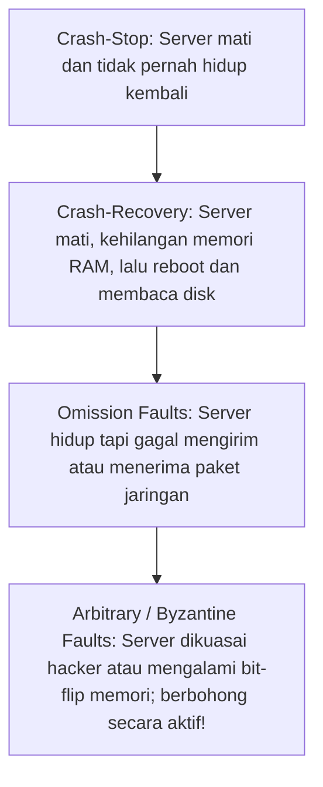

# Modul 138: Keamanan & Infrastruktur Jaringan Lanjut (Stateful Firewalls, IDS/IPS Suricata, VPN WireGuard/IPsec, CDN, DDoS)

**Navigasi**: [⬅️ Master Index](../../INDEX.md) | [Tingkat 8: Tingkat 8: Pemrosesan Sinyal Digital, Telekomunikasi & Network Engineering](./README.md)
*Sebelumnya*: [137. layer-7-application-protokol-layanan-internet](./137-layer-7-application-protokol-layanan-internet.md) | *Berikutnya*: [139. software-defined-networking-sdn-otomasi](./139-software-defined-networking-sdn-otomasi.md)

---

## 1. Intuisi Dasar Tanpa Jargon ("Seperti Bayi Baru Lahir")
Menulis program yang berjalan di satu komputer terasa aman dan teratur: jika baris 1 selesai, baris 2 pasti dieksekusi; jika variabel disimpan di RAM, nilainya tidak akan hilang sedetik kemudian. Namun ketika program Anda dipecah menjadi ribuan server yang tersebar di Singapura, Frankfurt, dan Virginia, dunia berubah menjadi mimpi buruk ketidakpastian. Fondasi Sistem Terdistribusi ([Distributed Systems Foundations](https://www.cl.cam.ac.uk/teaching/2021/ConcDisSys/dist-sys-notes.pdf)) adalah seni membangun sistem andal di atas fondasi yang rapuh: pesan di jaringan bisa terlambat berjam-jam, tiba dua kali, atau hilang tanpa jejak; server bisa mati mendadak atau berjalan sangat lambat seperti mayat hidup; dan jika Anda mengirim pesan ke server lain dan tidak ada balasan, Anda secara matematis **tidak pernah tahu** apakah server tersebut mati, jaringan terputus, atau server tersebut telah memproses pesanan Anda namun balasan konfirmasinya yang hilang di jalan (masalah abadi Two Generals Problem)!

## 2. Fondasi Teoretis & Aksiomatik / Matematis
Model Kegagalan Sistem Terdistribusi dan Ketidakmungkinan Konsensus FLP (Fischer-Lynch-Paterson, 1985):

1. **Taksonomi Model Waktu Sistem Terdistribusi**:
   - **Synchronous Model**: Terdapat batas atas pasti ($\Delta$) untuk delay pengiriman pesan jaringan dan kecepatan komputasi prosesor. (Tidak realistis di internet nyata!).
   - **Asynchronous Model**: Pesan jaringan dijamin sampai pada akhirnya, namun **tidak ada batasan waktu maksimum** berapa lama pesan boleh terlambat, dan tidak ada jam global bersama. (Model internet nyata!).
   - **Partially Synchronous**: Sistem berperilaku asinkron pada awalnya, lalu setelah waktu tertentu (*Global Stabilization Time / GST*), sistem beralih menjadi sinkron dengan batas keterlambatan $\Delta$.

2. **Teorema Ketidakmungkinan FLP (Impossibility of Distributed Consensus)**:
   $$\text{Dalam model sistem asinkron murni, tidak ada algoritma konsensus deterministik yang dapat menjamin}$$   $$\text{kesepakatan jika bahkan hanya SATU server saja yang dapat mengalami kegagalan crash secara tiba-tiba!}$$
   Oleh karena itu, algoritma konsensus dunia nyata (Paxos, Raft) wajib mengasumsikan model sinkron sebagian atau menggunakan timer timeout probabilistik.

3. **Two Generals' Problem (Masalah Dua Jenderal)**:
   Dua jenderal ingin menyerang benteng musuh secara serentak. Kurir pembawa pesan dapat ditangkap musuh di lembah.
   Terbukti secara matematis bahwa tidak ada protokol jabat tangan konfirmasi berhingga ($K$ pesan) yang dapat menjamin kesepakatan mutlak 100% melintasi saluran komunikasi yang tidak andal.

## 3. Anatomi Teknis & Cara Kerja Internal
Spektrum Model Kegagalan Komputasi Terdistribusi (Hierarchy of Failure Modes):



1. **Batas Teorema Byzantine Fault Tolerance (BFT)**:
   Untuk mentoleransi $f$ buah server pengkhianat/Byzantine yang berbohong atau mengirim informasi bertentangan secara licik, sistem wajib memiliki total minimal server:
   $$N \ge 3f + 1$$
   (Sebagai contoh, untuk bertahan dari 1 hacker jahat, Anda membutuhkan minimal 4 server independen) ([Castro & Liskov PBFT Paper](https://pmg.csail.mit.edu/papers/osdi99.pdf)).

## 4. Implementasi Praktis & Kode / Simulasi Riil
```python
# Simulating Asynchronous Network Message Delay and Two Generals Uncertainty in Python
import random
from typing import Optional

class UnreliableNetworkChannel:
    def __init__(self, packet_loss_prob=0.3):
        self.packet_loss_prob = packet_loss_prob

    def send_message(self, message: str) -> Optional[str]:
        # Simulasikan kurir yang tertangkap musuh
        if random.random() < self.packet_loss_prob:
            return None # Paket hilang di jalan (Timeout)
        return f"ACK: Received '{message}'"

def execute_general_attack_plan():
    net = UnreliableNetworkChannel(packet_loss_prob=0.4)
    proposal = "Attack at Dawn"
    
    # Jenderal 1 mengirim pesan ke Jenderal 2
    response = net.send_message(proposal)
    if response is None:
        # DILEMA MATEMATIS SISTEM TERDISTRIBUSI:
        # Apakah Jenderal 2 tidak pernah menerima pesan? 
        # ATAU Jenderal 2 telah menerima pesan dan setuju, namun konfirmasi balasan ACK yang hilang?
        print("[Dilemma] Jenderal 1 tidak tahu status Jenderal 2! Menyerang sendirian adalah bunuh diri!")
    else:
        print(f"[Success] Jenderal 1 menerima: {response}")
```

## 5. Miskonsepsi & Jebakan Industri
1. **The Fallacies of Distributed Computing (Peter Deutsch, 1994)**: Berasumsi bahwa 'Jaringan selalu andal', 'Latensi bernilai nol', 'Bandwidth tidak terbatas', dan 'Topologi jaringan tidak pernah berubah'. Mengabaikan salah satu ilusi ini menjamin crash arsitektur pada skala produksi ([Deutsch 8 Fallacies of Distributed Systems](https://en.wikipedia.org/wiki/Fallacies_of_distributed_computing)).
2. **Cascading Failure Storm via Tight Retries**: Ketika database downstream melambat, ribuan klien serentak melakukan retry permintaan secara agresif tanpa *Exponential Backoff* dan *Jitter*, menumpuk jutaan request baru yang menghancurkan server hingga lumpuh total.
3. **Split-Brain Disaster**: Jaringan terputus di tengah data center, membelah klaster menjadi dua pulau terisolasi. Jika kedua pulau menganggap pihak seberang telah mati dan keduanya mengangkat 'Leader' baru secara sepihak, keduanya akan menulis data yang saling bertentangan secara permanen.

## 6. Proyek Latihan & Rubrik Penilaian Mandiri
1. **Tingkat Pemula**: Sebutkan dan jelaskan secara singkat '8 Fallacies of Distributed Computing' dan berikan contoh konkret kegagalan dunia nyata untuk setiap falasi.
2. **Tingkat Menengah**: Buktikan secara matematis melalui penalaran induksi bahwa Two Generals' Problem tidak dapat diselesaikan dengan pasti dalam protokol jabat tangan pesan yang memiliki jumlah langkah berhingga $N$.
3. **Tingkat Mahir**: Bangun simulator jaringan asinkron di Python yang menyimulasikan 5 node proses terdistribusi dengan penundaan transmisi acak (0 hingga 2000 ms), duplikasi paket, dan packet drops. Terapkan protokol pertukaran status detak jantung (*Heartbeat Gossip Protocol*) dengan estimasi detektor kegagalan adaptif ($\Phi$-Accrual Failure Detector).

## 7. Rekomendasi Sumber Belajar Standar Emas
| Sumber Pembelajaran | Penulis / Institusi | Tautan Langsung | Fokus Materi |
| :--- | :--- | :--- | :--- |
| Designing Data-Intensive Applications (DDIA) | Martin Kleppmann (Univ. of Cambridge) | [O'Reilly DDIA Book](https://dataintensive.net/) | Bab 8: The Trouble with Distributed Systems (Unreliable Networks & Clocks) |
| Impossibility of Distributed Consensus with One Faulty Process | Fischer, Lynch, Paterson | [ACM JACM 1985 (FLP Paper)](https://dl.acm.org/doi/10.1145/3149.214121) | Makalah Orisinal Pembuktian Teorema Ketidakmungkinan Konsensus FLP |
| Distributed Systems: Principles and Paradigms | Maarten van Steen & Andrew S. Tanenbaum | [Distributed Systems Book Free](https://www.distributed-systems.net/index.php/books/ds4/) | Arsitektur Sistem Terdistribusi, Model Komunikasi, Sinkronisasi & Toleransi |
| Practical Byzantine Fault Tolerance (PBFT) | Miguel Castro & Barbara Liskov (MIT) | [MIT PBFT Paper](https://pmg.csail.mit.edu/papers/osdi99.pdf) | Replikasi State Machine BFT, Konsensus Byzantine 3f+1 & Quorum |

---
*Navigasi Cepat*: [Ke Tingkat 8](./README.md) | [Ke Master Index](../../INDEX.md) | *Sebelumnya*: [137. layer-7-application-protokol-layanan-internet](./137-layer-7-application-protokol-layanan-internet.md) | *Berikutnya*: [139. software-defined-networking-sdn-otomasi](./139-software-defined-networking-sdn-otomasi.md)
