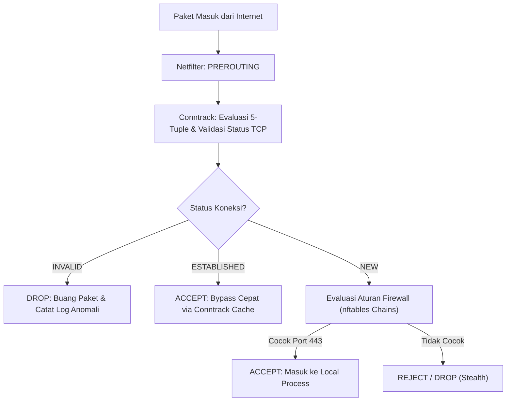

# Modul 138: Keamanan & Infrastruktur Jaringan Lanjut (Stateful Firewalls, IDS/IPS Suricata, VPN WireGuard/IPsec, CDN, DDoS)

**Navigasi**: [⬅️ Master Index](../../INDEX.md) | [Tingkat 8: Tingkat 8: Pemrosesan Sinyal Digital, Telekomunikasi & Network Engineering](./README.md)
*Sebelumnya*: [137. layer-7-application-protokol-layanan-internet](./137-layer-7-application-protokol-layanan-internet.md) | *Berikutnya*: [139. software-defined-networking-sdn-otomasi](./139-software-defined-networking-sdn-otomasi.md)

---

## 1. Intuisi Dasar Tanpa Jargon ("Seperti Bayi Baru Lahir")
### 1.1 Internet: Lingkungan Publik yang Penuh Ancaman ([Network Security Fundamentals](https://datatracker.ietf.org/doc/html/rfc2196))
Ketika komputer Anda terhubung ke internet, ia berada di jaringan publik terbuka di mana jutaan botnet, skrip scanner otomatis, dan penyerang tingkat negara bagian (*state-sponsored actors*) terus-menerus memindai setiap alamat IP yang aktif untuk mencari kelemahan port atau celah keamanan layanan.

### 1.2 Membangun Benteng Berlapis: Firewall, IDS/IPS, dan VPN ([The Practical Packet Analysis Guide](https://nostarch.com/packetanalysis3))
Keamanan jaringan modern tidak mengandalkan satu gembok tunggal, melainkan arsitektur pertahanan berlapis (*Defense-in-Depth*):
1. **Stateful Firewall (iptables / nftables)**: Tidak hanya memeriksa alamat IP asal dan tujuan, tetapi melacak *status koneksi* di memori kernel (apakah paket ini adalah bagian dari koneksi sah yang dimulai dari dalam, atau upaya penyusupan baru dari luar).
2. **Intrusion Detection/Prevention System (Suricata / Snort)**: Bertindak seperti pemindai bagasi sinar-X yang memeriksa isi muatan data paket (*Deep Packet Inspection / DPI*) untuk mencocokkan tanda tangan malware atau pola serangan zero-day.
3. **Virtual Private Network (WireGuard / IPsec)**: Membangun "terowongan terenkripsi aman" melintasi internet publik, menyamarkan seluruh lalu lintas dari penyadap dan penyedia internet.
4. **Mitigasi Serangan DDoS (Cloudflare / Arbor Networks)**: Menyerap dan menyaring banjir miliaran paket sampah (*Distributed Denial of Service*) menggunakan jaringan Anycast global.

## 2. Fondasi Teoretis & Aksiomatik / Matematis
### 2.1 Formulasi State Machine Tabel Pelacakan Koneksi (Conntrack) ([Linux Kernel Netfilter Conntrack](https://www.netfilter.org/documentation/resources/conntrack-paper.pdf))
Sebuah firewall stateful memodelkan koneksi transport TCP sebagai mesin keadaan hingga (*Finite State Machine*).
Sebuah tuple koneksi 5-elemen (*5-Tuple*) didefinisikan secara unik:
$$\mathcal{T} = (\text{src\_ip}, \text{dst\_ip}, \text{src\_port}, \text{dst\_port}, \text{protocol})$$
Status conntrack diklasifikasikan ke dalam 4 keadaan deterministik:
1. `NEW`: Paket SYN pertama yang sah memulai koneksi.
2. `ESTABLISHED`: Respon SYN-ACK dan ACK telah diterima dua arah.
3. `RELATED`: Koneksi sekunder terkait (misal transfer data FTP pasif atau ICMP Error).
4. `INVALID`: Paket yang melanggar aturan urutan nomor *Sequence / Acknowledgment* atau memiliki flag TCP abnormal (misal paket SYN-FIN atau data tanpa handshake).

Peluang paket `INVALID` lolos disaring secara ketat:
$$P(\text{Accept} \mid \text{State} = \text{INVALID}) = 0$$

### 2.2 Matematika Kriptografi VPN Modern: WireGuard vs IPsec ([Jason A. Donenfeld, 2017](https://www.wireguard.com/papers/wireguard.pdf))
WireGuard merancang protokol kriptografi minimalis modern berbasis Noise Protocol Framework:
- Pertukaran Kunci (*Key Exchange*): Curve25519 (Diffie-Hellman eliptik)
- Autentikasi Pesan & Enkripsi: ChaCha20-Poly1305 (AEAD)
- Fungsi Hash Kriptografis: BLAKE2s
Kelebihan mendasar WireGuard dibandingkan IPsec/OpenVPN adalah konsep **Cryptokey Routing**:
Tabel routing kernel memetakan alamat IP publik tunnel langsung ke Kunci Publik statis peer:
$$\text{Table}[\text{AllowedIP}] \leftrightarrow \text{PublicKey}$$
Jika paket terenkripsi didekripsi dengan kunci privat yang sah namun alamat IP sumber internalnya tidak cocok dengan daftar `AllowedIPs` kunci publik tersebut, paket langsung dibuang seketika tanpa memicu jejak respons, membuat server WireGuard sepenuhnya "senyap dan tak kasat mata" (*stealth mode*) terhadap pemindai port port scanning.

## 3. Anatomi Teknis & Cara Kerja Internal


#### Tabel Walkthrough Penanganan Paket Stateful Firewall pada Serangan SYN Flood
| Langkah | Jenis Paket Masuk | Flag TCP | Status Conntrack | Aksi Firewall | Alokasi Memori Kernel |
|---|---|---|---|---|---|
| 1 | SYN Normal | `SYN` | `NEW` | Izinkan & Catat di Tabel Conntrack | Alokasikan struktur `nf_conn` |
| 2 | SYN Banjir Liar | `SYN` (Spoofed IP) | `NEW` (Trafik > Ambang) | Aktifkan **SYN Cookies** | **0 Byte Alokasi!** |
| 3 | Paket Palsu Tanpa Handshake | `ACK` | `INVALID` | **DROP Seketika** | Tidak ada |
| 4 | Paket Respon Sah | `SYN-ACK` | `ESTABLISHED` | Verifikasi SYN Cookie -> Buka Koneksi | Alokasi aman |

#### Tabel Penelusuran Serangan DDoS Terdistribusi Botnet Mirai (2016)
| Gelombang Serangan | Vektor Penetrasi IoT | Protokol Banjir Trafik | Karakteristik Paket Serangan | Volume Lalu Lintas Agregat | Status Penyedia DNS Dyn & Internet Pantai Timur AS |
|---|---|---|---|---|---|
| Fase 1: Infeksi Botnet | Pindai port Telnet 23 / 2323 | Brute-force 60 pasang kredensial default | Ambil alih kamera CCTV, router rumahan | 600.000 perangkat IoT terinfeksi | Botnet tertidur menunggu komando C2 |
| Fase 2: Perintah Serang | Sinyal C2 diluncurkan | Banjir UDP / DNS Water Torture | Kueri acak: `[random].dyn.com` | Ratusan juta paket UDP per detik | Bandwidth transit gateway Dyn jenuh |
| Fase 3: Saturasi Pipa | Ratusan gigabit membanjiri | Amplifikasi GRE / TCP SYN Flood | Header paket dipalsukan acak | **PEAK: 1.2 TERABIT PER DETIK!** | Saluran serat optik fisik uplink saturasi 100% |
| Fase 4: Keruntuhan DNS | Authoritative Server Dyn tumbang | Kueri sah diabaikan | Paket sah tenggelam dalam antrean drop | DNS resolver dunia gagal lookup | **INTERNET GLOBAL LUMPUH!** (Twitter, Netflix, Spotify mati) |
| Mitigasi Anycast | Scrubbing Center & BGP Anycast | Rute dipecah ke 50 data center dunia | Penyerapan trafik terdistribusi | Volume lokal teredam $< 30\text{ Gbps}$ | Infrastruktur bertahan dari serangan terabyte |

## 4. Implementasi Praktis & Kode / Simulasi Riil
```bash
#!/usr/bin/env bash
# Skrip konfigurasi firewall stateful modern menggunakan nftables murni
set -euo pipefail

echo "Mengonfigurasi tabel firewall nftables tingkat produksi..."

nft -f - << 'EOF'
flush ruleset

table inet filter {
    chain input {
        type filter hook input priority filter; policy drop;

        # 1. Izinkan lalu lintas loopback lokal
        iifname "lo" accept

        # 2. Izinkan koneksi yang telah terjalin dan sah (Stateful)
        ct state established,related accept

        # 3. Buang seketika semua paket dengan status INVALID
        ct state invalid drop

        # 4. Pertahanan anti-ping flood (Batasi ICMP Echo ke 10 paket per detik)
        ip protocol icmp icmp type echo-request limit rate 10/second accept

        # 5. Izinkan port SSH (Port 22) dengan proteksi brute-force (Maks 5 koneksi baru per menit)
        tcp dport 22 ct state new meter ssh-meter { ip saddr limit rate 5/minute } accept
        tcp dport 22 drop

        # 6. Izinkan server web HTTPS (Port 443) dan HTTP (Port 80)
        tcp dport { 80, 443 } ct state new accept

        # Catat dan tolak sisa lalu lintas mencurigakan
        log prefix "NFTABLES-DROP: " flags all counter drop
    }

    chain forward {
        type filter hook forward priority filter; policy drop;
    }

    chain output {
        type filter hook output priority filter; policy accept;
    }
}
EOF

echo "Konfigurasi nftables berhasil dimuat ke kernel Linux!"
nft list ruleset
```

## 5. Miskonsepsi & Jebakan Industri
### Studi Kasus Kegagalan Nyata: Runtuhnya Layanan Dyn DNS Akibat Serangan Mirai Botnet DDoS (2016)
- **Kronologi & Latar Belakang**: Pada 21 Oktober 2016, penyedia infrastruktur DNS global Dyn diserang oleh banjir lalu lintas DDoS sebesar \$1.2 \text{ Tbps}$ dari ratusan ribu perangkat IoT (kamera IP, router rumahan) yang terinfeksi malware Mirai. Serangan ini melumpuhkan akses ke Twitter, Spotify, Netflix, Reddit, dan GitHub di seluruh Amerika Utara dan Eropa.
- **Akar Masalah**: Penyerang membanjiri server DNS Dyn dengan jutaan kueri rekursif nama domain acak (*Random Subdomain Attack / Pseudo-Random Domain Attack*). Karena setiap kueri meminta subdomain unik yang tidak pernah ada (seperti `a8f93.example.com`), mekanisme caching DNS tidak berfungsi, memaksa server DNS melakukan pencarian mendalam yang menghabiskan CPU dan tabel soket jaringan.
- **Rekomendasi Industri**: Terapkan jaringan **Anycast BGP** multi-region untuk mendistribusikan beban volume ke puluhan data center di seluruh dunia. Pasang sistem pemfilteran DDoS berbasis kecerdasan buatan (*Scrubbing Centers*) yang mampu mendeteksi kueri non-standar dan membatasi laju permintaan (*Rate Limiting*) sebelum paket mencapai server DNS inti.

### Studi Kasus Kegagalan Nyata: Serangan Siber Terdistribusi Botnet IoT Mirai yang Melumpuhkan DNS Dyn dan Internet Global (21 Oktober 2016)
- **Kronologi & Konteks Kasus**: Pada 21 Oktober 2016, infrastruktur penyedia DNS global Dyn (anak perusahaan Oracle) dihantam serangan Distributed Denial of Service (DDoS) multi-gelombang terbesar dalam sejarah hingga saat itu, dengan puncak volume mencapai lebih dari 1,2 Terabit per detik (Tbps).
- **Akar Masalah Keamanan Infrastruktur Jaringan & Perangkat IoT Lemah**: Serangan dilancarkan oleh Mirai, sebuah botnet yang menginfeksi lebih dari 600.000 perangkat cerdas Internet of Things (kamera pengawas CCTV, DVR video recorder, dan router rumahan). Perangkat-perangkat ini terpapar langsung ke internet publik dengan port manajemen Telnet (port 23/2323) terbuka dan menggunakan kombinasi nama pengguna dan kata sandi bawaan pabrik yang tidak pernah diubah (seperti `root:admin` atau `admin:12345`). Botnet Mirai membanjiri server nama otoritatif Dyn menggunakan kombinasi serangan multi-vektor: DNS Water Torture (kueri rekursif ke jutaan subdomain acak untuk menguras kapasitas cache), banjir fragmen UDP, dan TCP SYN floods. Serangan ini menghabiskan bandwidth fisik jaringan serat optik uplink Dyn, melumpuhkan resolusi domain untuk puluhan layanan digital raksasa dunia termasuk Twitter, GitHub, Spotify, Netflix, Reddit, dan PayPal selama lebih dari 10 jam.

- **Potongan Kode / Arsitektur Cacat (Vulnerable Implementation)**:
```c
// Rekonstruksi Tabel Kredensial Default Pemindaian Mirai Botnet (scanner.c)
#include <stdio.h>

// Basis data kamus kredensial statis pabrikan perangkat IoT yang dieksploitasi Mirai:
static char *mirai_dictionary_usernames[] = {
    "root", "admin", "user", "support", "guest", "default"
};

static char *mirai_dictionary_passwords[] = {
    "xc3511", "vizxv", "admin", "123456", "default", "password", 
    "root", "1234", "pass", "54321", "klm456", "juantech"
};

// Penyerang melakukan scanning port 23 TCP acak di seluruh ruang alamat IPv4 global:
void scan_and_infect_iot_device(const char *target_ip) {
    // Jika port 23 terbuka: coba pasangkan kombinasi kredensial bawaan:
    for (int u = 0; u < 6; u++) {
        for (int p = 0; p < 12; p++) {
            if (try_telnet_login(target_ip, mirai_dictionary_usernames[u], mirai_dictionary_passwords[p])) {
                // Infeksi sukses: unduh biner payload botnet dan matikan proses watchdog
                deploy_botnet_payload(target_ip);
                return;
            }
        }
    }
}
```

- **Analisis Forensik & Rekayasa Modern**: Serangan Mirai mengubah lanskap keamanan siber infrastruktur internet dunia. Standar rekayasa jaringan modern merespons melalui: (1) Adopsi arsitektur *BGP Anycast* masif pada penyedia DNS yang menyebarkan lalu lintas ke puluhan pusat penyaringan (*Scrubbing Centers*) di seluruh dunia; (2) Pengesahan regulasi internasional (seperti standar ISO/IEC 27402 dan undang-undang privasi IoT California/Inggris) yang melarang keras penggunaan password bawaan pabrik seragam pada perangkat keras konsumen.

## 6. Proyek Latihan & Rubrik Penilaian Mandiri
### Level 1 (Pemula)
- **Tugas**: Periksa status tabel pelacakan koneksi conntrack pada kernel Linux menggunakan perintah terminal `conntrack` atau `/proc/net/nf_conntrack`.
- **Petunjuk Arsitektur**: Jalankan perintah `cat /proc/sys/net/netfilter/nf_conntrack_count` untuk melihat jumlah koneksi aktif dan `cat /proc/sys/net/netfilter/nf_conntrack_max` untuk batas maksimalnya.
- **Vektor Uji**:
  - Amati apakah rasio `count / max` berada di bawah batas aman \$70\%$.
- **Rubrik Penilaian**: Verifikasi pembacaan conntrack (50%), analisis batas aman kapasitas (30%), kebersihan dokumentasi (20%).

### Level 2 (Menengah)
- **Tugas**: Tulis aturan deteksi IDS Suricata untuk mendeteksi upaya eksploitasi SQL Injection sederhana pada parameter URL HTTP GET (`UNION SELECT`).
- **Petunjuk Arsitektur**: Gunakan sintaks Suricata: `alert http any any -> any any (msg:"SQLi Attempt"; http_uri; content:"UNION"; nocase; content:"SELECT"; distance:0; sid:100001; rev:1;)`.
- **Vektor Uji**:
  - Uji lalu lintas dengan `curl "http://localhost/search?q=1%20UNION%20SELECT%20null,password"`. Aturan harus memicu alert log.
- **Rubrik Penilaian**: Ketepatan sintaks aturan Suricata (40%), penanganan case-insensitive (30%), uji verifikasi alert (30%).

### Level 3 (Mahir)
- **Tugas**: Konfigurasikan tunnel VPN WireGuard peer-to-peer antar dua namespace jaringan Linux terisolasi (`netns`) tanpa menggunakan perangkat keras fisik tambahan.
- **Petunjuk Arsitektur**: Buat dua namespace `ip netns add ns1` dan `ip netns add ns2`, buat pasangan interface `veth`, konfigurasi kunci privat/publik WireGuard dengan perintah `wg genkey`, dan uji transmisi ping terenkripsi.
- **Vektor Uji**:
  - Tangkap lalu lintas pada interface perantara `veth` menggunakan `tcpdump`.
  - Seluruh paket data ICMP harus terenkripsi sempurna sebagai paket UDP ChaCha20 tanpa muatan teks terbaca.
- **Rubrik Penilaian**: Isolasi namespace jaringan (40%), konfigurasi kriptografi WireGuard akurat (30%), verifikasi enkripsi paket (30%).

### Tingkat 1: Dasar
- **Tugas**: Bangun fungsi penyaring paket jaringan (*Stateless Packet Filter Firewall Rule Engine*) dalam Python/C yang memproses aliran paket, memeriksa tuple 5-parameter (IP Asal, IP Tujuan, Port Asal, Port Tujuan, Protokol), dan menerapkan kebijakan keamanan daftar kontrol akses (*Access Control List / ACL*) dengan aturan penolakan bawaan (*Default Deny*).
- **Petunjuk Perancangan Arsitektur**:
  - Evaluasi aturan secara berurutan (*First-Match Rule Processing*).
  - Terapkan tindakan `ACCEPT`, `DROP`, atau `REJECT` (dengan emisi paket reset TCP RST atau ICMP Destination Unreachable).
- **Test Vector & Kasus Uji Ekstrem**:
  - *Audit Kebijakan*: Suntikkan paket uji dengan port 23 (Telnet); pastikan aturan ACL memblokir paket seketika dan mencatat insiden keamanan ke log file.
- **Rubrik Penilaian Mandiri**: 40% Evaluasi Aturan 5-Tupel ACL yang Tepat, 30% Penegakan Prinsip Default Deny, 30% Logging Keamanan Terstruktur.

### Tingkat 2: Menengah
- **Tugas**: Kembangkan sistem pertahanan mitigasi laju trafik (*Token Bucket Rate Limiter*) dalam C/Python untuk melindungi server dari serangan banjir request HTTP/DNS, yang mengizinkan lalu lintas normal mengalir dan membatasi (*throttle/drop*) lonjakan trafik yang melebihi batas kapasitas burst bucket yang ditentukan per alamat IP klien.
- **Petunjuk Perancangan Arsitektur**:
  - Token ditambahkan ke ember dengan laju konstan $R$ token per detik hingga kapasitas maksimum $B$.
  - Setiap request membutuhkan 1 token; jika token habis, kembalikan kode status HTTP `429 Too Many Requests`.
- **Test Vector & Kasus Uji Ekstrem**:
  - *Uji Lonjakan*: Kapasitas bucket 100 token, laju refill 10 token/detik; kirim $150$ request dalam 1 detik; buktikan tepat 100 request pertama diloloskan dan 50 request sisanya ditolak dengan status 429.
- **Rubrik Penilaian Mandiri**: 40% Algoritma Token Bucket Dinamis yang Akurat, 30% Penanganan Laju Pengisian Ulang Token Presisi Waktu, 30% Efisiensi Memori Pelacakan Klien.

### Tingkat 3: Mahir
- **Tugas**: Rancang sistem deteksi dan mitigasi serangan DDoS berbasis pemfilteran paket berkecepatan kawat menggunakan *eBPF / XDP* (eXpress Data Path) di Linux yang memproses paket langsung pada lapisan driver kartu jaringan (NIC) sebelum menyentuh tumpukan memori kernel OS (*sk_buff allocation*), mampu membuang hingga 10 juta paket jahat per detik pada satu server tunggal.
- **Petunjuk Perancangan Arsitektur**:
  - Tulis program XDP C yang memeriksa header IP/UDP dan membandingkan IP asal terhadap tabel hitam (*Blacklist BPF Map*).
  - Kembalikan aksi `XDP_DROP` untuk membuang paket seketika di tingkat perangkat keras.
- **Test Vector & Kasus Uji Ekstrem**:
  - *Benchmark Pembuangan Paket*: Banjiri interface dengan $1.000.000$ paket UDP palsu per detik; buktikan program XDP membuang seluruh paket di tingkat NIC dengan utilisasi CPU host tetap rendah $< 5\%$.
- **Rubrik Penilaian Mandiri**: 40% Implementasi Filter Paket XDP Kernel Driver yang Benar, 30% Eliminasi Overhead Alokasi sk_buff, 30% Throughput Pembuangan Paket Ultra-Tinggi.

## 7. Rekomendasi Sumber Belajar Standar Emas
| Kategori | Judul Sumber & Tautan | Penulis / Institusi | Fokus Pembahasan |
|---|---|---|---|
| Paper WireGuard | [WireGuard: Next Generation Kernel Network Tunnel](https://www.wireguard.com/papers/wireguard.pdf) | Jason A. Donenfeld (2017) | Publikasi resmi protokol VPN modern berbasis kriptografi state-of-the-art |
| Dokumentasi Netfilter | [Netfilter and nftables Architecture Documentation](https://www.netfilter.org/documentation/) | Netfilter Core Team | Arsitektur hooks pemrosesan paket kernel Linux dan sintaks modern nftables |
| Standar Keamanan | [RFC 2196: Site Security Handbook](https://datatracker.ietf.org/doc/html/rfc2196) | IETF Network Working Group | Panduan formal perancangan kebijakan keamanan jaringan, firewall, dan mitigasi insiden |

---
*Navigasi Cepat*: [Ke Tingkat 8](./README.md) | [Ke Master Index](../../INDEX.md) | *Sebelumnya*: [137. layer-7-application-protokol-layanan-internet](./137-layer-7-application-protokol-layanan-internet.md) | *Berikutnya*: [139. software-defined-networking-sdn-otomasi](./139-software-defined-networking-sdn-otomasi.md)
