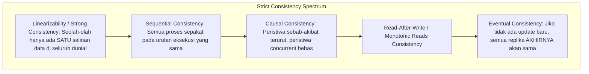

# Modul 140: Siklus Hidup Pengembangan Perangkat Lunak (SDLC, Agile, Scrum, Kanban, RFC, ADR, Technical Debt)

**Navigasi**: [⬅️ Master Index](../../INDEX.md) | [Tingkat 9: Tingkat 9: Software Engineering, Front-End, Back-End, Full-Stack & Cloud/SRE](./README.md)
*Sebelumnya*: [139. software-defined-networking-sdn-otomasi](../08-dsp-telekomunikasi-jaringan/139-software-defined-networking-sdn-otomasi.md) | *Berikutnya*: [141. penguasaan-git-tingkat-lanjut](./141-penguasaan-git-tingkat-lanjut.md)

---

## 1. Intuisi Dasar Tanpa Jargon ("Seperti Bayi Baru Lahir")
Bayangkan Anda mengelola cabang bank internasional dengan kantor di Jakarta dan London. Tiba-tiba, kabel serat optik bawah laut samudra putus total (Partisi Jaringan). Pada detik itu juga, seorang nasabah datang ke kantor cabang Jakarta ingin menarik seluruh uang tabungannya. Apa yang harus Anda lakukan? Jika Anda mengizinkan nasabah menarik uang, Anda memilih **Ketersediaan (Availability)**, tetapi Anda mengambil risiko bahwa cabang London tidak tahu uang tersebut sudah habis, membuka celah penarikan ganda (**Kehilangan Konsistensi**). Jika Anda menolak penarikan uang demi menjaga kebenaran saldo, Anda memilih **Konsistensi (Consistency)**, tetapi nasabah Anda marah karena sistem menolak melayaninya (**Kehilangan Ketersediaan**). **Teorema CAP & PACELC** ([CAP Theorem & PACELC](https://www.infoq.com/articles/cap-twelve-years-later-how-the-rules-have-changed/)) adalah hukum fisika tak terbantahkan sistem terdistribusi: Anda tidak bisa memiliki segalanya di dunia yang tidak sempurna!

## 2. Fondasi Teoretis & Aksiomatik / Matematis
Formulasi Formal Teorema CAP (Eric Brewer, 2000 & Gilbert-Lynch Proof, 2002) dan Teorema PACELC (Daniel Abadi, 2012):

1. **Teorema CAP (Consistency, Availability, Partition Tolerance)**:
   Dalam sistem penyimpanan terdistribusi asinkron, ketika terjadi **Partisi Jaringan ($P$)** yang tidak terhindarkan, sistem **hanya dapat memilih satu di antara dua**:
   $$\text{Partisi Jaringan } (P) \implies \text{Pilih } \mathbf{CP} \quad \underline{\text{ATAU}} \quad \mathbf{AP}$$
   - **Sistem CP (Consistent & Partition-Tolerant: Spanner, HBase, ZooKeeper, etcd)**: Menolak melayani request atau mengembalikan error jika tidak dapat menjamin pembacaan data terbaru yang mutlak linier (*Linearizable*).
   - **Sistem AP (Available & Partition-Tolerant: Cassandra, DynamoDB, CouchDB)**: Selalu menerima pembacaan dan penulisan meskipun data sudah usang atau bertentangan, mengandalkan rekonsiliasi masa depan (*Eventual Consistency*).

2. **Teorema PACELC (Peluasan Kondisi Normal Tanpa Partisi)**:
   CAP hanya membahas apa yang terjadi saat terjadi bencana partisi jaringan ($P$). Padahal $99.99\%$ waktu sistem berjalan normal! Teorema PACELC melengkapi:
   $$\mathbf{P} \implies \text{Pilih Antara } (\mathbf{A} \lor \mathbf{C}), \quad \mathbf{E}\text{lse (Saat Jaringan Normal)} \implies \text{Pilih Antara } (\mathbf{L} \lor \mathbf{C})$$
   Di mana $L$ adalah Latensi (kecepatan) dan $C$ adalah Konsistensi.
   - **Sistem PC/EC (Spanner, Bigtable)**: Memilih Konsistensi saat partisi, dan memilih Konsistensi (siap bayar mahal latensi RTT) saat normal.
   - **Sistem PA/EL (Cassandra, Dynamo)**: Memilih Ketersediaan saat partisi, dan memilih Latensi ultra-cepat saat kondisi normal.

## 3. Anatomi Teknis & Cara Kerja Internal
Spektrum Model Konsistensi: Dari Konsistensi Kuat (Linearizability) Hingga Eventual Consistency:



1. **Linearizability (Herlihy & Wing, 1990)**: Model konsistensi paling ketat. Setiap operasi pembacaan dijamin mengembalikan nilai dari operasi penulisan terakhir yang selesai dalam waktu fisik global ($t_{finish} < t_{start}$).
2. **Eventual Consistency & CRDTs**: Conflict-Free Replicated Data Types (CRDTs) adalah struktur data matematika yang memungkinkan replika terdistribusi menerima update lokal secara bebas tanpa koordinasi, dan dijamin akan menyatu (*converge*) ke nilai akhir yang identik secara otomatis melalui sifat aljabar Semilattice komutatif dan asosiatif.

## 4. Implementasi Praktis & Kode / Simulasi Riil
```python
# Conflict-Free Replicated Data Type (CRDT): Positive-Negative Counter (PN-Counter)
from typing import Dict

class PNCounterCRDT:
    """
    State-based CRDT Counter yang mendukung increment dan decrement secara terdistribusi
    tanpa perlu koordinasi atau penguncian mutex (AP System Friendly)!
    """
    def __init__(self, node_id: str):
        self.node_id = node_id
        self.P: Dict[str, int] = {} # Vektor pertambahan
        self.N: Dict[str, int] = {} # Vektor pengurangan

    def increment(self, val=1):
        self.P[self.node_id] = self.P.get(self.node_id, 0) + val

    def decrement(self, val=1):
        self.N[self.node_id] = self.N.get(self.node_id, 0) + val

    @property
    def value(self) -> int:
        return sum(self.P.values()) - sum(self.N.values())

    def merge(self, other: 'PNCounterCRDT'):
        """Operasi Penggabungan Bersifat Idempoten, Komutatif, dan Asosiatif!"""
        all_nodes = set(self.P.keys()).union(other.P.keys())
        for n in all_nodes:
            self.P[n] = max(self.P.get(n, 0), other.P.get(n, 0))
            self.N[n] = max(self.N.get(n, 0), other.N.get(n, 0))

print("CRDT PN-Counter module ready!")
```

## 5. Miskonsepsi & Jebakan Industri
1. **Claiming a 'CA' System in Distributed Networks**: Mengklaim sistem database terdistribusi adalah 'CA' (Consistent and Available). Jaringan fisik nirkabel dan serat optik pasti akan mengalami putus kabel atau delay paket sewaktu-waktu ($P$ tidak bisa ditolak!). Menolak $P$ berarti sistem Anda hanya berjalan di satu komputer tunggal tanpa jaringan.
2. **Violating Read-After-Write Consistency in Asynchronous Replication**: Pengguna memperbarui foto profil mereka (menulis ke Leader Database), lalu me-refresh halaman web (membaca dari Read-Only Replica yang tertinggal lag 500 ms). Pengguna melihat foto profil lamanya kembali dan mengira aplikasi rusak (solusi: arahkan pembacaan data milik pengguna sendiri ke Leader selama 5 detik setelah penulisan).
3. **Relying on Eventual Consistency for Financial Ledgers**: Menggunakan database Eventual Consistency murni untuk pembukuan transaksi saldo uang rekening tanpa penguncian transaksi terdistribusi, memicu risiko pembobolan saldo negatif via serangan penarikan paralel cepat.

## 6. Proyek Latihan & Rubrik Penilaian Mandiri
1. **Tingkat Pemula**: Klasifikasikan database berikut ke dalam taksonomi Teorema CAP dan PACELC: (a) PostgreSQL (Single-node), (b) Apache Cassandra, (c) Google Cloud Spanner, (d) MongoDB.
2. **Tingkat Menengah**: Simulasikan dua node independen menggunakan `PNCounterCRDT` di atas: Node A melakukan operasi `+5`, `-2`; Node B melakukan `+10`, `-3` saat jaringan terputus. Lakukan `merge` bolak-balik dan buktikan kedua node menghasilkan angka saldo akhir yang identik (10).
3. **Tingkat Mahir**: Rancang formal checker pengujian Linearizability untuk sistem penyimpanan Key-Value store menggunakan kerangka kerja Jepsen (atau model Knossos/Porcupine). Jalankan simulasi injeksi partisi jaringan (iptables drop) dan deteksi apakah terdapat pembacaan yang melanggar urutan waktu fisik eksekusi.

## 7. Rekomendasi Sumber Belajar Standar Emas
| Sumber Pembelajaran | Penulis / Institusi | Tautan Langsung | Fokus Materi |
| :--- | :--- | :--- | :--- |
| Brewer's Conjecture and the Feasibility of Consistent, Available, Partition-Tolerant Web Services | Seth Gilbert & Nancy Lynch (MIT) | [ACM SIGACT 2002 Paper](https://users.ece.cmu.edu/~adrian/731-sp04/readings/GL-cap.pdf) | Pembuktian Matematis Formal Pertama Teorema CAP Brewer |
| Consistency Tradeoffs in Modern Distributed Database System Design (PACELC) | Daniel J. Abadi (Yale University) | [IEEE Computer 2012 Paper](https://www.cs.umd.edu/~abadi/papers/abadi-pacelc.pdf) | Teori PACELC: Tradeoff Latensi vs Konsistensi pada Kondisi Jaringan Normal |
| Conflict-Free Replicated Data Types (CRDTs) | Marc Shapiro et al. (INRIA) | [INRIA Research Report 2011](https://inria.hal.science/inria-00609399/document) | State-based (CvRDT) vs Operation-based (CmRDT) Mathematical Proofs |
| Linearizability: A Correctness Condition for Concurrent Objects | Maurice P. Herlihy & Jeannette M. Wing | [ACM TOPLAS 1990](https://dl.acm.org/doi/10.1145/78969.78972) | Definisi Formal Matematis Model Konsistensi Kuat Linearizability |

---
*Navigasi Cepat*: [Ke Tingkat 9](./README.md) | [Ke Master Index](../../INDEX.md) | *Sebelumnya*: [139. software-defined-networking-sdn-otomasi](../08-dsp-telekomunikasi-jaringan/139-software-defined-networking-sdn-otomasi.md) | *Berikutnya*: [141. penguasaan-git-tingkat-lanjut](./141-penguasaan-git-tingkat-lanjut.md)
