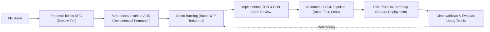

# Modul 140: Siklus Hidup Pengembangan Perangkat Lunak (SDLC, Agile, Scrum, Kanban, RFC, ADR, Technical Debt)

**Navigasi**: [⬅️ Master Index](../../INDEX.md) | [Tingkat 9: Tingkat 9: Software Engineering, Front-End, Back-End, Full-Stack & Cloud/SRE](./README.md)
*Sebelumnya*: [139. software-defined-networking-sdn-otomasi](../08-dsp-telekomunikasi-jaringan/139-software-defined-networking-sdn-otomasi.md) | *Berikutnya*: [141. penguasaan-git-tingkat-lanjut](./141-penguasaan-git-tingkat-lanjut.md)

---

## 1. Intuisi Dasar Tanpa Jargon ("Seperti Bayi Baru Lahir")
### 1.1 Mengapa Proyek Perangkat Lunak Sering Gagal? ([The Mythical Man-Month - Fred Brooks](https://en.wikipedia.org/wiki/The_Mythical_Man-Month))
"Menambahkan tenaga kerja ke proyek perangkat lunak yang terlambat hanya akan membuatnya semakin terlambat" (Hukum Brooks). Di era awal komputasi, pengembangan software diperlakukan seperti membangun jembatan beton atau gedung pencakar langit: seluruh rancangan dibuat di awal selama 6 bulan (*Waterfall Model*), lalu dikerjakan selama 2 tahun tanpa pernah menunjukkan hasil kepada pengguna. Ketika selesai, perangkat lunak sudah usang, tidak sesuai kebutuhan bisnis, atau dipenuhi ratusan bug arsitektur fatal.

### 1.2 Dari Agile ke Dokumentasi Arsitektur Berkelanjutan (RFC & ADR) ([Architectural Decision Records Guide](https://adr.github.io/))
Siklus Hidup Pengembangan Perangkat Lunak modern (*Modern SDLC*) mengakui bahwa kebutuhan pengguna selalu berubah. Alih-alih membuat rencana kaku bertahun-tahun, tim rekayasa bekerja dalam siklus iteratif pendek (Scrum / Kanban, 1-2 minggu) dengan umpan balik terus-menerus.
Namun, kecepatan tanpa disiplin menghasilkan tumpukan **Utang Teknis (Technical Debt)** yang dapat membangkrutkan perusahaan. Tim rekayasa elit menggunakan mekanisme tata kelola formal:
- **Request for Comments (RFC)**: Dokumen proposal arsitektur teknis sebelum baris kode pertama ditulis.
- **Architectural Decision Records (ADR)**: Catatan sejarah keputusan mengapa sebuah teknologi dipilih atau ditolak, mencegah tim di masa depan mengulang kesalahan yang sama.

## 2. Fondasi Teoretis & Aksiomatik / Matematis
### 2.1 Teori Dinamika Utang Teknis & Suku Bunga Kompon ([Ward Cunningham, 1992](https://c2.com/doc/ward/debt.html))
Utang Teknis dimodelkan secara matematis layaknya utang finansial berbunga majemuk:
Diberikan biaya awal implementasi pintas (*shortcut*) $C_0$ dan biaya implementasi arsitektur bersih $C_{\text{clean}}$ di mana $C_0 < C_{\text{clean}}$:
Besar pokok utang (*principal debt*):
$$D_0 = C_{\text{clean}} - C_0$$
Setiap kali fitur baru dikembangkan pada basis kode yang memiliki utang teknis, tim membayar bunga (*interest*) berupa waktu ekstra $I(t)$ akibat gesekan arsitektur:
$$I(t) = r \cdot D(t)$$
Total biaya pengembangan kumulatif pada waktu $T$:
$$C_{\text{total}}(T) = C_0 + \int_0^T I(t) \, dt$$
Jika $D(t)$ tidak pernah dilunasi (*refactoring*), bunga $I(t)$ bertumbuh secara eksponensial hingga 100% kapasitas tim habis hanya untuk memelihara bug (*Maintenance Bankruptcy*).

### 2.2 Model Aliran Kanban & Teori Antrean Little's Law ([John D.C. Little, 1961](https://pubsonline.informs.org/doi/abs/10.1287/opre.9.3.383))
Hukum Little menghubungkan tiga metrik kunci dalam siklus pengembangan:
$$W = \frac{L}{\lambda}$$
Di mana:
- $W$ adalah Waktu Tunggu (*Cycle Time / Lead Time*): rata-rata waktu yang dibutuhkan sebuah fitur dari ide hingga rilis produksi.
- $L$ adalah Jumlah Pekerjaan Sedang Berlangsung (*Work-in-Progress / WIP*): jumlah tiket fitur yang sedang aktif dikerjakan.
- $\lambda$ adalah Throughput sistem: jumlah fitur selesai per satuan waktu.
**Konsekuensi Matematis Penting**: Satu-satunya cara tercepat untuk memangkas Cycle Time ($W$) tanpa mengorbankan kualitas adalah dengan **Membatasi Batas WIP ($L$)**. Memaksa pengembang mengerjakan terlalu banyak tugas sekaligus secara simultan justru memperlambat pengiriman seluruh sistem!

## 3. Anatomi Teknis & Cara Kerja Internal


#### Tabel Walkthrough Siklus Keputusan Arsitektur (ADR Lifecycle Template)
| Komponen ADR | Deskripsi Isi Teknis | Contoh Nyata Kasus Sistem |
|---|---|---|
| Judul & Status | Identitas dan status keputusan | `ADR-0042: Migrasi dari REST ke gRPC untuk Komunikasi Internal (APPROVED)` |
| Konteks | Masalah bisnis dan batasan teknis yang dihadapi | "Latensi serialisasi JSON REST mencapai 45 ms pada jam sibuk antar 200 microservice." |
| Keputusan | Tindakan arsitektur yang diambil secara presisi | "Kami mengadopsi gRPC berbasis Protobuf 3 dengan HTTP/2 streaming." |
| Konsekuensi Positif | Manfaat nyata yang terukur | "Latensi p99 turun menjadi 4 ms, ukuran payload menyusut 70%." |
| Konsekuensi Negatif | Biaya atau kompromi yang harus ditanggung | "Debugging membutuhkan tooling khusus; browser frontend memerlukan gRPC-Web proxy." |

#### Tabel Penelusuran Siklus Hidup Rekayasa & Kegagalan Dekomposisi Persyaratan MCAS
| Tahap Siklus Hidup (SDLC) | Dokumen / Artefak Rekayasa | Asumsi Desain Sub-sistem | Masukan Sensor Fisik ($AOA$) | Keputusan Otomasi Perangkat Lunak | Status Integritas Aerodinamika Pesawat |
|---|---|---|---|---|---|
| 1. Desain Konsep | Dokumen Persyaratan MCAS | Menghilangkan sensasi pitch-up mesin LEAP | Tunggal: 1 Sensor Sudut Serang | Berikan wewenang kendali trim horizontal | Asumsi awal: Sistem non-kritis |
| 2. Analisis Bahaya (FHA) | Penilaian Kegagalan Fungsional | Diklasifikasikan sebagai "Major" (bukan "Catastrophic") | - | Tidak memerlukan redundansi dual-sensor!| Asumsi fatal: Pilot dapat membatalkan |
| 3. Uji Terbang | Penambahan Otoritas MCAS | Otoritas trim dinaikkan dari $0.55^\circ$ ke $2.5^\circ$ | - | Perubahan kode tidak di-audit ulang via FHA! | Potensi manuver hidung menukik ekstrem |
| 4. Kegagalan Sensor Riil | Operasi Penerbangan Penumpang | Sensor tunggal AOA macet membaca $+40^\circ$ palsu | Sinyal salah: Mengira pesawat stall | MCAS memutar stabilizer menukikkan hidung! | Pilot melawan gaya kendali manual |
| 5. Loop Berulang | Ketiadaan Reset Intervensi | MCAS aktif berulang kali setiap 10 detik | Sensor palsu terus memicu sistem | Stabilizer terdorong ke batas fisik bawah | Pesawat menukik tak terkendali ke laut |

## 4. Implementasi Praktis & Kode / Simulasi Riil
```markdown
# ADR-0012: Penerapan PostgreSQL Partitioning untuk Data Transaksi Historis

## Status
Diterima (Approved) - 2026-10-20

## Konteks
Tabel `transactions` pada sistem perbankan bertumbuh 25 juta baris per bulan. Kueri audit bulanan
mengalami perlambatan parah (dari 200 ms membengkak menjadi 45 detik) akibat pemindaian indeks
B+Tree raksasa (ukuran indeks melebihi RAM penyangga buffer pool).

## Keputusan Arsitektur
1. Mengubah tabel tunggal `transactions` menjadi tabel berpartisi deklaratif PostgreSQL berdasarkan rentang tanggal:
   `PARTITION BY RANGE (created_at)`.
2. Menerapkan partisi otomatis per bulan dengan retensi data 5 tahun.
3. Menolak opsi migrasi ke NoSQL Cassandra karena sistem membutuhkan konsistensi ACID transaksi perbankan ketat.

## Konsekuensi
- **Positif**: Pemindaian kueri memanfaatkan *Partition Pruning*, memangkas waktu kueri menjadi < 150 ms.
- **Positif**: Penghapusan data kedaluwarsa 5 tahun cukup menggunakan `DROP TABLE partition_name` instan tanpa overhead `VACUUM`.
- **Negatif**: Kueri yang tidak menyertakan kolom filter `created_at` akan memindai seluruh partisi secara paralel, membutuhkan aturan linter kueri wajib.
```

## 5. Miskonsepsi & Jebakan Industri
### Studi Kasus Kegagalan Nyata: Runtuhnya Proyek Modernisasi Sistem Tiket Udara FAA AS (\$1.5 Miliar Terbuang)
- **Kronologi & Latar Belakang**: Proyek *Advanced Automation System (AAS)* Federal Aviation Administration (FAA) AS yang bertujuan memodernisasi sistem kendali lalu lintas udara nasional dibatalkan pada tahun 1994 setelah menghabiskan anggaran lebih dari \$1.5 miliar tanpa menghasilkan satu baris pun kode yang dapat beroperasi di produksi.
- **Akar Masalah**: Siklus pengembangan menerapkan model Waterfall raksasa dengan perubahan spesifikasi kebutuhan (*Scope Creep*) yang tidak terkendali (ribuan halaman dokumen bertambah tiap kuartal). Kurangnya fase integrasi awal dan tidak adanya pengiriman inkremental membuat arsitek tidak menyadari ketidakcocokan perangkat keras dan perangkat lunak hingga proyek berjalan bertahun-tahun.
- **Rekomendasi Industri**: Hindari proyek *Big Bang Release*. Pecah inisiatif transformasi skala besar menjadi serangkaian rilis kecil yang dapat beroperasi mandiri (*Vertical Slices*) dengan integrasi otomatis harian (*Continuous Integration*).

### Studi Kasus Kegagalan Nyata: Tragedi Dua Kecelakaan Fatal Boeing 737 MAX Akibat Kegagalan Rekayasa Sistem Perangkat Lunak MCAS (2018-2019)
- **Kronologi & Konteks Sejarah**: Pada 29 Oktober 2018 dan 10 Maret 2019, dua pesawat komersial Boeing 737 MAX 8 (Lion Air Penerbangan 610 dan Ethiopian Airlines Penerbangan 302) jatuh tak lama setelah lepas landas, menewaskan total 346 penumpang dan awak kabin, memicu pengandangan (*grounding*) global armada Boeing 737 MAX selama 20 bulan dan meruntuhkan reputasi pabrikan kedirgantaraan tersebut.
- **Akar Masalah Rekayasa Perangkat Lunak, SDLC, & Single Point of Failure**: Pada tahap siklus hidup rekayasa sistem (*Systems Engineering Lifecycle*), sistem perangkat lunak Maneuvering Characteristics Augmentation System (MCAS) dirancang untuk menyesuaikan karakteristik aerodinamis pesawat agar memiliki sensasi kemudi yang identik dengan generasi sebelumnya. Namun, terjadi serangkaian kegagalan SDLC kritis: (1) Sistem kritis diberi wewenang membelokkan kendali horizontal pesawat secara agresif namun hanya dihubungkan ke satu buah sensor sudut serang (*Angle of Attack / AOA*), menciptakan titik kegagalan tunggal (*Single Point of Failure*); (2) Ketika otoritas pergerakan MCAS dinaikkan dalam pengujian terbang, analisis bahaya fungsional (*Functional Hazard Analysis*) tidak diperbarui; (3) Ketiadaan mekanisme batas pengulangan: ketika sensor AOA rusak dan mengirimkan data palsu bahwa hidung pesawat terlalu mendongak, MCAS secara terus menerus dan berulang-ulang menukikkan hidung pesawat setiap kali pilot berusaha menarik kemudi ke atas, hingga tenaga fisik pilot kalah oleh motor trim horizontal otomatis.

- **Potongan Kode / Arsitektur Cacat (Vulnerable Implementation)**:
```c
// Rekonstruksi Logika Cacat Sistem Kontrol MCAS (Single Sensor Dependency)
#include <stdbool.h>

struct FlightSensors {
    double aoa_left_sensor_degrees;  // Sensor Sudut Serang Kiri
    double aoa_right_sensor_degrees; // Sensor Sudut Serang Kanan (Tersedia tapi diabaikan!)
};

// Cacat Desain MCAS Asli: Hanya membaca satu sensor tanpa voting silang!
void evaluate_mcas_logic_flawed(struct FlightSensors sensors, double *trim_command) {
    // CACAT FATAL: Ketergantungan tunggal pada sensor kiri
    double active_aoa = sensors.aoa_left_sensor_degrees; 
    
    // Jika sensor kiri rusak dan mengirim nilai ekstrem 40 derajat:
    if (active_aoa > 12.0) { // Indikasi palsu bahwa pesawat akan stall
        // Dorong hidung pesawat menukik 2.5 derajat ke bawah:
        *trim_command -= 2.5; 
        // Mengulang perintah ini setiap 10 detik tanpa memeriksa intervensi pilot!
    }
}

// Mitigasi Defensif Modern: Pembandingan Silang Dual-Sensor & Batasan Satu Kali Aktivasi
void evaluate_mcas_logic_safe(struct FlightSensors sensors, double *trim_command, bool *mcas_disabled) {
    double delta = sensors.aoa_left_sensor_degrees - sensors.aoa_right_sensor_degrees;
    // Jika selisih antara kedua sensor melebihi ambang batas aman (misal 5.5 derajat):
    if (delta > 5.5 || delta < -5.5) {
        *mcas_disabled = true; // Nonaktifkan MCAS untuk sisa penerbangan
        log_cockpit_warning("AOA_DISAGREE_DETECTED");
        return;
    }
}
```

- **Analisis Forensik & Rekayasa Modern**: Tragedi 737 MAX merevolusi metodologi rekayasa perangkat lunak keselamatan kritis (*Safety-Critical Systems Engineering*). Standar sertifikasi penerbangan internasional kini menegaskan bahwa: (1) Tidak ada sistem perangkat lunak otomatis yang boleh mengesampingkan perintah kendali fisik manusia secara permanen; (2) Seluruh sensor input kritis wajib memiliki redundansi minimal tri-sensor dengan *voting logic* terisolasi; (3) Setiap perubahan parameter spesifikasi di tengah siklus hidup wajib memicu audit keselamatan komprehensif ulang dari awal.

## 6. Proyek Latihan & Rubrik Penilaian Mandiri
### Level 1 (Pemula)
- **Tugas**: Hitung Cycle Time ($W$) rata-rata sebuah tim rekayasa perangkat lunak jika batas WIP mereka adalah 15 tiket fitur dan tim berhasil menyelesaikan rata-rata 3 tiket per hari.
- **Petunjuk Arsitektur**: Terapkan Hukum Little $W = L / \lambda$.
- **Vektor Uji**:
  - $L = 15$ tiket, $\lambda = 3$ tiket/hari.
  - Cycle Time $W = \frac{15}{3} = 5$ hari kerja.
- **Rubrik Penilaian**: Penerapan rumus Little's Law (50%), satuan hitung akurat (30%), kebersihan dokumentasi (20%).

### Level 2 (Menengah)
- **Tugas**: Tulis dokumen Architectural Decision Record (ADR) lengkap dalam format Markdown untuk memilih antara arsitektur Monolit Modular vs Microservices pada startup tahap awal.
- **Petunjuk Arsitektur**: Sertakan seluruh bagian standar ADR: Judul, Status, Konteks Bisnis, Keputusan, dan Analisis Konsekuensi Positif/Negatif.
- **Vektor Uji**:
  - Keputusan harus mencerminkan pertimbangan Hukum Conway dan keterbatasan ukuran tim rekayasa awal.
- **Rubrik Penilaian**: Kedalaman analisis trade-off (40%), kepatuhan struktur format ADR (30%), objektivitas argumentasi teknis (30%).

### Level 3 (Mahir)
- **Tugas**: Bangun simulasi Monte Carlo di Python untuk memprediksi tanggal rilis proyek perangkat lunak (probabilitas 50%, 85%, dan 95%) berdasarkan data historis throughput penyelesaian tugas mingguan.
- **Petunjuk Arsitektur**: Gunakan sampling acak dengan pengembalian (*bootstrap resampling*) dari array throughput historis 10 minggu terakhir untuk mensimulasikan 10.000 iterasi proyek 50 tiket.
- **Vektor Uji**:
  - Throughput historis: `[3, 5, 2, 6, 4, 3, 5, 4, 3, 5]` tiket/minggu.
  - Output: Cetak estimasi minggu rilis pada persentil p50, p85, dan p95.
- **Rubrik Penilaian**: Metodologi statistik Monte Carlo akurat (40%), visualisasi sebaran probabilitas (30%), penanganan batas tepi (30%).

### Tingkat 1: Dasar
- **Tugas**: Bangun template dokumen catatan keputusan arsitektur (*Architecture Decision Record / ADR*) dan skrip validator otomatis dalam Python yang memindai direktori `docs/adr/`, memeriksa kelengkapan format standar Michael Nygard (Status: Proposed/Accepted/Deprecated, Context, Decision, Consequences), dan memvalidasi bahwa setiap keputusan memiliki nomor urut urut deterministik.
- **Petunjuk Perancangan Arsitektur**:
  - Gunakan ekspresi reguler untuk mengekstrak header Markdown: `## Context`, `## Decision`, `## Consequences`.
- **Test Vector & Kasus Uji Ekstrem**:
  - *Validasi Dokumen*: Masukkan 3 file ADR valid dan 1 file ADR yang melupakan bagian `Consequences`; buktikan skrip meloloskan 3 file dan menolak file cacat dengan pesan peringatan yang jelas.
- **Rubrik Penilaian Mandiri**: 40% Kepatuhan Skema Standar ADR Michael Nygard, 30% Validasi Otomatis Berkas Markdown Akurat, 30% Kerapian Pelaporan Status.

### Tingkat 2: Menengah
- **Tugas**: Kembangkan mesin verifikasi redundansi sensor (*Triple Modular Redundancy / TMR Voting Engine*) dalam Python/C untuk sistem kendali penerbangan kritis yang menerima masukan dari 3 sensor sudut serang independen, mendeteksi dan mengisolasi sensor anomali (*Fault Detection and Isolation / FDI*), dan menghasilkan nilai keluaran konsensus menggunakan algoritma *Median-of-Three* atau *Weighted Average*.
- **Petunjuk Perancangan Arsitektur**:
  - Jika selisih satu sensor terhadap dua sensor lainnya melampaui batas toleransi $\Delta > 5^\circ$, tandai sensor tersebut sebagai `FAULTY` dan jangan gunakan nilainya dalam estimasi.
- **Test Vector & Kasus Uji Ekstrem**:
  - *Kegagalan Sensor Tunggal*: Masukan sensor: $S_1 = 10.2^\circ, S_2 = 10.4^\circ, S_3 = 45.0^\circ$ (sensor 3 rusak); buktikan sistem mengisolasi $S_3$ dan menghasilkan estimasi konsensus $10.3^\circ$.
- **Rubrik Penilaian Mandiri**: 40% Implementasi Logika TMR Voting yang Tepat, 30% Isolasi Kesalahan Sensor Anomali Otomatis, 30% Kestabilan Nilai Estimasi.

### Tingkat 3: Mahir
- **Tugas**: Rancang mesin manajemen *Technical Debt Tracker* berbasis analisis statis ketergantungan modul kode dalam Python yang membangun Directed Acyclic Graph (DAG) arsitektur sistem, menghitung metrik Robert C. Martin: Ketidakstabilan (*Instability* $I = C_e / (C_a + C_e)$) dan Abstrak (*Abstractness* $A$), serta menghitung jarak dari garis urutan utama (*Normalized Distance from the Main Sequence* $D = |A + I - 1|$).
- **Petunjuk Perancangan Arsitektur**:
  - $C_a$ (Afferent Couplings): Jumlah kelas luar yang bergantung pada modul ini.
  - $C_e$ (Efferent Couplings): Jumlah kelas luar yang dipanggil oleh modul ini.
  - Jika $D > 0.7$, tandai modul tersebut berada pada *Zone of Pain* (terlalu kaku) atau *Zone of Uselessness* (terlalu abstrak tanpa implementasi).
- **Test Vector & Kasus Uji Ekstrem**:
  - *Analisis Modul*: Analisis struktur 10 modul C/Python; buktikan modul utility mandiri memiliki $I \approx 0$ dan modul orkestrasi memiliki $I \approx 1$, serta hasilkan metrik $D$ yang valid.
- **Rubrik Penilaian Mandiri**: 40% Perhitungan Metrik Kopling Afferent/Efferent yang Benar, 30% Formulasi Distance from Main Sequence Martin, 30% Visualisasi Peta Kualitas Arsitektur.

## 7. Rekomendasi Sumber Belajar Standar Emas
| Kategori | Judul Sumber & Tautan | Penulis / Institusi | Fokus Pembahasan |
|---|---|---|---|
| Buku Klasik | [The Mythical Man-Month: Essays on Software Engineering](https://en.wikipedia.org/wiki/The_Mythical_Man-Month) | Frederick P. Brooks, Jr. | Pelajaran abadi manajemen rekayasa software, Hukum Brooks, dan Second-System Effect |
| Standar ADR | [Documenting Architecture Decisions (ADR)](https://cognitect.com/blog/2011/11/15/documenting-architecture-decisions) | Michael Nygard (Cognitect) | Proposal awal format standar pencatatan keputusan arsitektur modular berkelanjutan |
| Teori Aliran | [Actionable Agile Metrics for Predictability](https://actionableagile.com/books/) | Daniel S. Vacanti | Panduan matematika formal penerapan Hukum Little dan grafik Cumulative Flow Diagram |

---
*Navigasi Cepat*: [Ke Tingkat 9](./README.md) | [Ke Master Index](../../INDEX.md) | *Sebelumnya*: [139. software-defined-networking-sdn-otomasi](../08-dsp-telekomunikasi-jaringan/139-software-defined-networking-sdn-otomasi.md) | *Berikutnya*: [141. penguasaan-git-tingkat-lanjut](./141-penguasaan-git-tingkat-lanjut.md)
