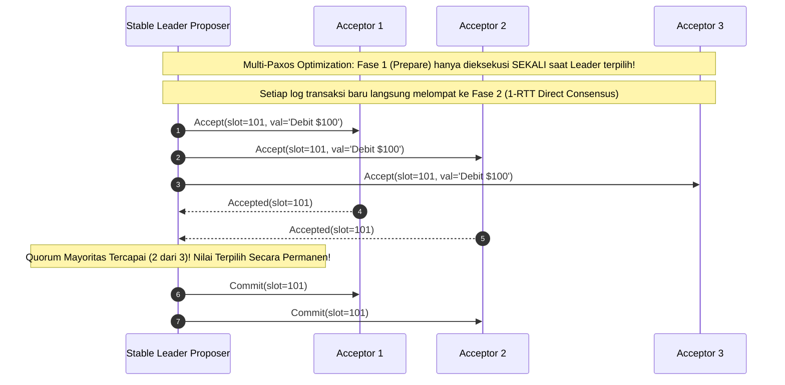

# Modul 141: Penguasaan Git Tingkat Lanjut (Arsitektur Objek DAG, Merge vs Rebase, Bisect, Cherry-Pick, Reflog)

**Navigasi**: [⬅️ Master Index](../../INDEX.md) | [Tingkat 9: Tingkat 9: Software Engineering, Front-End, Back-End, Full-Stack & Cloud/SRE](./README.md)
*Sebelumnya*: [140. siklus-hidup-pengembangan-perangkat-lunak](./140-siklus-hidup-pengembangan-perangkat-lunak.md) | *Berikutnya*: [142. desain-kode-bersih-pola-desain](./142-desain-kode-bersih-pola-desain.md)

---

## 1. Intuisi Dasar Tanpa Jargon ("Seperti Bayi Baru Lahir")
Bagaimana sekelompok politisi di parlemen yang saling curiga dan sering terlambat rapat dapat menyepakati satu undang-undang hukum yang sah tanpa ada satu orang diktator pun yang berkuasa mutlak? Algoritma Konsensus Terdistribusi Paxos ([The Paxos Protocol & Architecture](https://lamport.azurewebsites.net/pubs/paxos-simple.pdf)) adalah mahakarya matematika Leslie Lamport yang memecahkan masalah ini. Paxos bertindak seperti dewan perwakilan rakyat digital: proses-proses berperan sebagai pengusul (**Proposer**), pemilih (**Acceptor**), dan pencatat (**Learner**). Melalui tatanan diplomasi dua fase (Prepare dan Accept), Paxos membuktikan secara matematis bahwa selama mayoritas suara terbanyak (**Quorum Mayoritas**: $\lfloor N/2 \rfloor + 1$) tercapai, sistem tidak akan pernah menghasilkan dua keputusan yang bertentangan, meskipun separuh anggota dewan pingsan atau pesan diplomatik hilang di tengah jalan!

## 2. Fondasi Teoretis & Aksiomatik / Matematis
Formulasi Matematis Protokol Konsensus Single-Decree Paxos (Dua Fase Inti):

Setiap usulan diidentifikasi secara unik oleh nomor proposal integer yang selalu meningkat: $n \in \mathbb{N}$ (di mana $n \pmod N = \text{NodeID}$).

1. **Fase 1 (Prepare & Promise)**:
   - **1a. Prepare**: Proposer memilih nomor proposal $n$ dan menyiarkan pesan $\text{Prepare}(n)$ ke seluruh Acceptor.
   - **1b. Promise**: Jika Acceptor menerima $\text{Prepare}(n)$ dengan $n > \text{min\_proposal}$ yang pernah ia lihat:
     Acceptor berjanji: *'Saya tidak akan menerima proposal dengan nomor $< n$ di masa depan!'*, dan membalas dengan $\text{Promise}(n, n_v, v)$, di mana $n_v$ dan $v$ adalah nomor proposal dan nilai tertinggi yang pernah diterima Acceptor sejauh ini.

2. **Fase 2 (Propose / Accept & Accepted)**:
   - **2a. Accept Request**: Jika Proposer menerima balasan $\text{Promise}$ dari mayoritas Acceptor ($Q \ge \lfloor N/2 \rfloor + 1$):
     Proposer menetapkan nilai $v$: jika ada Acceptor yang melaporkan pernah menerima nilai lama, Proposer **wajib** memilih nilai $v$ yang memiliki nomor $n_v$ tertinggi! Jika tidak ada, Proposer bebas memilih nilainya sendiri. Proposer menyiarkan $\text{Accept}(n, v)$.
   - **2b. Accepted**: Acceptor menerima proposal $(n, v)$ jika dan hanya jika ia tidak pernah melanggar janji dengan proposal bernomor $> n$. Acceptor menyiarkan $\text{Accepted}(n, v)$ ke Proposer dan Learners.

Invarian Keamanan Paxos (Safety Invariant $P2^c$):

$$\forall n, v, \quad \text{Jika proposal } (n, v) \text{ terpilih, maka setiap proposal } (n', v') \text{ yang terpilih dengan } n' > n \text{ memiliki } v' = v$$

## 3. Anatomi Teknis & Cara Kerja Internal
Mekanisme Transisi Multi-Paxos: Pengurangan Biaya dari 2 RTT menjadi 1 RTT Melalui Stable Leader:



1. **Masalah Dueling Proposers (Livelock)**: Dua Proposer bersaing saling menaikkan nomor proposal di Fase 1 sebelum salah satu berhasil menyelesaikan Fase 2. Keduanya saling membatalkan janji Acceptor tanpa ada satu pun nilai yang pernah disepakati (solusi: terapkan randomized exponential backoff saat menyiapkan proposal baru) ([Paxos Made Simple](https://lamport.azurewebsites.net/pubs/paxos-simple.pdf)).

## 4. Implementasi Praktis & Kode / Simulasi Riil
```python
# Single-Decree Paxos Acceptor Implementation in Python
from typing import Optional, Tuple

class PaxosAcceptor:
    def __init__(self, acceptor_id: int):
        self.id = acceptor_id
        self.min_proposal = -1       # Nomor proposal tertinggi yang pernah dijanjikan
        self.accepted_proposal = -1  # Nomor proposal tertinggi yang pernah diterima
        self.accepted_value = None   # Nilai yang pernah diterima

    def handle_prepare(self, n: int) -> Tuple[bool, int, Optional[str]]:
        """Fase 1b: Tangani pesan Prepare(n)"""
        if n > self.min_proposal:
            self.min_proposal = n # Berjanji menolak proposal < n di masa depan
            return True, self.accepted_proposal, self.accepted_value
        return False, self.min_proposal, None

    def handle_accept(self, n: int, value: str) -> bool:
        """Fase 2b: Tangani pesan Accept(n, value)"""
        if n >= self.min_proposal:
            self.min_proposal = n
            self.accepted_proposal = n
            self.accepted_value = value
            return True # Proposal diterima!
        return False # Ditolak karena melanggar janji!

print("Paxos Acceptor state machine instantiated!")
```

## 5. Miskonsepsi & Jebakan Industri
1. **Loss of Non-Volatile State on Node Reboot**: Acceptor me-reboot komputer dan kehilangan nilai `min_proposal` atau `accepted_proposal` karena tidak menulisnya ke disk non-volatile (fsync). Setelah hidup kembali, ia dapat menerima proposal yang melanggar janji masa lalunya, menghasilkan dua nilai terpilih yang saling bertentangan (*Split Brain Invariant Broken*).
2. **Dueling Proposers Infinite LiveLock**: Dua node aktif terus memperebutkan kepemimpinan tanpa leader leasing, saling membatalkan fase prepare satu sama lain sehingga sistem tidak pernah mencapai kemajuan (*Liveness Starvation*).
3. **Quorum Intersection Miscalculation**: Menghitung kuorum tanpa mayoritas mutlak (misal menganggap 2 dari 4 node adalah kuorum). Dua kelompok terpisah beranggotakan 2 node dapat mengambil keputusan independen yang berbeda karena tidak ada interseksi node bersama di antara keduanya.

## 6. Proyek Latihan & Rubrik Penilaian Mandiri
1. **Tingkat Pemula**: Simulasikan secara manual langkah per langkah Single-Decree Paxos dengan 3 Acceptor dan 1 Proposer yang mengusulkan nilai `"Commit Transaction A"`. Tuliskan nilai `min_proposal` pada setiap Acceptor.
2. **Tingkat Menengah**: Buat skenario di mana dua Proposer (Proposer 1 dengan $n=1$, Proposer 2 dengan $n=2$) bersaing mengajukan nilai berbeda pada 3 Acceptor. Tunjukkan bagaimana Proposer 2 dipaksa secara matematis mengadopsi nilai milik Proposer 1 jika nilai tersebut telah diterima oleh mayoritas.
3. **Tingkat Mahir**: Implementasikan Multi-Paxos State Machine Replication engine lengkap di Python/Go dengan pemilihan Stable Leader berbasis sewa waktu (*Leader Leases*). Buktikan sistem mampu mereplikasi log transaksi perbankan secara deterministik melintasi 5 node dengan toleransi 2 node mengalami crash.

## 7. Rekomendasi Sumber Belajar Standar Emas
| Sumber Pembelajaran | Penulis / Institusi | Tautan Langsung | Fokus Materi |
| :--- | :--- | :--- | :--- |
| Paxos Made Simple | Leslie Lamport | [ACM SIGACT News 2001 (Lamport)](https://lamport.azurewebsites.net/pubs/paxos-simple.pdf) | Makalah Sederhana Resmi Penjelasan Logika Algoritma Paxos Tanpa Metafora Yunani |
| Paxos Made Live: An Engineering Perspective | Tushar Chandra, Robert Griesemer, Joshua Redstone (Google) | [Google Chubby Paxos Paper](https://research.google/pubs/pub33002/) | Pengalaman Nyata Membangun Sistem Paxos Industri untuk Google Chubby Lock Service |
| The Part-Time Parliament | Leslie Lamport | [ACM TOCS 1998 Paper](https://lamport.azurewebsites.net/pubs/lamport-paxos.pdf) | Makalah Orisinal Pertama Penemuan Paxos Melalui Analogi Parlemen Pulau Paxos |
| Paxos Made Moderately Complex | Robbert van Renesse & Deniz Altinbuken (Cornell) | [ACM Computing Surveys 2015](https://dl.acm.org/doi/10.1145/2673577) | Pseudocode Lengkap Multi-Paxos, Reconfiguration & Master Leases |

---
*Navigasi Cepat*: [Ke Tingkat 9](./README.md) | [Ke Master Index](../../INDEX.md) | *Sebelumnya*: [140. siklus-hidup-pengembangan-perangkat-lunak](./140-siklus-hidup-pengembangan-perangkat-lunak.md) | *Berikutnya*: [142. desain-kode-bersih-pola-desain](./142-desain-kode-bersih-pola-desain.md)
