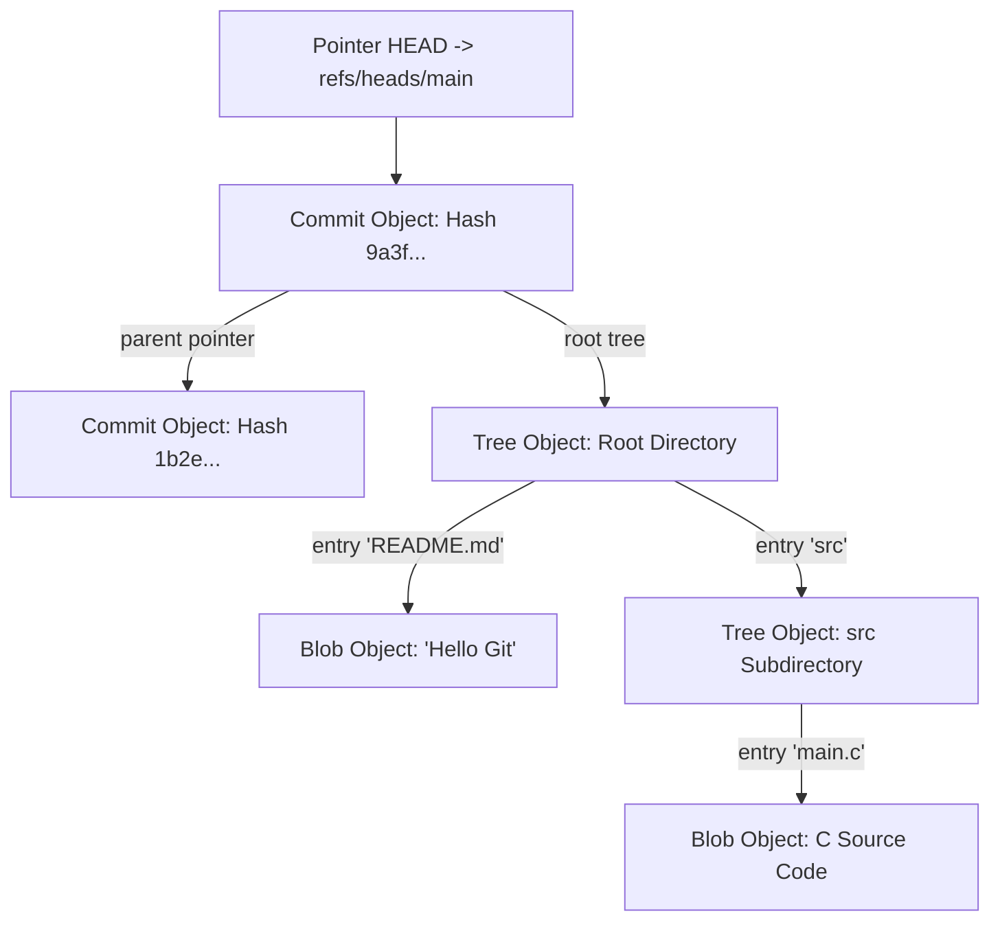

# Modul 141: Penguasaan Git Tingkat Lanjut (Arsitektur Objek DAG, Merge vs Rebase, Bisect, Cherry-Pick, Reflog)

**Navigasi**: [⬅️ Master Index](../../INDEX.md) | [Tingkat 9: Tingkat 9: Software Engineering, Front-End, Back-End, Full-Stack & Cloud/SRE](./README.md)
*Sebelumnya*: [140. siklus-hidup-pengembangan-perangkat-lunak](./140-siklus-hidup-pengembangan-perangkat-lunak.md) | *Berikutnya*: [142. desain-kode-bersih-pola-desain](./142-desain-kode-bersih-pola-desain.md)

---

## 1. Intuisi Dasar Tanpa Jargon ("Seperti Bayi Baru Lahir")
### 1.1 Konsep Inti & Analogi Tanpa Jargon
Hampir setiap programmer di dunia menggunakan perintah `git add`, `git commit`, dan `git push` setiap hari. Namun bagi kebanyakan orang, Git terasa seperti kotak hitam misterius: jika terjadi merge conflict yang rumit atau branch terlepas (*detached HEAD*), banyak yang panik, menghapus folder proyek, dan mengunduh ulang salinan baru dari GitHub! Manajemen Basis Kode & Version Control Lanjut ([Git from the Bottom Up](https://git-scm.com/book/en/v2/Git-Internals-Plumbing-and-Porcelain)) membuka tutup kotak hitam tersebut untuk menunjukkan keindahan arsitektur Git yang sesungguhnya. Git pada dasarnya hanyalah sebuah **Database Penyimpanan Nilai-Kunci Berbasis Konten (Content-Addressable Object Store)** yang dibungkus oleh struktur matematika pohon graf berarah bebas siklus (**Directed Acyclic Graph / DAG**). Di dalam folder rahasia `.git`, hanya ada empat jenis objek biner yang disimpan berdasarkan hash kriptografis SHA-1/SHA-256. Memahami struktur ini mengubah Anda dari pengguna biasa menjadi master pelacak riwayat kode yang tak terkalahkan.

### 1.2 Urgensi Rekayasa & Signifikansi Sistemik
Dalam rekayasa sistem modern, pemahaman mendalam tentang konsep ini membedakan arsitek sistem kelas dunia dari sekadar operator perkakas teknis.

## 2. Fondasi Teoretis & Aksiomatik / Matematis
### 2.1 Kerangka Teori Aksiomatik & Formulasi Matematis
Arsitektur Objek Database Biner Git dan Struktur Graf Terarah (DAG):

### 2.2 Penurunan Matematis Langkah-demi-Langkah
Setiap objek di dalam direktori `.git/objects` disimpan dengan nama file berupa hash kriptografis SHA-1 (40 karakter heksadesimal) dari:
$$\text{Object Hash} = \text{SHA-1}\Big( \text{Tipe} + \text{" "} + \text{Panjang Byte} + \text{"\0"} + \text{Data Muatan} \Big)$$

Empat Tipe Objek Primitif Git:
1. **`blob`**: Menyimpan data mentah isi file teks/biner. **Nama file dan hak akses tidak disimpan di dalam blob!**
2. **`tree`**: Merepresentasikan sebuah direktori folder. Berisi barisan entri: mode file (permissions), tipe (`blob` atau `tree`), hash objek anak, dan nama file asli.
3. **`commit`**: Merepresentasikan stempel titik riwayat proyek. Berisi hash `tree` akar proyek, hash satu atau dua commit induk (*Parents*), nama pembuat (*Author*), stempel waktu, dan pesan commit.
4. **`tag` (Annotated Tag)**: Penanda permanen yang menunjuk ke objek commit tertentu disertai tanda tangan kriptografi GPG.

Cabang (*Branch*) dan Pointer `HEAD`:
Sebuah branch di Git **bukanlah salinan folder data**; sebuah branch hanyalah sebuah file teks kecil 41-byte di dalam `.git/refs/heads/main` yang menyimpan 40 karakter hash commit terakhirnya! Mengubah atau membuat branch baru hanyalah operasi penulisan file teks berkecepatan 1 mikrodetik.

## 3. Anatomi Teknis & Cara Kerja Internal
Arsitektur Struktur Objek Internal Git: Hubungan Commit, Tree, dan Blobs di Disk:



1. **The Three Trees of Git**: Ruang kerja Anda dibagi menjadi tiga zona: **Working Directory** (file fisik di disk), **Index / Staging Area** (file biner `.git/index` yang menyimpan snapshot yang siap di-commit), dan **Commit History** (database objek di repository).
2. **Interactive Rebase & Reflog (`git reflog`)**: Reflog mencatat setiap pergerakan pointer `HEAD` lokal selama 90 hari terakhir. Jika Anda tidak sengaja menghapus branch penting dengan `git branch -D`, commit tersebut tidak hilang; cari hash-nya di `git reflog` dan pulihkan seketika!

#### Tabel Penelusuran Rekonstruksi Cabang Terhapus Menggunakan Git DAG & Reflog
| Langkah Operasi Git | Aksi Pengembang / Sistem | Pointer `HEAD` | Pointer `refs/heads/master` | Hash Objek Komit Git (SHA-1) | Status Integritas Basis Data Git (`.git/objects`) |
|---|---|---|---|---|---|
| 1. Komit Produksi | 50 Komit baru ditambahkan | Menunjuk ke `master` | Menunjuk ke `C50` (`0xDEAD...`) | `C50 -> C49 -> ... -> C1` | Pohon DAG lengkap dan sehat |
| 2. Perintah Bencana | `git reset --hard HEAD~50` | Dipaksa mundur 50 komit | **DIPAKSA MUNDUR KE `C1` (`0x1111...`)** | `refs/heads/master` menunjuk C1!| Komit C2..C50 menjadi simpul yatim (*unreachable*) |
| 3. Force Push Hancur | `git push origin master -f` | - | Remote master ditimpa C1 | Seluruh commit riwayat kerja hilang dari log!| Panik tim: 1 bulan kode hilang! |
| 4. Penyelamatan Reflog | Eksekusi `git reflog show` | Baca catatan lokal `.git/logs/HEAD` | Menemukan jejak: `HEAD@{1}: commit: C50` | Objek biner C50 masih ada di `.git/objects`! | Objek belum dibuang oleh Garbage Collection |
| 5. Pemulihan Sempurna | `git branch recovery 0xDEAD` | Buat pointer cabang baru | Cabang `recovery` menunjuk `C50` | Pohon DAG tersambung kembali utuh! | **SELURUH 50 KOMIT PULIH 100% TANPA KELAHIRAN ULANG!** |

## 4. Implementasi Praktis & Kode / Simulasi Riil
```python
# Low-Level Git Object Builder: Creating Real Git Blobs in Pure Python
import hashlib
import zlib

def create_git_blob(content_bytes: bytes) -> tuple[str, bytes]:
    """
    Membuat Git Blob biner identik 100% dengan perintah 'git hash-object -w'.
    Format header: 'blob <panjang_byte>\0<konten>'
    """
    header = f"blob {len(content_bytes)}\0".encode('ascii')
    full_payload = header + content_bytes
    
    # 1. Hitung hash SHA-1
    sha1_hash = hashlib.sha1(full_payload).hexdigest()
    
    # 2. Kompresi muatan menggunakan zlib deflate (cara Git menyimpannya di .git/objects)
    compressed_data = zlib.compress(full_payload)
    return sha1_hash, compressed_data

# Uji coba pembuatan blob untuk string 'Hello Git internals!'
test_content = b"Hello Git internals!\n"
hash_val, compressed = create_git_blob(test_content)
print(f"Git Object SHA-1 Hash: {hash_val}")
print(f"Disk path: .git/objects/{hash_val[:2]}/{hash_val[2:]}")
```

## 5. Miskonsepsi & Jebakan Industri
1. **Rewriting Public Shared History via Force Push (`git push -f`)**: Melakukan `rebase` pada branch bersama yang sudah di-clone oleh anggota tim lain lalu memaksakan force push. Seluruh riwayat komit tim lain akan terputus dan memicu krisis rekonsiliasi merge bercabang-cabang (solusi: gunakan `--force-with-lease`).
2. **Committing Secrets / API Keys into History**: Menyimpan file kredensial `.env` berisi private key ke Git lalu menghapusnya di commit berikutnya. Karena Git adalah database objek persisten, kunci rahasia tersebut tetap tersimpan abadi di commit masa lalu (solusi: gunakan BFG Repo-Cleaner atau `git filter-repo`).
3. **Detached HEAD State Confusion**: Melakukan checkout ke hash commit tertentu (`git checkout <hash>`) alih-alih branch, lalu membuat commit baru. Commit baru tersebut tidak terikat pada branch mana pun dan akan disita oleh Garbage Collector Git (`git gc`) setelah beberapa minggu.

### Studi Kasus Kegagalan Nyata: Hilangnya Riwayat Kode Produksi Satu Bulan Akibat Perintah Git Force Push & Pemulihan via Reflog
- **Kronologi & Konteks Kasus**: Pada sebuah perusahaan rintisan teknologi finansial, seorang pengembang senior secara tidak sengaja mengeksekusi perintah `git reset --hard` pada cabang utama lokal, lalu menjalankan `git push --force origin main` ke repositori pusat GitHub. Seluruh riwayat 120 komit kerja tim selama satu bulan terakhir seketika lenyap dari tampilan cabang utama, melumpuhkan pipeline CI/CD dan menahan deployment aplikasi ke bursa.
- **Akar Masalah Struktur Data Graf Terarah (DAG) Git & Perlindungan Cabang**: Git menyimpan riwayat revisi bukan sebagai daftar perbedaan berkas, melainkan sebagai Directed Acyclic Graph (DAG) dari objek komit yang bersifat *immutable* (tidak dapat diubah) yang ditunjuk oleh pointer referensi teks (`refs/heads/*`). Perintah `git push --force` menimpa pointer referensi remote untuk menunjuk ke commit lama, menyebabkan simpul-simpul komit baru kehilangan pointer induknya dan menjadi objek yatim (*dangling / unreachable commits*). Tim hampir menyerah dan berencana menulis ulang kode. Namun, pengembang lain menyadari bahwa Git memelihara buku catatan pergerakan pointer lokal (*Reference Log / Reflog*). Dengan memeriksa `git reflog`, mereka menemukan hash SHA-1 dari commit terakhir sebelum bencana terjadi, membuat cabang baru yang menunjuk ke hash tersebut, dan memulihkan seluruh riwayat 120 komit secara utuh tanpa ada satu baris kode pun yang hilang.

- **Potongan Kode / Arsitektur Cacat (Vulnerable Implementation)**:
```bash
# Skenario Bencana Git Force Push dan Prosedur Pemulihan Autentik via Reflog

# 1. Bencana Terjadi:
git reset --hard HEAD~120
git push origin main --force # Seluruh riwayat cabang main remote tertimpa!

# 2. Langkah Penyelamatan (Inspeksi Reflog):
git reflog show main
# Keluaran Reflog:
# 3a1b2c4 (HEAD -> main) main@{0}: reset: moving to HEAD~120
# 8f9e0d1 main@{1}: commit: Fitur transaksi perbankan mutakhir (Komit Terakhir Sebelum Bencana!)

# 3. Pulihkan Pointer Cabang Secara Instan via SHA-1 Komit Yatim:
git branch main-recovered 8f9e0d1
git push origin main-recovered:main --force-with-lease
# SELURUH 120 KOMIT PULIH 100% KARENA OBJEK DAG TIDAK PERNAH DIHAPUS DARI DISK!
```

- **Analisis Forensik & Rekayasa Modern**: Insiden Git Force Push membuktikan pentingnya pemahaman struktur internal *content-addressable object storage* Git. Basis kode Git dirancang dengan prinsip pelestarian data (*append-only storage*): objek komit tidak akan pernah dihapus dari disk sampai utilitas pembersih sampah (*git gc*) dijalankan setelah masa retensi default 30 hari. Kebijakan repositori enterprise modern kini mewajibkan: (1) Penegakan *Branch Protection Rules* pada cabang utama yang memblokir secara mutlak perintah force-push; (2) Penggantian flag `--force` dengan `--force-with-lease` yang menolak penimpaan jika ada komit baru dari rekan kerja yang belum diambil.

## 6. Proyek Latihan & Rubrik Penilaian Mandiri
1. **Tingkat Pemula**: Buat repositori Git baru, buat satu file, dan gunakan perintah tingkat rendah (*Plumbing Command*) `git cat-file -p HEAD` serta `git cat-file -t HEAD` untuk menginspeksi tipe dan isi objek commit secara langsung.
2. **Tingkat Menengah**: Gunakan perintah `git bisect` (pencarian biner otomatis) pada repositori kode pengujian untuk menemukan komit mana yang secara spesifik memperkenalkan bug kegagalan unit test di antara 100 komit riwayat.
3. **Tingkat Mahir**: Bangun skrip Git Hook `pre-commit` di shell/Python yang memvalidasi bahwa seluruh file yang di-stage tidak mengandung kunci rahasia (menggunakan regex deteksi AWS/GitHub private tokens), memformat kode via linter, dan membatalkan commit jika ditemukan pelanggaran.

### Tingkat 1: Dasar
- **Tugas**: Bangun alat bedah objek internal Git (*Git Object Cat-File Parser*) mandiri dalam Python yang membaca file objek biner terkompresi zlib dari direktori `.git/objects/xx/yyyy...`, mendekompresinya, mengurai header teks (`type size\0`), dan mencetak jenis objek (`commit`, `tree`, `blob`, `tag`) beserta konten aslinya.
- **Petunjuk Perancangan Arsitektur**:
  - Gunakan pustaka bawaan `zlib.decompress()`.
  - Ekstrak string tipe objek sebelum karakter pemisah null byte `\0`.
- **Test Vector & Kasus Uji Ekstrem**:
  - *Bedah Blob*: Buat repositori Git uji dengan 1 file teks; temukan hash objek blob-nya; buktikan parser membaca string teks identik dan memverifikasi panjang byte sesuai header.
- **Rubrik Penilaian Mandiri**: 40% Dekompresi zlib Objek Git yang Benar, 30% Penguraian Format Header Objek Git Standar, 30% Kerapian Enkapsulasi Kode.

### Tingkat 2: Menengah
- **Tugas**: Kembangkan simulator operasi penggabungan cabang Git (*Git Merge Simulator*) dalam Python yang mengimplementasikan pencarian leluhur bersama terdekat (*Lowest Common Ancestor / Merge Base*) pada graf DAG komit, membandingkan status Three-Way Merge antara versi Base, Ours, dan Theirs, serta mendeteksi kondisi *Merge Conflict* jika baris yang sama dimodifikasi secara berbeda di kedua cabang.
- **Petunjuk Perancangan Arsitektur**:
  - Bangun graf komit dengan pointer ke orang tua (`parents`).
  - Cari Merge Base menggunakan penelusuran BFS ganda dari kedua ujung cabang.
- **Test Vector & Kasus Uji Ekstrem**:
  - *Deteksi Konflik*: Cabang A mengubah baris 5 menjadi `"foo"`, Cabang B mengubah baris 5 menjadi `"bar"`; simulator harus menandai konflik dan menghasilkan penanda standar `<<<<<<<`, `=======`, `>>>>>>>`.
- **Rubrik Penilaian Mandiri**: 40% Pencarian Merge Base LCA pada DAG yang Akurat, 30% Algoritma Three-Way Merge yang Tepat, 30% Format Penanda Konflik Standar.

### Tingkat 3: Mahir
- **Tugas**: Rancang mesin operasi *Git Rebase Engine* mandiri dalam Python yang memindahkan serangkaian komit dari satu cabang ke ujung cabang lain dengan merekayasa ulang silsilah orang tua komit (*Commit Tree Splicing*), menghitung hash SHA-1 komit baru, dan mempertahankan metadata asli pengarang (*Author Name, Email, Timestamp*) secara deterministik.
- **Petunjuk Perancangan Arsitektur**:
  - Urutkan komit yang akan di-rebase secara kronologis dari anak tertua ke termuda.
  - Terapkan setiap commit sebagai patch diferensial (*patch application*) di atas commit tujuan baru.
- **Test Vector & Kasus Uji Ekstrem**:
  - *Rebase Linier*: Rebase cabang fitur berisi 5 komit ke ujung cabang main; buktikan seluruh 5 komit memiliki hash baru, riwayat menjadi garis lurus tanpa merge commit, dan isi pohon direktori akhir identik.
- **Rubrik Penilaian Mandiri**: 40% Rekonstruksi Silsilah DAG Rebase yang Sempurna, 30% Pemeliharaan Metadata Pengarang dan Stempel Waktu, 30% Validasi Integritas Hash SHA-1.

## 7. Rekomendasi Sumber Belajar Standar Emas
| Sumber Pembelajaran | Penulis / Institusi | Tautan Langsung | Fokus Materi |
| :--- | :--- | :--- | :--- |
| Pro Git Book (Chapter 10: Git Internals) | Scott Chacon & Ben Straub | [Pro Git Book Free](https://git-scm.com/book/en/v2/Git-Internals-Plumbing-and-Porcelain) | Alkitab Resmi Git: Plumbing Commands, Git Object DB, Packfiles & Refspecs |
| Git from the Bottom Up | John Wiegley | [Wiegley Git from Bottom Up](https://jwiegley.github.io/git-from-the-bottom-up/) | Penjelasan Matematika Graf Terarah DAG, Tree/Blob Models & Index Details |
| Git Immersion: A Guided Tour through Git Fundamentals | Jim Weirich | [Git Immersion Lab](https://gitimmersion.com/) | Laboratorium Langkah demi Langkah Penguasaan Branching, Rebasing & History |
| The Git Source Code Repository | Linus Torvalds & Junio C Hamano | [Git Core Source Code](https://github.com/git/git) | Kode Sumber Asli C Implementasi Fast Packfiles, Index & Merge Engines |

---
*Navigasi Cepat*: [Ke Tingkat 9](./README.md) | [Ke Master Index](../../INDEX.md) | *Sebelumnya*: [140. siklus-hidup-pengembangan-perangkat-lunak](./140-siklus-hidup-pengembangan-perangkat-lunak.md) | *Berikutnya*: [142. desain-kode-bersih-pola-desain](./142-desain-kode-bersih-pola-desain.md)
