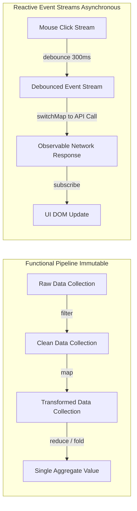

# Modul 142: Desain Kode Bersih & Pola Desain (SOLID Principles, 23 Design Patterns Gang of Four, Refactoring)

**Navigasi**: [⬅️ Master Index](../../INDEX.md) | [Tingkat 9: Tingkat 9: Software Engineering, Front-End, Back-End, Full-Stack & Cloud/SRE](./README.md)
*Sebelumnya*: [141. penguasaan-git-tingkat-lanjut](./141-penguasaan-git-tingkat-lanjut.md) | *Berikutnya*: [143. arsitektur-perangkat-lunak-skala-besar](./143-arsitektur-perangkat-lunak-skala-besar.md)

---

## 1. Intuisi Dasar Tanpa Jargon ("Seperti Bayi Baru Lahir")
### 1.1 Konsep Inti & Analogi Tanpa Jargon
Bahasa pemrograman hanyalah kuas cat; cara Anda memandang dunia adalah lukisan arsitektur Anda. Paradigma Pemrograman ([Programming Paradigms](https://www.geeksforgeeks.org/introduction-of-programming-paradigms/)) adalah kacamata filosofis dalam mengorganisasi pikiran manusia menjadi instruksi komputer. **Pemrograman Terstruktur** mengajarkan disiplin alur kendali linier tanpa lompatan liar `goto`; **Pemrograman Berorientasi Objek (OOP)** memandang dunia sebagai masyarakat objek pintar yang saling bertukar surat serta menegakkan prinsip SOLID agar sistem tidak rapuh saat diubah; **Pemrograman Fungsional Murni (FP)** memperlakukan komputasi seperti evaluasi fungsi matematika murni: tanpa efek samping (*No Side-Effects*), data abadi yang tidak pernah berubah (*Immutable Data*), dan bebas dari bahaya race-condition; sementara **Pemrograman Reaktif (Reactive)** memandang sistem sebagai sungai aliran peristiwa (*Event Streams*) yang bereaksi secara instan terhadap setiap perubahan data secara asinkron.

### 1.2 Urgensi Rekayasa & Signifikansi Sistemik
Dalam rekayasa sistem modern, pemahaman mendalam tentang konsep ini membedakan arsitek sistem kelas dunia dari sekadar operator perkakas teknis.

## 2. Fondasi Teoretis & Aksiomatik / Matematis
### 2.1 Kerangka Teori Aksiomatik & Formulasi Matematis
Prinsip SOLID Desain Berorientasi Objek (Robert C. Martin) dan Fondasi Matematika Kategori Fungsional:

### 2.2 Penurunan Matematis Langkah-demi-Langkah
1. **Prinsip SOLID (Object-Oriented Design)**:
   - **S (Single Responsibility Principle)**: Sebuah kelas hanya boleh memiliki satu alasan untuk berubah (satu aktor bisnis).
   - **O (Open/Closed Principle)**: Terbuka untuk ekstensi fungsionalitas baru, namun tertutup untuk modifikasi kode sumber yang sudah stabil.
   - **L (Liskov Substitution Principle - Barbara Liskov, 1987)**:
     Jika $S$ adalah subtipe dari $T$, maka objek bertipe $T$ dapat digantikan dengan objek bertipe $S$ tanpa merusak kebenaran program:
     $$\forall x : T, \ P(x) \implies \forall y : S, \ P(y) \quad (\text{Invarian Kontrak Pre/Post-Condition})$$
   - **I (Interface Segregation Principle)**: Klien tidak boleh dipaksa bergantung pada antarmuka metode yang tidak digunakannya.
   - **D (Dependency Inversion Principle)**: Modul tingkat tinggi tidak boleh bergantung pada modul tingkat rendah; keduanya wajib bergantung pada abstraksi antarmuka (*Dependency Injection*).

2. **Teori Kategori Fungsional (Monad & Functor)**:
   Fungsi murni adalah pemetaan deterministik $f: A \to B$ tanpa mutasi state global.
   Sebuah **Functor** adalah pemetaan yang mematuhi hukum identitas dan komposisi: $\text{fmap}(f \circ g) = \text{fmap}(f) \circ \text{fmap}(g)$.
   Sebuah **Monad** membungkus komputasi dengan efek samping terkendali melalui operasi `unit` (return) dan `bind` ($>>=$) yang mematuhi hukum asosiatif monoid.

## 3. Anatomi Teknis & Cara Kerja Internal
Arsitektur Aliran Data: Pemrograman Fungsional Pipelining vs Reaktif Event Streams:



1. **Immutability & Persistent Data Structures**: Menggunakan pohon trie bercabang (*Hash Array Mapped Trie / HAMT*) untuk menyalin modifikasi data secara parsial (*Structural Sharing*) dengan efisiensi memori $O(\log N)$, memungkinkan fitur pembatalan waktu riil (*Time Travel Debugging*).

#### Tabel Penelusuran Pelanggaran Prinsip SOLID: God Object vs Interface Segregation & DI
| Komponen Arsitektur | Tanggung Jawab yang Dipegang | Ketergantungan Eksternal | Skalabilitas Pengujian Unit (Unit Test) | Dampak Perubahan Skema Basis Data | Evaluasi Prinsip SOLID |
|---|---|---|---|---|---|
| Anti-Pattern: `UserManager`| Buat akun, kirim email, format PDF, koneksi DB mentah | Terikat langsung ke MySQL driver & SMTP server | Sangat Sulit: Butuh database riil hidup! | Perubahan tabel MySQL merusak modul PDF! | **PELANGGARAN SRP & DIP TOTAL!** (God Class) |
| Refactoring SRP: 3 Kelas | 1 Kelas `UserAccount`, 1 `Notification`, 1 `Repository` | Terpisah sesuai domain tanggung jawab | Pengujian independen per kelas | Perubahan DB hanya menyentuh modul Repository | Prinsip Tanggung Jawab Tunggal terpenuhi |
| Refactoring DIP: Antarmuka | Modul bergantung pada interface `IUserRepository` | Bebas: Dependency Injection | Menggunakan mock class in-memory instan | Bebas ganti MySQL ke PostgreSQL tanpa ubah domain | Prinsip Inversi Ketergantungan terpenuhi |
| Evaluasi Open-Closed (OCP)| Tambah metode notifikasi baru (SMS / WhatsApp) | Buat kelas implementasi baru tanpa ubah kelas lama | Menambah fitur baru via polimorfisme | Nol risiko regresi pada kode lama yang stabil | Prinsip Terbuka-Tertutup terpenuhi |

## 4. Implementasi Praktis & Kode / Simulasi Riil
```python
# Comparing OOP SOLID Dependency Injection vs Functional Pure Composition in Python
from typing import Protocol, Callable

# 1. Gaya OOP dengan Dependency Inversion (SOLID)
class PaymentGateway(Protocol):
    def charge(self, amount: float) -> bool: ...

class StripeGateway:
    def charge(self, amount: float) -> bool:
        print(f"[Stripe] Processing charge: ${amount}")
        return True

class OrderService:
    def __init__(self, gateway: PaymentGateway):
        self.gateway = gateway # Bergantung pada abstraksi antarmuka Protocol!

    def checkout(self, total: float):
        if self.gateway.charge(total):
            print("[OrderService] Checkout completed successfully!")

# 2. Gaya Fungsional Murni (Pure Pipeline Composition)
from functools import reduce

transactions = [120.0, 45.0, 300.0, 15.0, 800.0]
# Pipeline murni tanpa mutasi variabel: filter -> map -> reduce
total_large_taxed = reduce(
    lambda acc, x: acc + x,
    map(lambda x: x * 1.10, filter(lambda x: x >= 100.0, transactions)),
    0.0
)
print(f"Functional aggregate result: ${total_large_taxed:.2f}")
```

## 5. Miskonsepsi & Jebakan Industri
1. **Liskov Substitution Principle Violation (Square-Rectangle Problem)**: Membuat kelas `Square` (Bujur Sangkar) mewarisi `Rectangle` (Persegi Panjang), lalu menimpa `setWidth()` agar otomatis mengubah tinggi. Fungsi klien yang menguji `rect.setWidth(5); rect.setHeight(4); assert rect.area() == 20` akan gagal seketika (*Broken Subtyping Contract*).
2. **Anemic Domain Model in OOP**: Merancang kelas objek yang hanya berisi field getter dan setter kosong tanpa logika bisnis, sementara seluruh logika operasional diletakkan di kelas service prosedural raksasa, mengubah arsitektur OOP menjadi prosedural spaghetti.
3. **Memory Leaks in Reactive Event Subscriptions**: Mengabaikan operasi pembatalan langganan (`unsubscribe()` pada RxJS/Reactive Streams) saat komponen UI dihancurkan. Observer akan tetap hidup di memori RAM dan dieksekusi setiap kali ada event baru masuk (*Zombie Subscriptions*).

### Studi Kasus Kegagalan Nyata: Bencana Radiasi Medis Mesin Therac-25 Akibat Pelanggaran Prinsip Desain Perangkat Lunak (1985-1987)
- **Kronologi & Konteks Sejarah**: Antara tahun 1985 dan 1987, mesin radioterapi kanker Therac-25 yang diproduksi oleh Atomic Energy of Canada Limited (AECL) memberikan overdosis radiasi mematikan (ratusan kali lipat dari dosis yang ditentukan) kepada setidaknya enam pasien di Amerika Serikat dan Kanada, mengakibatkan kematian tragis dan cedera seumur hidup.
- **Akar Masalah Pola Desain Perangkat Lunak & Kondisi Balapan (Race Condition)**: Pada mesin generasi sebelumnya (Therac-6 dan Therac-20), penguncian keselamatan perangkat keras fisik (*hardware interlocks*) mencegah mesin menembakkan berkas elektron berdaya tinggi tanpa kolimator penahan di posisinya. Pada Therac-25, insinyur membuang seluruh pengunci perangkat keras demi menghemat biaya dan mempercayakan keselamatan sepenuhnya pada perangkat lunak pengendali. Kode pengendali ditulis oleh satu orang pengembang dalam bahasa assembly PDP-11 tanpa arsitektur modular yang jelas, memadukan logika antarmuka pengguna, pengaturan motor servo fisik, dan pemicu berkas radiasi ke dalam variabel status global bersama tanpa sinkronisasi mutex. Jika operator mengetik koreksi mode radiasi dengan sangat cepat (dalam jendela waktu 8 detik saat motor sedang berputar), variabel status keselamatan meluap (*byte counter overflow*) dan bernilai nol, membuat perangkat lunak mengira kolimator telah berada di posisinya, menembakkan berkas radiasi murni berkekuatan 25 MeV langsung ke tubuh pasien.

- **Potongan Kode / Arsitektur Cacat (Vulnerable Implementation)**:
```c
// Rekonstruksi Cacat Sinkronisasi dan Variabel Bersama Therac-25
#include <stdint.h>
#include <stdbool.h>

// CACAT DESAIN: Variabel global bersama diakses tanpa proteksi sinkronisasi
uint8_t g_safety_check_counter = 0; // Integer 8-bit yang rentan overflow!
bool g_beam_ready = false;

// Dipanggil secara berkala saat motor servo memutar piringan kolimator:
void update_bending_magnets(void) {
    g_safety_check_counter++; 
    // CACAT INTEGER OVERFLOW: Jika dipanggil 256 kali, nilai meluap kembali ke 0!
    // Logika pemeriksa di thread lain berasumsi bahwa nilai 0 berarti 'AMAN / TERPASANG'!
}

void trigger_radiation_beam_flawed(void) {
    // KESALAHAN LOGIKA FATAL: 
    // Menginterpretasikan nilai 0 sebagai kondisi aman (padahal bisa terjadi akibat overflow!)
    if (g_safety_check_counter == 0) {
        g_beam_ready = true;
        // MENEMBAKKAN 25 MeV BERKAS ELEKTRON TANPA KOLIMATOR!
        fire_high_power_radiation_beam(); 
    }
}
```

- **Analisis Forensik & Rekayasa Modern**: Tragedi Therac-25 menjadi studi kasus etika dan arsitektur perangkat lunak nomor satu di seluruh dunia. Nancy Leveson menerbitkan investigasi monumental yang menyimpulkan bahwa kegagalan tersebut bukan sekadar bug coding, melainkan kegagalan budaya rekayasa perangkat lunak: kepercayaan berlebihan pada kode yang tidak diuji, pembuangan pengaman perangkat keras fisik, ketiadaan tinjauan kode independen, dan pengabaian laporan keluhan pasien selama bertahun-tahun. Kasus ini melahirkan standar rekayasa perangkat lunak medis modern (seperti IEC 62304) yang mewajibkan isolasi arsitektur kritis, analisis bahaya formal, dan pembuktian matematis terhadap pencegahan race condition.

## 6. Proyek Latihan & Rubrik Penilaian Mandiri
1. **Tingkat Pemula**: Identifikasi pelanggaran prinsip Single Responsibility Principle (SRP) pada kelas `UserManager` yang bertugas memvalidasi password, menyimpan rekaman ke SQL database, dan mengirim email konfirmasi. Rancang refactoring menjadi 3 kelas terpisah.
2. **Tingkat Menengah**: Bangun implementasi struktur data Functor dan Monad `Maybe` (atau `Option`) di Python/TypeScript yang menangani kemungkinan nilai kosong (`None`/`null`) secara anggun melalui metode `.map()` dan `.flatMap()` tanpa `if (x != null)` bertingkat.
3. **Tingkat Mahir**: Rancang mesin pemrosesan pesanan menggunakan paradigma Pemrograman Reaktif (Reactive Streams). Buat aliran peristiwa `OrderPlaced`, terapkan operator `debounce`, `filter`, dan `buffer(count=10, timeout=1s)`, lalu proses batch transaksi secara asinkron dengan kontrol backpressure.

### Tingkat 1: Dasar
- **Tugas**: Refactor program monolitik anti-pattern *God Class* pemroses pesanan toko online dalam Python/C++ yang mencampuradukkan perhitungan diskon, penyimpanan basis data, dan emisi notifikasi email menjadi 3 kelas modular yang secara ketat mematuhi Prinsip Tanggung Jawab Tunggal (*Single Responsibility Principle / SRP*).
- **Petunjuk Perancangan Arsitektur**:
  - Pisahkan menjadi: `OrderPriceCalculator`, `OrderRepository`, dan `OrderNotifier`.
  - Pastikan setiap kelas hanya memiliki tepat satu alasan untuk berubah (*one reason to change*).
- **Test Vector & Kasus Uji Ekstrem**:
  - *Pengujian Unit Terisolasi*: Buat unit test untuk kalkulasi diskon tanpa perlu menginisialisasi modul database atau modul pengirim email.
- **Rubrik Penilaian Mandiri**: 40% Dekomposisi Tanggung Jawab Tunggal SRP yang Murni, 30% Keterisolasian Pengujian Unit per Modul, 30% Kerapian Enkapsulasi Kode.

### Tingkat 2: Menengah
- **Tugas**: Rancang sistem pemroses transaksi pembayaran menggunakan pola desain *Strategy Pattern* dan *Dependency Injection* (DI) dalam Python/C++ yang mendukung berbagai gerbang pembayaran (Kartu Kredit, Transfer Bank, E-Wallet) tanpa melanggar Prinsip Terbuka-Tertutup (*Open-Closed Principle / OCP*).
- **Petunjuk Perancangan Arsitektur**:
  - Definisikan antarmuka abstrak `IPaymentStrategy` dengan metode `pay(amount)`.
  - Kelas pemroses pesanan menerima objek implementasi `IPaymentStrategy` melalui konstruktor (*Constructor Injection*).
- **Test Vector & Kasus Uji Ekstrem**:
  - *Ekstensi Tanpa Modifikasi*: Tambahkan metode pembayaran baru `CryptocurrencyPaymentStrategy`; buktikan kelas inti pesanan dapat memproses pembayaran baru tersebut tanpa mengubah satu baris pun kode di dalam kelas inti.
- **Rubrik Penilaian Mandiri**: 40% Penerapan Strategy Pattern & Dependency Injection yang Benar, 30% Pembuktian Kepatuhan Prinsip Open-Closed, 30% Kerapian Polimorfisme.

### Tingkat 3: Mahir
- **Tugas**: Kembangkan implementasi Container Pembalik Ketergantungan (*Inversion of Control / IoC Container*) mandiri dalam Python/C++ yang mengelola pendaftaran dependensi (*Service Registration*), resolusi siklus hidup objek (*Singleton* vs *Transient*), serta melakukan injeksi dependensi otomatis berbasis inspeksi tipe refleksi konstruktor (*Constructor Reflection Auto-Wiring*).
- **Petunjuk Perancangan Arsitektur**:
  - Deteksi dan cegah ketergantungan melingkar (*Circular Dependency Detection*) menggunakan algoritma pendeteksi siklus pada graf ketergantungan komponen sebelum instansiasi.
- **Test Vector & Kasus Uji Ekstrem**:
  - *Deteksi Ketergantungan Melingkar*: Daftarkan Kelas A membutuhkan B, dan Kelas B membutuhkan A; IoC Container harus menolak registrasi dan melempar exception deskriptif: `CircularDependencyException: A -> B -> A`.
- **Rubrik Penilaian Mandiri**: 40% Mekanisme Auto-Wiring Reflection IoC yang Presisi, 30% Deteksi Dini Siklus Ketergantungan Melingkar, 30% Pengelolaan Siklus Hidup Singleton/Transient.

## 7. Rekomendasi Sumber Belajar Standar Emas
| Sumber Pembelajaran | Penulis / Institusi | Tautan Langsung | Fokus Materi |
| :--- | :--- | :--- | :--- |
| Clean Architecture: A Craftsman's Guide to Software Structure | Robert C. Martin (Uncle Bob) | [Pearson Clean Architecture](https://www.pearson.com/en-us/subject-catalog/p/clean-architecture-a-craftsmans-guide-to-software-structure-and-design/P200000009583) | Prinsip SOLID Lengkap, Boundaries, Component Cohesion & Decoupling |
| Category Theory for Programmers | Bartosz Milewski | [Milewski Category Theory](https://github.com/hmemcpy/milewski-ctfp-pdf) | Fondasi Matematika Pemrograman Fungsional: Functors, Monads, Monoids & Kleisli |
| Reactive Programming and the Reactive Manifesto | Jonas Bonér et al. | [The Reactive Manifesto](https://www.reactivemanifesto.org/) | Responsive, Resilient, Elastic, Message Driven Distributed Systems |
| Structure and Interpretation of Computer Programs (SICP) | Harold Abelson & Gerald Jay Sussman (MIT) | [MIT SICP Full Text](https://mitpress.mit.edu/sites/default/files/sicp/full-text/book/book.html) | Paradigma Komputasi Abstraksi, Functional Programming & State Machines |

---
*Navigasi Cepat*: [Ke Tingkat 9](./README.md) | [Ke Master Index](../../INDEX.md) | *Sebelumnya*: [141. penguasaan-git-tingkat-lanjut](./141-penguasaan-git-tingkat-lanjut.md) | *Berikutnya*: [143. arsitektur-perangkat-lunak-skala-besar](./143-arsitektur-perangkat-lunak-skala-besar.md)
