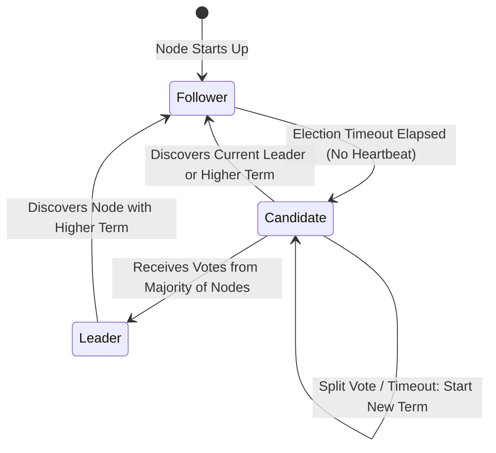

# Modul 142: Desain Kode Bersih & Pola Desain (SOLID Principles, 23 Design Patterns Gang of Four, Refactoring)

**Navigasi**: [⬅️ Master Index](../../INDEX.md) | [Tingkat 9: Tingkat 9: Software Engineering, Front-End, Back-End, Full-Stack & Cloud/SRE](./README.md)
*Sebelumnya*: [141. penguasaan-git-tingkat-lanjut](./141-penguasaan-git-tingkat-lanjut.md) | *Berikutnya*: [143. arsitektur-perangkat-lunak-skala-besar](./143-arsitektur-perangkat-lunak-skala-besar.md)

---

## 1. Intuisi Dasar Tanpa Jargon ("Seperti Bayi Baru Lahir")
Meskipun Paxos adalah algoritma konsensus yang terbukti secara matematis, hampir semua orang yang membacanya merasa kesulitan untuk memahaminya, apalagi mengimplementasikannya ke dalam kode nyata tanpa bug tersembunyi. Bahkan tim insinyur jenius di Google membutuhkan waktu bertahun-tahun untuk membuat Paxos bekerja stabil di sistem Chubby mereka. Algoritma Konsensus Terdistribusi: Raft ([In Search of an Understandable Consensus Algorithm](https://raft.github.io/)) diciptakan oleh Diego Ongaro dan John Ousterhout di Stanford University pada tahun 2014 dengan satu misi utama: menciptakan algoritma konsensus yang setara kekuatannya dengan Multi-Paxos, tetapi **sangat mudah dipahami dan diimplementasikan** oleh manusia normal! Raft memecah konsensus menjadi tiga bagian mandiri: **Pemilihan Pemimpin (Leader Election)** melalui sistem pemungutan suara berbatas waktu acak; **Replikasi Log (Log Replication)** di mana pemimpin mendikte pengisian jurnal secara satu arah; dan **Keselamatan (Safety Invariants)** yang menjamin tidak ada riwayat data yang pernah ditulis ulang.

## 2. Fondasi Teoretis & Aksiomatik / Matematis
Tiga Sub-Masalah Algoritma Raft dan Invarian Keselamatan (Raft Safety Invariants):

1. **Pemilihan Pemimpin (Leader Election)**:
   Setiap node berada dalam salah satu dari 3 status: `Follower`, `Candidate`, atau `Leader`.
   Waktu dibagi menjadi era jabatan bernomor integer (*Terms* $T = 1, 2, 3, \dots$):
   - Follower mereset **Election Timeout** acak (biasanya $150-300\text{ ms}$) setiap kali menerima detak jantung (*Heartbeat / AppendEntries*) dari Leader.
   - Jika timeout habis tanpa heartbeat: Follower berubah menjadi `Candidate`, menaikkan term ($T = T + 1$), memilih dirinya sendiri, dan menyiarkan pesan $\text{RequestVote}$ ke node lain.
   - Node menjadi `Leader` jika dan hanya jika berhasil mengumpulkan suara dari mayoritas node ($\lfloor N/2 \rfloor + 1$).

2. **Replikasi Log (Log Replication)**:
   Leader menerima perintah dari klien, menambahkan entri ke log lokalnya, lalu menyiarkan pesan $\text{AppendEntries}$ ke seluruh Follower.
   Sebuah entri log dianggap **Committed** ketika berhasil disalin ke mayoritas node.

3. **Invarian Keselamatan Inti Raft (Election Safety Invariant)**:
   $$\text{Candidate } C \text{ hanya berhak memenangkan pemilihan suara jika log miliknya minimal sama mutakhirnya}$$   $$\text{dengan log milik mayoritas pemilih } (\text{Term akhir } C \ge \text{Term pemilih } \land \text{Index akhir } C \ge \text{Index pemilih})$$
   Invarian ini menjamin bahwa Leader baru pasti memegang seluruh entri log yang pernah di-commit di era-era jabatan sebelumnya (*Leader Completeness Property*)!

## 3. Anatomi Teknis & Cara Kerja Internal
Mesin Status Transisi Peran Node Raft dan Struktur Entri Log Berindeks:



1. **Log Matching Property**: Jika dua log di server berbeda memiliki entri dengan index dan term yang sama, maka seluruh entri log dari awal hingga index tersebut dijamin identik 100%.
2. **Joint Consensus (Rekonfigurasi Klaster Dinamis)**:
   Mengubah keanggotaan klaster (menambah atau menghapus server) secara aman pada saat sistem berjalan tanpa henti melalui konfigurasi transisi gabungan dua-fase ($C_{old, new}$).

## 4. Implementasi Praktis & Kode / Simulasi Riil
```python
# Raft Consensus Node State Machine Core Logic in Python
import random
import time
from typing import List, Dict, Optional

class RaftNode:
    def __init__(self, node_id: int, peers: List[int]):
        self.id = node_id
        self.peers = peers
        self.current_term = 0
        self.voted_for: Optional[int] = None
        self.log: List[Dict] = [] # Entri: {'term': T, 'command': C}
        self.role = "FOLLOWER"
        self.commit_index = -1
        self.last_heartbeat = time.time()
        self.election_timeout = random.uniform(0.15, 0.30)

    def handle_append_entries(self, term: int, leader_id: int, prev_log_index: int, 
                              prev_log_term: int, entries: List[Dict], leader_commit: int) -> Tuple[int, bool]:
        # 1. Tolak jika term pengirim lebih kecil dari term lokal saat ini
        if term < self.current_term: return self.current_term, False
        
        # Perbarui term dan beralih status ke Follower jika term pengirim lebih tinggi
        if term > self.current_term:
            self.current_term = term
            self.role = "FOLLOWER"
            self.voted_for = None

        self.last_heartbeat = time.time() # Reset detak jantung
        
        # 2. Periksa konsistensi log pendahulu (Log Matching Invariant)
        if prev_log_index >= 0:
            if len(self.log) <= prev_log_index or self.log[prev_log_index]['term'] != prev_log_term:
                return self.current_term, False # Log konflik!

        # Sisipkan entri baru dan mutakhirkan commit index
        self.log = self.log[:prev_log_index + 1] + entries
        if leader_commit > self.commit_index:
            self.commit_index = min(leader_commit, len(self.log) - 1)
        return self.current_term, True
```

## 5. Miskonsepsi & Jebakan Industri
1. **Committing Entries from Previous Terms Directly by Counting Replicas**: Pemimpin baru mencoba men-commit entri log warisan dari era kepemimpinan sebelumnya hanya dengan menghitung apakah entri tersebut telah tersalin di mayoritas replika (Gambar 8 pada paper Raft). Hal ini dapat memicu penimpaan data yang berbahaya; aturan Raft menyatakan: *Pemimpin hanya boleh men-commit entri dari term jabatannya saat ini!*.
2. **Fixed Election Timeout Causing Split-Vote Deadlock**: Menggunakan durasi election timeout yang statis dan identik pada semua server. Semua Follower akan menjadi Candidate pada detik yang persis sama dan saling membagi suara secara seimbang (*Split Vote*), membuat sistem gagal memilih Leader selamanya (solusi: selalu acak timeout antara $150-300\text{ ms}$).
3. **Stale Leader Phantom Reads**: Jaringan terisolasi memisahkan Leader lama di pulau minoritas. Leader lama tetap melayani kueri baca klien dengan data usang (*Stale Read*) tanpa menyadari pulau mayoritas telah memilih Leader baru (solusi: Leader wajib melakukan handshake kueri Read-Index ke mayoritas node sebelum menjawab pembacaan).

## 6. Proyek Latihan & Rubrik Penilaian Mandiri
1. **Tingkat Pemula**: Buka visualisasi interaktif resmi Raft di peramban web ([The Secret Lives of Data - Raft](https://thesecretlivesofdata.com/raft/)). Amati proses Leader Election saat node pemimpin dimatikan secara paksa.
2. **Tingkat Menengah**: Implementasikan handler pesan `RequestVote` lengkap di Python sesuai aturan evaluasi log term dan indeks kandidat Raft. Uji skenario di mana node yang log-nya tertinggal ditolak suaranya oleh node yang log-nya lebih mutakhir.
3. **Tingkat Mahir**: Bangun klaster penyimpanan Key-Value terdistribusi berbasis Raft 3-node yang fungsional (seperti etcd mini) menggunakan gRPC di Go atau Rust. Tunjukkan kemampuan klaster mempertahankan konsistensi data saat satu node dimatikan (`kill -9`) dan dipulihkan kembali.

## 7. Rekomendasi Sumber Belajar Standar Emas
| Sumber Pembelajaran | Penulis / Institusi | Tautan Langsung | Fokus Materi |
| :--- | :--- | :--- | :--- |
| In Search of an Understandable Consensus Algorithm (Extended Raft Paper) | Diego Ongaro & John Ousterhout (Stanford) | [Raft Official Extended Paper](https://raft.github.io/raft.pdf) | Alkitab Raft: Leader Election, Log Replication, Safety Proofs & Joint Consensus |
| The Secret Lives of Data: Raft Interactive Visualization | Ben Johnson | [The Secret Lives of Data](https://thesecretlivesofdata.com/raft/) | Visualisasi Interaktif Animasi Terbaik Cara Kerja Pemilihan Pemimpin & Replikasi Raft |
| etcd: Distributed Reliable Key-Value Store Architecture | Cloud Native Computing Foundation (CNCF) | [etcd Raft Implementation](https://github.com/etcd-io/raft) | Mesin Konsensus Raft Produksi Terbesar di Dunia (Menggerakkan Kubernetes) |
| Students' Guide to Raft (MIT 6.824) | Jon Gjengset (MIT Distributed Systems) | [MIT 6.824 Raft Guide](https://thesquareplanet.com/blog/students-guide-to-raft/) | Analisis Jebakan Bug Klasik Implementasi Raft, Lock Granularity & RPC Timings |

---
*Navigasi Cepat*: [Ke Tingkat 9](./README.md) | [Ke Master Index](../../INDEX.md) | *Sebelumnya*: [141. penguasaan-git-tingkat-lanjut](./141-penguasaan-git-tingkat-lanjut.md) | *Berikutnya*: [143. arsitektur-perangkat-lunak-skala-besar](./143-arsitektur-perangkat-lunak-skala-besar.md)
