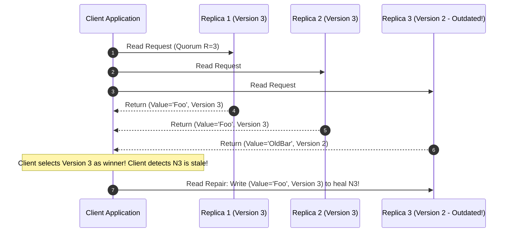

# Modul 143: Arsitektur Perangkat Lunak Skala Besar (Modular Monolith, Clean/Hexagonal Architecture, Microservices, CQRS, DDD)

**Navigasi**: [⬅️ Master Index](../../INDEX.md) | [Tingkat 9: Tingkat 9: Software Engineering, Front-End, Back-End, Full-Stack & Cloud/SRE](./README.md)
*Sebelumnya*: [142. desain-kode-bersih-pola-desain](./142-desain-kode-bersih-pola-desain.md) | *Berikutnya*: [144. metodologi-pengujian-otomatis](./144-metodologi-pengujian-otomatis.md)

---

## 1. Intuisi Dasar Tanpa Jargon ("Seperti Bayi Baru Lahir")
Menyimpan data bisnis di satu hard disk tunggal adalah tindakan bunuh diri: semua disk pada akhirnya akan rusak atau terbakar. Replikasi Data Terdistribusi ([Distributed Data Replication](https://dataintensive.net/)) adalah seni menggandakan data yang sama ke banyak mesin yang terhubung di jaringan. Tiga mazhab besar menguasai dunia arsitektur penyimpanan modern: **Leader-Follower (Single-Leader)** seperti PostgreSQL di mana semua penulisan wajib disetorkan ke sang Raja tunggal; **Multi-Leader** di mana kantor cabang di berbagai benua dapat menerima penulisan data secara lokal lalu menyinkronkannya perlahan; dan **Leaderless (Amazon Dynamo-style)** seperti Apache Cassandra yang tidak memiliki hierarki pemimpin sama sekali—klien melempar penulisan langsung ke sekumpulan server acak dan menggunakan matematika kuorum sakti ($R + W > N$) untuk menjamin pembacaan data segar tanpa pernah bergantung pada satu server pun!

## 2. Fondasi Teoretis & Aksiomatik / Matematis
Matematika Kuorum Replikasi Tanpa Pemimpin (Leaderless Quorum Reads and Writes):

Diberikan klaster penyimpanan terdistribusi dengan total $N$ replika penyimpanan data.
- Setiap operasi penulisan (*Write*) wajib dikonfirmasi oleh minimal $W$ replika.
- Setiap operasi pembacaan (*Read*) wajib meminta data dari minimal $R$ replika.

Kondisi Konsistensi Kuorum Ketat (Strict Quorum Condition):
$$\mathbf{R + W > N}$$

Pembuktian Matematis Prinsip Sarang Merpati (Pigeonhole Principle):
Jika $R + W > N$, maka himpunan replika yang menerima penulisan data terbaru ($W$) dan himpunan replika yang dibaca oleh klien ($R$) **pasti memiliki irisan minimal satu node bersama**:
$$|R \cap W| = R + W - N \ge 1$$
Node yang berada di titik temu irisan tersebut dijamin memegang versi data paling mutakhir (dilacak via Version Vectors), menjamin bahwa pembacaan selalu menghasilkan nilai terkini (*Strong Consistency*)!

Konfigurasi Kuorum Khas pada $N = 3$:
$$W = 2, \quad R = 2 \implies R + W = 4 > 3 \quad (\text{Mentoleransi 1 node mati secara transparan})$$

## 3. Anatomi Teknis & Cara Kerja Internal
Mekanisme Rekonsiliasi Data Replikasi Tanpa Pemimpin: Read Repair dan Anti-Entropy:



1. **Read Repair**: Klien yang mendeteksi ada replika yang memegang versi data usang saat operasi pembacaan kuorum secara otomatis mengirimkan pembaruan data terbaru kembali ke replika yang tertinggal untuk menyembuhkannya (*Self-Healing Data*).
2. **Anti-Entropy Process via Merkle Trees**: Proses latar belakang berkala di mana server membandingkan pohon hash kriptografi (**Merkle Tree**) untuk mendeteksi perbedaan blok data yang hilang tanpa perlu mentransfer seluruh isi database melintasi jaringan.

## 4. Implementasi Praktis & Kode / Simulasi Riil
```python
# Quorum Read/Write Consistency Simulator (R + W > N) in Python
from typing import List, Dict, Optional

class ReplicaNode:
    def __init__(self, node_id: int):
        self.id = node_id
        self.store: Dict[str, Tuple[str, int]] = {} # key -> (val, version)

    def write(self, key: str, val: str, version: int) -> bool:
        cur_ver = self.store.get(key, (None, -1))[1]
        if version > cur_ver:
            self.store[key] = (val, version)
            return True
        return False

class QuorumClient:
    def __init__(self, replicas: List[ReplicaNode], W: int, R: int):
        self.replicas = replicas
        self.W = W; self.R = R; self.current_version = 0

    def quorum_write(self, key: str, val: str) -> bool:
        self.current_version += 1
        acks = sum(r.write(key, val, self.current_version) for r in self.replicas)
        return acks >= self.W

    def quorum_read(self, key: str) -> Optional[str]:
        responses = [r.store.get(key, (None, -1)) for r in self.replicas[:self.R]]
        # Ambil nilai dengan versi tertinggi yang berhasil dibaca dari kuorum R
        best_val, best_ver = max(responses, key=lambda item: item[1])
        return best_val
```

## 5. Miskonsepsi & Jebakan Industri
1. **Sloppy Quorum and Phantom Data Losses**: Menggunakan *Sloppy Quorum* dan *Hinted Handoff* saat partisi jaringan: penulisan diterima oleh node sementara di luar himpunan $N$ utama. Sifat $R + W > N$ runtuh sementara, dan pembacaan kuorum dapat mengembalikan data usang sampai proses hinted handoff selesai.
2. **Replication Lag in Asynchronous Read Replicas**: Menambahkan 10 read-replica asinkron untuk menangani beban pembacaan web. Selama lonjakan penulisan tinggi, jeda replikasi (*Replication Lag*) membengkak hingga puluhan detik, memicu keluhan pengguna yang melihat data mereka menghilang sementara.
3. **Multi-Leader Write-Write Conflict Explosion**: Dua pengguna mengedit profil yang sama pada dua data center berbeda secara bersamaan. Jika tidak ada aturan resolusi konflik deterministik (seperti LWW, CRDT, atau Operational Transformation), database akan mengalami percabangan data korup permanen.

## 6. Proyek Latihan & Rubrik Penilaian Mandiri
1. **Tingkat Pemula**: Diberikan klaster penyimpanan 5 node ($N=5$). Tentukan apakah konfigurasi berikut memenuhi konsistensi kuorum ketat: (a) $W=3, R=3$, (b) $W=4, R=2$, (c) $W=2, R=3$, (d) $W=5, R=1$.
2. **Tingkat Menengah**: Bangun simulasi Merkle Tree sederhana di Python untuk membandingkan dua dataset 1000 rekaman beralamat kunci. Tunjukkan bagaimana perbedaan data pada satu rekaman tunggal dapat diisolasi dalam waktu $O(\log N)$ penelusuran pohon hash.
3. **Tingkat Mahir**: Implementasikan arsitektur replikasi Leaderless Cassandra mini lengkap dengan fitur Read Repair asinkron dan deteksi konflik berbasis Vector Clocks. Simulasikan penulisan konkruen yang memicu cabang nilai bercabang (*Siblings*) dan lakukan rekonsiliasi manual di sisi klien.

## 7. Rekomendasi Sumber Belajar Standar Emas
| Sumber Pembelajaran | Penulis / Institusi | Tautan Langsung | Fokus Materi |
| :--- | :--- | :--- | :--- |
| Dynamo: Amazon's Highly Available Key-value Store | Giuseppe DeCandia et al. (Amazon) | [Amazon Dynamo SOSP 2007](https://www.allthingsdistributed.com/files/amazon-dynamo-sosp2007.pdf) | Makalah Orisinal Penemuan Arsitektur Dynamo: Quorums, Merkle Trees & Sloppy Quorums |
| Designing Data-Intensive Applications (DDIA) | Martin Kleppmann | [DDIA Chapter 5: Replication](https://dataintensive.net/) | Leader-Follower, Multi-Leader, Quorum Reads/Writes & Replication Lag Invariants |
| Cassandra: A Decentralized Structured Storage System | Avinash Lakshman & Prashant Malik (Facebook) | [ACM SIGOPS 2010 Cassandra](https://www.cs.cornell.edu/projects/ladis2009/papers/lakshman-datastore.pdf) | Arsitektur Cassandra, LSM-Trees, Gossip Protocol & Tunable Consistency |
| Apache Kafka Replication Internals & In-Sync Replicas (ISR) | Neha Narkhede et al. | [Confluent Kafka Replication](https://www.confluent.io/blog/hands-free-kafka-replication-a-lesson-in-operational-simplicity/) | Model Replikasi Log Komit Terdistribusi & In-Sync Replica (ISR) Pool |

---
*Navigasi Cepat*: [Ke Tingkat 9](./README.md) | [Ke Master Index](../../INDEX.md) | *Sebelumnya*: [142. desain-kode-bersih-pola-desain](./142-desain-kode-bersih-pola-desain.md) | *Berikutnya*: [144. metodologi-pengujian-otomatis](./144-metodologi-pengujian-otomatis.md)
