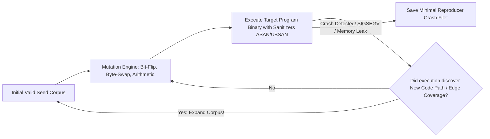

# Modul 144: Metodologi Pengujian Otomatis (Testing Pyramid, Unit Mocks, Integration, Contract Pact, E2E, TDD)

**Navigasi**: [⬅️ Master Index](../../INDEX.md) | [Tingkat 9: Tingkat 9: Software Engineering, Front-End, Back-End, Full-Stack & Cloud/SRE](./README.md)
*Sebelumnya*: [143. arsitektur-perangkat-lunak-skala-besar](./143-arsitektur-perangkat-lunak-skala-besar.md) | *Berikutnya*: [145. interaksi-manusia-komputer-hci-ui-ux](./145-interaksi-manusia-komputer-hci-ui-ux.md)

---

## 1. Intuisi Dasar Tanpa Jargon ("Seperti Bayi Baru Lahir")
### 1.1 Konsep Inti & Analogi Tanpa Jargon
Banyak programmer mengira pekerjaan mereka selesai begitu kode berhasil dikompilasi dan 'tampak berjalan' di laptop mereka. Itu adalah ilusi yang berbahaya: perangkat lunak yang belum diuji secara ketat adalah bom waktu yang menunggu meledak di tangan pengguna. Metodologi Pengujian Perangkat Lunak ([Software Testing Methodology](https://martinfowler.com/articles/practical-test-pyramid.html)) adalah disiplin rekayasa pertahanan bertingkat. Piramida Pengujian memandu efisiensi kita: ribuan **Unit Tests** cepat di lapisan bawah menguji fungsi terisolasi; **Integration Tests** memastikan database dan API pihak ketiga berbicara dengan harmonis; sementara teknik modern mutakhir—seperti **Property-Based Testing** yang menguji kebenaran properti matematika dengan ribuan input acak ekstrem, dan **Fuzz Testing** yang membombardir biner dengan mutasi data gila—mampu menemukan celah keamanan memori tersembunyi yang tidak pernah terpikirkan oleh otak manusia terpandai sekalipun.

### 1.2 Urgensi Rekayasa & Signifikansi Sistemik
Dalam rekayasa sistem modern, pemahaman mendalam tentang konsep ini membedakan arsitek sistem kelas dunia dari sekadar operator perkakas teknis.

## 2. Fondasi Teoretis & Aksiomatik / Matematis
### 2.1 Kerangka Teori Aksiomatik & Formulasi Matematis
Teorema Pengujian Dijkstra dan Formalisme Property-Based Testing (QuickCheck):

### 2.2 Penurunan Matematis Langkah-demi-Langkah
1. **Teorema Edsger W. Dijkstra (1970)**:
   $$\text{'Pengujian program dapat membuktikan keberadaan bug dengan sangat efektif,}$$
   $$\text{tetapi secara matematis TIDAK AKAN PERNAH bisa membuktikan ketiadaan bug!'}$$

2. **Piramida Pengujian (The Test Pyramid - Mike Cohn & Martin Fowler)**:
   $$\text{UI / End-to-End Tests (10\% - Lambat & Rapuh)} \quad < \quad \text{Integration Tests (20\%)} \quad < \quad \mathbf{Unit Tests (70\% - Cepat & Stabil)}$$

3. **Property-Based Testing (Claessen & Hughes, 2000)**:
   Alih-alih menguji contoh spesifik (*Example-based testing* seperti `add(2, 3) == 5`), kita mendefinisikan sifat invarian matematika universal $\forall x$:
   $$\forall x, y \in \mathbb{Z}, \quad x + y \equiv y + x \quad (\text{Komutatif})$$
   $$\forall x \in \text{Data}, \quad \text{deserialize}(\text{serialize}(x)) \equiv x \quad (\text{Round-trip Invariant})$$
   Mesin penguji secara otomatis menghasilkan ribuan kasus acak; jika ditemukan kegagalan, mesin menjalankan **Shrinking**: memangkas input gagal menjadi contoh terkecil yang paling minimal.

## 3. Anatomi Teknis & Cara Kerja Internal
Arsitektur Coverage-Guided Fuzzing (AFL / libFuzzer Engine):



1. **Sanitizers Instrumentation (ASan / UBSan / TSan)**:
   Kompilator (Clang/GCC `-fsanitize=address`) menyuntikkan instruksi pengawas bayangan memori (*Shadow Memory*) di setiap akses pointer untuk mendeteksi buffer overflow, use-after-free, dan data race tepat pada instruksi terjadinya kesalahan.

#### Tabel Penelusuran Integrasi Trajektori Mars Climate Orbiter: Mismatch Satuan Gaya (1999)
| Titik Waktu Perjalanan | Sub-sistem Penggerak (Lockheed Martin) | Sub-sistem Navigasi (NASA JPL) | Konversi Satuan Fisik | Deviasi Trajektori Akumulatif | Status Posisi Pesawat Antariksa |
|---|---|---|---|---|---|
| Kalibrasi Manuver TCM-4| Pendorong diaktifkan | Format data impuls: Pound-detik ($lbf\cdot s$) | JPL mengasumsikan Newton-detik ($N\cdot s$) | Faktor galat: $1\text{ lbf} = 4.44822\text{ N}$ | Pembacaan gaya lebih kecil $4.45\times$ dari riil! |
| Hari Perjalanan 1..286 | Setiap impuls pendorong | Nilai impuls dikirim tanpa metadata satuan | Akumulasi kesalahan kalkulasi trajektori | Deviasi lintasan bertambah 1 km per minggu | Diabaikan oleh pengujian unit terisolasi |
| Pendekatan Mars | Rencana ketinggian orbit masuk | Target ketinggian aman: $226\text{ km}$ di atas Mars | Kalkulasi JPL salah karena input gaya cacat | Ketinggian riil pesawat meluncur turun | Pesawat meluncur ke atmosfer tebal Mars |
| Penurunan Fatal | Pesawat mendekati Mars | - | - | Ketinggian riil anjlok ke **57 KM!** | Batas kehancuran struktural: $< 80\text{ km}$! |
| Kehancuran Pesawat | Gesekan atmosfer ekstrem | Wahana terbakar dan hancur di angkasa | - | Sinyal radio terputus permanen | **PESAWAT SENILAI $327 JUTA HILANG TOTAL!** |

## 4. Implementasi Praktis & Kode / Simulasi Riil
```python
# Property-Based Testing using Hypothesis Framework in Python
from hypothesis import given, strategies as st

# Fungsi yang diuji: Pengurutan list angka
def custom_sort(lst: list) -> list:
    return sorted(lst)

# Uji Properti Universal Invarian Pengurutan
@given(st.lists(st.integers()))
def test_sorting_properties(input_list):
    result = custom_sort(input_list)
    
    # Properti 1: Panjang output harus selalu sama dengan panjang input
    assert len(result) == len(input_list)
    
    # Properti 2: Elemen hasil wajib terurut secara monoton menaik
    for i in range(len(result) - 1):
        assert result[i] <= result[i + 1]
        
    # Properti 3: Idempotensi sorting
    assert custom_sort(result) == result

print("Property-based test assertions defined!")
```

## 5. Miskonsepsi & Jebakan Industri
1. **Over-Mocking Testing Nothing (Mocking All Collaborators)**: Mengganti semua dependensi database dan API dengan mock objek palsu. Unit test lulus 100% dengan warna hijau, namun ketika dijalankan di server nyata, sistem crash seketika karena skema SQL di database fisik tidak cocok dengan mock.
2. **Flaky Tests Eroding Engineering Trust**: Menulis pengujian integrasi yang mengandalkan jeda waktu tidur `sleep(2)` alih-alih polling kondisi asinkron yang tepat. Pengujian akan gagal sesekali saat CPU server CI sedang sibuk, membuat tim mengabaikan laporan kegagalan pengujian.
3. **Chasing 100% Code Coverage Vanity Metric**: Mengharuskan 100% line coverage tanpa menguji kondisi batas (*Edge Cases*). Mengeksekusi setiap baris kode bukan berarti menguji seluruh kemungkinan kombinasi status logika.

### Studi Kasus Kegagalan Nyata: Kehancuran Wahana Antariksa Mars Climate Orbiter Akibat Mismatch Satuan Pound-Force vs Newton (1999)
- **Kronologi & Konteks Sejarah**: Pada 23 September 1999, wahana antariksa penjelajah Mars milik NASA, Mars Climate Orbiter senilai 327,6 juta dolar AS, tiba di orbit planet Mars setelah menempuh perjalanan 9 bulan melintasi antariksa. Namun saat memasuki manuver penyisipan orbit (*Mars Orbit Insertion*), sinyal komunikasi pesawat terputus dan tidak pernah kembali.
- **Akar Masalah Pengujian Otomatis & Kontrak Antarmuka Perangkat Lunak**: Investigasi dewan peninjau kegagalan NASA mengungkap kesalahan integrasi perangkat lunak yang mengejutkan: perangkat lunak stasiun darat yang ditulis oleh kontraktor Lockheed Martin menghitung data impuls pendorong manuver menggunakan satuan imperial Inggris *Pound-force seconds* ($lbf \cdot s$). Namun perangkat lunak navigasi navigasi di NASA Jet Propulsion Laboratory (JPL) mengasumsikan data masukan tersebut menggunakan satuan metrik standar internasional *Newton-seconds* ($N \cdot s$). Satu pound-force setara dengan $4,44822$ Newton. Karena tidak ada pengujian integrasi otomatis ujung-ke-ujung (*End-to-End Integration Tests*) yang memvalidasi kontrak tipe data dan satuan fisik antar antarmuka sistem, akumulasi galat impuls sebesar $4,45\times$ menyebabkan lintasan pesawat turun terlalu rendah: bukannya masuk ke orbit pada ketinggian aman 226 km, pesawat menukik ke ketinggian 57 km di dalam atmosfer tebal Mars dan hancur berkeping-keping akibat panas gesekan dan tekanan aerodinamis.

- **Potongan Kode / Arsitektur Cacat (Vulnerable Implementation)**:
```c
// Rekonstruksi Mismatch Kontrak Tipe Data pada Antarmuka Mars Climate Orbiter
#include <stdio.h>

// Modul Lockheed Martin: Menghitung gaya dalam satuan Imperial (Pound-Force)
double calculate_thruster_impulse_imperial(double thruster_burn_seconds) {
    double force_pounds = 100.0; // lbf
    return force_pounds * thruster_burn_seconds; // Satuan: lbf * s
}

// Modul NASA JPL: Mengasumsikan masukan adalah Satuan Metrik (Newton-Seconds)
// CACAT INTEGRASI: Ketiadaan validasi tipe kuat (Strong Typing) pada antarmuka fungsi!
void update_spacecraft_trajectory_flawed(double impulse_input) {
    // JPL berasumsi impulse_input adalah Newton * detik:
    // Padahal nilai riil 4.45x lebih besar karena dikirim dalam Pound-Force * detik!
    double force_newtons = impulse_input; // KESALAHAN FATAL KONTRAK DATA!
    
    // Akumulasi kesalahan trajektori menurunkan ketinggian orbit hingga menabrak atmosfer Mars!
}

// Mitigasi Defensif Modern: Pemodelan Domain Satuan dengan Sistem Tipe Kuat (Strong Units)
typedef struct { double value_newtons; } ForceMetric;
typedef struct { double value_pounds;  } ForceImperial;

ForceMetric convert_imperial_to_metric(ForceImperial f) {
    return (ForceMetric){ .value_newtons = f.value_pounds * 4.4482216 };
}
```

- **Analisis Forensik & Rekayasa Modern**: Tragedi Mars Climate Orbiter menjadi dasar pembentukan metodologi *Contract Testing* dan penegakan sistem tipe kuat (*Dimensional Analysis Type Safety*). Bahasa pemrograman modern (seperti Rust, F#, dan C++ dengan pustaka `std::chrono` dan unit types) kini mendukung pembungkusan tipe dimensi fisik di tingkat kompilasi (*zero-cost phantom types*), sehingga upaya meneruskan variabel berdimensi `Pound` ke fungsi yang mengharapkan `Newton` akan ditolak secara mutlak sebagai kesalahan kompilasi (*compile-time error*).

## 6. Proyek Latihan & Rubrik Penilaian Mandiri
1. **Tingkat Pemula**: Tulis rangkaian pengujian unit test menggunakan kerangka `pytest` untuk fungsi kalkulator string matematika: uji input normal, pembagian nol, input negatif, dan format karakter tidak valid.
2. **Tingkat Menengah**: Gunakan pustaka mock (`unittest.mock`) untuk menguji layanan pembayaran pesanan e-commerce: simulasikan kegagalan jaringan saat menghubungi gateway pembayaran dan buktikan status pesanan ditandai sebagai `PAYMENT_FAILED`.
3. **Tingkat Mahir**: Bangun target Fuzz Testing menggunakan Google `libFuzzer` dan Clang AddressSanitizer (`-fsanitize=fuzzer,address`) untuk mem-fuzz parser header biner paket jaringan kustom di C/C++. Biarkan fuzzer berjalan selama 10 menit dan analisis apakah ditemukan memory leak atau out-of-bounds read.

### Tingkat 1: Dasar
- **Tugas**: Bangun suite pengujian unit (*Unit Test Suite*) komprehensif menggunakan framework pengujian (seperti `unittest` dalam Python atau `Google Test` dalam C++) untuk modul kalkulator konversi suhu (Celsius, Fahrenheit, Kelvin) yang memverifikasi kasus normal, kasus batas absolut (*Absolute Zero* $-273.15^\circ\text{C} = 0\text{ K}$), dan memastikan exception dilempar jika suhu di bawah nol mutlak dimasukkan.
- **Petunjuk Perancangan Arsitektur**:
  - Terapkan struktur pengujian standar AAA (*Arrange, Act, Assert*).
  - Gunakan `assertAlmostEqual` dengan toleransi floating-point $\epsilon = 10^{-5}$.
- **Test Vector & Kasus Uji Ekstrem**:
  - *Suhu Di Bawah Nol Mutlak*: Uji konversi $-300^\circ\text{C}$; sistem harus melempar exception `ValueError: Suhu tidak boleh berada di bawah nol mutlak`.
- **Rubrik Penilaian Mandiri**: 40% Kepatuhan Struktur AAA Pengujian Unit yang Rapi, 30% Cakupan Kasus Batas Nol Mutlak, 30% Validasi Penolakan Exception.

### Tingkat 2: Menengah
- **Tugas**: Kembangkan pengujian berbasis properti (*Property-Based Testing*) mandiri dalam Python (menggunakan konsep mirip framework Hypothesis) untuk memvalidasi fungsi pengurutan array dengan menghasilkan $1.000$ array acak masukan dan menegakkan 3 invarian matematika universal: (1) Panjang array output sama dengan input, (2) Elemen output adalah permutasi sah dari input, (3) Setiap elemen $A[i] \le A[i+1]$.
- **Petunjuk Perancangan Arsitektur**:
  - Bangkitkan vektor uji acak mencakup array kosong, array 1 elemen, array dengan seluruh elemen duplikat, dan array bernilai ekstrem integer ($[-2^{31}, 2^{31}-1]$).
- **Test Vector & Kasus Uji Ekstrem**:
  - *Fuzzing Invarian*: Jalankan pengujian properti pada QuickSort; pastikan seluruh 1.000 permutasi acak lolos verifikasi invarian 100%.
- **Rubrik Penilaian Mandiri**: 40% Perumusan 3 Invarian Universal Property-Based Testing, 30% Pembangkitan Masukan Fuzzing Kasus Ekstrem, 30% Ketahanan Pengujian.

### Tingkat 3: Mahir
- **Tugas**: Rancang pustaka sistem tipe dimensional aman (*Type-Safe Unit Dimension System*) dalam C++ atau Rust yang menggunakan template metaprogramming / phantom types untuk menyandikan dimensi fisik SI dasar (Massa $M$, Panjang $L$, Waktu $T$) ke dalam tipe data kompilasi, buktikan bahwa perkalian $\text{Massa} \times \text{Akselerasi}$ otomatis menghasilkan tipe $\text{Gaya}$ (Newton), dan kesalahan penambahan $\text{Meter} + \text{Detik}$ ditolak oleh kompiler.
- **Petunjuk Perancangan Arsitektur**:
  - Definisikan tipe template: `Unit<int M, int L, int T>`.
  - Kelebihan operator `+` hanya mengizinkan operand dengan dimensi template yang identik persis.
  - Kelebihan operator `*` menjumlahkan eksponen dimensi template masing-masing: `Unit<M1+M2, L1+L2, T1+T2>`.
- **Test Vector & Kasus Uji Ekstrem**:
  - *Verifikasi Kompilasi*: Tulis ekspresi `Force f = Mass(10) * Acceleration(9.8)`; verifikasi kompilasi berhasil; Tulis `Length(10) + Time(5)`; verifikasi kompiler menolak kode dengan pesan error tipe tidak cocok.
- **Rubrik Penilaian Mandiri**: 40% Template Metaprogramming Dimensi SI Bebas Cacat, 30% Penegakan Keamanan Satuan di Tingkat Kompilasi (Zero Runtime Overhead), 30% Kerapian Enkapsulasi Operator.

## 7. Rekomendasi Sumber Belajar Standar Emas
| Sumber Pembelajaran | Penulis / Institusi | Tautan Langsung | Fokus Materi |
| :--- | :--- | :--- | :--- |
| The Practical Test Pyramid | Ham Vocke & Martin Fowler | [Martin Fowler Testing Pyramid](https://martinfowler.com/articles/practical-test-pyramid.html) | Unit Tests, Integration Tests, End-to-End Tests & Anti-Patterns |
| QuickCheck: A Lightweight Tool for Random Testing of Haskell Programs | Koen Claessen & John Hughes | [ACM ICFP 2000 Paper](https://dl.acm.org/doi/10.1145/351240.351266) | Makalah Orisinal Penemuan Property-Based Testing & Shrinking |
| LLVM libFuzzer: A Library for In-Process Coverage-Guided Fuzz Testing | The LLVM Compiler Infrastructure | [LLVM libFuzzer Documentation](https://llvm.org/docs/LibFuzzer.html) | Coverage-Guided Fuzzing, Sanitizer Integration & Corpus Management |
| Unit Testing Principles, Practices, and Patterns | Vladimir Khorikov (Manning) | [Manning Khorikov Book](https://www.manning.com/books/unit-testing) | Definisi Unit Test Baik vs Buruk, Mocking vs Stubs & Anti-Fragile Tests |

---
*Navigasi Cepat*: [Ke Tingkat 9](./README.md) | [Ke Master Index](../../INDEX.md) | *Sebelumnya*: [143. arsitektur-perangkat-lunak-skala-besar](./143-arsitektur-perangkat-lunak-skala-besar.md) | *Berikutnya*: [145. interaksi-manusia-komputer-hci-ui-ux](./145-interaksi-manusia-komputer-hci-ui-ux.md)
