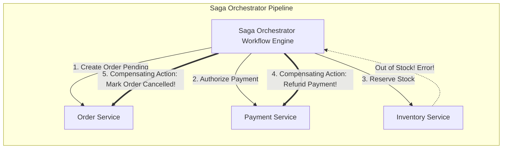

# Modul 145: Interaksi Manusia & Komputer / HCI serta UI/UX (Fitts's Law, Hick's Law, Aksesibilitas WCAG AAA, Design Systems)

**Navigasi**: [⬅️ Master Index](../../INDEX.md) | [Tingkat 9: Tingkat 9: Software Engineering, Front-End, Back-End, Full-Stack & Cloud/SRE](./README.md)
*Sebelumnya*: [144. metodologi-pengujian-otomatis](./144-metodologi-pengujian-otomatis.md) | *Berikutnya*: [146. front-end-mesin-browser-standar-web](./146-front-end-mesin-browser-standar-web.md)

---

## 1. Intuisi Dasar Tanpa Jargon ("Seperti Bayi Baru Lahir")
Bayangkan transaksi perbankan modern: Anda mentransfer Rp 1.000.000 dari rekening Bank A Anda untuk membayar belanjaan di toko e-commerce yang menggunakan rekening Bank B. Uang wajib dipotong dari Bank A dan uang wajib masuk ke Bank B. Tidak boleh ada skenario di mana uang di Bank A terpotong namun Bank B gagal menerima uang tersebut (uang lenyap di udara!); dan tidak boleh uang masuk ke Bank B namun Bank A gagal memotong saldo Anda (uang bertambah secara gaib!). Transaksi Terdistribusi ([Distributed Transactions & Sagas](https://microservices.io/patterns/data/saga.html)) adalah protokol penegakan keadilan absolut melintasi batas sistem yang berbeda. Dari protokol klasik yang sangat ketat (**Two-Phase Commit / 2PC**) di mana semua database mengunci data dan bersumpah bersama; hingga pola arsitektur modern microservices (**Saga Pattern**) yang mengoordinasikan transaksi panjang melalui rantai peristiwa dan transaksi kompensasi pembatalan otomatis (*Compensating Transactions*) yang anggun.

## 2. Fondasi Teoretis & Aksiomatik / Matematis
Protokol Dua Fase (Two-Phase Commit / 2PC) dan Pola Saga Kompensasi (Saga Pattern):

1. **Protokol Two-Phase Commit (2PC - Gray, 1978)**:
   Dikelola oleh satu Koordinator Transaksi (**Coordinator**) dan sekumpulan partisipan database (**Participants**):
   - **Fase 1 (Prepare / Voting)**:
     Koordinator mengirim pesan $\text{Prepare}$ ke seluruh partisipan. Partisipan mengeksekusi transaksi secara lokal, mengunci baris data (Row Locks), menulis perubahan ke redo log, dan membalas: `VOTE_COMMIT` (siap) atau `VOTE_ABORT` (gagal).
   - **Fase 2 (Commit / Rollback)**:
     Jika **SEMUA** partisipan membalas `VOTE_COMMIT`, Koordinator menulis keputusan ke disk log dan menyiarkan perintah $\text{Global\_Commit}$.
     Jika **ADA SATU SAJA** yang membalas `VOTE_ABORT` (atau timeout), Koordinator menyiarkan perintah $\text{Global\_Abort}$.

2. **Kelemahan Fatal 2PC: Sifat Pemblokiran (Blocking Protocol)**:
   Jika Koordinator mengalami crash permanen setelah partisipan membalas `VOTE_COMMIT` di Fase 1, seluruh partisipan **terkunci selamanya (*Blocked in In-Doubt State*)**! Partisipan tidak boleh membatalkan secara sepihak dan tidak boleh meng-commit sendiri.

3. **Pola Transaksi Saga (Hector Garcia-Molina & Kenneth Salem, 1987)**:
   Memecahkan transaksi global menjadi urutan transaksi lokal independen: $T_1, T_2, \dots, T_n$.
   Setiap transaksi lokal $T_i$ memiliki pasangan **Transaksi Kompensasi** $C_i$ yang membatalkan dampak efek samping $T_i$ jika terjadi kegagalan di tengah jalan:
   $$\text{Jika } T_k \text{ Gagal} \implies \text{Eksekusi Kompensasi Mundur: } C_{k-1}, C_{k-2}, \dots, C_1$$

## 3. Anatomi Teknis & Cara Kerja Internal
Arsitektur Saga Pattern (Choreography vs Orchestration) dan Pola Transaksional Outbox:



1. **Transactional Outbox Pattern**: Memecahkan masalah pembaruan database dan publikasi event pesan ke message broker (Kafka/RabbitMQ) secara atomik. Alih-alih mempublikasikan pesan langsung ke jaringan, aplikasi menulis payload pesan ke tabel internal database lokal (`outbox table`) di dalam transaksi database lokal yang sama. Proses latar belakang terpisah (*Message Relay / Debezium CDC*) membaca tabel outbox dan mempublikasikannya ke broker dengan jaminan *At-Least-Once Delivery* ([Microservices.io Outbox Pattern](https://microservices.io/patterns/data/transactional-outbox.html)).

## 4. Implementasi Praktis & Kode / Simulasi Riil
```python
# Saga Pattern Orchestrator with Forward Execution and Backward Compensation in Python
from typing import List, Callable, Tuple

class SagaStep:
    def __init__(self, name: str, action: Callable[[], bool], compensate: Callable[[], None]):
        self.name = name
        self.action = action         # Transaksi lokal maju
        self.compensate = compensate # Aksi kompensasi mundur pembalik

class SagaOrchestrator:
    def __init__(self):
        self.steps: List[SagaStep] = []
        self.executed_steps: List[SagaStep] = []

    def add_step(self, step: SagaStep):
        self.steps.append(step)

    def execute(self) -> bool:
        for step in self.steps:
            print(f"[Saga] Executing forward action: {step.name}...")
            success = step.action()
            if success:
                self.executed_steps.append(step)
            else:
                print(f"[Saga ALERT] Action failed at step: {step.name}! Initiating rollback...")
                self._rollback()
                return False
        print("[Saga] Distributed transaction workflow completed successfully!")
        return True

    def _rollback(self):
        # Eksekusi kompensasi secara mundur dari langkah terakhir yang sukses!
        for step in reversed(self.executed_steps):
            print(f"  [Compensating] Undoing changes for: {step.name}...")
            step.compensate()
```

## 5. Miskonsepsi & Jebakan Industri
1. **2PC Lock Contention Crippling Cloud Microservices**: Menggunakan Two-Phase Commit melintasi microservices independen yang berkomunikasi melalui jaringan publik. Kunci baris database ditahan selama proses voting, membekukan ribuan transaksi lain dan melumpuhkan throughput sistem saat terjadi latensi jaringan.
2. **Non-Idempotent Compensating Actions in Saga**: Mengimplementasikan aksi kompensasi pembatalan yang tidak idempoten (misal fungsi kompensasi pembalikan saldo dipanggil dua kali akibat timeout retry jaringan, memotong uang nasabah dua kali lipat!).
3. **Dual-Write Hazard without Transactional Outbox**: Menyimpan data order ke database PostgreSQL, lalu mengirimkan pesan event ke Apache Kafka di baris kode berikutnya. Jika server crash tepat di antara kedua baris kode tersebut, data tersimpan di database tetapi event tidak pernah dikirim ke Kafka, merusak konsistensi antar-microservice.

## 6. Proyek Latihan & Rubrik Penilaian Mandiri
1. **Tingkat Pemula**: Simulasikan diagram alur Two-Phase Commit (2PC) ketika terdapat 1 Koordinator dan 3 Partisipan di mana Partisipan nomor 2 menolak dengan suara `VOTE_ABORT`. Tunjukkan pesan yang dikirimkan koordinator pada Fase 2.
2. **Tingkat Menengah**: Gunakan kelas `SagaOrchestrator` di atas untuk memodelkan proses checkout e-commerce (Langkah 1: Buat Order, Langkah 2: Potong Saldo Kartu Kredit, Langkah 3: Potong Stok Barang). Simulasikan kegagalan pada Langkah 3 dan buktikan saldo kartu kredit dikembalikan secara otomatis via fungsi kompensasi.
3. **Tingkat Mahir**: Implementasikan pola Transactional Outbox Pattern lengkap menggunakan PostgreSQL dan Python: simpan transaksi pesanan bersama entri pesan event di tabel `outbox` dalam satu transaksi ACID `BEGIN ... COMMIT`. Bangun worker independen yang membaca tabel outbox secara streaming menggunakan Change Data Capture (CDC) atau `SELECT ... FOR UPDATE SKIP LOCKED`.

## 7. Rekomendasi Sumber Belajar Standar Emas
| Sumber Pembelajaran | Penulis / Institusi | Tautan Langsung | Fokus Materi |
| :--- | :--- | :--- | :--- |
| Notes on Data Base Operating Systems (Two-Phase Commit 2PC) | Jim Gray (Turing Award Winner) | [Jim Gray 1978 Classic Paper](https://www.microsoft.com/en-us/research/publication/notes-on-data-base-operating-systems/) | Makalah Orisinal Penemuan Protokol Konsensus Transaksi Two-Phase Commit |
| Sagas: Hector Garcia-Molina & Kenneth Salem | Princeton University | [ACM SIGMOD 1987 Paper](https://www.cs.cornell.edu/andru/cs711/2002fa/reading/sagas.pdf) | Makalah Orisinal Penemuan Pola Transaksi Kompensasi Sagas |
| Pattern: Saga (Orchestration vs Choreography) | Chris Richardson (Microservices.io) | [Microservices.io Saga Pattern](https://microservices.io/patterns/data/saga.html) | Pola Arsitektur Microservices Saga, Compensating Transactions & Outbox |
| Transactional Outbox Pattern for Microservices | Debezium / Red Hat | [Debezium Outbox Pattern](https://debezium.io/blog/2019/02/19/reliable-microservices-data-exchange/) | Change Data Capture (CDC), Event Sourcing & Dual-Write Hazard Elimination |

---
*Navigasi Cepat*: [Ke Tingkat 9](./README.md) | [Ke Master Index](../../INDEX.md) | *Sebelumnya*: [144. metodologi-pengujian-otomatis](./144-metodologi-pengujian-otomatis.md) | *Berikutnya*: [146. front-end-mesin-browser-standar-web](./146-front-end-mesin-browser-standar-web.md)
