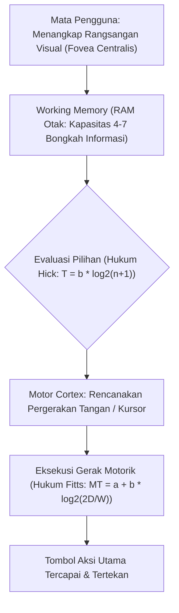

# Modul 145: Interaksi Manusia & Komputer / HCI serta UI/UX (Fitts's Law, Hick's Law, Aksesibilitas WCAG AAA, Design Systems)

**Navigasi**: [⬅️ Master Index](../../INDEX.md) | [Tingkat 9: Tingkat 9: Software Engineering, Front-End, Back-End, Full-Stack & Cloud/SRE](./README.md)
*Sebelumnya*: [144. metodologi-pengujian-otomatis](./144-metodologi-pengujian-otomatis.md) | *Berikutnya*: [146. front-end-mesin-browser-standar-web](./146-front-end-mesin-browser-standar-web.md)

---

## 1. Intuisi Dasar Tanpa Jargon ("Seperti Bayi Baru Lahir")
### 1.1 Menjembatani Pikiran Manusia dan Sirkuit Komputer ([The Design of Everyday Things - Don Norman](https://www.nngroup.com/books/design-everyday-things-revised/))
Sebuah sistem perangkat lunak yang memiliki algoritma tercepat di dunia tidak ada gunanya jika pengguna manusia tidak tahu cara menggunakannya atau membuat kesalahan fatal karena antarmuka yang membingungkan. Interaksi Manusia dan Komputer (Human-Computer Interaction / HCI) adalah sains yang mempelajari bagaimana memori kerja, persepsi visual, dan fisiologi motorik manusia berinteraksi dengan sistem digital.

### 1.2 Dua Hukum Fisika Desain: Hukum Fitts & Hukum Hick ([Fitts's Law in UI Design](https://www.nngroup.com/articles/fitts-law/))
Perancangan UI bukan sekadar tentang estetika seni atau memilih warna yang indah. Desain antarmuka berakar pada hukum matematika psikofisik terbukti:
1. **Hukum Fitts**: Waktu yang dibutuhkan tangan atau kursor manusia untuk mencapai sebuah target tombol berbanding lurus dengan jarak dan berbanding terbalik dengan ukuran tombol. Itulah sebabnya tombol aksi utama dibuat besar dan diletakkan dekat dengan jangkauan ibu jari pada ponsel!
2. **Hukum Hick**: Waktu yang dibutuhkan seseorang untuk mengambil keputusan meningkat secara logaritmik seiring bertambahnya jumlah pilihan menu. Terlalu banyak tombol di layar memicu kelumpuhan analisis (*analysis paralysis*).
Ditambah dengan standar aksesibilitas web **WCAG AAA**, sistem modern harus dapat diakses secara setara oleh pengguna dengan disabilitas penglihatan, motorik, maupun kognitif.

## 2. Fondasi Teoretis & Aksiomatik / Matematis
### 2.1 Formulasi Matematis Hukum Fitts ([Paul M. Fitts, 1954](https://psycnet.apa.org/record/1955-03714-001))
Waktu Gerakan (*Movement Time / MT*) untuk mencapai target selebar $W$ pada jarak $D$:
$$\text{MT} = a + b \cdot \text{ID}$$
Di mana $\text{ID}$ adalah Indeks Kesulitan (*Index of Difficulty*, satuan bit):
$$\text{ID} = \log_2 \left( \frac{2D}{W} \right) \quad \text{atau formulasi Shannon: } \log_2 \left( \frac{D}{W} + 1 \right)$$
Konstanta empiris $a$ merepresentasikan waktu reaksi awal manusia ($\approx 200 \text{ ms}$), dan $b$ adalah laju konduksi pemrosesan informasi motorik ($\approx 100 \text{ ms/bit}$).
**Prinsip Desain Sudut Tak Hingga**: Pada layar desktop komputer, keempat sudut layar memiliki lebar efektif $W = \infty$ karena kursor mouse tidak dapat keluar dari batas monitor fisik, menjadikan sudut layar sebagai target tercepat dengan $\text{ID} \to 0$.

### 2.2 Formulasi Hukum Hick-Hyman & Rasio Kontras Aksesibilitas WCAG ([W3C WCAG 2.2 Standard](https://www.w3.org/TR/WCAG22/))
Waktu Reaksi Keputusan Manusia ($T$) dengan $n$ pilihan alternatif probabilitas sama:
$$T = b \cdot \log_2(n + 1)$$
Rumus Rasio Kontras Luminansi Relatif WCAG:
Diberikan luminansi relatif warna latar depan $L_1$ dan latar belakang $L_2$ ($L_1 > L_2$):
$$\text{Contrast Ratio} = \frac{L_1 + 0.05}{L_2 + 0.05}$$
Standar Kepatuhan:
- Tingkat AA: Rasio minimal $4.5:1$ untuk teks normal, $3:1$ untuk teks besar.
- Tingkat AAA: Rasio minimal $7:1$ untuk teks normal, $4.5:1$ untuk teks besar.
Luminansi $L$ dihitung dari komponen sRGB ternormalisasi:
$$L = 0.2126 \cdot R + 0.7152 \cdot G + 0.0722 \cdot B$$

## 3. Anatomi Teknis & Cara Kerja Internal


#### Tabel Walkthrough Perhitungan Indeks Kesulitan Hukum Fitts untuk Dua Desain Tombol
| Parameter | Desain A (Tombol Kecil Jauh) | Desain B (Tombol Besar Dekat / Floating Action Button) |
|---|---|---|
| Jarak Target $D$ | 800 piksel | 100 piksel |
| Lebar Target $W$ | 20 piksel | 60 piksel |
| Rasio $D/W$ | \$800 / 20 = 40$ | \$100 / 60 = 1.67$ |
| Indeks Kesulitan $\text{ID} = \log_2(D/W + 1)$ | $\log_2(41) \approx 5.36 \text{ bit}$ | $\log_2(2.67) \approx 1.42 \text{ bit}$ |
| Prediksi Waktu Gerak ($a=200, b=100$) | \$200 + 100(5.36) = 736 \text{ ms}$ | \$200 + 100(1.42) = 342 \text{ ms}$ (**2.15x Lebih Cepat!**) |

#### Tabel Penelusuran Siklus Keputusan UI/UX & Peringatan Rudal Palsu Hawaii (13 Januari 2018)
| Langkah Operasi Operator | Tampilan Antarmuka Antarmuka (UI Dropdown) | Pilihan Menu yang Tersedia | Penerapan Hukum Hick & Fitts | Konfirmasi Tindakan (*Dialog Modal*) | Konsekuensi Keamanan Publik |
|---|---|---|---|---|---|
| Pergantian Shift Jaga | Menu drop-down teks statis membingungkan | 15 Tombol teks abu-abu berjejer rapat | Melanggar Hukum Fitts: Tombol darurat berdampingan dengan uji coba!| Nol pembeda visual (warna seragam) | Operator dalam kondisi stres shift pagi |
| Maksud Operator | Menjalankan latihan pengujian internal rutin | Tombol 1: `TEST AMBER ALERT` | Menu drop-down panjang | Teks uji dan darurat mirip | Beban kognitif tinggi |
| Kesalahan Klik Fisik | Salah memilih baris menu drop-down | Terpilih Tombol 2: `PACOM (CDW) - STATE ONLY` | Teks membingungkan tanpa kata "TEST" | Dialog modal hanya bertanya: *"Are you sure?"* | Tombol konfirmasi tidak menjelaskan dampak! |
| Peringatan Terpancar | Operator menekan tombol "Yes" | Sinyal darurat disiarkan | Melewati TV, radio, jaringan seluler ponsel | 1.4 Juta penduduk menerima notifikasi darurat | **KEPANIKAN MASAL SELURUH NEGARA BAGIAN!** |
| Waktu Pembatalan | Tidak ada tombol "Batal / Undo" instan | Operator panik mencari cara membatalkan | Ketiadaan prosedur pembatalan darurat | Butuh waktu 38 menit untuk klarifikasi resmi!| Penduduk bersembunyi di bunker dan saluran air |

## 4. Implementasi Praktis & Kode / Simulasi Riil
```python
import math

def calculate_wcag_contrast(rgb1: tuple[int, int, int], rgb2: tuple[int, int, int]) -> dict:
    """
    Menghitung rasio kontras warna sesuai formula resmi W3C WCAG 2.2.
    rgb1, rgb2: Tuple (R, G, B) integer 0 s/d 255.
    """
    def channel_luminance(c_int: int) -> float:
        c_norm = c_int / 255.0
        if c_norm <= 0.04045:
            return c_norm / 12.92
        else:
            return math.pow((c_norm + 0.055) / 1.055, 2.4)

    def relative_luminance(rgb: tuple[int, int, int]) -> float:
        r = channel_luminance(rgb[0])
        g = channel_luminance(rgb[1])
        b = channel_luminance(rgb[2])
        return 0.2126 * r + 0.7152 * g + 0.0722 * b

    lum1 = relative_luminance(rgb1)
    lum2 = relative_luminance(rgb2)

    l_max = max(lum1, lum2)
    l_min = min(lum1, lum2)

    contrast_ratio = (l_max + 0.05) / (l_min + 0.05)

    return {
        "contrast_ratio": round(contrast_ratio, 2),
        "wcag_aa_normal": contrast_ratio >= 4.5,
        "wcag_aa_large": contrast_ratio >= 3.0,
        "wcag_aaa_normal": contrast_ratio >= 7.0
    }

# Uji coba: Teks abu-abu muda di atas latar putih (Kesalahan umum UI modern)
res = calculate_wcag_contrast((180, 180, 180), (255, 255, 255))
print(f"Rasio Kontras: {res['contrast_ratio']}:1 | Lolos AA: {res['wcag_aa_normal']} | Lolos AAA: {res['wcag_aaa_normal']}")
```

## 5. Miskonsepsi & Jebakan Industri
### Studi Kasus Kegagalan Nyata: Insiden Tombol Peringatan Darurat Rudal Palsu Hawaii (2018)
- **Kronologi & Latar Belakang**: Pada 13 Januari 2018, lebih dari 1,4 juta penduduk kepulauan Hawaii menerima pesan darurat di ponsel mereka: *"EMERGENCY ALERT: BALLISTIC MISSILE THREAT INBOUND TO HAWAII. SEEK IMMEDIATE SHELTER. THIS IS NOT A DRILL."* Selama 38 menit terjadi kepanikan massal sebelum ralat resmi dikeluarkan.
- **Akar Masalah**: Antarmuka sistem darurat menggunakan menu drop-down teks murni di mana opsi pengujian internal rutin (`DRILL - PACOM (CDO) - State Only`) berada tepat berdampingan dengan opsi peringatan nyata (*LIVE*) tanpa pemisahan visual, tanpa warna pembeda, dan tanpa dialog konfirmasi verifikasi dua langkah (*two-factor confirmation dialog*). Operator salah mengklik opsi pengujian yang memicu sirene perang nyata.
- **Rekomendasi Industri**: Tindakan destruktif atau berkonsekuensi tinggi harus dirancang dengan **Interlock Fisik/Digital** (misal: mengharuskan mengetik kata konfirmasi "HAPUS"), menggunakan pemisahan warna zona bahaya (merah/amber), dan mematuhi prinsip *Error Prevention & Forgiving UI*.

### Studi Kasus Kegagalan Nyata: Kepanikan Massal Peringatan Rudal Balistik Palsu Hawaii Akibat Cacat Desain UI/UX (13 Januari 2018)
- **Kronologi & Konteks Sejarah**: Pada Sabtu pagi, 13 Januari 2018 pukul 08:07 waktu Hawaii, lebih dari 1,4 juta penduduk dan wisatawan di seluruh Kepulauan Hawaii menerima peringatan darurat darurat ekstrem di ponsel pintar mereka: *"BALLISTIC MISSILE THREAT INBOUND TO HAWAII. SEEK IMMEDIATE SHELTER. THIS IS NOT A DRILL."* Notifikasi ini menyiarkan alarm darurat di seluruh stasiun televisi dan radio, memicu kepanikan massal selama 38 menit sebelum pemerintah negara bagian mengeluarkan konfirmasi resmi bahwa peringatan tersebut adalah kesalahan sistem palsu.
- **Akar Masalah Desain Interaksi Manusia-Komputer (HCI) & Antarmuka Pengguna (UI/UX)**: Laporan investigasi Komisi Komunikasi Federal (FCC) menyimpulkan bahwa insiden tersebut dipicu oleh rancangan antarmuka pengguna yang sangat buruk pada perangkat lunak Emergency Alert System (EAS). Antarmuka sistem hanya menampilkan menu drop-down teks polos dengan daftar panjang opsi perintah yang memiliki nama teknis membingungkan dan tata letak berhimpitan tanpa hierarki visual. Tombol untuk latihan uji coba internal (*DRILL - State Only*) ditempatkan berdampingan persis dengan tombol peluncuran peringatan darurat rudal nyata (*PACOM (CDW) - STATE ONLY*) dengan warna, ukuran, dan bentuk yang sama persis (pelanggaran Hukum Fitts dan Hukum Hick). Dialog konfirmasi pop-up hanya memuat pertanyaan generik *"Are you sure?"* tanpa menampilkan ringkasan dampak bencana yang akan terjadi, dan sistem tidak memiliki mekanisme tombol pembatalan cepat (*Emergency Cancel/Undo*).

- **Potongan Kode / Arsitektur Cacat (Vulnerable Implementation)**:
```html
<!-- Rekonstruksi Antarmuka Cacat Sistem Peringatan Darurat Hawaii (2018) -->
<!-- CACAT UI/UX FATAL: Opsi latihan rutin dan peringatan perang nyata disatukan 
     dalam menu dropdown teks polos tanpa pembeda visual atau kode warna bahaya! -->
<select id="emergency_action_menu">
    <option value="test_amber">TEST - Amber Alert</option>
    <option value="test_tsunami">TEST - Tsunami Warning</option>
    <!-- Opsi Latihan Uji Coba: -->
    <option value="drill_missile">DRILL - PACOM (CDW) - STATE ONLY</option>
    <!-- Opsi Nyata Mematikan (Terletak Berdampingan!): -->
    <option value="real_missile">PACOM (CDW) - STATE ONLY</option>
</select>

<!-- Mitigasi Desain UI/UX Modern: Pemisahan Fisik, Kode Warna Kontras, & Konfirmasi 2-Faktor -->
<!-- Tombol Darurat Nyata wajib diisolasi di zona merah dengan pengetikan konfirmasi eksplisit -->
```

- **Analisis Forensik & Rekayasa Modern**: Krisis peringatan rudal Hawaii menjadi bukti paling nyata bahwa *bad UI/UX design can cause real-world catastrophe*. Rekayasa antarmuka pengguna untuk operasi kritis (*High-Consequence UI Design*) kini menegaskan prinsip: (1) Tombol tindakan destruktif wajib dipisahkan secara fisik dan visual dari tombol tindakan rutin; (2) Penggunaan dialog konfirmasi berbasis ketik konfirmasi eksplisit (misal: mengharuskan operator mengetik kata "BROADCAST MISSILE ALERT" alih-alih sekadar menekan tombol "OK"); (3) Ketersediaan tombol pembatalan instan (*One-Click Retraction Button*) yang dapat diakses dalam hitungan detik.

## 6. Proyek Latihan & Rubrik Penilaian Mandiri
### Level 1 (Pemula)
- **Tugas**: Hitung rasio kontras teks hitam murni `(0, 0, 0)` di atas latar belakang putih murni `(255, 255, 255)` menggunakan rumus WCAG.
- **Petunjuk Arsitektur**: Luminansi hitam adalah 0.0, luminansi putih adalah 1.0. Rasio $= (1.0 + 0.05) / (0.0 + 0.05)$.
- **Vektor Uji**:
  - Rasio kontras mutlak: \$1.05 / 0.05 = 21.00:1$ (Memenuhi standar WCAG AAA tertinggi).
- **Rubrik Penilaian**: Ketepatan aljabar luminansi (50%), verifikasi batas AAA (30%), kebersihan format (20%).

### Level 2 (Menengah)
- **Tugas**: Evaluasi dua tata letak navigasi e-commerce: (A) Menu navigasi datar dengan 16 kategori sekaligus vs (B) Menu mega hierarkis bertingkat 4 kategori utama masing-masing memiliki 4 sub-kategori, menggunakan Hukum Hick.
- **Petunjuk Arsitektur**: Bandingkan waktu reaksi $T_A = b \log_2(17)$ vs $T_B = 2 \times b \log_2(5)$.
- **Vektor Uji**:
  - Amati pengurangan beban kognitif pada struktur kategori hierarkis terpilih.
- **Rubrik Penilaian**: Penerapan rumus Hick-Hyman akurat (40%), perbandingan rasio waktu (30%), analisis psikologi kognitif (30%).

### Level 3 (Mahir)
- **Tugas**: Rancang komponen sistem desain UI tombol aksesibel di TypeScript/HTML yang mendukung navigasi keyboard penuh (Tab focus rings, Enter/Space actuation), atribut ARIA (`aria-pressed`, `aria-busy`), dan kontras adaptif mode gelap/terang otomatis.
- **Petunjuk Arsitektur**: Gunakan variabel token CSS semantik, tangani event listener `onKeyDown` untuk tombol Escape/Space, pastikan focus outline tidak pernah di-disable (`outline: none` dilarang keras tanpa pengganti).
- **Vektor Uji**:
  - Navigasi tombol hanya menggunakan tombol keyboard Tab dan Spacebar.
  - Komponen screen reader harus membacakan status `aria-busy="true"` saat proses asinkron berlangsung.
- **Rubrik Penilaian**: Kepatuhan standar aksesibilitas WCAG 2.2 (40%), implementasi ARIA semantik (30%), modularitas token CSS (30%).

### Tingkat 1: Dasar
- **Tugas**: Bangun komponen formulir web tombol destruktif (*Destructive Action Confirmation Modal*) dalam HTML/CSS/JavaScript yang mematuhi pedoman aksesibilitas WCAG 2.1 AA (kontras rasio warna teks $\ge 4.5:1$, navigasi keyboard penuh via tombol `Tab` dan `Esc`, serta atribut `aria-labelledby` dan `role="dialog"`).
- **Petunjuk Perancangan Arsitektur**:
  - Jebak fokus keyboard di dalam dialog modal (*Focus Trap*) saat modal terbuka.
  - Pulihkan fokus ke tombol pemicu awal saat modal ditutup.
- **Test Vector & Kasus Uji Ekstrem**:
  - *Navigasi Keyboard*: Buka modal; tekan `Tab` berulang-ulang; buktikan fokus hanya berputar di dalam modal dan tombol `Esc` menutup modal secara bersih.
- **Rubrik Penilaian Mandiri**: 40% Kepatuhan Standar Aksesibilitas WCAG 2.1 AA, 30% Implementasi Focus Trap yang Benar, 30% Kerapian Tata Letak Visual.

### Tingkat 2: Menengah
- **Tugas**: Kembangkan komponen antarmuka operasi keselamatan kritis (*Safety-Critical Operation Control*) dalam JavaScript/TypeScript yang mencegah kesalahan klik manusia menggunakan mekanisme *Two-Step Intentional Friction*: (1) Mengharuskan pengguna mengetik frasa konfirmasi yang tepat secara manual, dan (2) Timer penundaan pembatalan mundur 10 detik (*10-Second Undo Grace Period Bar*) sebelum aksi dikirim ke backend.
- **Petunjuk Perancangan Arsitektur**:
  - Tombol submit tetap dinonaktifkan (`disabled`) hingga string konfirmasi cocok persis (case-sensitive).
  - Tampilkan bilah kemajuan (*Progress Bar*) animasi mundur 10 detik dengan tombol "Batal / Undo" yang menonjol.
- **Test Vector & Kasus Uji Ekstrem**:
  - *Uji Pembatalan*: Pengguna mengetik konfirmasi, menekan tombol eksekusi; pada detik ke-7 pengguna menekan tombol "Batal"; buktikan request ke server dibatalkan dan status kembali bersih.
- **Rubrik Penilaian Mandiri**: 40% Mekanisme Two-Step Friction yang Efektif, 30% Implementasi Undo Grace Period Timer yang Tepat, 30% Umpan Balik Visual Status yang Jelas.

### Tingkat 3: Mahir
- **Tugas**: Rancang alat audit aksesibilitas web otomatis (*Automated DOM Accessibility Linter*) dalam JavaScript/Python yang membedah pohon DOM halaman web, mengevaluasi rasio kontras warna luminansi relatif teks terhadap latar belakang ($L_1 / L_2$), mendeteksi gambar tanpa atribut `alt`, serta memvalidasi struktur hierarki heading dokumen (`h1` $\to$ `h2` $\to$ `h3` tanpa ada level yang melompat).
- **Petunjuk Perancangan Arsitektur**:
  - Formula luminansi relatif WCAG: $L = 0.2126 R + 0.7152 G + 0.0722 B$ dengan koreksi gamma sRGB.
  - Rasio kontras: $(L_1 + 0.05) / (L_2 + 0.05)$.
- **Test Vector & Kasus Uji Ekstrem**:
  - *Audit Halaman Kompleks*: Jalankan linter pada halaman web uji yang memuat teks abu-abu di atas latar putih (`contrast 2.5:1`); buktikan linter mendeteksi pelanggaran WCAG dan mencetak nomor baris elemen yang bermasalah.
- **Rubrik Penilaian Mandiri**: 40% Perhitungan Rasio Kontras Luminansi Sesuai Formula WCAG, 30% Validasi Hierarki Heading & Atribut Aksesibilitas, 30% Pelaporan Diagnostik Rinci.

## 7. Rekomendasi Sumber Belajar Standar Emas
| Kategori | Judul Sumber & Tautan | Penulis / Institusi | Fokus Pembahasan |
|---|---|---|---|
| Standar Aksesibilitas | [Web Content Accessibility Guidelines (WCAG) 2.2](https://www.w3.org/TR/WCAG22/) | W3C Accessibility Guidelines Working Group | Pedoman resmi global standar aksesibilitas web, kontras warna, dan navigasi screen reader |
| Buku Fundamental HCI | [The Design of Everyday Things](https://www.nngroup.com/books/design-everyday-things-revised/) | Don Norman (Nielsen Norman Group) | Konsep dasar affordance, signifiers, feedback, dan pencegahan kesalahan kognitif manusia |
| Paper Fitts Asli | [The Information Capacity of the Human Motor System in Controlling the Amplitude of Movement](https://psycnet.apa.org/record/1955-03714-001) | Paul M. Fitts (1954) | Publikasi sejarah pembuktian matematis kapasitas motorik manusia dan Hukum Fitts |

---
*Navigasi Cepat*: [Ke Tingkat 9](./README.md) | [Ke Master Index](../../INDEX.md) | *Sebelumnya*: [144. metodologi-pengujian-otomatis](./144-metodologi-pengujian-otomatis.md) | *Berikutnya*: [146. front-end-mesin-browser-standar-web](./146-front-end-mesin-browser-standar-web.md)
