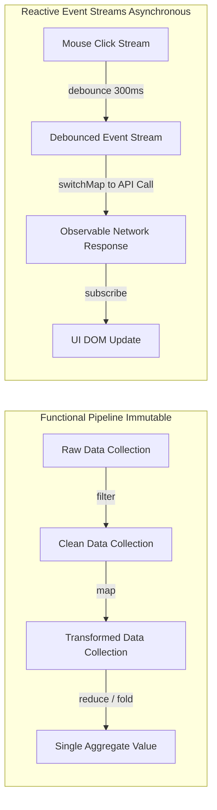

# Modul 146: Front-End: Bedah Mesin Browser & Standar Web (DOM/CSSOM Render Tree, V8 Event Loop, Web Workers, WebAssembly)

**Navigasi**: [⬅️ Master Index](../../INDEX.md) | [Tingkat 9: Tingkat 9: Software Engineering, Front-End, Back-End, Full-Stack & Cloud/SRE](./README.md)
*Sebelumnya*: [145. interaksi-manusia-komputer-hci-ui-ux](./145-interaksi-manusia-komputer-hci-ui-ux.md) | *Berikutnya*: [147. front-end-arsitektur-framework-ui-modern](./147-front-end-arsitektur-framework-ui-modern.md)

---

## 1. Intuisi Dasar Tanpa Jargon ("Seperti Bayi Baru Lahir")
Bahasa pemrograman hanyalah kuas cat; cara Anda memandang dunia adalah lukisan arsitektur Anda. Paradigma Pemrograman ([Programming Paradigms](https://www.geeksforgeeks.org/introduction-of-programming-paradigms/)) adalah kacamata filosofis dalam mengorganisasi pikiran manusia menjadi instruksi komputer. **Pemrograman Terstruktur** mengajarkan disiplin alur kendali linier tanpa lompatan liar `goto`; **Pemrograman Berorientasi Objek (OOP)** memandang dunia sebagai masyarakat objek pintar yang saling bertukar surat serta menegakkan prinsip SOLID agar sistem tidak rapuh saat diubah; **Pemrograman Fungsional Murni (FP)** memperlakukan komputasi seperti evaluasi fungsi matematika murni: tanpa efek samping (*No Side-Effects*), data abadi yang tidak pernah berubah (*Immutable Data*), dan bebas dari bahaya race-condition; sementara **Pemrograman Reaktif (Reactive)** memandang sistem sebagai sungai aliran peristiwa (*Event Streams*) yang bereaksi secara instan terhadap setiap perubahan data secara asinkron.

## 2. Fondasi Teoretis & Aksiomatik / Matematis
Prinsip SOLID Desain Berorientasi Objek (Robert C. Martin) dan Fondasi Matematika Kategori Fungsional:

1. **Prinsip SOLID (Object-Oriented Design)**:
   - **S (Single Responsibility Principle)**: Sebuah kelas hanya boleh memiliki satu alasan untuk berubah (satu aktor bisnis).
   - **O (Open/Closed Principle)**: Terbuka untuk ekstensi fungsionalitas baru, namun tertutup untuk modifikasi kode sumber yang sudah stabil.
   - **L (Liskov Substitution Principle - Barbara Liskov, 1987)**:
     Jika $S$ adalah subtipe dari $T$, maka objek bertipe $T$ dapat digantikan dengan objek bertipe $S$ tanpa merusak kebenaran program:
     $$\forall x : T, \ P(x) \implies \forall y : S, \ P(y) \quad (\text{Invarian Kontrak Pre/Post-Condition})$$
   - **I (Interface Segregation Principle)**: Klien tidak boleh dipaksa bergantung pada antarmuka metode yang tidak digunakannya.
   - **D (Dependency Inversion Principle)**: Modul tingkat tinggi tidak boleh bergantung pada modul tingkat rendah; keduanya wajib bergantung pada abstraksi antarmuka (*Dependency Injection*).

2. **Teori Kategori Fungsional (Monad & Functor)**:
   Fungsi murni adalah pemetaan deterministik $f: A \to B$ tanpa mutasi state global.
   Sebuah **Functor** adalah pemetaan yang mematuhi hukum identitas dan komposisi: $\text{fmap}(f \circ g) = \text{fmap}(f) \circ \text{fmap}(g)$.
   Sebuah **Monad** membungkus komputasi dengan efek samping terkendali melalui operasi `unit` (return) dan `bind` ($>>=$) yang mematuhi hukum asosiatif monoid.

## 3. Anatomi Teknis & Cara Kerja Internal
Arsitektur Aliran Data: Pemrograman Fungsional Pipelining vs Reaktif Event Streams:



1. **Immutability & Persistent Data Structures**: Menggunakan pohon trie bercabang (*Hash Array Mapped Trie / HAMT*) untuk menyalin modifikasi data secara parsial (*Structural Sharing*) dengan efisiensi memori $O(\log N)$, memungkinkan fitur pembatalan waktu riil (*Time Travel Debugging*).

## 4. Implementasi Praktis & Kode / Simulasi Riil
```python
# Comparing OOP SOLID Dependency Injection vs Functional Pure Composition in Python
from typing import Protocol, Callable

# 1. Gaya OOP dengan Dependency Inversion (SOLID)
class PaymentGateway(Protocol):
    def charge(self, amount: float) -> bool: ...

class StripeGateway:
    def charge(self, amount: float) -> bool:
        print(f"[Stripe] Processing charge: ${amount}")
        return True

class OrderService:
    def __init__(self, gateway: PaymentGateway):
        self.gateway = gateway # Bergantung pada abstraksi antarmuka Protocol!

    def checkout(self, total: float):
        if self.gateway.charge(total):
            print("[OrderService] Checkout completed successfully!")

# 2. Gaya Fungsional Murni (Pure Pipeline Composition)
from functools import reduce

transactions = [120.0, 45.0, 300.0, 15.0, 800.0]
# Pipeline murni tanpa mutasi variabel: filter -> map -> reduce
total_large_taxed = reduce(
    lambda acc, x: acc + x,
    map(lambda x: x * 1.10, filter(lambda x: x >= 100.0, transactions)),
    0.0
)
print(f"Functional aggregate result: ${total_large_taxed:.2f}")
```

## 5. Miskonsepsi & Jebakan Industri
1. **Liskov Substitution Principle Violation (Square-Rectangle Problem)**: Membuat kelas `Square` (Bujur Sangkar) mewarisi `Rectangle` (Persegi Panjang), lalu menimpa `setWidth()` agar otomatis mengubah tinggi. Fungsi klien yang menguji `rect.setWidth(5); rect.setHeight(4); assert rect.area() == 20` akan gagal seketika (*Broken Subtyping Contract*).
2. **Anemic Domain Model in OOP**: Merancang kelas objek yang hanya berisi field getter dan setter kosong tanpa logika bisnis, sementara seluruh logika operasional diletakkan di kelas service prosedural raksasa, mengubah arsitektur OOP menjadi prosedural spaghetti.
3. **Memory Leaks in Reactive Event Subscriptions**: Mengabaikan operasi pembatalan langganan (`unsubscribe()` pada RxJS/Reactive Streams) saat komponen UI dihancurkan. Observer akan tetap hidup di memori RAM dan dieksekusi setiap kali ada event baru masuk (*Zombie Subscriptions*).

## 6. Proyek Latihan & Rubrik Penilaian Mandiri
1. **Tingkat Pemula**: Identifikasi pelanggaran prinsip Single Responsibility Principle (SRP) pada kelas `UserManager` yang bertugas memvalidasi password, menyimpan rekaman ke SQL database, dan mengirim email konfirmasi. Rancang refactoring menjadi 3 kelas terpisah.
2. **Tingkat Menengah**: Bangun implementasi struktur data Functor dan Monad `Maybe` (atau `Option`) di Python/TypeScript yang menangani kemungkinan nilai kosong (`None`/`null`) secara anggun melalui metode `.map()` dan `.flatMap()` tanpa `if (x != null)` bertingkat.
3. **Tingkat Mahir**: Rancang mesin pemrosesan pesanan menggunakan paradigma Pemrograman Reaktif (Reactive Streams). Buat aliran peristiwa `OrderPlaced`, terapkan operator `debounce`, `filter`, dan `buffer(count=10, timeout=1s)`, lalu proses batch transaksi secara asinkron dengan kontrol backpressure.

## 7. Rekomendasi Sumber Belajar Standar Emas
| Sumber Pembelajaran | Penulis / Institusi | Tautan Langsung | Fokus Materi |
| :--- | :--- | :--- | :--- |
| Clean Architecture: A Craftsman's Guide to Software Structure | Robert C. Martin (Uncle Bob) | [Pearson Clean Architecture](https://www.pearson.com/en-us/subject-catalog/p/clean-architecture-a-craftsmans-guide-to-software-structure-and-design/P200000009583) | Prinsip SOLID Lengkap, Boundaries, Component Cohesion & Decoupling |
| Category Theory for Programmers | Bartosz Milewski | [Milewski Category Theory](https://github.com/hmemcpy/milewski-ctfp-pdf) | Fondasi Matematika Pemrograman Fungsional: Functors, Monads, Monoids & Kleisli |
| Reactive Programming and the Reactive Manifesto | Jonas Bonér et al. | [The Reactive Manifesto](https://www.reactivemanifesto.org/) | Responsive, Resilient, Elastic, Message Driven Distributed Systems |
| Structure and Interpretation of Computer Programs (SICP) | Harold Abelson & Gerald Jay Sussman (MIT) | [MIT SICP Full Text](https://mitpress.mit.edu/sites/default/files/sicp/full-text/book/book.html) | Paradigma Komputasi Abstraksi, Functional Programming & State Machines |

---
*Navigasi Cepat*: [Ke Tingkat 9](./README.md) | [Ke Master Index](../../INDEX.md) | *Sebelumnya*: [145. interaksi-manusia-komputer-hci-ui-ux](./145-interaksi-manusia-komputer-hci-ui-ux.md) | *Berikutnya*: [147. front-end-arsitektur-framework-ui-modern](./147-front-end-arsitektur-framework-ui-modern.md)
