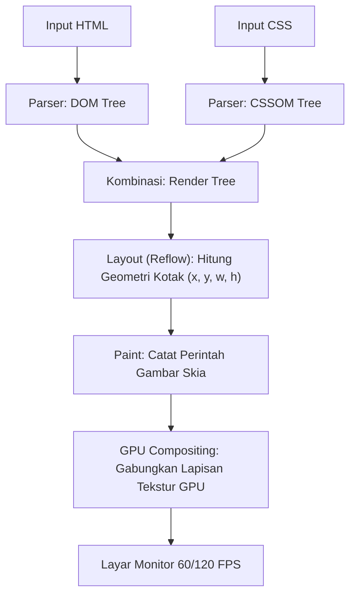

# Modul 146: Front-End: Bedah Mesin Browser & Standar Web (DOM/CSSOM Render Tree, V8 Event Loop, Web Workers, WebAssembly)

**Navigasi**: [⬅️ Master Index](../../INDEX.md) | [Tingkat 9: Tingkat 9: Software Engineering, Front-End, Back-End, Full-Stack & Cloud/SRE](./README.md)
*Sebelumnya*: [145. interaksi-manusia-komputer-hci-ui-ux](./145-interaksi-manusia-komputer-hci-ui-ux.md) | *Berikutnya*: [147. front-end-arsitektur-framework-ui-modern](./147-front-end-arsitektur-framework-ui-modern.md)

---

## 1. Intuisi Dasar Tanpa Jargon ("Seperti Bayi Baru Lahir")
### 1.1 Apa yang Sebenarnya Terjadi Saat Membuka Situs Web? ([How Browsers Work: Behind the scenes of modern web browsers](https://web.dev/articles/how-browsers-work))
Ketika Anda mengetik `https://google.com` di browser Anda, browser mengunduh ratusan kilobyte string teks mentah HTML, CSS, dan JavaScript. Bagaimana tumpukan string teks tersebut diubah menjadi antarmuka visual interaktif dengan animasi 60 frame per detik di layar ponsel Anda?

### 1.2 Pipeline Rendering dan Mesin Eksekusi JavaScript ([Inside look at modern web browser - Chrome Developers](https://developer.chrome.com/blog/inside-browser-part1/))
Browser modern (seperti Chromium dan Firefox) adalah mahakarya rekayasa sistem yang terdiri dari mesin terintegrasi raksasa:
1. **Mesin Rendering (Blink / Gecko)**: Membaca HTML menjadi pohon struktur objek memori (*Document Object Model / DOM*), mengurai CSS menjadi *CSSOM*, menggabungkan keduanya menjadi *Render Tree*, menghitung posisi geometri koordinat setiap kotak elemen (*Layout / Reflow*), dan menggambar piksel warna ke lapisan raster GPU (*Painting & Compositing*).
2. **Mesin JavaScript (Google V8 / SpiderMonkey)**: Mengeksekusi kode JavaScript menggunakan kompilasi JIT bertingkat (*Ignition Bytecode Interpreter* dan *TurboFan Compiler*) di atas arsitektur model *Single-Threaded Event Loop*.
3. **WebAssembly (Wasm)**: Memungkinkan kode biner compiled performa tinggi yang ditulis dalam C, C++, atau Rust berjalan langsung di dalam tab browser dengan kecepatan mendekati eksekusi *native* hardware!

## 2. Fondasi Teoretis & Aksiomatik / Matematis
### 2.1 Aljabar Pipeline Critical Rendering Path ([W3C DOM and CSSOM Specifications](https://www.w3.org/TR/DOM-Level-2-Core/))
Pipeline Critical Rendering Path memetakan tahapan berurutan:
$$\text{HTML} \xrightarrow{\text{Tokenizer}} \text{DOM} \quad \text{dan} \quad \text{CSS} \xrightarrow{\text{Parser}} \text{CSSOM}$$
Pohon Render (*Render Tree*) adalah irisan fungsional:
$$\text{RenderTree} = \{ v \in \text{DOM} \mid \text{CSSOM}(v).\text{display} \ne \text{"none"} \}$$
Perhitungan Geometri Tata Letak (*Layout Stage*):
Untuk setiap node $v \in \text{RenderTree}$, mesin menghitung kotak pembatas (*Box Model Geometry*):
$$\text{Box}(v) = (x_v, y_v, \text{width}_v, \text{height}_v)$$
Perubahan properti geometri (seperti `width`, `height`, `margin`) memicu **Reflow Global** yang memiliki kompleksitas waktu $\mathcal{O}(N)$ terhadap seluruh pohon DOM.
Sedangkan perubahan properti yang ditangani langsung oleh GPU Compositor (seperti `transform` matriks 3D dan `opacity`) memiliki biaya $\mathcal{O}(1)$ tanpa memicu reflow maupun repainting CPU.

### 2.2 Model Matematis Event Loop V8 & Antrean Tugas Microtask ([HTML Living Standard Event Loops](https://html.spec.whatwg.org/multipage/webappapis.html#event-loops))
Model konseptual antrean eksekusi per siklus detak (*tick*):
Diberikan Call Stack $S$, Antrean Tugas Makro $Q_{\text{macro}}$ (Timer, I/O), dan Antrean Tugas Mikro $Q_{\text{micro}}$ (Promises, `queueMicrotask`):
Invarian Pemrosesan per Tick:
1. Jalankan 1 tugas tertua dari $Q_{\text{macro}}$ hingga Stack $S$ kosong.
2. Kuras habis **SELURUH** tugas yang ada di $Q_{\text{micro}}$ hingga $Q_{\text{micro}} = \emptyset$:
   $$\forall m \in Q_{\text{micro}}, \quad \text{Execute}(m)$$
3. Lakukan rendering layar jika jendela waktu \$16.67 \text{ ms}$ (\$60 \text{ FPS}$) telah tercapai (*requestAnimationFrame*).
Jika sebuah mikro-tugas menjadwalkan mikro-tugas baru secara terus-menerus, ia memicu *Microtask Starvation*, mengunci antrean rendering dan membuat tab browser membeku total (*unresponsive*).

## 3. Anatomi Teknis & Cara Kerja Internal


#### Tabel Walkthrough Siklus Event Loop Eksekusi Kode Asinkron
| Langkah | Call Stack | Web APIs Background | Microtask Queue ($Q_{\text{micro}}$) | Macrotask Queue ($Q_{\text{macro}}$) | Output Terminal |
|---|---|---|---|---|---|
| 1 | `console.log("Start")` | - | - | - | "Start" |
| 2 | `setTimeout(cb1, 0)` | Timer 0ms dijadwalkan | - | - | - |
| 3 | `Promise.resolve().then(cb2)` | - | `[cb2]` | - | - |
| 4 | `console.log("End")` | - | `[cb2]` | `[cb1]` | "End" |
| 5 (Drain) | `cb2()` | - | `[]` | `[cb1]` | "Microtask Promise" |
| 6 (Next) | `cb1()` | - | - | `[]` | "Macrotask Timeout" |

#### Tabel Penelusuran Siklus Hidup Event Loop Browser & Pembekuan Utas Utama (Main Thread Freeze)
| Tahap Event Loop Browser | Status Call Stack JavaScript | Status Microtask Queue (Promises) | Status Macrotask Queue (Timers/I/O) | Status Rendering Pipeline (Layout/Paint) | Pengalaman Pengguna (Frame Rate) |
|---|---|---|---|---|---|
| Eksekusi Normal | Eksekusi fungsi UI cepat | `Promise.then` diproses | `setTimeout` dijadwalkan | RequestAnimationFrame $\to$ Paint (16 ms) | Mulus 60 FPS (16.6 ms per frame) |
| Loop Berat Dimulai | `while(true)` atau kueri berat | Menunggu stack kosong | Menunggu stack kosong | **TERBLOKIR TOTAL!** | Call stack dikuasai komputasi berat |
| Panggilan UI Pengguna | Pengguna mengklik tombol | Event click masuk macrotask queue | Event tertahan tidak bisa jalan | Browser tidak bisa me-render frame baru | **UI FREEZE / HANG LENGKAP!** |
| Peringatan Browser | Eksekusi $> 5\text{ detik}$ | Antrean terus menumpuk | Task terus terhambat | Tidak ada pembaruan layar | Dialog: *"Page Unresponsive / Kill?"*|
| Mitigasi Web Worker | Pindahkan tugas ke Thread Worker | Call stack utama tetap kosong | Event click diproses instan | Pipeline rendering berjalan lancar | Frame rate stabil 60 FPS (Bebas Lag)|

## 4. Implementasi Praktis & Kode / Simulasi Riil
```javascript
// Demonstrasi urutan deterministik eksekusi V8 Event Loop
console.log("1. Stack Sinkron Utama");

// Macrotask: Dijadwalkan ke antrean Task Queue
setTimeout(() => {
    console.log("5. Macrotask (setTimeout 0ms)");
}, 0);

// Microtask: Dijadwalkan ke antrean prioritas Microtask Queue
Promise.resolve().then(() => {
    console.log("3. Microtask 1 (Promise)");
}).then(() => {
    console.log("4. Microtask 2 (Promise Chaining)");
});

// Pemanggilan sinkron
console.log("2. Stack Sinkron Selesai");

/*
OUTPUT PASTI:
1. Stack Sinkron Utama
2. Stack Sinkron Selesai
3. Microtask 1 (Promise)
4. Microtask 2 (Promise Chaining)
5. Macrotask (setTimeout 0ms)
*/
```

## 5. Miskonsepsi & Jebakan Industri
### Studi Kasus Kegagalan Nyata: Bencana Layout Thrashing (Forced Synchronous Layout) pada Aplikasi Infinite Scroll
- **Kronologi & Latar Belakang**: Sebuah aplikasi portal media raksasa mengalami penurunan drastis performa scrolling di perangkat mobile, di mana frame rate anjlok dari 60 FPS menjadi 8 FPS (*jank* parah).
- **Kode Cacat**:
```javascript
// CACAT LAYOUT THRASHING: Membaca geometri setelah menulis DOM di dalam loop
for (let i = 0; i < elements.length; i++) {
    elements[i].style.width = "200px";           // Menulis properti DOM (Invalidasi Layout)
    const height = elements[i].offsetHeight;     // MEMAKSA Reflow Sinkron Seketika!
    elements[i].style.height = (height + 10) + "px";
}
```
- **Akar Masalah**: Browser menunda perhitungan layout secara batch. Namun, ketika kode membaca properti geometri seperti `offsetHeight` atau `getBoundingClientRect()` tepat setelah memodifikasi gaya visual, browser dipaksa menghentikan eksekusi JavaScript dan menjalankan perhitungan Reflow penuh seketika. Pada 1.000 elemen, layout dihitung ulang 1.000 kali dalam satu frame tunggal.
- **Rekomendasi Industri**: Pisahkan fase baca dan fase tulis (*Read-then-Write Phase*). Gunakan `requestAnimationFrame` atau library virtualizer modern seperti TanStack Virtual untuk mendaur ulang elemen DOM yang berada di luar viewport layar.

### Studi Kasus Kegagalan Nyata: Pembekuan Total Antarmuka Pengguna SPA Perbankan Akibat Loop Sinkronis Berat pada Utas Utama Browser
- **Kronologi & Konteks Kasus**: Pada platform Single Page Application (SPA) perbankan korporasi, fitur baru ditambahkan untuk menghasilkan laporan mutasi rekening gabungan dan visualisasi grafik arus kas untuk periode 5 tahun langsung di browser pengguna.
- **Akar Masalah Mesin Peramban, Event Loop, & Arsitektur Single-Threaded JavaScript**: Mesin browser modern (seperti V8 pada Chrome) mengeksekusi kode JavaScript pada satu utas tunggal (*Single Main Thread*), yang juga bertugas menangani pemrosesan peristiwa pengguna (*DOM Events*), kalkulasi gaya CSS (*Recalculate Style*), penataan tata letak (*Layout/Reflow*), dan penggambaran piksel layar (*Paint/Composite*). Pengembang mengimplementasikan kalkulasi agregasi statistik terhadap 500.000 baris transaksi menggunakan loop sinkronis berat di utas utama. Ketika pengguna mengklik tombol 'Hasilkan Laporan', *Call Stack* JavaScript dikuasai penuh oleh komputasi kalkulasi selama lebih dari 8 detik. Browser sama sekali tidak dapat menjalankan tahapan rendering atau merespons interaksi klik pengguna. Halaman web membeku total (*UI Freeze*), kursor mengetik macet, dan browser menampilkan dialog peringatan sistem: *"Page Unresponsive: Do you want to kill it?"*, merusak kepercayaan nasabah institusi besar.

- **Potongan Kode / Arsitektur Cacat (Vulnerable Implementation)**:
```javascript
// Rekonstruksi Anti-Pattern Pemblokiran Main Thread pada Single Page Application
function processLargeFinancialReportFlawed(transactionRecords) {
    // CACAT FATAL: Komputasi berat sinkron pada Utas Utama (Main Thread)!
    // Memblokir Event Loop, Rendering Pipeline, dan Interaksi Pengguna selama 8 detik!
    let aggregatedSum = 0;
    for (let i = 0; i < transactionRecords.length; i++) { // 500.000 iterasi
        aggregatedSum += complexMathCalculations(transactionRecords[i]);
    }
    updateDashboardUI(aggregatedSum);
}

// Mitigasi Defensif Modern: Pemindahan Beban Berat ke Web Worker Terisolasi
function processReportWithWebWorkerSafe(transactionRecords) {
    // Web Worker berjalan di utas latar belakang independen (Background Thread)
    // Utas utama browser tetap bebas 100% melayani rendering 60 FPS dan interaksi pengguna!
    const worker = new Worker("report_calculator_worker.js");
    worker.postMessage(transactionRecords);

    worker.onmessage = function(event) {
        // Terima hasil kalkulasi tanpa ada lag sedikitpun di antarmuka
        updateDashboardUI(event.data.aggregatedSum);
    };
}
```

- **Analisis Forensik & Rekayasa Modern**: Insiden pembekuan utas utama menegaskan pemahaman arsitektur mesin peramban. Aturan emas rekayasa front-end modern adalah: *Never block the main thread*. Batas waktu eksekusi satu frame adalah $16.6\text{ milidetik}$ untuk mempertahankan animasi 60 FPS. Sistem web berkinerja tinggi modern mengatasi komputasi berat melalui: (1) Pemanfaatan *Web Workers* untuk pemrosesan paralel di latar belakang; (2) Pemecahan komputasi besar menjadi irisan mikro (*Time-Slicing*) menggunakan API `scheduler.yield()` atau `requestIdleCallback()`; (3) Kompilasi modul komputasi intensif ke *WebAssembly* (Wasm).

## 6. Proyek Latihan & Rubrik Penilaian Mandiri
### Level 1 (Pemula)
- **Tugas**: Jelaskan mengapa pembaruan animasi visual menggunakan `transform: translate3d()` jauh lebih berkinerja tinggi dibanding mengubah properti `top` atau `left`.
- **Petunjuk Arsitektur**: Jelaskan perbedaan tahapan pipeline: `top`/`left` memicu Layout -> Paint -> Composite, sedangkan `transform` hanya memicu Composite pada layer GPU.
- **Vektor Uji**:
  - Konsep kunci: Eliminasi fase Reflow dan Repaint pada CPU.
- **Rubrik Penilaian**: Ketepatan tahapan Critical Rendering Path (50%), peran GPU compositor (30%), kebersihan bahasa (20%).

### Level 2 (Menengah)
- **Tugas**: Buat fungsi debouncing kustom zero-dependency di JavaScript yang menunda eksekusi fungsi berat pencarian hingga pengguna berhenti mengetik selama \$300 \text{ ms}$.
- **Petunjuk Arsitektur**: Gunakan closure untuk menyimpan ID timer dari `setTimeout()`, dan bersihkan timer lama dengan `clearTimeout()` setiap kali event baru terpicu.
- **Vektor Uji**:
  - Panggil fungsi 10 kali dalam interval 50 ms. Fungsi target harus dieksekusi tepat 1 kali pada 300 ms setelah panggilan ke-10.
- **Rubrik Penilaian**: Integritas timer closure (40%), penanganan parameter variadik `...args` (30%), verifikasi single-execution (30%).

### Level 3 (Mahir)
- **Tugas**: Kompilasi modul fungsi faktorial komputasi cepat dalam bahasa C ke biner WebAssembly (`.wasm`) menggunakan toolchain Emscripten / Clang, dan panggil modul tersebut dari runtime browser JavaScript.
- **Petunjuk Arsitektur**: Ekspor fungsi `EMSCRIPTEN_KEEPALIVE uint64_t factorial(uint32_t n)`. Muat modul di JavaScript menggunakan `WebAssembly.instantiateStreaming()`.
- **Vektor Uji**:
  - Panggil `wasmInstance.exports.factorial(10)` dari console browser.
  - Verifikasi hasil: `3628800`.
- **Rubrik Penilaian**: Keberhasilan build biner Wasm (40%), integrasi jembatan JS-Wasm bersih (30%), benchmarking waktu eksekusi vs JS native (30%).

### Tingkat 1: Dasar
- **Tugas**: Bangun simulator Event Loop JavaScript mandiri dalam Python/JavaScript yang memodelkan interaksi antara Call Stack, Microtask Queue (Promise callbacks), Macrotask Queue (`setTimeout`, `setImmediate`), dan Animation Frame Tasks, buktikan secara terurut urutan eksekusi token sesuai spesifikasi HTML5 Living Standard.
- **Petunjuk Perancangan Arsitektur**:
  - Aturan presedensi: Selesaikan seluruh microtask dalam antrean sebelum mengambil 1 macrotask berikutnya.
- **Test Vector & Kasus Uji Ekstrem**:
  - *Urutan Eksekusi Klasik*: Kode memuat `console.log(1)`, `setTimeout(..., 0)` mencetak `2`, `Promise.resolve().then(...)` mencetak `3`, `console.log(4)`; simulator harus menghasilkan urutan eksekusi yang benar: `1 -> 4 -> 3 -> 2`.
- **Rubrik Penilaian Mandiri**: 40% Kepatuhan Spesifikasi Urutan Microtask vs Macrotask HTML5, 30% Simulasi Call Stack dan Task Queues Akurat, 30% Kerapian Enkapsulasi Kode.

### Tingkat 2: Menengah
- **Tugas**: Kembangkan teknik pembagian tugas komputasi kooperatif (*Cooperative Time-Slicing Task Runner*) dalam JavaScript yang memecah loop komputasi berat $1.000.000$ iterasi menjadi blok-blok kecil berdurasi maksimum $8\text{ ms}$ menggunakan `requestAnimationFrame` atau `MessageChannel`, menjaga laju animasi layar tetap stabil pada 60 FPS tanpa memicu keluhan browser.
- **Petunjuk Perancangan Arsitektur**:
  - Ukur waktu eksekusi menggunakan `performance.now()`.
  - Berikan kontrol kembali ke browser (*yield to host*) saat durasi irisan waktu $8\text{ ms}$ tercapai, dan jadwalkan sisa komputasi pada frame berikutnya.
- **Test Vector & Kasus Uji Ekstrem**:
  - *Benchmark Kelancaran UI*: Jalankan animasi CSS bola memantul bersamaan dengan loop 1 juta kalkulasi; buktikan bola memantul mulus tanpa ada frame drop yang terlihat.
- **Rubrik Penilaian Mandiri**: 40% Penerapan Pola Cooperative Time-Slicing yang Presisi, 30% Pemeliharaan Frame Budget < 16ms, 30% Keterukuran Kinerja Telemetri.

### Tingkat 3: Mahir
- **Tugas**: Rancang modul komputasi akselerasi peramban menggunakan *WebAssembly* (Wasm) yang dikompilasi dari C/Rust untuk melakukan manipulasi pemrosesan citra digital (Filter Gaussian Blur) pada buffer kanvas piksel mentah (`ImageData.data` / `Uint8ClampedArray`) menggunakan memori linier bersama (*SharedArrayBuffer* / Wasm Linear Memory) tanpa penyalinan data redundan.
- **Petunjuk Perancangan Arsitektur**:
  - Ekspor memori linier WebAssembly ke JavaScript.
  - Tulis algoritma konvolusi 2D kernel Gaussian dalam C/Rust dengan optimasi vektorisasi biner.
- **Test Vector & Kasus Uji Ekstrem**:
  - *Benchmark Akselerasi*: Proses gambar beresolusi 4K ($3840 \times 2160$ piksel); buktikan modul WebAssembly menyelesaikan pemrosesan $\ge 4\times$ lebih cepat dibandingkan implementasi JavaScript murni.
- **Rubrik Penilaian Mandiri**: 40% Integrasi Memori Linier WebAssembly Zero-Copy yang Tepat, 30% Algoritma Pemrosesan Citra C/Rust Efisien, 30% Perbandingan Benchmark Kinerja Komparatif.

## 7. Rekomendasi Sumber Belajar Standar Emas
| Kategori | Judul Sumber & Tautan | Penulis / Institusi | Fokus Pembahasan |
|---|---|---|---|
| Panduan Arsitektur | [How Browsers Work: Behind the Scenes of Modern Web Browsers](https://web.dev/articles/how-browsers-work) | Tali Garsiel & Paul Irish | Panduan paling lengkap anatomi parser HTML/CSS, WebKit/Blink, dan layout trees |
| Spesifikasi W3C | [HTML Living Standard: Event Loops](https://html.spec.whatwg.org/multipage/webappapis.html#event-loops) | WHATWG Standard Community | Definisi formal siklus antrean event loop, microtasks, dan rendering ticks |
| Standar Wasm | [WebAssembly Core Specification](https://www.w3.org/TR/wasm-core-1/) | W3C WebAssembly Working Group | Arsitektur mesin tumpukan biner WebAssembly dan model keamanan memori linier |

---
*Navigasi Cepat*: [Ke Tingkat 9](./README.md) | [Ke Master Index](../../INDEX.md) | *Sebelumnya*: [145. interaksi-manusia-komputer-hci-ui-ux](./145-interaksi-manusia-komputer-hci-ui-ux.md) | *Berikutnya*: [147. front-end-arsitektur-framework-ui-modern](./147-front-end-arsitektur-framework-ui-modern.md)
