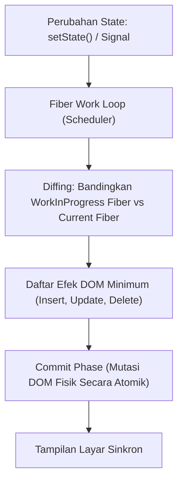

# Modul 147: Front-End: Arsitektur Framework UI Modern (React Fiber, Svelte Signals, SSR, SSG, ISR, Vite, Core Web Vitals)

**Navigasi**: [⬅️ Master Index](../../INDEX.md) | [Tingkat 9: Tingkat 9: Software Engineering, Front-End, Back-End, Full-Stack & Cloud/SRE](./README.md)
*Sebelumnya*: [146. front-end-mesin-browser-standar-web](./146-front-end-mesin-browser-standar-web.md) | *Berikutnya*: [148. rekayasa-aplikasi-mobile-desktop-lintas-platform](./148-rekayasa-aplikasi-mobile-desktop-lintas-platform.md)

---

## 1. Intuisi Dasar Tanpa Jargon ("Seperti Bayi Baru Lahir")
### 1.1 Mengapa Kita Butuh Framework UI Modern? ([React Docs: Thinking in React](https://react.dev/learn/thinking-in-react))
Di era web klasik, pengembang memanipulasi elemen layar secara imperatif satu per satu: `document.getElementById('btn').style.color = 'red'`. Ketika aplikasi web membengkak menjadi ribuan komponen yang saling terhubung (keranjang belanja, notifikasi realtime, formulir multi-langkah), menjaga agar tampilan layar selalu sinkron dengan status data (*state*) menjadi mimpi buruk yang dipenuhi bug ketidakkonsistenan.

### 1.2 Dari Virtual DOM ke Signals Reaktif Murni ([Svelte 5 Runes & Signals Explained](https://svelte.dev/blog/runes))
Framework UI modern mengubah paradigma ini menjadi **Deklaratif**:
$$UI = f(\text{State})$$
Anda cukup mendefinisikan bagaimana tampilan seharusnya terlihat untuk suatu kondisi data tertentu; framework yang akan mencari tahu cara paling efisien untuk memperbarui piksel layar:
1. **Model Virtual DOM & Fiber (React)**: Menyimpan pohon representasi UI tiruan di memori JavaScript. Ketika state berubah, React membandingkan pohon lama dan pohon baru (*Reconciliation / Diffing Algorithm*) secara bertahap tanpa memblokir thread utama (*Concurrent Mode*), lalu menerapkan perubahan minimum ke DOM asli.
2. **Model Signals Reaktif Halus (Svelte, Solid, Vue 3)**: Mengeliminasi Virtual DOM sepenuhnya! Variabel state dibungkus dalam objek *Signal* yang melacak langsung elemen DOM mana saja yang bergantung padanya. Ketika nilai berubah, elemen DOM diperbarui secara bedah mikro (*fine-grained surgical update*) dengan nol komputasi diffing!
Ditambah teknik rendering modern: **SSR** (Server-Side Rendering untuk SEO kilat), **SSG** (Static Site Generation), dan **ISR** (Incremental Static Regeneration).

## 2. Fondasi Teoretis & Aksiomatik / Matematis
### 2.1 Teorema Rekonsiliasi Pohon & Kompleksitas Diffing Virtual DOM ([React Documentation](https://legacy.reactjs.org/docs/reconciliation.html))
Secara matematis, algoritma umum untuk mengubah sebuah pohon berukuran $n$ node menjadi pohon lain berukuran $n$ memiliki batas kompleksitas bawah:
$$\mathcal{O}(n^3)$$
Jika sebuah halaman web memiliki 1.000 komponen, $\mathcal{O}(1000^3) = 1.000.000.000$ operasi per frame, mustahil berjalan secara real-time!

React menerapkan dua asumsi heuristik praktis yang memangkas kompleksitas menjadi linier:
$$\mathcal{O}(n)$$
1. **Asumsi Tipe Komponen**: Dua elemen dari tipe berbeda (misal `<div />` berubah menjadi `<span />`) akan menghasilkan pohon yang berbeda secara struktural. React menghancurkan subtree lama sepenuhnya tanpa memeriksa turunan dalamnya.
2. **Kunci Diferensiasi (*Key Heuristic*)**: Pengembang menandai elemen daftar anak menggunakan atribut unik `key`. React menggunakan pemetaan hash $\mathcal{O}(1)$ untuk mencocokkan node yang berpindah posisi tanpa menghancurkan dan membangun ulang elemen DOM fisik.

### 2.2 Formulasi Matematika Metrik Google Core Web Vitals ([Google Chrome Web Vitals](https://web.dev/explore/vitals))
Kualitas performa antarmuka pengguna diukur secara kuantitatif melalui tiga metrik standar industri:
1. **LCP (Largest Contentful Paint)**: Waktu render elemen visual terbesar di viewport:
   $$\text{Target LCP} \le 2.5 \text{ detik}$$
2. **INP (Interaction to Next Paint)**: Latensi respon terhadap interaksi pengguna (klik, ketuk):
   $$\text{Target INP} \le 200 \text{ milidetik}$$
3. **CLS (Cumulative Layout Shift)**: Pergeseran tata letak tak terduga:
   $$\text{CLS} = \sum (\text{Impact Fraction} \times \text{Distance Fraction}), \quad \text{Target CLS} \le 0.1$$

## 3. Anatomi Teknis & Cara Kerja Internal


#### Tabel Komparasi Paradigma Arsitektur Framework UI Modern
| Fitur / Parameter | React Fiber (React 18+) | Svelte Signals (Svelte 5) | SolidJS (Fine-Grained) |
|---|---|---|---|
| Strategi Pembaruan | Virtual DOM Diffing Heuristik | Fine-grained reactivity murni | Proxy Signal Dependency Graph |
| Ukuran Runtime Library | Menengah (~45 KB gzip) | Hampir Nol (Compiler-based) | Sangat Ringan (~7 KB) |
| Pemrosesan Beban Kerja | Time-slicing Concurrent Mode | Direct DOM compilation | Kompilasi reactive bindings |
| Overhead Memori Virtual DOM | Ada (Pohon Fiber ganda) | Tidak Ada | Tidak Ada |
| Mekanisme Primitif | `useState`, `useTransition` | Runes (`$state`, `$derived`) | `createSignal`, `createEffect` |

#### Tabel Penelusuran Render Waterfall & Rekonsiliasi Pohon React Fiber
| Siklus Render Komponen | State Mutasi yang Terjadi | Fase Render React (Virtual DOM Diffing) | Fase Commit (Mutasi DOM Riil) | Jumlah Re-render Komponen Anak | Utilisasi Memori & Frame Drop |
|---|---|---|---|---|---|
| Inisialisasi T=0 | Mounting komponen dashboard | Bangun pohon Fiber lengkap | Tulis DOM pertama kali | 1 kali per komponen | Bersih 60 FPS |
| Mutasi Data Finansial | Pembaruan harga saham ticker | State diangkat ke Root Komponen | Diffing seluruh pohon komponen | Seluruh 500 kartu anak dirender ulang!| 16 ms terlewati, frame drop |
| Cacat Prop Inline | Objek gaya dibuat inline: `style={{}}` | Referensi objek baru setiap render | React mengira prop berubah! | `React.memo` gagal total! | Render berantai berulang |
| Render Waterfall | Komponen A picu B, B picu C di effect | Render cascading bersarang | Browser melakukan Reflow berulang kali | 15 Kali re-render dalam 1 frame! | **FRAME RATE ANJLOK KE 8 FPS!** |
| Mitigasi Optimal | Atomic State (Zustand/Signals) | Hanya komponen harga yang berlangganan | Diffing terlokalisasi pada 1 simpul Fiber | Tepat 1 komponen anak yang dirender ulang | Frame rate pulih stabil 60 FPS |

## 4. Implementasi Praktis & Kode / Simulasi Riil
```typescript
// Implementasi primitif Signal reaktif murni (Fine-grained reactivity)
type Subscriber = () => void;

let activeEffect: Subscriber | null = null;

export function createSignal<T>(initialValue: T): [() => T, (newValue: T) => void] {
    let value = initialValue;
    const subscribers = new Set<Subscriber>();

    function read(): T {
        // Daftarkan efek aktif sebagai dependen saat nilai dibaca
        if (activeEffect) {
            subscribers.add(activeEffect);
        }
        return value;
    }

    function write(newValue: T): void {
        if (value !== newValue) {
            value = newValue;
            // Notifikasi seluruh dependen secara instan tanpa diffing
            for (const sub of subscribers) {
                sub();
            }
        }
    }

    return [read, write];
}

export function createEffect(fn: Subscriber): void {
    activeEffect = fn;
    fn(); // Jalankan sekali untuk mengumpulkan dependency
    activeEffect = null;
}
```

## 5. Miskonsepsi & Jebakan Industri
### Studi Kasus Kegagalan Nyata: Bencana Re-render Eksponensial Akibat Mutasi Objek State Langsung di React
- **Kronologi & Latar Belakang**: Sebuah dashboard pemantauan bursa cryptocurrency mengalami kemacetan total browser pengguna (*crash tab*) setiap kali harga koin diperbarui via WebSocket 50 kali per detik.
- **Akar Masalah**: Pengembang memutasi array state secara langsung (`state.push(newItem)`) dan memanggil `setState(state)` dengan referensi memori objek yang sama. Karena referensi pointer memori tidak berubah (`Object.is(oldState, newState) == true`), React tidak menyadari perubahan pada beberapa sub-komponen, mendorong pengembang lain memasang hook anti-pola `useEffect` dengan dependency array yang tidak stabil, memicu *infinite re-render loop*.
- **Rekomendasi Industri**: Pertahankan prinsip **Imutabilitas Data (Data Immutability)** mutlak pada state framework UI. Selalu kembalikan referensi objek baru menggunakan penyalinan struktural (`[...state, newItem]` atau library Immer) agar perbandingan pointer $\mathcal{O}(1)$ berfungsi secara andal.

### Studi Kasus Kegagalan Nyata: Keruntuhan Performa Dashboard Finansial Akibat Efek Domino Re-render (Render Waterfall) pada React SPA
- **Kronologi & Konteks Kasus**: Pada platform trading mata uang kripto dan saham berfrekuensi tinggi, dasbor web dirancang menggunakan framework React untuk menampilkan grafik pergerakan harga real-time, buku pesanan (*Order Book*), dan daftar transaksi berjalan.
- **Akar Masalah Kerangka Kerja Front-End Modern & Rekonsiliasi Virtual DOM**: Ketika data harga pasar berfluktuasi puluhan kali per detik melalui koneksi WebSocket, pengembang menempatkan status data harga (*market price state*) pada komponen induk paling atas (*Root Dashboard Component*). Karena sifat reaktivitas default React, pembaruan status pada komponen induk secara otomatis memicu evaluasi rekonsiliasi ulang (*re-render*) ke seluruh pohon komponen anak di bawahnya. Lebih parah lagi, fungsi penanganan event dan objek konfigurasi diteruskan menggunakan fungsi panah inline baru (`onClick={() => ...}`) dan objek literal baru (`style={{ color: 'red' }}`) pada setiap render. Hal ini merusak optimasi `React.memo`, karena referensi memori prop selalu dianggap berubah. Pohon komponen yang memuat lebih dari 800 elemen dievaluasi ulang 50 kali per detik, memicu *Render Waterfall* yang membuat penggunaan CPU browser mencapai 100%, membekukan input klik order pengguna, dan memicu kerugian finansial akibat order yang terlambat dieksekusi.

- **Potongan Kode / Arsitektur Cacat (Vulnerable Implementation)**:
```jsx
// Rekonstruksi Anti-Pattern Render Waterfall pada Komponen Finansial
import React, { useState, useEffect } from 'react';

// CACAT: Komponen Induk memegang state berfrekuensi tinggi dan meneruskan prop instan baru
function CryptoDashboardFlawed() {
    const [price, setPrice] = useState(0);

    useEffect(() => {
        const ws = new WebSocket("wss://stream.exchange.com");
        ws.onmessage = (event) => setPrice(JSON.parse(event.data).price); // 50 update/detik!
    }, []);

    return (
        <div>
            {/* CACAT: Setiap 'price' berubah, OrderBook dan TradeHistory ikut dirender ulang! */}
            <HeaderDisplay currentPrice={price} />
            <OrderBook data={staticOrderBook} onTrade={() => executeTrade()} /> 
            <TradeHistory list={staticHistory} theme={{ dark: true }} />
        </div>
    );
}

// Mitigasi Defensif: Isolasi State Berfrekuensi Tinggi & Stabilisasi Referensi Memori
// Pindahkan state WebSocket langsung ke dalam komponen HeaderDisplay atau gunakan Signal terisolasi!
```

- **Analisis Forensik & Rekayasa Modern**: Insiden Render Waterfall mendorong revolusi dalam arsitektur manajemen state front-end modern. Standar industri beralih dari pengangkatan status global (*Lifting State Up*) ke pendekatan reaktivitas halus (*Fine-Grained Reactivity*): (1) Adopsi arsitektur berbasis *Signals* (seperti pada Svelte, SolidJS, dan Preact) di mana pembaruan data memodifikasi simpul teks DOM secara langsung tanpa rekonsiliasi pohon Virtual DOM penuh; (2) Pemanfaatan *Atomic State Management* (Zustand, Jotai) yang melokalisasi langganan pembaruan hanya pada komponen yang benar-benar menampilkan data tersebut.

## 6. Proyek Latihan & Rubrik Penilaian Mandiri
### Level 1 (Pemula)
- **Tugas**: Jelaskan mengapa penggunaan indeks array numerik (`key={index}`) sebagai atribut key pada daftar elemen dinamis di React dianggap sebagai anti-pola berbahaya.
- **Petunjuk Arsitektur**: Jelaskan apa yang terjadi pada internal state komponen anak jika sebuah elemen disisipkan di posisi awal daftar (`unshift`).
- **Vektor Uji**:
  - Komponen input teks mempertahankan nilai ketikan lama pada elemen yang salah.
- **Rubrik Penilaian**: Pemahaman algoritma rekonsiliasi key (50%), identifikasi bug retensi state (30%), kebersihan solusi ID unik (20%).

### Level 2 (Menengah)
- **Tugas**: Bangun hook kustom `useDebouncedState` di TypeScript yang memperbarui nilai representasi UI secara instan namun menunda pembaruan nilai kueri analitik berat selama \$400 \text{ ms}$.
- **Petunjuk Arsitektur**: Gabungkan dua state internal dengan pembersihan timer `useEffect` return cleanup callback.
- **Vektor Uji**:
  - Periksa responsivitas input teks (tetap 60 FPS tanpa jank saat mengetik cepat).
- **Rubrik Penilaian**: Pengelolaan timer cleanup bersih (40%), pengetikan generik TypeScript akurat (30%), pencegahan memory leak (30%).

### Level 3 (Mahir)
- **Tugas**: Rancang pipeline Server-Side Rendering (SSR) mini di Node.js menggunakan TypeScript yang merender pohon komponen virtual ke string HTML lengkap (`renderToString`) dan menghasilkan script hidrasi (*hydration script*).
- **Petunjuk Arsitektur**: Buat representasi VNode sederhana `{ tag, props, children }`, fungsi render rekursif menghasilkan string tag HTML, dan script client-side yang mencocokkan event listeners ke DOM fisik tanpa merusak markup server.
- **Vektor Uji**:
  - Output string HTML harus memuat seluruh teks awal sebelum JavaScript browser diaktifkan.
  - Verifikasi bahwa proses hidrasi client-side tidak memicu pembuatan ulang elemen DOM (`DOM replacement mismatch warning`).
- **Rubrik Penilaian**: Ketepatan alur SSR ke Hidrasi (40%), penanganan sanitasi XSS (30%), efisiensi rekursi string (30%).

### Tingkat 1: Dasar
- **Tugas**: Bangun implementasi mesin reaktivitas halus (*Fine-Grained Reactivity / Signals Engine*) mandiri dalam JavaScript/TypeScript dengan fungsi primitif `createSignal(initialVal)` (mengembalikan pasangan `[get, set]`) dan `createEffect(callback)` yang secara otomatis melacak ketergantungan langganan saat pembacaan nilai (*Auto-Dependency Tracking*) tanpa memerlukan Virtual DOM diffing.
- **Petunjuk Perancangan Arsitektur**:
  - Gunakan tumpukan konteks global untuk mencatat effect yang sedang dieksekusi saat getter signal dipanggil.
  - Saat setter signal dipanggil dengan nilai baru, picu eksekusi ulang seluruh effect yang berlangganan padanya.
- **Test Vector & Kasus Uji Ekstrem**:
  - *Pelacakan Otomatis*: Buat 2 signal `countA` dan `countB`; buat 1 effect yang membaca `countA + countB`; mutasi `countA`; buktikan effect dieksekusi otomatis; mutasi variabel luar; buktikan effect tidak dieksekusi.
- **Rubrik Penilaian Mandiri**: 40% Mekanisme Auto-Dependency Tracking Signal yang Presisi, 30% Ketiadaan Eksekusi Reaktif Berlebih (Zero Redundant Triggers), 30% Kerapian Enkapsulasi Kode.

### Tingkat 2: Menengah
- **Tugas**: Kembangkan komponen tabel data virtual (*Virtual Windowing / Virtual List Component*) dalam React/JavaScript yang mampu menampilkan $100.000$ baris data secara mulus pada 60 FPS dengan hanya me-render elemen DOM yang terlihat di dalam jendela pandang (*Viewport*) ditambah buffer penyangga kecil (sekitar 20 elemen DOM riil saja).
- **Petunjuk Perancangan Arsitektur**:
  - Lacak posisi gulir vertikal (`scrollTop`) dan tinggi kontainer (`viewportHeight`).
  - Hitung indeks baris awal dan akhir: $\text{startIndex} = \lfloor \text{scrollTop} / \text{itemHeight} \rfloor$.
  - Gunakan penataan transform `translateY` untuk menempatkan elemen pada posisi fisik yang benar.
- **Test Vector & Kasus Uji Ekstrem**:
  - *Inspeksi Elemen DOM*: Buka daftar 100.000 data; periksa pohon DOM di peramban; pastikan jumlah simpul `<div>` baris yang terbentuk di dalam dokumen tidak pernah melebihi 30 elemen sepanjang proses pengguliran cepat.
- **Rubrik Penilaian Mandiri**: 40% Formula Matematika Virtual Windowing yang Akurat, 30% Penghematan Memori DOM Ekstrem (< 30 Nodes), 30% Pengguliran Layar Mulus Bebas Kedipan (Flicker-Free).

### Tingkat 3: Mahir
- **Tugas**: Rancang mesin rekonsiliasi pohon Virtual DOM mini berbasis arsitektur *Fiber Reconciler* dalam JavaScript yang memecah proses diffing pohon komponen menjadi unit-unit kerja kecil yang dapat ditangguhkan (*Interruptible Work Units via Fiber Linked-List Nodes*) menggunakan `requestIdleCallback`, mampu mengutamakan pembaruan input pengetikan pengguna di atas pembaruan grafik data latar belakang.
- **Petunjuk Perancangan Arsitektur**:
  - Representasikan pohon Fiber dengan pointer `child`, `sibling`, dan `return` (induk).
  - Pisahkan fase pengerjaan menjadi dua tahap: Fase Render yang dapat diinterupsi dan Fase Commit yang menerapkan mutasi ke DOM secara atomik tak terputus.
- **Test Vector & Kasus Uji Ekstrem**:
  - *Interupsi Prioritas*: Mulai proses rendering pohon besar (1.000 elemen); suntikkan event pengetikan pengguna di tengah jalan; buktikan mesin menangguhkan diffing pohon untuk merespons ketikan pengguna seketika, lalu melanjutkan sisa diffing.
- **Rubrik Penilaian Mandiri**: 40% Struktur Data Fiber Linked-List yang Benar, 30% Mekanisme Penjadwalan Kerja Kooperatif (Interruptible Render Phase), 30% Atomisitas Fase Commit.

## 7. Rekomendasi Sumber Belajar Standar Emas
| Kategori | Judul Sumber & Tautan | Penulis / Institusi | Fokus Pembahasan |
|---|---|---|---|
| Arsitektur React | [A Cartoon Guide to React Fiber](https://conf.reactjs.org/) | Lin Clark (React Conf) | Penjelasan visual mendalam arsitektur kooperatif multitasking React Fiber |
| Teori Reaktivitas | [SolidJS: Reactive Principles and Fine-Grained Signals](https://www.solidjs.com/guides/foundations) | Ryan Carniato | Pembahasan komparatif arsitektur Signal reaktif tanpa overhead Virtual DOM |
| Standar Performa | [Google Web Vitals Documentation](https://web.dev/explore/vitals) | Google Chrome Team | Metrik kuantitatif resmi pengukuran performa pengguna (LCP, INP, CLS) |

---
*Navigasi Cepat*: [Ke Tingkat 9](./README.md) | [Ke Master Index](../../INDEX.md) | *Sebelumnya*: [146. front-end-mesin-browser-standar-web](./146-front-end-mesin-browser-standar-web.md) | *Berikutnya*: [148. rekayasa-aplikasi-mobile-desktop-lintas-platform](./148-rekayasa-aplikasi-mobile-desktop-lintas-platform.md)
