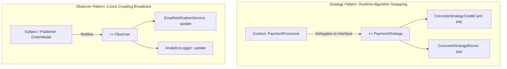

# Modul 147: Front-End: Arsitektur Framework UI Modern (React Fiber, Svelte Signals, SSR, SSG, ISR, Vite, Core Web Vitals)

**Navigasi**: [⬅️ Master Index](../../INDEX.md) | [Tingkat 9: Tingkat 9: Software Engineering, Front-End, Back-End, Full-Stack & Cloud/SRE](./README.md)
*Sebelumnya*: [146. front-end-mesin-browser-standar-web](./146-front-end-mesin-browser-standar-web.md) | *Berikutnya*: [148. rekayasa-aplikasi-mobile-desktop-lintas-platform](./148-rekayasa-aplikasi-mobile-desktop-lintas-platform.md)

---

## 1. Intuisi Dasar Tanpa Jargon ("Seperti Bayi Baru Lahir")
Arsitek bangunan tidak menemukan kembali bentuk lengkungan jembatan atau fondasi tiang pancang dari nol setiap kali mereka merancang gedung baru; mereka menggunakan pola-pola arsitektur teruji yang telah terbukti kokoh selama berabad-abad. Pola Desain Perangkat Lunak (Design Patterns) ([Gang of Four Design Patterns](https://refactoring.guru/design-patterns)) adalah kosakata universal solusi rekayasa perangkat lunak untuk memecahkan masalah berulang. Diformalkan oleh 'Gang of Four' (GoF) pada tahun 1994, pola-pola ini dibagi menjadi tiga keluarga utama: **Creational Patterns** (seperti *Factory* dan *Singleton*) yang mengisolasi proses pembuatan objek agar sistem tidak terikat pada kelas konkret; **Structural Patterns** (seperti *Adapter* yang menghubungkan dua kabel berbeda colokan, dan *Decorator* yang menambahkan fitur lapis demi lapis); serta **Behavioral Patterns** (seperti *Observer* yang menyiarkan pengumuman ke ribuan pelanggan, dan *Strategy* yang menukar algoritma secara dinamis pada saat runtime).

## 2. Fondasi Teoretis & Aksiomatik / Matematis
Taksonomi Formal 23 Pola Desain Gang of Four (GoF) dan Concurrency Patterns:

$$\begin{array}{|l|l|l|}
\hline
\textbf{Keluarga Pola} & \textbf{Pola Desain Utama (GoF)} & \textbf{Tujuan Inti Rekayasa} \\
\hline
\text{Creational} & \text{Factory Method, Abstract Factory, Builder, Singleton, Prototype} & \text{Enkapsulasi instansiasi & variasi objek} \\
\text{Structural} & \text{Adapter, Bridge, Composite, Decorator, Facade, Proxy} & \text{Komposisi struktur kelas & relasi antarmuka} \\
\text{Behavioral} & \text{Observer, Strategy, Command, State, Template Method, Iterator} & \text{Distribusi tanggung jawab & algoritma interaksi} \\
\text{Concurrency} & \text{Thread Pool, Active Object, Producer-Consumer, Half-Sync/Half-Async} & \text{Pengelolaan konkruensi & pencegahan deadlock} \\
\hline
\end{array}$$

Prinsip Desain Utama Pola GoF:

1. **Favor Object Composition over Class Inheritance**:
   Warisan hierarki kelas yang kaku (*Class Inheritance*) menciptakan kopling erat yang rapuh; komposisi objek (*Object Composition*) menggunakan pointer antarmuka memungkinkan pertukaran perilaku secara fleksibel pada saat runtime.
2. **Program to an Interface, not an Implementation**:
   Variabel hanya boleh dideklarasikan menggunakan tipe antarmuka abstrak (`Shape`), bukan tipe kelas konkret instansiasi (`RedCircle`).

## 3. Anatomi Teknis & Cara Kerja Internal
Arsitektur Pola Strategy Pattern vs Observer Pattern:



1. **Thread-Safe Double-Checked Locking Singleton**:
   Pola pembuatan objek tunggal yang aman di lingkungan multi-threading. Menggunakan pemeriksaan ganda pointer bernilai `null` sebelum dan sesudah penguncian mutex, dipadukan dengan kata kunci `volatile` (atau operasi atomik C++11) untuk mencegah optimasi reordering penulisan pointer sebelum alokasi memori konstruktor selesai ([Double-Checked Locking Hazard](https://www.cs.umd.edu/~pugh/java/memoryModel/DoubleCheckedLocking.html)).

## 4. Implementasi Praktis & Kode / Simulasi Riil
```python
# Production-Grade Observer Pattern and Strategy Pattern in Python
from typing import Protocol, List

# --- Strategy Pattern ---
class CompressionStrategy(Protocol):
    def compress(self, data: bytes) -> bytes: ...

class GzipCompressionStrategy:
    def compress(self, data: bytes) -> bytes:
        import gzip; return gzip.compress(data)

class ZstandardCompressionStrategy:
    def compress(self, data: bytes) -> bytes:
        return b"[zstd]" + data # Mock kompresi zstd

class FileArchiver:
    def __init__(self, strategy: CompressionStrategy):
        self.strategy = strategy # Injeksi strategi algoritma

    def archive(self, file_bytes: bytes) -> bytes:
        return self.strategy.compress(file_bytes)

# --- Observer Pattern ---
class EventListener(Protocol):
    def on_event(self, event_name: str, payload: dict): ...

class EventBroadcaster:
    def __init__(self):
        self._listeners: List[EventListener] = []

    def subscribe(self, listener: EventListener):
        self._listeners.append(listener)

    def notify(self, event_name: str, payload: dict):
        for listener in self._listeners:
            listener.on_event(event_name, payload)
```

## 5. Miskonsepsi & Jebakan Industri
1. **Pattern Over-Engineering (Design Pattern Cargo Cult)**: Memaksa penerapan puluhan pola desain GoF (seperti Factory, Decorator, Visitor) pada kode utilitas sederhana yang hanya membutuhkan fungsi 5 baris, meningkatkan kompleksitas kognitif tanpa manfaat nyata.
2. **Singleton Pattern as Hidden Global State**: Menggunakan Singleton untuk menyimpan status global yang dapat diubah secara bebas oleh kelas mana pun. Mengakibatkan hilangnya isolasi pengujian unit test (*Test Contamination*) dan menyembunyikan ketergantungan arsitektur.
3. **Circular Observer Notifications (Infinite Event Loops)**: Observer A mendengarkan perubahan status Model B dan memperbarui Model C, sementara Observer C mendengarkan Model C dan memperbarui kembali Model B. Sistem terjebak dalam infinite loop pemanggilan notifikasi hingga kehabisan stack memori.

## 6. Proyek Latihan & Rubrik Penilaian Mandiri
1. **Tingkat Pemula**: Identifikasi pola desain GoF yang paling tepat untuk masalah berikut: (a) Membuat objek mobil dengan puluhan opsi konfigurasi opsional (*Builder*), (b) Menambahkan border dan scrollbar pada jendela grafis (*Decorator*), (c) Menyeragamkan antarmuka pustaka lama dengan pustaka baru (*Adapter*).
2. **Tingkat Menengah**: Implementasikan pola Command Pattern lengkap dengan fitur antrean perintah (*Command Queue*) dan fungsionalitas tombol 'Undo' yang mampu membalikkan status mutasi objek bisnis secara bertingkat.
3. **Tingkat Mahir**: Rancang arsitektur Concurrency Pattern *Half-Sync/Half-Async* atau *Active Object* dalam C++/Rust: gunakan thread asinkron untuk menerima I/O socket jaringan berkecepatan tinggi, antrekan request ke buffer perantara thread-safe, dan proses logika bisnis secara sinkron menggunakan Thread Pool terukur.

## 7. Rekomendasi Sumber Belajar Standar Emas
| Sumber Pembelajaran | Penulis / Institusi | Tautan Langsung | Fokus Materi |
| :--- | :--- | :--- | :--- |
| Design Patterns: Elements of Reusable Object-Oriented Software | Erich Gamma, Richard Helm, Ralph Johnson, John Vlissides (GoF) | [Gang of Four Book](https://en.wikipedia.org/wiki/Design_Patterns) | Alkitab Pola Desain Klasik: 23 Pola Creational, Structural & Behavioral |
| Refactoring Guru: Design Patterns Visual Catalog | Alexander Shvets | [Refactoring Guru Patterns](https://refactoring.guru/design-patterns) | Visualisasi Diagram UML, Analogi Dunia Nyata & Contoh Kode Multi-Bahasa |
| Pattern-Oriented Software Architecture (POSA Volume 2) | Douglas Schmidt et al. | [Wiley POSA Volume 2](https://www.wiley.com/en-us/Pattern+Oriented+Software+Architecture%2C+Volume+2%2C+Patterns+for+Concurrent+and+Networked+Objects-p-9780471606956) | Concurrency & Networked Object Patterns: Half-Sync/Half-Async, Leader/Followers |
| Game Programming Patterns | Robert Nystrom | [Game Programming Patterns Online](https://gameprogrammingpatterns.com/) | Pola Desain Modern: Flyweight, Game Loop, Update Method, Spatial Partition |

---
*Navigasi Cepat*: [Ke Tingkat 9](./README.md) | [Ke Master Index](../../INDEX.md) | *Sebelumnya*: [146. front-end-mesin-browser-standar-web](./146-front-end-mesin-browser-standar-web.md) | *Berikutnya*: [148. rekayasa-aplikasi-mobile-desktop-lintas-platform](./148-rekayasa-aplikasi-mobile-desktop-lintas-platform.md)
