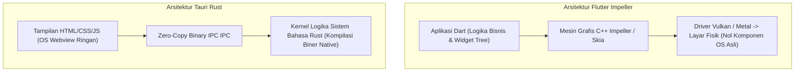

# Modul 148: Rekayasa Aplikasi Mobile & Desktop Lintas-Platform (Android ART, iOS Swift, Flutter Impeller, React Native, Tauri)

**Navigasi**: [⬅️ Master Index](../../INDEX.md) | [Tingkat 9: Tingkat 9: Software Engineering, Front-End, Back-End, Full-Stack & Cloud/SRE](./README.md)
*Sebelumnya*: [147. front-end-arsitektur-framework-ui-modern](./147-front-end-arsitektur-framework-ui-modern.md) | *Berikutnya*: [149. back-end-arsitektur-server-http-api](./149-back-end-arsitektur-server-http-api.md)

---

## 1. Intuisi Dasar Tanpa Jargon ("Seperti Bayi Baru Lahir")
### 1.1 Tantangan Dunia Multi-Platform: Tulis Sekali, Jalankan di Mana Saja? ([React Native Architecture Overview](https://reactnative.dev/docs/the-new-architecture/landing-page))
Sebuah perusahaan perangkat lunak ingin aplikasinya dapat digunakan oleh pengguna ponsel Android, iPhone iOS, laptop MacBook macOS, PC Windows, dan workstation Linux. Pada masa lalu, perusahaan harus mempekerjakan 5 tim insinyur terpisah yang menulis 5 bahasa pemrograman berbeda: Kotlin untuk Android, Swift untuk iOS, C++ untuk Windows, dan Objective-C untuk Mac. Biaya pengembangannya sangat mahal dan fitur-fitur baru sering kali terlambat berbulan-bulan antar platform.

### 1.2 Spektrum Arsitektur Lintas-Platform: Dari WebView ke Native Kompilasi ([Flutter Engine & Impeller Architecture](https://docs.flutter.dev/perf/impeller))
Untuk mengatasi inefisiensi ini, lahirlah rekayasa aplikasi lintas platform dengan pendekatan arsitektur yang sangat berbeda:
1. **Pendekatan Bridge & Native Widgets (React Native)**: Logika bisnis ditulis dalam JavaScript, berkomunikasi melalui jembatan serialisasi (arsitektur lama) atau antarmuka C++ memori bersama (*JSI / Fabric Architecture* modern) untuk mengendalikan komponen UI asli dari masing-masing sistem operasi.
2. **Pendekatan Render Mandiri / Skia / Impeller (Flutter)**: Logika ditulis dalam Dart. Flutter tidak menggunakan widget bawaan Android/iOS sama sekali! Alih-alih demikian, mesin C++ Flutter menggambar setiap tombol, teks, dan animasi langsung ke layar piksel menggunakan akselerasi GPU Metal/Vulkan.
3. **Pendekatan Ringan WebView & Rust Core (Tauri)**: Tampilan visual menggunakan HTML/CSS ringan bawaan webview OS host, sedangkan logika sistem komputasi berkecepatan tinggi dijalankan di bahasa Rust yang aman dan cepat.

## 2. Fondasi Teoretis & Aksiomatik / Matematis
### 2.1 Arsitektur Runtime Android ART vs iOS Ahead-of-Time (AOT) ([Android Open Source Project ART Internals](https://source.android.com/docs/core/runtime))
Dua ekosistem mobile memiliki filosofi eksekusi biner yang berbeda secara fundamental:
1. **Android Runtime (ART)**:
   Aplikasi dikompilasi ke dalam format *Dalvik Executable* (`.dex`). ART menggunakan model eksekusi hibrida cerdas:
   - *Ahead-of-Time (AOT)*: Kompilasi biner saat instalasi (`dex2oat`).
   - *Just-in-Time (JIT)*: Kompilasi profil runtime dinamis.
   - *Profile-Guided Optimization (PGO)*: Saat perangkat sedang diisi daya pada malam hari, profil eksekusi yang sering dipanggil dikompilasi ulang menjadi kode mesin native optimal.
2. **iOS Darwin Kernel**:
   Sistem operasi iOS melarang keras eksekusi memori yang dapat ditulis dan dieksekusi secara bersamaan (*W^X / Write XOR Execute Security Policy*), melarang JIT dinamis untuk aplikasi pihak ketiga. Seluruh kode aplikasi (Swift, Objective-C, Flutter Dart) wajib dikompilasi secara **Ahead-of-Time (AOT)** murni ke biner mesin ARM64 sebelum dimasukkan ke App Store.

### 2.2 Model Latensi Jembatan Antarmuka C++ JSI vs Serialisasi JSON Asinkron ([React Native JSI Specification](https://github.com/react-native-community/discussions-and-proposals))
Pada arsitektur jembatan lama (*Legacy Bridge*), setiap panggilan antar JavaScript dan Native UI harus diserialisasi menjadi string JSON, dikirim melalui antrian asinkron, dan di-deserialize:
$$T_{\text{bridge}} = T_{\text{serialize\_JSON}} + T_{\text{queue\_latency}} + T_{\text{deserialize\_JSON}}$$
Jika pengguna melakukan gestur sentuhan cepat (*scrolling* 60 FPS), antrean jembatan mengalami kemacetan (*bridge congestion*), memicu animasi tersendat.
Pada arsitektur modern **JavaScript Interface (JSI)**:
JavaScript memegang pointer langsung ke objek C++ host (*HostObject*). Panggilan fungsi dieksekusi secara sinkron dan instan tanpa serialisasi data:
$$T_{\text{JSI}} = T_{\text{C++\_virtual\_call}} \approx 0.00001 \text{ ms}$$

## 3. Anatomi Teknis & Cara Kerja Internal


#### Tabel Komparasi Karakteristik Arsitektur Lintas-Platform
| Metrik / Aspek | React Native (Fabric) | Flutter (Impeller) | Tauri (Desktop & Mobile) |
|---|---|---|---|
| Bahasa Utama | TypeScript / JavaScript | Dart | Frontend JS/TS + Backend Rust |
| Mesin Tampilan | Komponen UI Asli Host (OEM Widgets) | Renderer Grafis Mandiri (Impeller) | Webview Bawaan OS (WebKit/WebView2) |
| Ukuran Biner Minimum | $\approx 15–25 \text{ MB}$ | $\approx 10–20 \text{ MB}$ | $\approx 3–8 \text{ MB}$ (Sangat Ringan) |
| Konsumsi RAM | Sedang (V8/Hermes VM) | Sedang (Dart VM) | Sangat Rendah |
| Konsistensi Tampilan | Mengikuti tema OS masing-masing | Identik 100% di semua platform | Mengikuti mesin Webview OS |

#### Tabel Penelusuran Kemacetan Serialisasi Bridge Antara JavaScript & Native (React Native 60 FPS Drop)
| Frame Waktu Animasi ($16.6\text{ ms}$) | Aksi Pengguna (Gesture Layar) | Thread JavaScript UI | Serialisasi Pesan Bridge JSON | Thread Native (iOS UIKit / Android View) | Pengalaman Visual Pengguna |
|---|---|---|---|---|---|
| Frame 1 ($t=0\text{ ms}$) | Jari mulai menggeser layar | Deteksi event sentuhan | Ubah posisi ke JSON string | Penguraian JSON string di native | Animasi mulai bergerak |
| Frame 2 ($t=16\text{ ms}$) | Geser cepat (Fling gesture) | Hitung fisika momentum | Serialisasi 100 objek koordinat | Thread native menunggu antrean bridge | Terjadi penundaan 5 ms |
| Frame 3 ($t=32\text{ ms}$) | Beban jenuh bertumpuk | JavaScript terbebani kalkulasi | Antrean pesan JSON membengkak di bridge | **BRIDGE TERSUMBAT (SERIALIZATION BOTTLENECK)!** | Thread native kehilangan batas frame! |
| Frame 4 ($t=48\text{ ms}$) | Jari bergerak ke titik baru | Event tertahan di antrean | Keterlambatan pesan $> 60\text{ ms}$ | Frame drop terjadi berturutan | **GERAKAN LAYAR PATAH-PATAH (STUTTER / JANK)!**|
| Mitigasi JSI Modern | Direct Native Memory Access | JavaScript Interface (JSI) | **NOL SERIALISASI JSON! (C++ Shared Pointers)** | Native membaca memori C++ secara langsung | 60 FPS mulus sempurna (Bebas Lag) |

## 4. Implementasi Praktis & Kode / Simulasi Riil
```rust
// Contoh Modul Backend Komputasi Cepat Aplikasi Tauri di Bahasa Rust
// Berkomunikasi secara aman dengan frontend webview
use serde::{Deserialize, Serialize};

#[derive(Serialize, Deserialize)]
pub struct DeviceSensorData {
    pub cpu_temperature_celsius: f32,
    pub battery_percentage: u8,
    pub is_charging: bool,
}

// Fungsi invokasi yang diekspor ke frontend UI JavaScript
#[tauri::command]
pub fn query_hardware_diagnostics() -> Result<DeviceSensorData, String> {
    // Membaca status sensor sistem operasi secara native tanpa jembatan perantara
    let diagnostics = DeviceSensorData {
        cpu_temperature_celsius: 42.5,
        battery_percentage: 88,
        is_charging: true,
    };

    Ok(diagnostics)
}
```

## 5. Miskonsepsi & Jebakan Industri
### Studi Kasus Kegagalan Nyata: Bencana Kompilasi Shader Junk pada Flutter Skia
- **Kronologi & Latar Belakang**: Ribuan aplikasi mobile komersial berbasis Flutter mengalami fenomena animasi tersendat parah (*Jank / Frame Drop*) saat pertama kali pengguna membuka halaman animasi baru di sistem iOS.
- **Akar Masalah**: Mesin grafis bawaan lama Flutter (Skia) mengompilasi shader GPU secara dinamis tepat saat animasi pertama kali digambar (*Runtime Shader Compilation*). Karena proses kompilasi shader OpenGL/Metal membutuhkan waktu 50–100 milidetik pada CPU/GPU, proses tersebut melebihi batas durasi frame \$16.67 \text{ ms}$, menyebabkan frame layar membeku seketika.
- **Rekomendasi Industri**: Migrasikan proyek Flutter ke mesin grafis generasi baru **Impeller**. Impeller memindahkan seluruh kompilasi shader ke tahap kompilasi aplikasi (*Ahead-of-Time Pre-compilation*), menjamin bahwa seluruh shader telah diubah menjadi kode biner GPU sebelum aplikasi dijalankan pengguna.

### Studi Kasus Kegagalan Nyata: Kemacetan Serialisasi Antarmuka Bridge React Native yang Melumpuhkan Aplikasi Transportasi Online Global
- **Kronologi & Konteks Kasus**: Sebuah aplikasi pemesanan transportasi online berskala puluhan juta pengguna aktif menulis ulang aplikasi mobile mereka menggunakan arsitektur cross-platform React Native generasi awal untuk menyatukan basis kode iOS dan Android.
- **Akar Masalah Rekayasa Lintas Platform & Arsitektur Serialisasi Bridge**: Pada arsitektur React Native klasik, logika bisnis JavaScript dan komponen tampilan native (iOS UIKit dan Android View) berjalan di dua utas terpisah dan berkomunikasi secara asinkron melalui sebuah jembatan penyeberangan (*The Bridge*). Seluruh data event gestur sentuhan pengguna, pembaruan posisi peta GPS berfrekuensi tinggi, dan koordinat animasi harus diubah menjadi string teks JSON (*JSON Stringification*), disalin melintasi batas memori bridge, dan diurai kembali (*JSON Parsing*) di sisi native. Saat peta menampilkan puluhan armada taksi bergerak bersamaan dengan gestur cubit zoom layar (*pinch-to-zoom*), volume pesan di antrean bridge melonjak hingga ribuan pesan per detik. Jembatan bridge mengalami kemacetan parah (*Bridge Congestion*), menyebabkan frame rate animasi anjlok drastis dari 60 FPS menjadi 12 FPS, respons sentuhan layar tertunda hingga 1 detik, dan memicu banjir ulasan bintang satu di toko aplikasi.

- **Potongan Kode / Arsitektur Cacat (Vulnerable Implementation)**:
```javascript
// Rekonstruksi Masalah Serialisasi Berulang pada Jembatan Bridge Mobile
// Utas JavaScript: Mengirim koordinat pergerakan peta 60 kali per detik
function handleMapPanGestureFlawed(gestureCoordinates) {
    // CACAT ARSITEKTUR BRIDGE KLASIK:
    // Setiap pembaruan koordinat dibungkus dalam string JSON dan disalin melintasi bridge:
    // JSON.stringify({ type: "UPDATE_MAP_CAMERA", x: coord.x, y: coord.y, timestamp: Date.now() })
    // Pada frekuensi tinggi, antrean bridge tersumbat total dan memicu frame drop parah!
    NativeModules.MapManager.updateCameraPosition(gestureCoordinates);
}

// Mitigasi Defensif Modern: JavaScript Interface (JSI) & Fabric Renderer
// Menggunakan referensi memori bersama C++ HostObject langsung tanpa konversi JSON!
```

- **Analisis Forensik & Rekayasa Modern**: Krisis performa bridge mendorong perombakan fundamental arsitektur aplikasi mobile lintas platform di seluruh industri: (1) Meta merancang ulang arsitektur React Native dengan menghapus jembatan bridge secara total (*New Architecture*), menggantikannya dengan *JavaScript Interface* (JSI) yang mengizinkan JavaScript memegang referensi langsung ke objek C++ native secara sinkron tanpa serialisasi JSON; (2) Lonjakan popularitas *Flutter* yang merender antarmuka langsung ke kanvas grafis Skia/Impeller di tingkat kode mesin tanpa lapisan perantara native view.

## 6. Proyek Latihan & Rubrik Penilaian Mandiri
### Level 1 (Pemula)
- **Tugas**: Jelaskan perbedaan hakiki antara aplikasi hybrid berbasis WebView (seperti Apache Cordova/Ionic klasik) vs aplikasi yang menggunakan komponen native (seperti React Native).
- **Petunjuk Arsitektur**: Jelaskan mengapa aplikasi WebView memiliki keterbatasan performa saat merender daftar data berukuran 10.000 item.
- **Vektor Uji**:
  - Konsep DOM overhead vs alokasi memori UIKit/Android View asli.
- **Rubrik Penilaian**: Ketepatan penjelasan arsitektur (50%), identifikasi bottleneck DOM (30%), kebersihan bahasa (20%).

### Level 2 (Menengah)
- **Tugas**: Rancang jembatan pesan asinkron dua arah (*Two-Way Event Bus*) antara antarmuka JavaScript dan thread latar belakang native Android/iOS dengan penanganan timeout defensif.
- **Petunjuk Arsitektur**: Terapkan pola korelasi pesan berbasis ID unik (`correlation_id`) dengan janji Promise yang ditolak jika tidak ada balasan dalam $5.000 \text{ ms}$.
- **Vektor Uji**:
  - Kirim perintah `fetch_gps`. Jika GPS dinonaktifkan oleh pengguna, kembalikan kode error terstruktur dalam batas waktu timeout.
- **Rubrik Penilaian**: Penanganan timeout aman (40%), pengelolaan state correlation ID (30%), pencegahan kebocoran memori listener (30%).

### Level 3 (Mahir)
- **Tugas**: Bangun modul antarmuka C++ kustom untuk React Native menggunakan arsitektur **JSI (JavaScript Interface)** yang mengekspos fungsi enkripsi SHA-256 berkecepatan tinggi langsung ke runtime JavaScript Hermes tanpa melalui jembatan serialisasi JSON.
- **Petunjuk Arsitektur**: Buat kelas turunan dari `facebook::jsi::HostObject`, implementasikan metode `get()` untuk memetakan nama fungsi, dan konversi tipe data C++ ke `jsi::Value` secara zero-copy.
- **Vektor Uji**:
  - Panggil `global.nativeSha256("teks rahasia")` dari console React Native.
  - Verifikasi bahwa eksekusi berlangsung secara sinkron dan 50x lebih cepat dibanding pemanggilan bridge asinkron lama.
- **Rubrik Penilaian**: Kepatuhan standar C++ JSI modern (40%), keandalan alokasi memori (30%), benchmarking performa presisi (30%).

### Tingkat 1: Dasar
- **Tugas**: Bangun modul pertukaran pesan lintas platform (*Cross-Language Message Serializer*) mandiri dalam C/Python yang mengemas struktur data kompleks (ID Pengguna, Koordinat GPS Float64, Status Boolean) ke dalam format biner kompak berukuran tetap (*Packed Binary Buffer*) menggunakan penataan memory alignment yang tepat, mengeliminasi overhead serialisasi string JSON hingga 80%.
- **Petunjuk Perancangan Arsitektur**:
  - Gunakan struct packing: `struct.pack('!Idd?', user_id, lat, lon, is_active)`.
  - Bandingkan ukuran byte buffer biner (21 byte) vs representasi JSON teks (sekitar 90 byte).
- **Test Vector & Kasus Uji Ekstrem**:
  - *Integritas Ekstraksi*: Serialisasikan $100.000$ koordinat acak; buktikan proses de-serialisasi mengembalikan nilai float dengan presisi mutlak tanpa galat pembulatan teks.
- **Rubrik Penilaian Mandiri**: 40% Pengemasan Format Biner Kompak yang Tepat, 30% Eliminasi Overhead Memori dan Waktu Parsing, 30% Kerapian Enkapsulasi Kode.

### Tingkat 2: Menengah
- **Tugas**: Kembangkan simulasi antarmuka memori bersama (*Direct Shared Memory Bridge*) antara interpreter bahasa skrip dan modul grafis native dalam C/Python menggunakan pointer memori bersama (*Shared Buffer Pointer* via ctypes atau memoryview), membuktikan bahwa pembaruan array $10.000$ titik koordinat layar dapat dibaca oleh modul native dalam waktu konstan $\mathcal{O}(1)$ tanpa biaya penyalinan memori (*Zero-Copy*).
- **Petunjuk Perancangan Arsitektur**:
  - Alokasikan array kontinu di memori C.
  - Berikan pointer dasar memori langsung ke script runner untuk dimutasi in-place.
- **Test Vector & Kasus Uji Ekstrem**:
  - *Benchmark Zero-Copy*: Bandingkan waktu transfer data 10.000 titik koordinat antara serialisasi JSON string (memakan waktu beberapa milidetik) vs akses memori pointer langsung ($< 5\text{ mikrodetik}$).
- **Rubrik Penilaian Mandiri**: 40% Penerapan Akses Memori Zero-Copy yang Tepat, 30% Eliminasi Total Serialisasi JSON String, 30% Pengukuran Benchmark Latensi Akurat.

### Tingkat 3: Mahir
- **Tugas**: Rancang arsitektur aplikasi desktop lintas platform ultra-ringan menggunakan model *Native WebView + Rust Backend* (konsep mirip arsitektur Tauri) di mana antarmuka HTML/CSS berjalan di dalam mesin peramban native sistem operasi (WebKit/WebView2) dan berkomunikasi dengan backend sistem via pemanggilan fungsi asinkron biner IPC lokal berkemampuan isolasi hak akses (*Capability-Based IPC Isolation*).
- **Petunjuk Perancangan Arsitektur**:
  - Backend memvalidasi setiap pemanggilan perintah (*IPC Command Dispatcher*) terhadap daftar izin whitelist ketat sebelum mengeksekusi operasi sistem berkas.
  - Ukuran biner eksekutabel akhir harus terbukti sangat ringkas ($< 15\text{ MB}$, dibandingkan aplikasi berbasis Electron yang berukuran $> 150\text{ MB}$).
- **Test Vector & Kasus Uji Ekstrem**:
  - *Audit Keamanan IPC*: UI mencoba memanggil perintah tidak terdaftar `system_execute_shell`; backend harus menolak seketika dengan error `PermissionDenied` dan mencatat upaya pelanggaran sandbox.
- **Rubrik Penilaian Mandiri**: 40% Arsitektur Ringan Native WebView Berbasis IPC Terisolasi, 30% Penegakan Keamanan Capability Whitelist yang Kuat, 30% Efisiensi Ukuran Biner dan Konsumsi RAM.

## 7. Rekomendasi Sumber Belajar Standar Emas
| Kategori | Judul Sumber & Tautan | Penulis / Institusi | Fokus Pembahasan |
|---|---|---|---|
| Arsitektur Android | [Android Runtime (ART) Architecture and Optimization](https://source.android.com/docs/core/runtime) | Android Open Source Project (Google) | Arsitektur kompilasi biner Dalvik, AOT dex2oat, dan garbage collection mobile |
| Arsitektur Engine | [Flutter Impeller Rendering Architecture](https://docs.flutter.dev/perf/impeller) | Flutter Engineering Team (Google) | Desain mesin grafis modern pengganti Skia untuk mengeliminasi shader compilation jank |
| Framework Desktop | [Tauri Architecture and Security Model](https://tauri.app/v1/references/architecture/) | Tauri Core Team | Arsitektur isolasi multi-proses antarmuka Webview dan backend biner Rust native |

---
*Navigasi Cepat*: [Ke Tingkat 9](./README.md) | [Ke Master Index](../../INDEX.md) | *Sebelumnya*: [147. front-end-arsitektur-framework-ui-modern](./147-front-end-arsitektur-framework-ui-modern.md) | *Berikutnya*: [149. back-end-arsitektur-server-http-api](./149-back-end-arsitektur-server-http-api.md)
