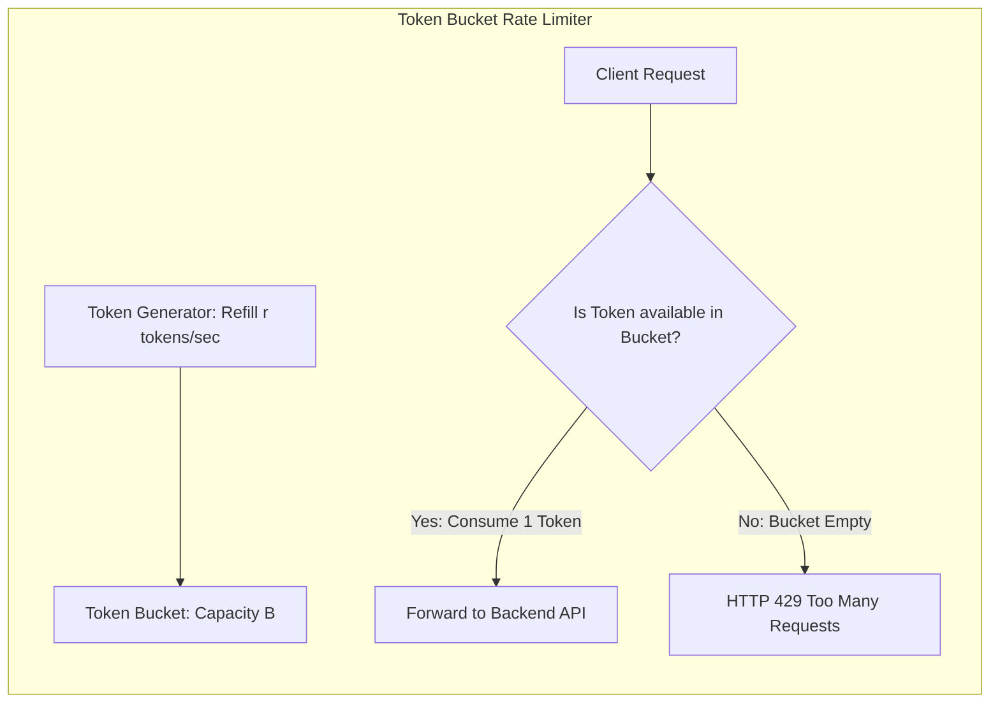

# Modul 149: Back-End: Arsitektur Server HTTP & API (Event-Driven vs Threaded, RESTful, GraphQL DataLoader, gRPC Protobuf)

**Navigasi**: [⬅️ Master Index](../../INDEX.md) | [Tingkat 9: Tingkat 9: Software Engineering, Front-End, Back-End, Full-Stack & Cloud/SRE](./README.md)
*Sebelumnya*: [148. rekayasa-aplikasi-mobile-desktop-lintas-platform](./148-rekayasa-aplikasi-mobile-desktop-lintas-platform.md) | *Berikutnya*: [150. back-end-keamanan-otentikasi-otorisasi](./150-back-end-keamanan-otentikasi-otorisasi.md)

---

## 1. Intuisi Dasar Tanpa Jargon ("Seperti Bayi Baru Lahir")
### 1.1 Konsep Inti & Analogi Tanpa Jargon
Jika database adalah gudang penyimpanan rahasia dan aplikasi frontend adalah etalase toko yang cantik, Application Programming Interface (API) adalah loket layanan resmi yang menghubungkan keduanya. Rekayasa API Kinerja Tinggi ([High-Performance API Engineering](https://restfulapi.net/)) bukan sekadar memilih antara format teks JSON atau biner Protocol Buffers; ini adalah seni merancang kontrak komunikasi digital yang elegan, aman, dan tahan banting. Dari disiplin arsitektur **RESTful** yang memetakan tindakan bisnis ke kata kerja standar HTTP (GET, POST, PUT, DELETE); kebebasan **GraphQL** yang mengizinkan aplikasi seluler meminta tepat field yang dibutuhkannya tanpa kelebihan satu byte pun (*No Over-fetching*); kecepatan peluru **gRPC** untuk komunikasi antar server microservice internal; hingga spesifikasi kontrak otomatis **OpenAPI (Swagger)** yang menjadi dokumen kebenaran tunggal bagi seluruh tim.

### 1.2 Urgensi Rekayasa & Signifikansi Sistemik
Dalam rekayasa sistem modern, pemahaman mendalam tentang konsep ini membedakan arsitek sistem kelas dunia dari sekadar operator perkakas teknis.

## 2. Fondasi Teoretis & Aksiomatik / Matematis
### 2.1 Kerangka Teori Aksiomatik & Formulasi Matematis
Prinsip Arsitektur REST Fielding (Roy Fielding, 2000) dan Komparasi Gaya API:

### 2.2 Penurunan Matematis Langkah-demi-Langkah
1. **Enam Kendala Arsitektur REST (Roy Fielding's Dissertation)**:
   - **Client-Server Separation**: Pemisahan antarmuka pengguna dari penyimpanan data.
   - **Statelessness**: Setiap request dari klien wajib memuat semua konteks yang dibutuhkan server untuk memprosesnya (tanpa sesi server).
   - **Cacheability**: Respons wajib secara eksplisit menyatakan apakah boleh di-cache oleh browser atau proxy (`Cache-Control: max-age=3600`).
   - **Uniform Interface**: Identifikasi resource via URI, manipulasi via representasi, pesan deskriptif diri, dan **HATEOAS** (Hypermedia as the Engine of Application State).
   - **Layered System**: Klien tidak tahu apakah terhubung langsung ke server akhir atau reverse proxy perantara.
   - **Code on Demand (Opsional)**: Pengiriman skrip eksekutabel klien.

2. **Idempotensi dan Keamanan Kata Kerja HTTP (RFC 7231)**:
   $$\begin{array}{|l|c|c|l|}
   \hline
   \textbf{Metode HTTP} & \textbf{Safe (Bebas Efek Samping)} & \textbf{Idempotent (Hasil Identik jika Diulang)} & \textbf{Tujuan Bisnis} \\
   \hline
   \texttt{GET} & \mathbf{Ya} & \mathbf{Ya} & \text{Membaca Resource} \\
   \texttt{POST} & \text{Tidak} & \text{Tidak} & \text{Membuat Resource Baru / Memicu Aksi} \\
   \texttt{PUT} & \text{Tidak} & \mathbf{Ya} & \text{Mengganti Resource secara Penuh} \\
   \texttt{PATCH} & \text{Tidak} & \text{Tidak (Bisa Idempoten)} & \text{Modifikasi Resource Parsial} \\
   \texttt{DELETE} & \text{Tidak} & \mathbf{Ya} & \text{Menghapus Resource} \\
   \hline
   \end{array}$$
   Idempotensi: $f(f(x)) = f(x)$. Mengeksekusi `DELETE /users/42` sepuluh kali berturut-turut menghasilkan kondisi akhir sistem yang persis sama dengan mengeksekusinya satu kali.

## 3. Anatomi Teknis & Cara Kerja Internal
Arsitektur Gateway API: Rate Limiting Token Bucket vs GraphQL N+1 Query Problem:



1. **Masalah Kueri N+1 pada GraphQL**: Ketika GraphQL mem-parse kueri bersarang (misal mengambil 100 penulis dan buku-bukunya), resolver naif mengeksekusi 1 kueri database untuk penulis dan $N=100$ kueri SQL terpisah untuk setiap buku. Solusi: Gunakan pola batching caching **DataLoader** (menggabungkan 100 kueri menjadi satu `SELECT * FROM books WHERE author_id IN (...)`).

#### Tabel Penelusuran Masalah Bom Kueri GraphQL N+1 & Kehabisan Pool Koneksi Basis Data
| Langkah Eksekusi Resolver GraphQL | Kueri Masukan Klien | Resolver yang Terpicu | Perintah SQL yang Dieksekusi ke Database | Jumlah Kueri SQL Kumulatif | Status Connection Pool DB (Maks: 50) |
|---|---|---|---|---|---|
| Kueri Utama | `query { authors { books { title } } }`| Resolver `authors` | `SELECT * FROM authors LIMIT 100;` | 1 Kueri SQL Utama | 1 Koneksi terpakai |
| Eksekusi Bersarang 1 | Untuk Author 1 | Resolver `books(author_id=1)` | `SELECT * FROM books WHERE author_id = 1;` | 2 Kueri SQL | 2 Koneksi terpakai |
| Eksekusi Bersarang 2..100 | Untuk Author 2..100 | Resolver `books` dieksekusi independen | **100 KUERI SQL TAMBAHAN DIEKSEKUSI INDIVIDUAL!**| **101 Kueri SQL Total (N+1 Problem)!**| Antrean kueri membanjiri pool |
| Lonjakan Beban | 10 Permintaan Bersamaan | 10 kueri GraphQL masuk serentak | $10 \times 101 = 1.010$ kueri SQL dalam 1 detik! | 1.010 Kueri menumpuk | **CONNECTION POOL EXHAUSTION!** |
| Keruntuhan Sistem | Kueri baru tertahan | Database server CPU 100% | Waktu tunggu melebihi timeout batas ($>30\text{ s}$) | Error: `Connection pool timed out` | Layanan backend crash dan menolak seluruh user |
| Mitigasi DataLoader | Batching & Caching | Agregasi seluruh ID Author | `SELECT * FROM books WHERE author_id IN (1, 2, ..., 100);` | **Tepat 2 Kueri SQL Saja!** | 2 Koneksi terpakai stabil (Aman) |

## 4. Implementasi Praktis & Kode / Simulasi Riil
```python
# Production-Grade Rate Limiter using Token Bucket Algorithm in Python
import time
from typing import Dict, Tuple

class TokenBucketRateLimiter:
    def __init__(self, capacity: int, fill_rate_per_sec: float):
        self.capacity = capacity
        self.fill_rate = fill_rate_per_sec
        # client_ip -> (current_tokens, last_refill_timestamp)
        self.buckets: Dict[str, Tuple[float, float]] = {}

    def allow_request(self, client_ip: str) -> bool:
        now = time.time()
        tokens, last_time = self.buckets.get(client_ip, (self.capacity, now))
        
        # 1. Isi ulang token berdasarkan waktu yang telah berlalu
        delta_time = now - last_time
        tokens = min(self.capacity, tokens + delta_time * self.fill_rate)
        
        # 2. Periksa ketersediaan token
        if tokens >= 1.0:
            tokens -= 1.0
            self.buckets[client_ip] = (tokens, now)
            return True # Permintaan diizinkan
        
        self.buckets[client_ip] = (tokens, now)
        return False # HTTP 429: Rate Limit Exceeded!

limiter = TokenBucketRateLimiter(capacity=5, fill_rate_per_sec=1.0)
assert limiter.allow_request("192.168.1.1") == True
print("Token Bucket Rate Limiter ready!")
```

## 5. Miskonsepsi & Jebakan Industri
1. **Breaking API Changes without Versioning**: Mengubah tipe field JSON dari integer menjadi string atau mengganti nama atribut pada endpoint yang aktif digunakan aplikasi seluler. Pengguna yang belum memperbarui aplikasi mereka di Play Store akan mengalami crash massal (solusi: gunakan URL path versioning `/api/v1/` atau header versioning).
2. **GraphQL Denial of Service via Deeply Nested Queries**: Penyerang mengirimkan satu kueri GraphQL yang memiliki kedalaman bersarang tak terbatas (`author { books { author { books { ... } } } }`). Server backend akan hang dan kehabisan memori CPU (solusi: batasi kedalaman kueri *Query Depth Limiting* dan *Cost Analysis*).
3. **Exposing Internal Database Errors in API Responses**: Mengembalikan pesan traceback error database SQL mentah di body HTTP 500. Membocorkan struktur nama tabel dan kredensial sensitif kepada penyerang peretas.

### Studi Kasus Kegagalan Nyata: Kelumpuhan Kluster Basis Data Produksi Akibat Bom Kueri GraphQL N+1 pada Layanan Media Sosial
- **Kronologi & Konteks Kasus**: Pada platform media sosial yang memproses jutaan pengguna aktif, tim pengembang mengganti antarmuka REST API lama dengan GraphQL untuk memberikan fleksibilitas kepada tim front-end dalam meminta struktur data yang dinamis.
- **Akar Masalah Arsitektur API Modern, Resolver GraphQL, & Masalah Kueri N+1**: Desain resolver GraphQL mengevaluasi setiap bidang (*field*) secara independen dan naif. Sebuah komponen antarmuka pengguna meminta daftar 100 postingan teratas beserta data profil pengarang dan komentar-komentarnya. Resolver mengeksekusi 1 kueri SQL untuk mengambil 100 postingan, lalu untuk setiap postingan, resolver mengeksekusi 1 kueri SQL terpisah untuk mengambil data pengarang, dan 1 kueri SQL terpisah lagi untuk mengambil komentarnya. Satu permintaan GraphQL tunggal memicu lebih dari 201 kueri SQL ke basis data (*The N+1 Query Problem*). Ketika kampanye pemasaran diluncurkan dan ribuan pengguna membuka aplikasi secara serempak, jutaan kueri SQL membanjiri basis data dalam hitungan detik. Kolam koneksi basis data (*Database Connection Pool*) jenuh seketika, latensi kueri melonjak dari 5 milidetik menjadi lebih dari 30 detik, dan server basis data utama mengalami *crash* akibat kehabisan memori.

- **Potongan Kode / Arsitektur Cacat (Vulnerable Implementation)**:
```javascript
// Rekonstruksi Masalah Bom Kueri N+1 pada Resolver GraphQL Naif
const resolversFlawed = {
    Query: {
        authors: async () => {
            // Kueri 1: Mengambil 100 penulis
            return await db.query("SELECT * FROM authors LIMIT 100");
        }
    },
    Author: {
        books: async (parentAuthor) => {
            // CACAT FATAL N+1: Fungsi ini dieksekusi 100 KALI secara individual!
            // Menghasilkan 100 kueri SQL terpisah yang mematikan pool koneksi database:
            return await db.query("SELECT * FROM books WHERE author_id = ?", [parentAuthor.id]);
        }
    }
};

// Mitigasi Defensif Modern: Pemanfaatan DataLoader untuk Batching & Caching
const DataLoader = require('dataloader');

// Menggabungkan 100 permintaan individual menjadi 1 kueri SQL tunggal berbasis klausa 'IN (...)':
const bookLoader = new DataLoader(async (authorIds) => {
    const books = await db.query("SELECT * FROM books WHERE author_id IN (?)", [authorIds]);
    return authorIds.map(id => books.filter(b => b.author_id === id));
});

const resolversSafe = {
    Author: {
        books: (parentAuthor) => bookLoader.load(parentAuthor.id) // Terbatching otomatis!
    }
};
```

- **Analisis Forensik & Rekayasa Modern**: Krisis kueri GraphQL membuktikan bahwa fleksibilitas antarmuka API lapisan aplikasi harus selalu diimbangi dengan kontrol perlindungan sumber daya di backend. Praktik terbaik arsitektur GraphQL modern mewajibkan: (1) Penerapan pustaka *DataLoader* (atau pembungkus batching) secara wajib pada setiap hubungan entitas data bersarang untuk mengubah kompleksitas $N+1$ menjadi 2 kueri SQL; (2) Penerapan batas kedalaman kueri maksimum (*Query Depth Limiting*) dan analisis biaya kueri statis (*Query Cost Analysis*) yang secara otomatis menolak permintaan kueri yang terlalu dalam atau terlalu rakus sumber daya sebelum dieksekusi.

## 6. Proyek Latihan & Rubrik Penilaian Mandiri
1. **Tingkat Pemula**: Tuliskan dokumen spesifikasi OpenAPI 3.0 dalam format YAML untuk API manajemen pengguna sederhana (`GET /users`, `POST /users`, dan `GET /users/{id}`) lengkap dengan skema validasi tipe data.
2. **Tingkat Menengah**: Bangun middleware autentikasi dan rate-limiting untuk REST API menggunakan FastAPI (Python) atau Express (TypeScript) yang memvalidasi token JWT (JSON Web Token) dan menyematkan header standar `X-RateLimit-Remaining`.
3. **Tingkat Mahir**: Implementasikan skema GraphQL lengkap dengan DataLoader untuk memecahkan masalah N+1 Query Problem. Uji perbandingan jumlah kueri SQL yang diterbitkan ke database sebelum dan sesudah optimasi DataLoader menggunakan profiling SQL.

### Tingkat 1: Dasar
- **Tugas**: Bangun server RESTful API minimalis berstandar RFC 7231 dalam Python (FastAPI/Flask) atau Go yang menerapkan pola operasi CRUD untuk sumber daya `/api/v1/articles` dengan penanganan kode status HTTP yang semantik (`200 OK`, `201 Created`, `400 Bad Request`, `404 Not Found`, `422 Unprocessable Entity`) dan validasi skema masukan JSON.
- **Petunjuk Perancangan Arsitektur**:
  - Gunakan model validasi data kuat (seperti Pydantic dalam Python atau Struct Validation dalam Go).
  - Pastikan operasi `GET`, `PUT`, `DELETE` bersifat idempoten (*Idempotent*).
- **Test Vector & Kasus Uji Ekstrem**:
  - *Validasi Skema*: Kirim permintaan `POST` dengan tipe data umur berupa string huruf; server harus menolak dengan kode status `422 Unprocessable Entity` dan pesan kesalahan field yang spesifik.
- **Rubrik Penilaian Mandiri**: 40% Kepatuhan Semantik Standar RESTful HTTP, 30% Validasi Skema Input yang Kuat, 30% Kerapian Enkapsulasi Kode.

### Tingkat 2: Menengah
- **Tugas**: Kembangkan implementasi pola *DataLoader* mandiri dalam Python/JavaScript yang mengumpulkan pemanggilan kunci individual yang terjadi dalam satu siklus microtask event loop yang sama (*Event Loop Tick Coalescing*), lalu mengeksekusi fungsi batch tunggal untuk mengambil seluruh data sekaligus, lengkap dengan mekanisme tembolok in-memory per-permintaan (*Per-Request Caching*).
- **Petunjuk Perancangan Arsitektur**:
  - Jadwalkan pemanggilan fungsi batch menggunakan `queueMicrotask` atau `Promise.resolve().then()`.
  - Kembalikan objek Promise independen untuk setiap kunci yang dipanggil.
- **Test Vector & Kasus Uji Ekstrem**:
  - *Verifikasi Batching*: Panggil `loader.load(1)`, `loader.load(2)`, `loader.load(3)` secara bersamaan; buktikan fungsi batch database hanya dipanggil tepat 1 kali dengan argumen array `[1, 2, 3]`.
- **Rubrik Penilaian Mandiri**: 40% Penggabungan Kunci Berbasis Event Loop Tick yang Tepat, 30% Eliminasi Masalah N+1 Kueri Terbukti, 30% Manajemen Cache Per-Request Rapi.

### Tingkat 3: Mahir
- **Tugas**: Rancang layanan komunikasi mikroservis berkinerja tinggi menggunakan *gRPC* dan *Protocol Buffers* (Protobuf v3) dalam Go/Python yang mendukung *Bidirectional Streaming RPC* dengan penegakan batas waktu tenggat (*Deadline Propagation*) dan kompresi biner HTTP/2, mampu memproses $50.000$ pesan per detik dengan latensi P99 $< 5\text{ ms}$.
- **Petunjuk Perancangan Arsitektur**:
  - Definisikan file `.proto` yang memuat layanan streaming data telemetri.
  - Tangani pembatalan konteks (`context.Canceled` / `DEADLINE_EXCEEDED`) di mana proses backend secara otomatis menghentikan kueri berat jika klien memutuskan koneksi di tengah jalan.
- **Test Vector & Kasus Uji Ekstrem**:
  - *Perambatan Deadline*: Klien menyetel timeout 50 ms pada pemanggilan streaming; buat server menunda pemrosesan selama 100 ms; pastikan gRPC membatalkan eksekusi di server dan melempar status `DEADLINE_EXCEEDED` seketika.
- **Rubrik Penilaian Mandiri**: 40% Kepatuhan Spesifikasi Protokol gRPC & Protobuf v3, 30% Penerapan Propagasi Deadline & Pembatalan Konteks yang Benar, 30% Throughput Streaming Tingkat Tinggi.

## 7. Rekomendasi Sumber Belajar Standar Emas
| Sumber Pembelajaran | Penulis / Institusi | Tautan Langsung | Fokus Materi |
| :--- | :--- | :--- | :--- |
| Architectural Styles and the Design of Network-based Software Architectures | Roy Thomas Fielding (UC Irvine) | [Roy Fielding Dissertation 2000](https://www.ics.uci.edu/~fielding/pubs/dissertation/top.htm) | Disertasi Resmi Penemuan Arsitektur REST & Prinsip HATEOAS |
| OpenAPI Specification v3.1.0 | OpenAPI Initiative (Linux Foundation) | [OpenAPI Spec Official](https://spec.openapis.org/oas/latest.html) | Standar Industri Pendefinisian Antarmuka RESTful API & Schema |
| GraphQL Official Specification & Learning Portal | GraphQL Foundation | [GraphQL Official Portal](https://graphql.org/learn/) | Schema Definition Language (SDL), Queries, Mutations & Resolvers |
| API Security in Action | Neil Madden (Manning Publications) | [Manning API Security](https://www.manning.com/books/api-security-in-action) | Token-based Auth (JWT), OAuth2, Macaroons, Rate Limiting & DoS Hardening |

---
*Navigasi Cepat*: [Ke Tingkat 9](./README.md) | [Ke Master Index](../../INDEX.md) | *Sebelumnya*: [148. rekayasa-aplikasi-mobile-desktop-lintas-platform](./148-rekayasa-aplikasi-mobile-desktop-lintas-platform.md) | *Berikutnya*: [150. back-end-keamanan-otentikasi-otorisasi](./150-back-end-keamanan-otentikasi-otorisasi.md)
