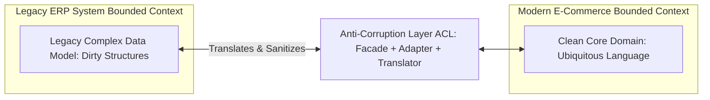

# Modul 149: Back-End: Arsitektur Server HTTP & API (Event-Driven vs Threaded, RESTful, GraphQL DataLoader, gRPC Protobuf)

**Navigasi**: [⬅️ Master Index](../../INDEX.md) | [Tingkat 9: Tingkat 9: Software Engineering, Front-End, Back-End, Full-Stack & Cloud/SRE](./README.md)
*Sebelumnya*: [148. rekayasa-aplikasi-mobile-desktop-lintas-platform](./148-rekayasa-aplikasi-mobile-desktop-lintas-platform.md) | *Berikutnya*: [150. back-end-keamanan-otentikasi-otorisasi](./150-back-end-keamanan-otentikasi-otorisasi.md)

---

## 1. Intuisi Dasar Tanpa Jargon ("Seperti Bayi Baru Lahir")
Berapa kali Anda melihat proyek perangkat lunak gagal bukan karena kompilator mengalami error, melainkan karena programmer salah mengartikan apa yang sebenarnya diinginkan oleh pakar bisnis? Bagi tim akuntansi, 'Pendapatan' berarti uang yang sudah cair di bank; tetapi bagi tim penjualan, 'Pendapatan' berarti kontrak yang baru ditandatangani meskipun uangnya belum dibayar! Domain-Driven Design (DDD) ([Domain-Driven Design Reference](https://www.domainlanguage.com/ddd/)) adalah mahakarya metodologi Eric Evans (2003) untuk menyatukan dua dunia yang terpisah ini. DDD mengajarkan kita berbicara dalam satu bahasa seragam yang disepakati bersama (**Ubiquitous Language**); memagari konteks makna kata yang berbeda ke dalam perbatasan yang jelas (**Bounded Contexts**); serta menyusun kode menggunakan blok bangunan suci: **Entities** yang memiliki identitas abadi, **Value Objects** yang nilainya diukur dari kesempurnaan datanya, dan **Aggregates** yang menjaga keutuhan aturan transaksi bisnis.

## 2. Fondasi Teoretis & Aksiomatik / Matematis
Arsitektur Strategis dan Taktis Domain-Driven Design (Eric Evans & Vaughn Vernon):

1. **Desain Strategis (Strategic Design)**:
   - **Ubiquitous Language**: Kosakata tunggal yang didefinisikan secara ketat dan digunakan secara identik oleh pakar bisnis, product manager, dan developer (tercermin langsung pada penamaan kelas, variabel, dan metode kode).
   - **Bounded Context**: Batas linguistik eksplisit di mana satu model domain memiliki makna tunggal yang tidak ambigu. Kata 'Akun' memiliki arti kredensial login di *Auth Context*, namun berarti buku kas keuangan di *Billing Context*!
   - **Context Mapping**: Pola integrasi antar bounded context: *Shared Kernel*, *Customer-Supplier*, *Conformist*, atau *Anti-Corruption Layer (ACL)*.

2. **Desain Taktis (Tactical Building Blocks)**:
   - **Value Object**: Objek tanpa identitas konseptual, bersifat **Immutable** mutlak. Dua Value Object dianggap identik jika semua atribut datanya sama ($Money(10, "USD") \equiv Money(10, "USD")$).
   - **Entity**: Objek yang memiliki siklus hidup dan identitas unik permanen yang tidak pernah berubah meskipun seluruh atribut datanya diperbarui ($User(ID=42)$).
   - **Aggregate & Aggregate Root**: Gugus entitas dan value objects yang diperlakukan sebagai satu kesatuan atomik untuk mutasi data. Dunia luar dilarang memodifikasi anggota internal secara langsung; semua operasi wajib melewati **Aggregate Root** untuk menegakkan aturan invarian bisnis.

## 3. Anatomi Teknis & Cara Kerja Internal
Pola Anti-Corruption Layer (ACL) Menghubungkan Dua Bounded Contexts Independen:



1. **Anti-Corruption Layer (ACL)**: Lapisan penerjemah diplomatik yang mengisolasi model domain baru yang bersih dari polusi model data lama sistem warisan (Legacy ERP). Mencegah konsep data jelek merembes masuk ke dalam kode baru.

## 4. Implementasi Praktis & Kode / Simulasi Riil
```python
# DDD Tactical Building Blocks: Value Object and Aggregate Root in Python
from dataclasses import dataclass
from typing import List

# 1. Value Object: Immutable murni tanpa identitas
@dataclass(frozen=True)
class Money:
    amount: float
    currency: str

    def add(self, other: 'Money') -> 'Money':
        if self.currency != other.currency:
            raise ValueError("Currency mismatch!")
        return Money(self.amount + other.amount, self.currency)

# 2. Aggregate Root: Menegakkan Invarian Bisnis
class OrderAggregateRoot:
    def __init__(self, order_id: str, customer_id: str):
        self.id = order_id
        self.customer_id = customer_id
        self.items: List[dict] = []
        self.status = "DRAFT"

    def add_line_item(self, product_id: str, price: Money, quantity: int):
        # Invarian Bisnis: Tidak boleh mengubah item jika order sudah di-submit!
        if self.status != "DRAFT":
            raise RuntimeError("Cannot modify an order that has already been submitted!")
        if quantity <= 0:
            raise ValueError("Quantity must be positive")
        self.items.append({"product_id": product_id, "price": price, "quantity": quantity})

    def submit_order(self):
        if not self.items:
            raise RuntimeError("Cannot submit an empty order!")
        self.status = "SUBMITTED"
```

## 5. Miskonsepsi & Jebakan Industri
1. **Megalomaniac Super-Aggregates**: Merancang satu Aggregate Root raksasa yang memuat seluruh riwayat data pelanggan (Customer memuat seluruh Orders, seluruh Invoices, seluruh Reviews). Memuat aggregate ini memakan gigabyte memori dan memicu tabrakan penguncian (*Lock Contention*) saat dua transaksi kecil berjalan bersamaan.
2. **Mutable Value Objects**: Mengizinkan atribut Value Object diubah setelah diciptakan. Jika objek `Money` tersebut dibagikan ke beberapa transaksi lain, mutasi satu saldo akan mencemari data transaksi lain secara tak terduga.
3. **Direct Mutation of Aggregate Internal Entities**: Mengizinkan kode di luar aggregate melakukan manipulasi langsung pada list item anak tanpa melalui Aggregate Root (`order.items.append(...)`). Seluruh aturan validasi bisnis akan terlewati.

## 6. Proyek Latihan & Rubrik Penilaian Mandiri
1. **Tingkat Pemula**: Identifikasi mana yang merupakan Entity dan mana yang merupakan Value Object dari daftar berikut: (a) Alamat Pengiriman Rumah, (b) Nomor Paspor Nasabah, (c) Koordinat GPS Latitude/Longitude, (d) Tiket Penerbangan Pesawat.
2. **Tingkat Menengah**: Buat Peta Konteks (Context Map) untuk platform ride-hailing (seperti Grab/Gojek) yang mendefinisikan hubungan antar Bounded Contexts: `Driver Matching`, `Billing & Payments`, dan `Customer Support`.
3. **Tingkat Mahir**: Implementasikan model Aggregate Root lengkap untuk proses `LoanApplication` (Pengajuan Pinjaman Bank). Terapkan siklus hidup transisi status (Draft -> UnderReview -> Approved / Rejected), publikasikan Domain Events (`LoanApprovedEvent`), dan tegakkan invarian batas rasio kredit pemohon.

## 7. Rekomendasi Sumber Belajar Standar Emas
| Sumber Pembelajaran | Penulis / Institusi | Tautan Langsung | Fokus Materi |
| :--- | :--- | :--- | :--- |
| Domain-Driven Design: Tackling Complexity in the Heart of Software | Eric Evans | [Eric Evans DDD Book](https://www.domainlanguage.com/ddd/) | Alkitab Asli Penemuan DDD: Ubiquitous Language, Bounded Contexts & Model-Driven Design |
| Implementing Domain-Driven Design (The Red Book) | Vaughn Vernon | [Addison-Wesley Vernon](https://kalele.io/books/) | Panduan Praktis Implementasi DDD: Aggregates, Domain Events & Hexagonal Mapping |
| Domain-Driven Design Reference: Definitions and Pattern Summaries | Eric Evans | [Domain Language Free PDF](https://www.domainlanguage.com/wp-content/uploads/2016/05/DDD_Reference_2015-05.pdf) | Ringkasan Resmi Pola-Pola Desain Strategis dan Taktis DDD |
| Domain Storytelling: A Collaborative Modeling Method | Stefan Hofer & Henning Schwentner | [Domain Storytelling Book](https://domainstorytelling.org/) | Metodologi Pemodelan Visual Domain Bersama Pakar Bisnis |

---
*Navigasi Cepat*: [Ke Tingkat 9](./README.md) | [Ke Master Index](../../INDEX.md) | *Sebelumnya*: [148. rekayasa-aplikasi-mobile-desktop-lintas-platform](./148-rekayasa-aplikasi-mobile-desktop-lintas-platform.md) | *Berikutnya*: [150. back-end-keamanan-otentikasi-otorisasi](./150-back-end-keamanan-otentikasi-otorisasi.md)
