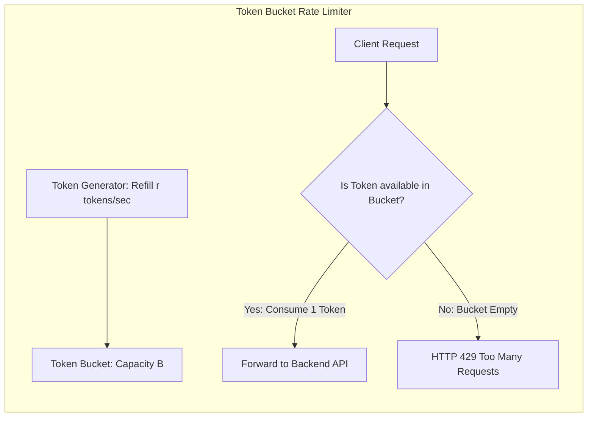

# Modul 150: Back-End: Keamanan Otentikasi & Otorisasi (Argon2id, Session Cookies, JWT, OAuth 2.0, OIDC, Passkeys WebAuthn, RBAC)

**Navigasi**: [⬅️ Master Index](../../INDEX.md) | [Tingkat 9: Tingkat 9: Software Engineering, Front-End, Back-End, Full-Stack & Cloud/SRE](./README.md)
*Sebelumnya*: [149. back-end-arsitektur-server-http-api](./149-back-end-arsitektur-server-http-api.md) | *Berikutnya*: [151. back-end-strategi-caching-multi-tingkat](./151-back-end-strategi-caching-multi-tingkat.md)

---

## 1. Intuisi Dasar Tanpa Jargon ("Seperti Bayi Baru Lahir")
Jika database adalah gudang penyimpanan rahasia dan aplikasi frontend adalah etalase toko yang cantik, Application Programming Interface (API) adalah loket layanan resmi yang menghubungkan keduanya. Rekayasa API Kinerja Tinggi ([High-Performance API Engineering](https://restfulapi.net/)) bukan sekadar memilih antara format teks JSON atau biner Protocol Buffers; ini adalah seni merancang kontrak komunikasi digital yang elegan, aman, dan tahan banting. Dari disiplin arsitektur **RESTful** yang memetakan tindakan bisnis ke kata kerja standar HTTP (GET, POST, PUT, DELETE); kebebasan **GraphQL** yang mengizinkan aplikasi seluler meminta tepat field yang dibutuhkannya tanpa kelebihan satu byte pun (*No Over-fetching*); kecepatan peluru **gRPC** untuk komunikasi antar server microservice internal; hingga spesifikasi kontrak otomatis **OpenAPI (Swagger)** yang menjadi dokumen kebenaran tunggal bagi seluruh tim.

## 2. Fondasi Teoretis & Aksiomatik / Matematis
Prinsip Arsitektur REST Fielding (Roy Fielding, 2000) dan Komparasi Gaya API:

1. **Enam Kendala Arsitektur REST (Roy Fielding's Dissertation)**:
   - **Client-Server Separation**: Pemisahan antarmuka pengguna dari penyimpanan data.
   - **Statelessness**: Setiap request dari klien wajib memuat semua konteks yang dibutuhkan server untuk memprosesnya (tanpa sesi server).
   - **Cacheability**: Respons wajib secara eksplisit menyatakan apakah boleh di-cache oleh browser atau proxy (`Cache-Control: max-age=3600`).
   - **Uniform Interface**: Identifikasi resource via URI, manipulasi via representasi, pesan deskriptif diri, dan **HATEOAS** (Hypermedia as the Engine of Application State).
   - **Layered System**: Klien tidak tahu apakah terhubung langsung ke server akhir atau reverse proxy perantara.
   - **Code on Demand (Opsional)**: Pengiriman skrip eksekutabel klien.

2. **Idempotensi dan Keamanan Kata Kerja HTTP (RFC 7231)**:
   $$\begin{array}{|l|c|c|l|}
   \hline
   \textbf{Metode HTTP} & \textbf{Safe (Bebas Efek Samping)} & \textbf{Idempotent (Hasil Identik jika Diulang)} & \textbf{Tujuan Bisnis} \\
   \hline
   \texttt{GET} & \mathbf{Ya} & \mathbf{Ya} & \text{Membaca Resource} \\
   \texttt{POST} & \text{Tidak} & \text{Tidak} & \text{Membuat Resource Baru / Memicu Aksi} \\
   \texttt{PUT} & \text{Tidak} & \mathbf{Ya} & \text{Mengganti Resource secara Penuh} \\
   \texttt{PATCH} & \text{Tidak} & \text{Tidak (Bisa Idempoten)} & \text{Modifikasi Resource Parsial} \\
   \texttt{DELETE} & \text{Tidak} & \mathbf{Ya} & \text{Menghapus Resource} \\
   \hline
   \end{array}$$
   Idempotensi: $f(f(x)) = f(x)$. Mengeksekusi `DELETE /users/42` sepuluh kali berturut-turut menghasilkan kondisi akhir sistem yang persis sama dengan mengeksekusinya satu kali.

## 3. Anatomi Teknis & Cara Kerja Internal
Arsitektur Gateway API: Rate Limiting Token Bucket vs GraphQL N+1 Query Problem:



1. **Masalah Kueri N+1 pada GraphQL**: Ketika GraphQL mem-parse kueri bersarang (misal mengambil 100 penulis dan buku-bukunya), resolver naif mengeksekusi 1 kueri database untuk penulis dan $N=100$ kueri SQL terpisah untuk setiap buku. Solusi: Gunakan pola batching caching **DataLoader** (menggabungkan 100 kueri menjadi satu `SELECT * FROM books WHERE author_id IN (...)`).

## 4. Implementasi Praktis & Kode / Simulasi Riil
```python
# Production-Grade Rate Limiter using Token Bucket Algorithm in Python
import time
from typing import Dict, Tuple

class TokenBucketRateLimiter:
    def __init__(self, capacity: int, fill_rate_per_sec: float):
        self.capacity = capacity
        self.fill_rate = fill_rate_per_sec
        # client_ip -> (current_tokens, last_refill_timestamp)
        self.buckets: Dict[str, Tuple[float, float]] = {}

    def allow_request(self, client_ip: str) -> bool:
        now = time.time()
        tokens, last_time = self.buckets.get(client_ip, (self.capacity, now))
        
        # 1. Isi ulang token berdasarkan waktu yang telah berlalu
        delta_time = now - last_time
        tokens = min(self.capacity, tokens + delta_time * self.fill_rate)
        
        # 2. Periksa ketersediaan token
        if tokens >= 1.0:
            tokens -= 1.0
            self.buckets[client_ip] = (tokens, now)
            return True # Permintaan diizinkan
        
        self.buckets[client_ip] = (tokens, now)
        return False # HTTP 429: Rate Limit Exceeded!

limiter = TokenBucketRateLimiter(capacity=5, fill_rate_per_sec=1.0)
assert limiter.allow_request("192.168.1.1") == True
print("Token Bucket Rate Limiter ready!")
```

## 5. Miskonsepsi & Jebakan Industri
1. **Breaking API Changes without Versioning**: Mengubah tipe field JSON dari integer menjadi string atau mengganti nama atribut pada endpoint yang aktif digunakan aplikasi seluler. Pengguna yang belum memperbarui aplikasi mereka di Play Store akan mengalami crash massal (solusi: gunakan URL path versioning `/api/v1/` atau header versioning).
2. **GraphQL Denial of Service via Deeply Nested Queries**: Penyerang mengirimkan satu kueri GraphQL yang memiliki kedalaman bersarang tak terbatas (`author { books { author { books { ... } } } }`). Server backend akan hang dan kehabisan memori CPU (solusi: batasi kedalaman kueri *Query Depth Limiting* dan *Cost Analysis*).
3. **Exposing Internal Database Errors in API Responses**: Mengembalikan pesan traceback error database SQL mentah di body HTTP 500. Membocorkan struktur nama tabel dan kredensial sensitif kepada penyerang peretas.

## 6. Proyek Latihan & Rubrik Penilaian Mandiri
1. **Tingkat Pemula**: Tuliskan dokumen spesifikasi OpenAPI 3.0 dalam format YAML untuk API manajemen pengguna sederhana (`GET /users`, `POST /users`, dan `GET /users/{id}`) lengkap dengan skema validasi tipe data.
2. **Tingkat Menengah**: Bangun middleware autentikasi dan rate-limiting untuk REST API menggunakan FastAPI (Python) atau Express (TypeScript) yang memvalidasi token JWT (JSON Web Token) dan menyematkan header standar `X-RateLimit-Remaining`.
3. **Tingkat Mahir**: Implementasikan skema GraphQL lengkap dengan DataLoader untuk memecahkan masalah N+1 Query Problem. Uji perbandingan jumlah kueri SQL yang diterbitkan ke database sebelum dan sesudah optimasi DataLoader menggunakan profiling SQL.

## 7. Rekomendasi Sumber Belajar Standar Emas
| Sumber Pembelajaran | Penulis / Institusi | Tautan Langsung | Fokus Materi |
| :--- | :--- | :--- | :--- |
| Architectural Styles and the Design of Network-based Software Architectures | Roy Thomas Fielding (UC Irvine) | [Roy Fielding Dissertation 2000](https://www.ics.uci.edu/~fielding/pubs/dissertation/top.htm) | Disertasi Resmi Penemuan Arsitektur REST & Prinsip HATEOAS |
| OpenAPI Specification v3.1.0 | OpenAPI Initiative (Linux Foundation) | [OpenAPI Spec Official](https://spec.openapis.org/oas/latest.html) | Standar Industri Pendefinisian Antarmuka RESTful API & Schema |
| GraphQL Official Specification & Learning Portal | GraphQL Foundation | [GraphQL Official Portal](https://graphql.org/learn/) | Schema Definition Language (SDL), Queries, Mutations & Resolvers |
| API Security in Action | Neil Madden (Manning Publications) | [Manning API Security](https://www.manning.com/books/api-security-in-action) | Token-based Auth (JWT), OAuth2, Macaroons, Rate Limiting & DoS Hardening |

---
*Navigasi Cepat*: [Ke Tingkat 9](./README.md) | [Ke Master Index](../../INDEX.md) | *Sebelumnya*: [149. back-end-arsitektur-server-http-api](./149-back-end-arsitektur-server-http-api.md) | *Berikutnya*: [151. back-end-strategi-caching-multi-tingkat](./151-back-end-strategi-caching-multi-tingkat.md)
