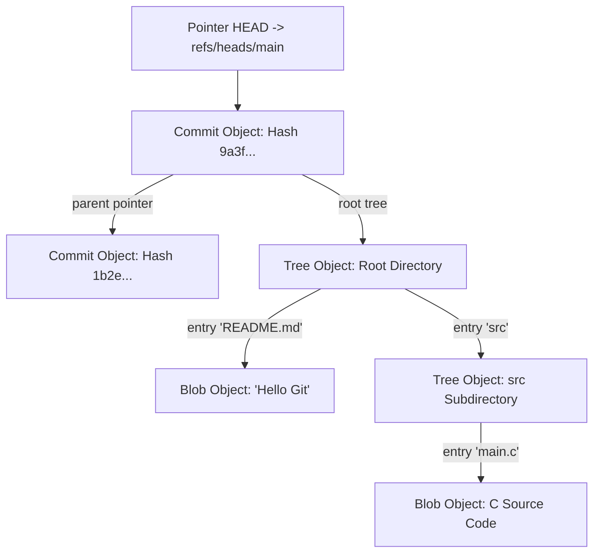

# Modul 151: Back-End: Strategi Caching Multi-Tingkat (Redis Key-Value, Cache-Aside, Mitigasi Cache Stampede, CDC Debezium)

**Navigasi**: [⬅️ Master Index](../../INDEX.md) | [Tingkat 9: Tingkat 9: Software Engineering, Front-End, Back-End, Full-Stack & Cloud/SRE](./README.md)
*Sebelumnya*: [150. back-end-keamanan-otentikasi-otorisasi](./150-back-end-keamanan-otentikasi-otorisasi.md) | *Berikutnya*: [152. back-end-pemrosesan-pesan-asinkron](./152-back-end-pemrosesan-pesan-asinkron.md)

---

## 1. Intuisi Dasar Tanpa Jargon ("Seperti Bayi Baru Lahir")
Hampir setiap programmer di dunia menggunakan perintah `git add`, `git commit`, dan `git push` setiap hari. Namun bagi kebanyakan orang, Git terasa seperti kotak hitam misterius: jika terjadi merge conflict yang rumit atau branch terlepas (*detached HEAD*), banyak yang panik, menghapus folder proyek, dan mengunduh ulang salinan baru dari GitHub! Manajemen Basis Kode & Version Control Lanjut ([Git from the Bottom Up](https://git-scm.com/book/en/v2/Git-Internals-Plumbing-and-Porcelain)) membuka tutup kotak hitam tersebut untuk menunjukkan keindahan arsitektur Git yang sesungguhnya. Git pada dasarnya hanyalah sebuah **Database Penyimpanan Nilai-Kunci Berbasis Konten (Content-Addressable Object Store)** yang dibungkus oleh struktur matematika pohon graf berarah bebas siklus (**Directed Acyclic Graph / DAG**). Di dalam folder rahasia `.git`, hanya ada empat jenis objek biner yang disimpan berdasarkan hash kriptografis SHA-1/SHA-256. Memahami struktur ini mengubah Anda dari pengguna biasa menjadi master pelacak riwayat kode yang tak terkalahkan.

## 2. Fondasi Teoretis & Aksiomatik / Matematis
Arsitektur Objek Database Biner Git dan Struktur Graf Terarah (DAG):

Setiap objek di dalam direktori `.git/objects` disimpan dengan nama file berupa hash kriptografis SHA-1 (40 karakter heksadesimal) dari:
$$\text{Object Hash} = \text{SHA-1}\Big( \text{Tipe} + \text{" "} + \text{Panjang Byte} + \text{"\0"} + \text{Data Muatan} \Big)$$

Empat Tipe Objek Primitif Git:
1. **`blob`**: Menyimpan data mentah isi file teks/biner. **Nama file dan hak akses tidak disimpan di dalam blob!**
2. **`tree`**: Merepresentasikan sebuah direktori folder. Berisi barisan entri: mode file (permissions), tipe (`blob` atau `tree`), hash objek anak, dan nama file asli.
3. **`commit`**: Merepresentasikan stempel titik riwayat proyek. Berisi hash `tree` akar proyek, hash satu atau dua commit induk (*Parents*), nama pembuat (*Author*), stempel waktu, dan pesan commit.
4. **`tag` (Annotated Tag)**: Penanda permanen yang menunjuk ke objek commit tertentu disertai tanda tangan kriptografi GPG.

Cabang (*Branch*) dan Pointer `HEAD`:
Sebuah branch di Git **bukanlah salinan folder data**; sebuah branch hanyalah sebuah file teks kecil 41-byte di dalam `.git/refs/heads/main` yang menyimpan 40 karakter hash commit terakhirnya! Mengubah atau membuat branch baru hanyalah operasi penulisan file teks berkecepatan 1 mikrodetik.

## 3. Anatomi Teknis & Cara Kerja Internal
Arsitektur Struktur Objek Internal Git: Hubungan Commit, Tree, dan Blobs di Disk:



1. **The Three Trees of Git**: Ruang kerja Anda dibagi menjadi tiga zona: **Working Directory** (file fisik di disk), **Index / Staging Area** (file biner `.git/index` yang menyimpan snapshot yang siap di-commit), dan **Commit History** (database objek di repository).
2. **Interactive Rebase & Reflog (`git reflog`)**: Reflog mencatat setiap pergerakan pointer `HEAD` lokal selama 90 hari terakhir. Jika Anda tidak sengaja menghapus branch penting dengan `git branch -D`, commit tersebut tidak hilang; cari hash-nya di `git reflog` dan pulihkan seketika!

## 4. Implementasi Praktis & Kode / Simulasi Riil
```python
# Low-Level Git Object Builder: Creating Real Git Blobs in Pure Python
import hashlib
import zlib

def create_git_blob(content_bytes: bytes) -> tuple[str, bytes]:
    """
    Membuat Git Blob biner identik 100% dengan perintah 'git hash-object -w'.
    Format header: 'blob <panjang_byte>\0<konten>'
    """
    header = f"blob {len(content_bytes)}\0".encode('ascii')
    full_payload = header + content_bytes
    
    # 1. Hitung hash SHA-1
    sha1_hash = hashlib.sha1(full_payload).hexdigest()
    
    # 2. Kompresi muatan menggunakan zlib deflate (cara Git menyimpannya di .git/objects)
    compressed_data = zlib.compress(full_payload)
    return sha1_hash, compressed_data

# Uji coba pembuatan blob untuk string 'Hello Git internals!'
test_content = b"Hello Git internals!\n"
hash_val, compressed = create_git_blob(test_content)
print(f"Git Object SHA-1 Hash: {hash_val}")
print(f"Disk path: .git/objects/{hash_val[:2]}/{hash_val[2:]}")
```

## 5. Miskonsepsi & Jebakan Industri
1. **Rewriting Public Shared History via Force Push (`git push -f`)**: Melakukan `rebase` pada branch bersama yang sudah di-clone oleh anggota tim lain lalu memaksakan force push. Seluruh riwayat komit tim lain akan terputus dan memicu krisis rekonsiliasi merge bercabang-cabang (solusi: gunakan `--force-with-lease`).
2. **Committing Secrets / API Keys into History**: Menyimpan file kredensial `.env` berisi private key ke Git lalu menghapusnya di commit berikutnya. Karena Git adalah database objek persisten, kunci rahasia tersebut tetap tersimpan abadi di commit masa lalu (solusi: gunakan BFG Repo-Cleaner atau `git filter-repo`).
3. **Detached HEAD State Confusion**: Melakukan checkout ke hash commit tertentu (`git checkout <hash>`) alih-alih branch, lalu membuat commit baru. Commit baru tersebut tidak terikat pada branch mana pun dan akan disita oleh Garbage Collector Git (`git gc`) setelah beberapa minggu.

## 6. Proyek Latihan & Rubrik Penilaian Mandiri
1. **Tingkat Pemula**: Buat repositori Git baru, buat satu file, dan gunakan perintah tingkat rendah (*Plumbing Command*) `git cat-file -p HEAD` serta `git cat-file -t HEAD` untuk menginspeksi tipe dan isi objek commit secara langsung.
2. **Tingkat Menengah**: Gunakan perintah `git bisect` (pencarian biner otomatis) pada repositori kode pengujian untuk menemukan komit mana yang secara spesifik memperkenalkan bug kegagalan unit test di antara 100 komit riwayat.
3. **Tingkat Mahir**: Bangun skrip Git Hook `pre-commit` di shell/Python yang memvalidasi bahwa seluruh file yang di-stage tidak mengandung kunci rahasia (menggunakan regex deteksi AWS/GitHub private tokens), memformat kode via linter, dan membatalkan commit jika ditemukan pelanggaran.

## 7. Rekomendasi Sumber Belajar Standar Emas
| Sumber Pembelajaran | Penulis / Institusi | Tautan Langsung | Fokus Materi |
| :--- | :--- | :--- | :--- |
| Pro Git Book (Chapter 10: Git Internals) | Scott Chacon & Ben Straub | [Pro Git Book Free](https://git-scm.com/book/en/v2/Git-Internals-Plumbing-and-Porcelain) | Alkitab Resmi Git: Plumbing Commands, Git Object DB, Packfiles & Refspecs |
| Git from the Bottom Up | John Wiegley | [Wiegley Git from Bottom Up](https://jwiegley.github.io/git-from-the-bottom-up/) | Penjelasan Matematika Graf Terarah DAG, Tree/Blob Models & Index Details |
| Git Immersion: A Guided Tour through Git Fundamentals | Jim Weirich | [Git Immersion Lab](https://gitimmersion.com/) | Laboratorium Langkah demi Langkah Penguasaan Branching, Rebasing & History |
| The Git Source Code Repository | Linus Torvalds & Junio C Hamano | [Git Core Source Code](https://github.com/git/git) | Kode Sumber Asli C Implementasi Fast Packfiles, Index & Merge Engines |

---
*Navigasi Cepat*: [Ke Tingkat 9](./README.md) | [Ke Master Index](../../INDEX.md) | *Sebelumnya*: [150. back-end-keamanan-otentikasi-otorisasi](./150-back-end-keamanan-otentikasi-otorisasi.md) | *Berikutnya*: [152. back-end-pemrosesan-pesan-asinkron](./152-back-end-pemrosesan-pesan-asinkron.md)
