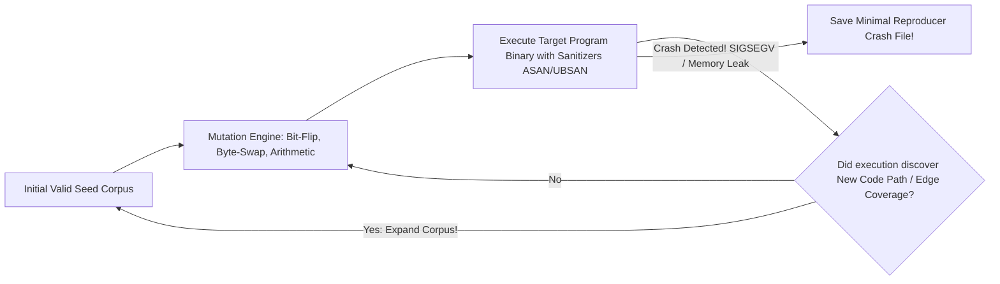

# Modul 152: Back-End: Pemrosesan Pesan Asinkron (Antrean Tugas, RabbitMQ AMQP, Apache Kafka Event Streaming, Outbox Pattern)

**Navigasi**: [⬅️ Master Index](../../INDEX.md) | [Tingkat 9: Tingkat 9: Software Engineering, Front-End, Back-End, Full-Stack & Cloud/SRE](./README.md)
*Sebelumnya*: [151. back-end-strategi-caching-multi-tingkat](./151-back-end-strategi-caching-multi-tingkat.md) | *Berikutnya*: [153. sistem-terdistribusi-keandalan-ketahanan](./153-sistem-terdistribusi-keandalan-ketahanan.md)

---

## 1. Intuisi Dasar Tanpa Jargon ("Seperti Bayi Baru Lahir")
Banyak programmer mengira pekerjaan mereka selesai begitu kode berhasil dikompilasi dan 'tampak berjalan' di laptop mereka. Itu adalah ilusi yang berbahaya: perangkat lunak yang belum diuji secara ketat adalah bom waktu yang menunggu meledak di tangan pengguna. Metodologi Pengujian Perangkat Lunak ([Software Testing Methodology](https://martinfowler.com/articles/practical-test-pyramid.html)) adalah disiplin rekayasa pertahanan bertingkat. Piramida Pengujian memandu efisiensi kita: ribuan **Unit Tests** cepat di lapisan bawah menguji fungsi terisolasi; **Integration Tests** memastikan database dan API pihak ketiga berbicara dengan harmonis; sementara teknik modern mutakhir—seperti **Property-Based Testing** yang menguji kebenaran properti matematika dengan ribuan input acak ekstrem, dan **Fuzz Testing** yang membombardir biner dengan mutasi data gila—mampu menemukan celah keamanan memori tersembunyi yang tidak pernah terpikirkan oleh otak manusia terpandai sekalipun.

## 2. Fondasi Teoretis & Aksiomatik / Matematis
Teorema Pengujian Dijkstra dan Formalisme Property-Based Testing (QuickCheck):

1. **Teorema Edsger W. Dijkstra (1970)**:
   $$\text{'Pengujian program dapat membuktikan keberadaan bug dengan sangat efektif,}$$
   $$\text{tetapi secara matematis TIDAK AKAN PERNAH bisa membuktikan ketiadaan bug!'}$$

2. **Piramida Pengujian (The Test Pyramid - Mike Cohn & Martin Fowler)**:
   $$\text{UI / End-to-End Tests (10\% - Lambat & Rapuh)} \quad < \quad \text{Integration Tests (20\%)} \quad < \quad \mathbf{Unit Tests (70\% - Cepat & Stabil)}$$

3. **Property-Based Testing (Claessen & Hughes, 2000)**:
   Alih-alih menguji contoh spesifik (*Example-based testing* seperti `add(2, 3) == 5`), kita mendefinisikan sifat invarian matematika universal $\forall x$:
   $$\forall x, y \in \mathbb{Z}, \quad x + y \equiv y + x \quad (\text{Komutatif})$$
   $$\forall x \in \text{Data}, \quad \text{deserialize}(\text{serialize}(x)) \equiv x \quad (\text{Round-trip Invariant})$$
   Mesin penguji secara otomatis menghasilkan ribuan kasus acak; jika ditemukan kegagalan, mesin menjalankan **Shrinking**: memangkas input gagal menjadi contoh terkecil yang paling minimal.

## 3. Anatomi Teknis & Cara Kerja Internal
Arsitektur Coverage-Guided Fuzzing (AFL / libFuzzer Engine):



1. **Sanitizers Instrumentation (ASan / UBSan / TSan)**:
   Kompilator (Clang/GCC `-fsanitize=address`) menyuntikkan instruksi pengawas bayangan memori (*Shadow Memory*) di setiap akses pointer untuk mendeteksi buffer overflow, use-after-free, dan data race tepat pada instruksi terjadinya kesalahan.

## 4. Implementasi Praktis & Kode / Simulasi Riil
```python
# Property-Based Testing using Hypothesis Framework in Python
from hypothesis import given, strategies as st

# Fungsi yang diuji: Pengurutan list angka
def custom_sort(lst: list) -> list:
    return sorted(lst)

# Uji Properti Universal Invarian Pengurutan
@given(st.lists(st.integers()))
def test_sorting_properties(input_list):
    result = custom_sort(input_list)
    
    # Properti 1: Panjang output harus selalu sama dengan panjang input
    assert len(result) == len(input_list)
    
    # Properti 2: Elemen hasil wajib terurut secara monoton menaik
    for i in range(len(result) - 1):
        assert result[i] <= result[i + 1]
        
    # Properti 3: Idempotensi sorting
    assert custom_sort(result) == result

print("Property-based test assertions defined!")
```

## 5. Miskonsepsi & Jebakan Industri
1. **Over-Mocking Testing Nothing (Mocking All Collaborators)**: Mengganti semua dependensi database dan API dengan mock objek palsu. Unit test lulus 100% dengan warna hijau, namun ketika dijalankan di server nyata, sistem crash seketika karena skema SQL di database fisik tidak cocok dengan mock.
2. **Flaky Tests Eroding Engineering Trust**: Menulis pengujian integrasi yang mengandalkan jeda waktu tidur `sleep(2)` alih-alih polling kondisi asinkron yang tepat. Pengujian akan gagal sesekali saat CPU server CI sedang sibuk, membuat tim mengabaikan laporan kegagalan pengujian.
3. **Chasing 100% Code Coverage Vanity Metric**: Mengharuskan 100% line coverage tanpa menguji kondisi batas (*Edge Cases*). Mengeksekusi setiap baris kode bukan berarti menguji seluruh kemungkinan kombinasi status logika.

## 6. Proyek Latihan & Rubrik Penilaian Mandiri
1. **Tingkat Pemula**: Tulis rangkaian pengujian unit test menggunakan kerangka `pytest` untuk fungsi kalkulator string matematika: uji input normal, pembagian nol, input negatif, dan format karakter tidak valid.
2. **Tingkat Menengah**: Gunakan pustaka mock (`unittest.mock`) untuk menguji layanan pembayaran pesanan e-commerce: simulasikan kegagalan jaringan saat menghubungi gateway pembayaran dan buktikan status pesanan ditandai sebagai `PAYMENT_FAILED`.
3. **Tingkat Mahir**: Bangun target Fuzz Testing menggunakan Google `libFuzzer` dan Clang AddressSanitizer (`-fsanitize=fuzzer,address`) untuk mem-fuzz parser header biner paket jaringan kustom di C/C++. Biarkan fuzzer berjalan selama 10 menit dan analisis apakah ditemukan memory leak atau out-of-bounds read.

## 7. Rekomendasi Sumber Belajar Standar Emas
| Sumber Pembelajaran | Penulis / Institusi | Tautan Langsung | Fokus Materi |
| :--- | :--- | :--- | :--- |
| The Practical Test Pyramid | Ham Vocke & Martin Fowler | [Martin Fowler Testing Pyramid](https://martinfowler.com/articles/practical-test-pyramid.html) | Unit Tests, Integration Tests, End-to-End Tests & Anti-Patterns |
| QuickCheck: A Lightweight Tool for Random Testing of Haskell Programs | Koen Claessen & John Hughes | [ACM ICFP 2000 Paper](https://dl.acm.org/doi/10.1145/351240.351266) | Makalah Orisinal Penemuan Property-Based Testing & Shrinking |
| LLVM libFuzzer: A Library for In-Process Coverage-Guided Fuzz Testing | The LLVM Compiler Infrastructure | [LLVM libFuzzer Documentation](https://llvm.org/docs/LibFuzzer.html) | Coverage-Guided Fuzzing, Sanitizer Integration & Corpus Management |
| Unit Testing Principles, Practices, and Patterns | Vladimir Khorikov (Manning) | [Manning Khorikov Book](https://www.manning.com/books/unit-testing) | Definisi Unit Test Baik vs Buruk, Mocking vs Stubs & Anti-Fragile Tests |

---
*Navigasi Cepat*: [Ke Tingkat 9](./README.md) | [Ke Master Index](../../INDEX.md) | *Sebelumnya*: [151. back-end-strategi-caching-multi-tingkat](./151-back-end-strategi-caching-multi-tingkat.md) | *Berikutnya*: [153. sistem-terdistribusi-keandalan-ketahanan](./153-sistem-terdistribusi-keandalan-ketahanan.md)
