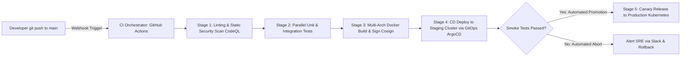

# Modul 153: Sistem Terdistribusi: Keandalan & Ketahanan (8 Fallacies, Circuit Breakers, Exponential Backoff, Rate Limiting)

**Navigasi**: [⬅️ Master Index](../../INDEX.md) | [Tingkat 9: Tingkat 9: Software Engineering, Front-End, Back-End, Full-Stack & Cloud/SRE](./README.md)
*Sebelumnya*: [152. back-end-pemrosesan-pesan-asinkron](./152-back-end-pemrosesan-pesan-asinkron.md) | *Berikutnya*: [154. devops-cloud-infrastructure-platform-engineering](./154-devops-cloud-infrastructure-platform-engineering.md)

---

## 1. Intuisi Dasar Tanpa Jargon ("Seperti Bayi Baru Lahir")
Di era perangkat lunak lama, merilis versi baru aplikasi adalah peristiwa horor tengah malam yang menegangkan: seluruh developer begadang, menyalin file via FTP manual, berdoa agar database tidak meledak, dan menghabiskan seminggu ke depan memadamkan kebakaran bug darurat (*Integration Hell*). Continuous Integration & Continuous Deployment (CI/CD) ([CI/CD Pipelines & DORA](https://cloud.google.com/devops)) adalah jalur perakitan otomatis pabrik manufaktur perangkat lunak modern. Setiap kali Anda menekan `git push`, robot otomasi (seperti GitHub Actions) langsung terbangun: mengompilasi biner, menjalankan ribuan pengujian unit test secara paralel, memindai kerentanan keamanan kode, membangun kontainer Docker, dan merilisnya ke server produksi secara bertahap tanpa downtime (**Canary / Blue-Green Deployment**). Perilisan perangkat lunak berubah dari peristiwa horor tahunan menjadi rutinitas harian yang membosankan dan sangat aman.

## 2. Fondasi Teoretis & Aksiomatik / Matematis
Metrik Keberhasilan Kinerja Rekayasa Perangkat Lunak DORA (DevOps Research and Assessment):

Google Cloud DORA menetapkan 4 metrik kunci pembeda tim rekayasa perangkat lunak kelas dunia (*Elite Performers*):

$$\begin{array}{|l|l|l|}
\hline
\textbf{Metrik Kunci DORA} & \textbf{Definisi Pengukuran} & \textbf{Target Kinerja Elite} \\
\hline
\textbf{Deployment Frequency} & \text{Seberapa sering kode berhasil dirilis ke produksi} & \text{Beberapa kali per hari (On-demand)} \\
\textbf{Lead Time for Changes} & \text{Waktu dari commit kode pertama hingga berjalan di produksi} & < 1\text{ Jam} \\
\textbf{Change Failure Rate (CFR)} & \text{Persentase rilis yang memicu degradasi layanan / rollback} & 0 - 15\% \\
\textbf{Time to Restore Service (MTTR)} & \text{Waktu untuk memulihkan layanan saat terjadi insiden} & < 1\text{ Jam} \\
\hline
\end{array}$$

Strategi Deployment Tanpa Downtime:
1. **Blue-Green Deployment**: Dua lingkungan produksi identik berdampingan (Blue = Aktif, Green = Versi Baru). Pengalihan lalu lintas pengguna dilakukan secara instan via router/load balancer. Rollback instan jika terjadi galat.
2. **Canary Deployment**: Rilis versi baru hanya dialirkan ke $1-5\%$ pengguna terpilih; pantau tingkat error; jika stabil, naikkan bertahap ke $100\%$.

## 3. Anatomi Teknis & Cara Kerja Internal
Arsitektur Pipa Alur Otomasi CI/CD Modern (GitHub Actions Runner Architecture):



1. **GitOps Workflow (ArgoCD / Flux)**:
   Repositori Git adalah sumber kebenaran tunggal (*Single Source of Truth*) dari status infrastruktur klaster. Agen yang berjalan di dalam klaster Kubernetes secara periodik menyelaraskan (*reconciliation loop*) status klaster riil dengan konfigurasi deklaratif di Git.

## 4. Implementasi Praktis & Kode / Simulasi Riil
```yaml
# Production-Ready GitHub Actions CI Pipeline Workflow (.github/workflows/ci.yml)
name: Continuous Integration & Verification Pipeline
on:
  push:
    branches: [ main ]
  pull_request:
    branches: [ main ]

jobs:
  test-and-security-scan:
    runs-on: ubuntu-latest
    steps:
      - name: Checkout Source Code
        uses: actions/checkout@v4

      - name: Set up Python Environment
        uses: actions/setup-python@v5
        with:
          python-version: '3.11'
          cache: 'pip'

      - name: Install Dependencies
        run: |
          python -m pip install --upgrade pip
          pip install flake8 pytest pytest-cov bandit

      - name: Static Security Analysis (SAST)
        run: bandit -r ./src -ll # Deteksi celah keamanan kode

      - name: Run Automated Unit Tests with Coverage
        run: pytest --cov=src --cov-fail-under=80 tests/
```

## 5. Miskonsepsi & Jebakan Industri
1. **Slow Monolithic CI Pipelines Stalling Engineering Velocity**: Membangun pipeline CI yang membutuhkan waktu 45 menit untuk selesai sebelum developer diizinkan merge. Developer akan beralih ke tugas lain dan kehilangan konteks (solusi: pecah job pengujian ke runner paralel independen dan manfaatkan layer caching Docker).
2. **Unpinned Third-Party Actions Vulnerability (Supply Chain Attack)**: Menggunakan action eksternal dengan tag cabang mutable `uses: actions/checkout@main`. Jika akun pemilik action diretas, kode berbahaya dapat disuntikkan ke pipeline produksi Anda (solusi: pin SHA-commit penuh `uses: actions/checkout@b4ffde65f46336ab851534e08f9565f8d3076391`).
3. **Secrets Leakage via CI Console Logging**: Mencetak variabel kredensial lingkungan ke terminal konsol build (`echo $DB_PASSWORD`). Seluruh staf yang memiliki akses baca ke repositori dapat mencuri kata sandi database produksi.

## 6. Proyek Latihan & Rubrik Penilaian Mandiri
1. **Tingkat Pemula**: Buat file alur kerja GitHub Actions `.github/workflows/lint.yml` di repositori GitHub Anda yang secara otomatis menjalankan linter kode setiap kali pull request baru dibuka.
2. **Tingkat Menengah**: Rancang pipeline multi-stage Docker build yang mengompilasi biner Go/Rust pada image builder, lalu menyalin biner akhir ke base image minimal `distroless` atau `alpine` berukuran < 20 MB.
3. **Tingkat Mahir**: Implementasikan pipeline rilis otomatis bergaya GitOps menggunakan ArgoCD di klaster Kubernetes lokal (k3d/minikube). Buat strategi Canary Deployment berbasis Flagger dan Prometheus yang secara bertahap mempromosikan lalu lintas 10% -> 50% -> 100% jika tingkat error HTTP 5xx di bawah 0.5%.

## 7. Rekomendasi Sumber Belajar Standar Emas
| Sumber Pembelajaran | Penulis / Institusi | Tautan Langsung | Fokus Materi |
| :--- | :--- | :--- | :--- |
| Accelerate: The Science of Lean Software and DevOps | Nicole Forsgren, Jez Humble, Gene Kim | [IT Revolution Accelerate](https://itrevolution.com/product/accelerate/) | Riset Empiris Metrik DORA, Kinerja Tim Elite & Continuous Delivery |
| Continuous Delivery: Reliable Software Releases | Jez Humble & David Farley | [Addison-Wesley Humble](https://www.pearson.com/en-us/subject-catalog/p/continuous-delivery-reliable-software-releases-through-build-test-and-deployment-automation/P200000009584) | Alkitab Asli Penemuan Metodologi Deployment Pipeline Otomasi |
| GitHub Actions Official Documentation | GitHub / Microsoft | [GitHub Actions Documentation](https://docs.github.com/en/actions) | Workflow Syntax, Matrix Builds, Self-hosted Runners & Security Hardening |
| Google Cloud DevOps Solutions & DORA Research | Google Cloud Architecture Center | [Google Cloud DevOps DORA](https://cloud.google.com/devops) | Panduan Transformasi Budaya DevOps, Trunk-Based Development & CI/CD |

---
*Navigasi Cepat*: [Ke Tingkat 9](./README.md) | [Ke Master Index](../../INDEX.md) | *Sebelumnya*: [152. back-end-pemrosesan-pesan-asinkron](./152-back-end-pemrosesan-pesan-asinkron.md) | *Berikutnya*: [154. devops-cloud-infrastructure-platform-engineering](./154-devops-cloud-infrastructure-platform-engineering.md)
