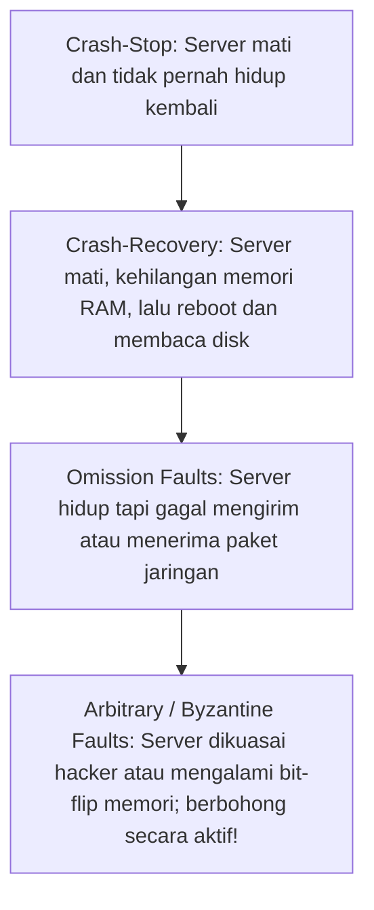

# Modul 153: Sistem Terdistribusi: Keandalan & Ketahanan (8 Fallacies, Circuit Breakers, Exponential Backoff, Rate Limiting)

**Navigasi**: [⬅️ Master Index](../../INDEX.md) | [Tingkat 9: Tingkat 9: Software Engineering, Front-End, Back-End, Full-Stack & Cloud/SRE](./README.md)
*Sebelumnya*: [152. back-end-pemrosesan-pesan-asinkron](./152-back-end-pemrosesan-pesan-asinkron.md) | *Berikutnya*: [154. devops-cloud-infrastructure-platform-engineering](./154-devops-cloud-infrastructure-platform-engineering.md)

---

## 1. Intuisi Dasar Tanpa Jargon ("Seperti Bayi Baru Lahir")
### 1.1 Konsep Inti & Analogi Tanpa Jargon
Menulis program yang berjalan di satu komputer terasa aman dan teratur: jika baris 1 selesai, baris 2 pasti dieksekusi; jika variabel disimpan di RAM, nilainya tidak akan hilang sedetik kemudian. Namun ketika program Anda dipecah menjadi ribuan server yang tersebar di Singapura, Frankfurt, dan Virginia, dunia berubah menjadi mimpi buruk ketidakpastian. Fondasi Sistem Terdistribusi ([Distributed Systems Foundations](https://www.cl.cam.ac.uk/teaching/2021/ConcDisSys/dist-sys-notes.pdf)) adalah seni membangun sistem andal di atas fondasi yang rapuh: pesan di jaringan bisa terlambat berjam-jam, tiba dua kali, atau hilang tanpa jejak; server bisa mati mendadak atau berjalan sangat lambat seperti mayat hidup; dan jika Anda mengirim pesan ke server lain dan tidak ada balasan, Anda secara matematis **tidak pernah tahu** apakah server tersebut mati, jaringan terputus, atau server tersebut telah memproses pesanan Anda namun balasan konfirmasinya yang hilang di jalan (masalah abadi Two Generals Problem)!

### 1.2 Urgensi Rekayasa & Signifikansi Sistemik
Dalam rekayasa sistem modern, pemahaman mendalam tentang konsep ini membedakan arsitek sistem kelas dunia dari sekadar operator perkakas teknis.

## 2. Fondasi Teoretis & Aksiomatik / Matematis
### 2.1 Kerangka Teori Aksiomatik & Formulasi Matematis
Model Kegagalan Sistem Terdistribusi dan Ketidakmungkinan Konsensus FLP (Fischer-Lynch-Paterson, 1985):

### 2.2 Penurunan Matematis Langkah-demi-Langkah
1. **Taksonomi Model Waktu Sistem Terdistribusi**:
   - **Synchronous Model**: Terdapat batas atas pasti ($\Delta$) untuk delay pengiriman pesan jaringan dan kecepatan komputasi prosesor. (Tidak realistis di internet nyata!).
   - **Asynchronous Model**: Pesan jaringan dijamin sampai pada akhirnya, namun **tidak ada batasan waktu maksimum** berapa lama pesan boleh terlambat, dan tidak ada jam global bersama. (Model internet nyata!).
   - **Partially Synchronous**: Sistem berperilaku asinkron pada awalnya, lalu setelah waktu tertentu (*Global Stabilization Time / GST*), sistem beralih menjadi sinkron dengan batas keterlambatan $\Delta$.

2. **Teorema Ketidakmungkinan FLP (Impossibility of Distributed Consensus)**:
   $$\text{Dalam model sistem asinkron murni, tidak ada algoritma konsensus deterministik yang dapat menjamin}$$   $$\text{kesepakatan jika bahkan hanya SATU server saja yang dapat mengalami kegagalan crash secara tiba-tiba!}$$
   Oleh karena itu, algoritma konsensus dunia nyata (Paxos, Raft) wajib mengasumsikan model sinkron sebagian atau menggunakan timer timeout probabilistik.

3. **Two Generals' Problem (Masalah Dua Jenderal)**:
   Dua jenderal ingin menyerang benteng musuh secara serentak. Kurir pembawa pesan dapat ditangkap musuh di lembah.
   Terbukti secara matematis bahwa tidak ada protokol jabat tangan konfirmasi berhingga ($K$ pesan) yang dapat menjamin kesepakatan mutlak 100% melintasi saluran komunikasi yang tidak andal.

## 3. Anatomi Teknis & Cara Kerja Internal
Spektrum Model Kegagalan Komputasi Terdistribusi (Hierarchy of Failure Modes):



1. **Batas Teorema Byzantine Fault Tolerance (BFT)**:
   Untuk mentoleransi $f$ buah server pengkhianat/Byzantine yang berbohong atau mengirim informasi bertentangan secara licik, sistem wajib memiliki total minimal server:
   $$N \ge 3f + 1$$
   (Sebagai contoh, untuk bertahan dari 1 hacker jahat, Anda membutuhkan minimal 4 server independen) ([Castro & Liskov PBFT Paper](https://pmg.csail.mit.edu/papers/osdi99.pdf)).

#### Tabel Penelusuran Keruntuhan Otomasi AWS S3 US-East-1 (28 Februari 2017)
| Langkah Operasi Otomasi | Perintah Diketik Operator | Maksud Tindakan Pengurangan Server | Eksekusi Skrip Otomasi | Status Subsistem Penyimpanan Fisik S3 | Dampak terhadap Internet Global |
|---|---|---|---|---|---|
| Perawatan Rutin | Ingin restart beberapa server billing S3 | Melepaskan kapasitas kecil server billing | Operator mengetik perintah terminal | Pengecekan argumen parameter tidak ada | Operasi pemeliharaan normal |
| Typo Perintah | Kesalahan pengetikan parameter perintah | Ingin menghapus 3 server | **TYPO MENGHAPUS TERLALU BANYAK SERVER!**| Skrip menghapus ratusan server vital | Server utama S3 mati serempak |
| Sub-sistem Vital Terhapus| Server Index & Placement S3 ikut mati | Metadata lokasi blok penyimpanan hilang | Seluruh cluster S3 kehilangan peta data | S3 menolak seluruh request baca/tulis | Layanan AWS S3 mati total! |
| Ketergantungan Melingkar | Layanan AWS lain bergantung pada S3 | EC2, Lambda, EBS membutuhkan S3 | **CIRCULAR DEPENDENCY: AWS Console mati!** | Layanan cloud global tumbang | Ribuan situs web dunia offline |
| Waktu Pemulihan Lambat | Cold Restart Index Server | Peta data miliaran objek di-scan ulang | Butuh waktu 4.5 jam verifikasi integritas | Tidak ada fail-safe pembatas blast radius | Kerugian ratusan juta dolar |

## 4. Implementasi Praktis & Kode / Simulasi Riil
```python
# Simulating Asynchronous Network Message Delay and Two Generals Uncertainty in Python
import random
from typing import Optional

class UnreliableNetworkChannel:
    def __init__(self, packet_loss_prob=0.3):
        self.packet_loss_prob = packet_loss_prob

    def send_message(self, message: str) -> Optional[str]:
        # Simulasikan kurir yang tertangkap musuh
        if random.random() < self.packet_loss_prob:
            return None # Paket hilang di jalan (Timeout)
        return f"ACK: Received '{message}'"

def execute_general_attack_plan():
    net = UnreliableNetworkChannel(packet_loss_prob=0.4)
    proposal = "Attack at Dawn"
    
    # Jenderal 1 mengirim pesan ke Jenderal 2
    response = net.send_message(proposal)
    if response is None:
        # DILEMA MATEMATIS SISTEM TERDISTRIBUSI:
        # Apakah Jenderal 2 tidak pernah menerima pesan? 
        # ATAU Jenderal 2 telah menerima pesan dan setuju, namun konfirmasi balasan ACK yang hilang?
        print("[Dilemma] Jenderal 1 tidak tahu status Jenderal 2! Menyerang sendirian adalah bunuh diri!")
    else:
        print(f"[Success] Jenderal 1 menerima: {response}")
```

## 5. Miskonsepsi & Jebakan Industri
1. **The Fallacies of Distributed Computing (Peter Deutsch, 1994)**: Berasumsi bahwa 'Jaringan selalu andal', 'Latensi bernilai nol', 'Bandwidth tidak terbatas', dan 'Topologi jaringan tidak pernah berubah'. Mengabaikan salah satu ilusi ini menjamin crash arsitektur pada skala produksi ([Deutsch 8 Fallacies of Distributed Systems](https://en.wikipedia.org/wiki/Fallacies_of_distributed_computing)).
2. **Cascading Failure Storm via Tight Retries**: Ketika database downstream melambat, ribuan klien serentak melakukan retry permintaan secara agresif tanpa *Exponential Backoff* dan *Jitter*, menumpuk jutaan request baru yang menghancurkan server hingga lumpuh total.
3. **Split-Brain Disaster**: Jaringan terputus di tengah data center, membelah klaster menjadi dua pulau terisolasi. Jika kedua pulau menganggap pihak seberang telah mati dan keduanya mengangkat 'Leader' baru secara sepihak, keduanya akan menulis data yang saling bertentangan secara permanen.

### Studi Kasus Kegagalan Nyata: Bencana Pemadaman AWS S3 US-East-1 Akibat Kesalahan Pengetikan Perintah Otomasi (28 Februari 2017)
- **Kronologi & Konteks Sejarah**: Pada 28 Februari 2017 pukul 09:37 PST, wilayah pusat data terbesar Amazon Web Services (AWS us-east-1 di Virginia Utara) mengalami pemadaman layanan Simple Storage Service (S3) berskala besar selama lebih dari 4,5 jam. Insiden ini melumpuhkan ribuan situs web dan layanan digital terkemuka dunia termasuk GitHub, Slack, Trello, Quora, Docker Hub, dan Apple Music, mengakibatkan perkiraan kerugian ekonomi global lebih dari 150 juta dolar.
- **Akar Masalah Rekayasa Keandalan Sistem Terdistribusi (SRE) & Radius Ledakan (Blast Radius)**: Seorang insinyur operasi terlatih sedang menjalankan prosedur pemeliharaan rutin untuk melepaskan sejumlah kecil server yang digunakan oleh sistem penagihan S3. Perintah utilitas otomasi yang dijalankan menerima masukan parameter jumlah server yang akan dimatikan. Namun, insinyur tersebut melakukan kesalahan pengetikan perintah (*command line typo*), memasukkan rentang parameter yang jauh lebih besar dari yang dimaksudkan. Utilitas otomasi tidak memiliki validasi ambang batas (*sanity check*) atau pembatasan kapasitas maksimum yang boleh dimatikan dalam satu waktu. Akibatnya, perintah tersebut mematikan sejumlah besar server dari dua subsistem paling kritis S3: subsistem indeks metadata dan subsistem penempatan blok data. S3 tidak pernah mengalami *cold restart* total pada subsistem tersebut selama bertahun-tahun; proses verifikasi integritas dan penelusuran miliaran metadata file saat proses restart memakan waktu lebih dari 4 jam, menelanjangi bahaya ketiadaan pembatas *blast radius* pada perkakas otomasi produksi.

- **Potongan Kode / Arsitektur Cacat (Vulnerable Implementation)**:
```python
# Rekonstruksi Cacat Perkakas Otomasi Tanpa Pembatas Blast Radius (AWS S3 2017)
def decommission_storage_servers_flawed(server_ids_to_remove):
    # CACAT FATAL OTOMASI: Tidak ada validasi ambang batas maksimum penghapusan!
    # Jika operator salah mengetik dan memasukkan 500 server bukannya 5:
    for server_id in server_ids_to_remove:
        # Menghapus server vital tanpa konfirmasi atau pembatasan persentase armada:
        terminate_storage_node(server_id)

# Mitigasi Defensif Modern: Penegakan Batas Maksimum Blast Radius (Circuit Breaker Otomasi)
def decommission_storage_servers_safe(server_ids_to_remove, total_active_fleet):
    MAX_DECOMMISSION_PERCENTAGE = 0.05 # Maksimal 5% dari total armada sekaligus!
    max_allowed = int(total_active_fleet * MAX_DECOMMISSION_PERCENTAGE)

    if len(server_ids_to_remove) > max_allowed:
        raise ValueError(
            f"BLAST RADIUS EXCEEDED: Permintaan menghapus {len(server_ids_to_remove)} server "
            f"melebihi ambang batas keselamatan maksimum ({max_allowed} server / 5%)! Tindakan Dibatalkan."
        )

    for server_id in server_ids_to_remove:
        terminate_storage_node(server_id)
```

- **Analisis Forensik & Rekayasa Modern**: Insiden AWS S3 2017 menjadi tonggak bersejarah dalam disiplin Site Reliability Engineering (SRE). Insiden ini melahirkan standarisasi pembatasan radius ledakan (*Blast Radius Containment*): (1) Seluruh perkakas operasi dan otomasi produksi wajib menyertakan validasi keselamatan yang menolak eksekusi jika tindakan mempengaruhi lebih dari persentase kecil armada server; (2) Pengujian berkala terhadap *Cold Restart* subsistem kritis untuk memastikan sistem mampu pulih dengan cepat saat terjadi bencana total; (3) Desain arsitektur *Decoupling* yang memutus ketergantungan melingkar (*Circular Dependencies*) antar-layanan internal.

## 6. Proyek Latihan & Rubrik Penilaian Mandiri
1. **Tingkat Pemula**: Sebutkan dan jelaskan secara singkat '8 Fallacies of Distributed Computing' dan berikan contoh konkret kegagalan dunia nyata untuk setiap falasi.
2. **Tingkat Menengah**: Buktikan secara matematis melalui penalaran induksi bahwa Two Generals' Problem tidak dapat diselesaikan dengan pasti dalam protokol jabat tangan pesan yang memiliki jumlah langkah berhingga $N$.
3. **Tingkat Mahir**: Bangun simulator jaringan asinkron di Python yang menyimulasikan 5 node proses terdistribusi dengan penundaan transmisi acak (0 hingga 2000 ms), duplikasi paket, dan packet drops. Terapkan protokol pertukaran status detak jantung (*Heartbeat Gossip Protocol*) dengan estimasi detektor kegagalan adaptif ($\Phi$-Accrual Failure Detector).

### Tingkat 1: Dasar
- **Tugas**: Bangun implementasi pola ketahanan sistem *Retry with Exponential Backoff & Full Jitter* mandiri dalam Python/C++ yang memanggil fungsi operasi jaringan tiruan yang rentan gagal, mencoba ulang hingga batas maksimum percobaan ($MaxRetries = 5$), dan menghitung waktu jeda tidur menggunakan formula standar AWS: $T = \text{random}(0, \min(Cap, \text{Base} \times 2^{\text{attempt}}))$.
- **Petunjuk Perancangan Arsitektur**:
  - Buktikan mengapa penambahan *Full Jitter* acak sangat krusial untuk mencegah fenomena ribuan klien memanggil server pada milidetik yang sama persis (*Thundering Herd on Retry*).
- **Test Vector & Kasus Uji Ekstrem**:
  - *Distribusi Waktu Tunggu*: Simulasikan 100 klien yang gagal pada waktu bersamaan; plot waktu jeda percobaan ulang mereka; buktikan penambahan Full Jitter menyebarkan request secara merata sepanjang interval waktu.
- **Rubrik Penilaian Mandiri**: 40% Formula Exponential Backoff dengan Full Jitter yang Benar, 30% Eliminasi Kolisi Waktu Tunggu Antar-Klien, 30% Kerapian Enkapsulasi Kode.

### Tingkat 2: Menengah
- **Tugas**: Kembangkan implementasi pola pemutus sirkuit *Circuit Breaker Pattern* mandiri dalam Python/Go (mengikuti spesifikasi Martin Fowler / Netflix Hystrix) dengan 3 status state machine: `CLOSED` (normal), `OPEN` (seluruh request langsung digagalkan tanpa menyentuh layanan luar saat rasio kegagalan $> 50\%$), dan `HALF-OPEN` (mengizinkan sejumlah kecil request percobaan setelah batas waktu jeda reset).
- **Petunjuk Perancangan Arsitektur**:
  - Lacak statistik kegagalan menggunakan jendela geser waktu (*Rolling Window Statistics* 10 detik).
  - Terapkan mekanisme pemulihan otomatis dari OPEN ke HALF-OPEN setelah cooldown timeout $5\text{ detik}$.
- **Test Vector & Kasus Uji Ekstrem**:
  - *Transisi Status*: Simulasikan layanan hilir mati (melempar error 100%); buktikan Circuit Breaker bertransisi ke `OPEN` setelah 10 request gagal; buktikan request ke-11 langsung ditolak dalam $< 1\text{ ms}$ (Fail-Fast).
- **Rubrik Penilaian Mandiri**: 40% State Machine 3-Status Circuit Breaker yang Presisi, 30% Logika Fail-Fast saat Status OPEN, 30% Pemulihan Otomatis Status HALF-OPEN.

### Tingkat 3: Mahir
- **Tugas**: Rancang pustaka pembatas laju terdistribusi berlatensi ultra-rendah (*Distributed Sliding Window Rate Limiter*) dalam Python/Go yang menggunakan koneksi kluster Redis dan skrip Lua atomik untuk menegakkan kuota batas request (misal: 100 request per menit per API key) dengan resolusi presisi sub-detik tanpa memicu kondisi balapan (*Race Condition*).
- **Petunjuk Perancangan Arsitektur**:
  - Gunakan Redis Sorted Set (`ZSET`): skor adalah stempel waktu milidetik saat ini.
  - Hapus entri di luar jendela waktu via `ZREMRANGEBYSCORE`, hitung jumlah entri aktif via `ZCARD`, dan tolak jika melebihi kuota dalam satu eksekusi skrip Lua atomik tunggal.
- **Test Vector & Kasus Uji Ekstrem**:
  - *Kontensi Multi-Thread*: 20 Thread konkuren mengirimkan $200$ request secara serentak dalam jendela 1 detik untuk kuota 100 request; buktikan sistem meloloskan tepat 100 request dan menolak tepat 100 request lainnya tanpa anomali over-admission.
- **Rubrik Penilaian Mandiri**: 40% Skrip Atomik Redis Lua Sliding Window yang Benar, 30% Presisi Resolusi Waktu Sub-Detik, 30% Kekebalan Penuh Terhadap Race Condition Konkuren.

## 7. Rekomendasi Sumber Belajar Standar Emas
| Sumber Pembelajaran | Penulis / Institusi | Tautan Langsung | Fokus Materi |
| :--- | :--- | :--- | :--- |
| Designing Data-Intensive Applications (DDIA) | Martin Kleppmann (Univ. of Cambridge) | [O'Reilly DDIA Book](https://dataintensive.net/) | Bab 8: The Trouble with Distributed Systems (Unreliable Networks & Clocks) |
| Impossibility of Distributed Consensus with One Faulty Process | Fischer, Lynch, Paterson | [ACM JACM 1985 (FLP Paper)](https://dl.acm.org/doi/10.1145/3149.214121) | Makalah Orisinal Pembuktian Teorema Ketidakmungkinan Konsensus FLP |
| Distributed Systems: Principles and Paradigms | Maarten van Steen & Andrew S. Tanenbaum | [Distributed Systems Book Free](https://www.distributed-systems.net/index.php/books/ds4/) | Arsitektur Sistem Terdistribusi, Model Komunikasi, Sinkronisasi & Toleransi |
| Practical Byzantine Fault Tolerance (PBFT) | Miguel Castro & Barbara Liskov (MIT) | [MIT PBFT Paper](https://pmg.csail.mit.edu/papers/osdi99.pdf) | Replikasi State Machine BFT, Konsensus Byzantine 3f+1 & Quorum |

---
*Navigasi Cepat*: [Ke Tingkat 9](./README.md) | [Ke Master Index](../../INDEX.md) | *Sebelumnya*: [152. back-end-pemrosesan-pesan-asinkron](./152-back-end-pemrosesan-pesan-asinkron.md) | *Berikutnya*: [154. devops-cloud-infrastructure-platform-engineering](./154-devops-cloud-infrastructure-platform-engineering.md)
