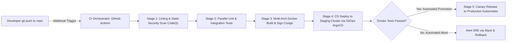

# Modul 154: DevOps, Cloud Infrastructure & Platform Engineering (CI/CD Pipelines, Terraform IaC HCL, GitOps ArgoCD)

**Navigasi**: [⬅️ Master Index](../../INDEX.md) | [Tingkat 9: Tingkat 9: Software Engineering, Front-End, Back-End, Full-Stack & Cloud/SRE](./README.md)
*Sebelumnya*: [153. sistem-terdistribusi-keandalan-ketahanan](./153-sistem-terdistribusi-keandalan-ketahanan.md) | *Berikutnya*: [155. orkestrasi-kontainer-bedah-internal-kubernetes](./155-orkestrasi-kontainer-bedah-internal-kubernetes.md)

---

## 1. Intuisi Dasar Tanpa Jargon ("Seperti Bayi Baru Lahir")
### 1.1 Konsep Inti & Analogi Tanpa Jargon
Di era perangkat lunak lama, merilis versi baru aplikasi adalah peristiwa horor tengah malam yang menegangkan: seluruh developer begadang, menyalin file via FTP manual, berdoa agar database tidak meledak, dan menghabiskan seminggu ke depan memadamkan kebakaran bug darurat (*Integration Hell*). Continuous Integration & Continuous Deployment (CI/CD) ([CI/CD Pipelines & DORA](https://cloud.google.com/devops)) adalah jalur perakitan otomatis pabrik manufaktur perangkat lunak modern. Setiap kali Anda menekan `git push`, robot otomasi (seperti GitHub Actions) langsung terbangun: mengompilasi biner, menjalankan ribuan pengujian unit test secara paralel, memindai kerentanan keamanan kode, membangun kontainer Docker, dan merilisnya ke server produksi secara bertahap tanpa downtime (**Canary / Blue-Green Deployment**). Perilisan perangkat lunak berubah dari peristiwa horor tahunan menjadi rutinitas harian yang membosankan dan sangat aman.

### 1.2 Urgensi Rekayasa & Signifikansi Sistemik
Dalam rekayasa sistem modern, pemahaman mendalam tentang konsep ini membedakan arsitek sistem kelas dunia dari sekadar operator perkakas teknis.

## 2. Fondasi Teoretis & Aksiomatik / Matematis
### 2.1 Kerangka Teori Aksiomatik & Formulasi Matematis
Metrik Keberhasilan Kinerja Rekayasa Perangkat Lunak DORA (DevOps Research and Assessment):

### 2.2 Penurunan Matematis Langkah-demi-Langkah
Google Cloud DORA menetapkan 4 metrik kunci pembeda tim rekayasa perangkat lunak kelas dunia (*Elite Performers*):

$$\begin{array}{|l|l|l|}
\hline
\textbf{Metrik Kunci DORA} & \textbf{Definisi Pengukuran} & \textbf{Target Kinerja Elite} \\
\hline
\textbf{Deployment Frequency} & \text{Seberapa sering kode berhasil dirilis ke produksi} & \text{Beberapa kali per hari (On-demand)} \\
\textbf{Lead Time for Changes} & \text{Waktu dari commit kode pertama hingga berjalan di produksi} & < 1\text{ Jam} \\
\textbf{Change Failure Rate (CFR)} & \text{Persentase rilis yang memicu degradasi layanan / rollback} & 0 - 15\% \\
\textbf{Time to Restore Service (MTTR)} & \text{Waktu untuk memulihkan layanan saat terjadi insiden} & < 1\text{ Jam} \\
\hline
\end{array}$$

Strategi Deployment Tanpa Downtime:
1. **Blue-Green Deployment**: Dua lingkungan produksi identik berdampingan (Blue = Aktif, Green = Versi Baru). Pengalihan lalu lintas pengguna dilakukan secara instan via router/load balancer. Rollback instan jika terjadi galat.
2. **Canary Deployment**: Rilis versi baru hanya dialirkan ke $1-5\%$ pengguna terpilih; pantau tingkat error; jika stabil, naikkan bertahap ke \$100\%$.

## 3. Anatomi Teknis & Cara Kerja Internal
Arsitektur Pipa Alur Otomasi CI/CD Modern (GitHub Actions Runner Architecture):



1. **GitOps Workflow (ArgoCD / Flux)**:
   Repositori Git adalah sumber kebenaran tunggal (*Single Source of Truth*) dari status infrastruktur klaster. Agen yang berjalan di dalam klaster Kubernetes secara periodik menyelaraskan (*reconciliation loop*) status klaster riil dengan konfigurasi deklaratif di Git.

#### Tabel Penelusuran Siklus CI/CD & Bencana Deployment Parsial Knight Capital (2012)
| Tahap Deployment CI/CD | Target Server Kluster (Total: 8 Server) | Tindakan Tim Operasi Deployment | Status Biner Kode yang Terpasang | Konfigurasi Feature Flag Aktif | Dampak Transaksi Pasar Finansial |
|---|---|---|---|---|---|
| Server 1 s/d 7 | Server Eksekusi 1..7 | Biner baru SMARS v8 disalin | Biner baru terpasang sukses | Flag `Power Peg` dinonaktifkan | Berjalan normal |
| Server 8 (Terlewatkan!)| Server Eksekusi 8 | **LUPA DIPERBARUI SECARA MANUAL!** | **BINER LAMA v7 TAHUN 2003 MASIH AKTIF!**| Flag `Power Peg` diaktifkan global! | Biner lama mengira flag untuk pengujian! |
| Pembukaan Bursa | Jam 09:30 Waktu New York | Order beli ritel mulai masuk | Server 8 mengeksekusi dead code 2003 | Loop membabi buta memborong saham | Mengirim 4 juta order agresif |
| Akumulasi Kerugian | 45 Menit Pertama | Server 8 memborong saham tanpa henti | Modal perusahaan terkuras habis | Tidak ada rollback otomatis | Rugi $440 Juta dalam 45 menit! |
| Mitigasi Modern CI/CD | Pipeline GitOps / Canary | Deployment otomatis atomik (All-or-Nothing) | Validasi hash versi identik di seluruh armada | Deployment dibatalkan jika 1 server gagal | Bencana manusiawi dicegah penuh |

## 4. Implementasi Praktis & Kode / Simulasi Riil
```yaml
# Production-Ready GitHub Actions CI Pipeline Workflow (.github/workflows/ci.yml)
name: Continuous Integration & Verification Pipeline
on:
  push:
    branches: [ main ]
  pull_request:
    branches: [ main ]

jobs:
  test-and-security-scan:
    runs-on: ubuntu-latest
    steps:
      - name: Checkout Source Code
        uses: actions/checkout@v4

      - name: Set up Python Environment
        uses: actions/setup-python@v5
        with:
          python-version: '3.11'
          cache: 'pip'

      - name: Install Dependencies
        run: |
          python -m pip install --upgrade pip
          pip install flake8 pytest pytest-cov bandit

      - name: Static Security Analysis (SAST)
        run: bandit -r ./src -ll # Deteksi celah keamanan kode

      - name: Run Automated Unit Tests with Coverage
        run: pytest --cov=src --cov-fail-under=80 tests/
```

## 5. Miskonsepsi & Jebakan Industri
1. **Slow Monolithic CI Pipelines Stalling Engineering Velocity**: Membangun pipeline CI yang membutuhkan waktu 45 menit untuk selesai sebelum developer diizinkan merge. Developer akan beralih ke tugas lain dan kehilangan konteks (solusi: pecah job pengujian ke runner paralel independen dan manfaatkan layer caching Docker).
2. **Unpinned Third-Party Actions Vulnerability (Supply Chain Attack)**: Menggunakan action eksternal dengan tag cabang mutable `uses: actions/checkout@main`. Jika akun pemilik action diretas, kode berbahaya dapat disuntikkan ke pipeline produksi Anda (solusi: pin SHA-commit penuh `uses: actions/checkout@b4ffde65f46336ab851534e08f9565f8d3076391`).
3. **Secrets Leakage via CI Console Logging**: Mencetak variabel kredensial lingkungan ke terminal konsol build (`echo $DB_PASSWORD`). Seluruh staf yang memiliki akses baca ke repositori dapat mencuri kata sandi database produksi.

### Studi Kasus Kegagalan Nyata: Bencana Finansial Knight Capital USD 440 Juta Akibat Kegagalan Otomasi Deployment CI/CD (2012)
- **Kronologi & Konteks Kasus**: Pada 1 Agustus 2012, Knight Capital Group mengalami salah satu bencana perangkat lunak paling mahal dalam sejarah perbankan investasi, kehilangan 440 juta dolar AS dalam waktu 45 menit dan membangkrutkan perusahaan akibat proses deployment perangkat lunak yang dilakukan secara manual dan tidak merata.
- **Akar Masalah DevOps, Otomasi CI/CD, & Konfigurasi Heterogen**: Tim operasi menyebarkan kode baru secara manual ke 8 server eksekusi trading satu per satu. Namun, staf operasi secara tidak sengaja melewatkan satu server (Server 8 tetap menjalankan biner lama yang memuat kode usang berusia 9 tahun). Ketika sakelar konfigurasi global (*Feature Flag*) diaktifkan pada pembukaan bursa, biner lama pada Server 8 menginterpretasikan flag tersebut sebagai instruksi untuk mengaktifkan kode pengujian lama yang tidak memiliki batasan risiko. Server 8 masuk ke dalam loop tak terbatas yang memborong saham pada harga penawaran tinggi dan menjualnya kembali pada harga rendah. Ketiadaan pipeline deployment otomatis yang menjamin sifat atomik (*All-or-Nothing Deployment*) dan tidak adanya verifikasi hash versi biner homogen antar server menjadi penyebab utama kehancuran perusahaan.

- **Potongan Kode / Arsitektur Cacat (Vulnerable Implementation)**:
```bash
# Rekonstruksi Prosedur Deployment Manual Cacat Knight Capital (2012)
# CACAT DEVOPS FATAL: Deployment manual via script copy tanpa verifikasi konsistensi armada:
for server in server1 server2 server3 server4 server5 server6 server7; do
    scp smars_v8.bin $server:/opt/trading/bin/
    ssh $server "systemctl restart trading_engine"
done
# KESALAHAN MANUSIA: server8 terlewatkan dan tetap menjalankan smars_v7 (memuat dead code)!

# Mitigasi Defensif Modern: Pipeline CI/CD Atomik & Verifikasi Hash Homogenitas
# Setiap node wajib memverifikasi SHA-256 versi biner sebelum menerima beban produksi:
EXPECTED_HASH="a3f5b789c0..."
ACTUAL_HASH=$(sha256sum /opt/trading/bin/smars.bin | awk '{print $1}')
if [ "$ACTUAL_HASH" != "$EXPECTED_HASH" ]; then
    echo "INTEGRITY ERROR: Biner tidak cocok! Membatalkan booting node..."
    exit 1
fi
```

- **Analisis Forensik & Rekayasa Modern**: Tragedi Knight Capital menjadi lonceng kematian bagi proses deployment manual di industri teknologi enterprise. Bencana ini memicu lahirnya gerakan *DevOps* dan *Infrastructure as Code* (IaC) modern. Standar rekayasa platform modern mewajibkan: (1) Prinsip *Immutable Infrastructure* di mana server tidak pernah diubah di tempat, melainkan diganti penuh dengan image baru yang identik; (2) Strategi deployment *Blue-Green* atau *Canary Deployment* yang secara bertahap mengalihkan lalu lintas sambil memantau metrik kesehatan bisnis; (3) Otomasi rollback instan jika metrik anomali terdeteksi dalam menit pertama rilis.

## 6. Proyek Latihan & Rubrik Penilaian Mandiri
1. **Tingkat Pemula**: Buat file alur kerja GitHub Actions `.github/workflows/lint.yml` di repositori GitHub Anda yang secara otomatis menjalankan linter kode setiap kali pull request baru dibuka.
2. **Tingkat Menengah**: Rancang pipeline multi-stage Docker build yang mengompilasi biner Go/Rust pada image builder, lalu menyalin biner akhir ke base image minimal `distroless` atau `alpine` berukuran < 20 MB.
3. **Tingkat Mahir**: Implementasikan pipeline rilis otomatis bergaya GitOps menggunakan ArgoCD di klaster Kubernetes lokal (k3d/minikube). Buat strategi Canary Deployment berbasis Flagger dan Prometheus yang secara bertahap mempromosikan lalu lintas 10% -> 50% -> 100% jika tingkat error HTTP 5xx di bawah 0.5%.

### Tingkat 1: Dasar
- **Tugas**: Bangun skrip pipeline integrasi berkelanjutan (*CI Pipeline Script*) dalam Bash/Python yang memvalidasi integritas basis kode sebelum penggabungan: memformat kode via linter, menjalankan pengujian unit otomatis, memverifikasi cakupan kode (*Code Coverage*) memenuhi ambang batas minimum $\ge 80\%$, dan menggagalkan build dengan exit code `1` jika ada satu pengujian yang gagal.
- **Petunjuk Perancangan Arsitektur**:
  - Terapkan mode kegagalan instan: `set -euo pipefail`.
  - Hasilkan laporan ringkasan pengujian dalam format teks terstruktur.
- **Test Vector & Kasus Uji Ekstrem**:
  - *Simulasi Kegagalan Uji*: Ubah satu pengujian menjadi gagal; buktikan skrip CI berhenti seketika, menolak proses build, dan mencetak pesan error yang jelas.
- **Rubrik Penilaian Mandiri**: 40% Otomasi 3 Tahap CI (Lint, Test, Coverage) yang Rapi, 30% Penegakan Ambang Batas Kegagalan Exit Code 1, 30% Kerapian Pelaporan Status.

### Tingkat 2: Menengah
- **Tugas**: Kembangkan implementasi orkestrator peluncuran bertahap (*Blue-Green Deployment Controller*) dalam Python/Bash yang mengelola dua lingkungan server identik (Lingkungan Biru aktif melayani pengguna, Lingkungan Hijau menerima biner baru), menjalankan pengujian asap kesehatan (*Smoke Health Check*) pada Lingkungan Hijau, dan mengalihkan lalu lintas proksi secara instan (*Atomic Traffic Cutover*) hanya jika seluruh health check lolos 100%.
- **Petunjuk Perancangan Arsitektur**:
  - Alihkan lalu lintas menggunakan pembaruan symlink konfigurasi proksi Nginx atau aturan iptables.
  - Sediakan mekanisme rollback satu perintah (`rollback`) yang membalikkan lalu lintas kembali ke lingkungan lama dalam waktu $< 1\text{ detik}$.
- **Test Vector & Kasus Uji Ekstrem**:
  - *Uji Gagal Smoke Test*: Pasang biner rusak di Lingkungan Hijau; buktikan health check mendeteksi error HTTP 500, membatalkan pengalihan lalu lintas, dan Lingkungan Biru tetap melayani pengguna tanpa gangguan.
- **Rubrik Penilaian Mandiri**: 40% Arsitektur Blue-Green Deployment yang Bersih, 30% Mekanisme Smoke Test & Atomic Traffic Switching, 30% Kemampuan Rollback Cepat.

### Tingkat 3: Mahir
- **Tugas**: Rancang deklarasi infrastruktur sebagai kode (*Infrastructure as Code / IaC Engine*) mini dalam Python yang membaca file spesifikasi topologi infrastruktur deklaratif (format YAML/JSON), membandingkan status yang diinginkan (*Desired State*) terhadap status infrastruktur aktual saat ini (*Actual State*), menghitung rencana perubahan diferensial (*Execution Plan Diff*), dan menerapkan mutasi sumber daya secara idempoten (*Idempotent Provisioning*).
- **Petunjuk Perancangan Arsitektur**:
  - Implementasikan 3 fase standar Terraform: `Init`, `Plan`, dan `Apply`.
  - Simpan status infrastruktur dalam file status persisten (*State File*) dengan mekanisme penguncian status (*State Locking*) untuk mencegah modifikasi konkuren ganda.
- **Test Vector & Kasus Uji Ekstrem**:
  - *Idempotensi Mutlak*: Jalankan `apply` dua kali berturut-turut pada konfigurasi yang sama; buktikan eksekusi kedua melaporkan `No changes needed (0 added, 0 modified, 0 destroyed)`.
- **Rubrik Penilaian Mandiri**: 40% Logika Rekonsiliasi Desired vs Actual State yang Akurat, 30% Sifat Idempotensi Eksekusi Terverifikasi, 30% Mekanisme State File Locking yang Aman.

## 7. Rekomendasi Sumber Belajar Standar Emas
| Sumber Pembelajaran | Penulis / Institusi | Tautan Langsung | Fokus Materi |
| :--- | :--- | :--- | :--- |
| Accelerate: The Science of Lean Software and DevOps | Nicole Forsgren, Jez Humble, Gene Kim | [IT Revolution Accelerate](https://itrevolution.com/product/accelerate/) | Riset Empiris Metrik DORA, Kinerja Tim Elite & Continuous Delivery |
| Continuous Delivery: Reliable Software Releases | Jez Humble & David Farley | [Addison-Wesley Humble](https://www.pearson.com/en-us/subject-catalog/p/continuous-delivery-reliable-software-releases-through-build-test-and-deployment-automation/P200000009584) | Alkitab Asli Penemuan Metodologi Deployment Pipeline Otomasi |
| GitHub Actions Official Documentation | GitHub / Microsoft | [GitHub Actions Documentation](https://docs.github.com/en/actions) | Workflow Syntax, Matrix Builds, Self-hosted Runners & Security Hardening |
| Google Cloud DevOps Solutions & DORA Research | Google Cloud Architecture Center | [Google Cloud DevOps DORA](https://cloud.google.com/devops) | Panduan Transformasi Budaya DevOps, Trunk-Based Development & CI/CD |

---
*Navigasi Cepat*: [Ke Tingkat 9](./README.md) | [Ke Master Index](../../INDEX.md) | *Sebelumnya*: [153. sistem-terdistribusi-keandalan-ketahanan](./153-sistem-terdistribusi-keandalan-ketahanan.md) | *Berikutnya*: [155. orkestrasi-kontainer-bedah-internal-kubernetes](./155-orkestrasi-kontainer-bedah-internal-kubernetes.md)
