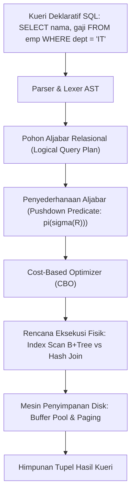

# Modul 157: Fondasi Teoretis Basis Data & Model Relasional (Aljabar Relasional Murni, Pemodelan Skema ERD)

**Navigasi**: [⬅️ Master Index](../../INDEX.md) | [Tingkat 10: Tingkat 10: Basis Data, Data Engineering & Sistem Informasi Enterprise](./README.md)
*Sebelumnya*: [156. observabilitas-tiga-pilar-sre](../09-software-engineering-cloud-sre/156-observabilitas-tiga-pilar-sre.md) | *Berikutnya*: [158. teori-normalisasi-perancangan-skema-data](./158-teori-normalisasi-perancangan-skema-data.md)

---

## 1. Intuisi Dasar Tanpa Jargon ("Seperti Bayi Baru Lahir")
### 1.1 Dunia Sebelum Model Relasional: Labirin Pointer Navigasional ([A Relational Model of Data for Large Shared Data Banks - E. F. Codd](https://dl.acm.org/doi/10.1145/362384.362685))
Pada tahun 1960-an, sistem database komersial (seperti IMS IBM) menggunakan model hierarkis atau model jaringan navigasional. Data disimpan sebagai pohon atau graf terhubung dengan pointer memori fisik mentah. Jika seorang programmer ingin mencari "Daftar pelanggan yang membeli produk X", programmer harus menulis kode loop imperatif rumit yang menelusuri pointer hard disk satu demi satu. Yang lebih parah: jika struktur fisik penyimpanan disk diubah, seluruh kode aplikasi perusahaan rusak total!

### 1.2 Revolusi Matematika Edgar F. Codd: Pemisahan Logika dari Fisik ([Database System Concepts - Silberschatz et al.](https://www.db-book.com/))
Pada tahun 1970, matematikawan IBM Edgar F. Codd menerbitkan makalah paling revolusioner dalam sejarah penyimpanan data. Codd mengusulkan: "Representasikan seluruh data bisnis bukan sebagai pointer disk fisik, melainkan sebagai **Relasi Matematis (Tabel)** yang berakar pada Teori Himpunan dan Logika Predikat Orde Pertama".
Pengguna tidak perlu lagi memberi tahu komputer *bagaimana* cara menelusuri disk; pengguna cukup menyatakan *apa* data yang diinginkan secara deklaratif (bahasa SQL). Mesin database (RDBMS) yang akan mencari strategi optimal untuk mengambil data dari disk secara mandiri. Inilah prinsip **Kemandirian Data Fisik (Physical Data Independence)**.

## 2. Fondasi Teoretis & Aksiomatik / Matematis
### 2.1 Aljabar Relasional Murni 6-Primitif ([Codd, 1970](https://dl.acm.org/doi/10.1145/362384.362685))
Sebuah relasi $R$ didefinisikan secara aksiomatik sebagai himpunan tupel $t$:
$$R \subseteq D_1 \times D_2 \times \dots \times D_k$$
Di mana $D_i$ adalah domain nilai atribut ke-$i$.

Enam Operator Primitif Aljabar Relasional:
1. **Seleksi ($\sigma_\phi$)**: Memilih subset tupel yang memenuhi kondisi predikat logika $\phi$:
   $$\sigma_\phi(R) = \{ t \in R \mid \phi(t) = \text{true} \}$$
2. **Proyeksi ($\pi_{a_1, \dots, a_k}$)**: Memilih subset atribut kolom tertentu dan membuang duplikasi matematis:
   $$\pi_{a_1, \dots, a_k}(R) = \{ (t[a_1], \dots, t[a_k]) \mid t \in R \}$$
3. **Gabungan Himpunan ($\cup$)**: Menyatukan dua relasi union-compatible:
   $$R \cup S = \{ t \mid t \in R \lor t \in S \}$$
4. **Selisih Himpunan ($-$)**: Mengambil tupel yang ada di $R$ namun tidak ada di $S$:
   $$R - S = \{ t \mid t \in R \land t \notin S \}$$
5. **Perkalian Cartesian ($\times$)**: Menghasilkan seluruh pasangan kombinasi pasangan tupel:
   $$R \times S = \{ t \cdot s \mid t \in R \land s \in S \}$$
6. **Penggantian Nama ($\rho_S$)**: Mengganti nama relasi atau atribut.

Operator Turunan Utama: **Natural Join ($\bowtie$)**:
$$R \bowtie S = \pi_{\text{Atribut Unik}}(\sigma_{R.A = S.A}(R \times S))$$
Dua bahasa query teoritis yang ekuivalen: Aljabar Relasional (prosedural abstrak) dan Kalkulus Relasional Tupel (deklaratif logika predikat).

### 2.2 Teorema Kelengkapan Codd (Codd's Completeness Theorem) ([Codd, 1972](https://dl.acm.org/doi/10.1145/800297.808503))
Teorema membuktikan bahwa bahasa kueri deklaratif (seperti SQL) dikatakan *Relational Complete* jika dan hanya jika bahasa tersebut memiliki kekuatan ekspresi yang setara dengan Aljabar Relasional Murni.

## 3. Anatomi Teknis & Cara Kerja Internal


#### Tabel Walkthrough Transformasi Operasi Aljabar Relasional pada Dua Tabel
| Operasi Aljabar | Notasi Matematis | Ekivalen SQL Deklaratif | Kompleksitas Waktu Teoretis |
|---|---|---|---|
| Seleksi Baris | $\sigma_{\text{age} > 30}(\text{Users})$ | `SELECT * FROM users WHERE age > 30` | $\mathcal{O}(N)$ atau $\mathcal{O}(\log N)$ dengan indeks |
| Proyeksi Kolom | $\pi_{\text{name, email}}(\text{Users})$ | `SELECT DISTINCT name, email FROM users` | $\mathcal{O}(N \log N)$ (eliminasi duplikasi) |
| Natural Join | $\text{Users} \bowtie \text{Orders}$ | `SELECT * FROM users NATURAL JOIN orders` | $\mathcal{O}(N + M)$ via Hash Join |
| Selisih Himpunan | $\text{ActiveUsers} - \text{Subscribers}$ | `SELECT * FROM active EXCEPT SELECT * FROM sub` | $\mathcal{O}(N \log N)$ |

#### Tabel Penelusuran Normalisasi Skema Relasional: Dari 1NF hingga BCNF & Reduksi Anomali
| Tingkat Bentuk Normal | Karakteristik Relasi Skema | Ketergantungan Fungsional ($X \to Y$) | Anomali Penyisipan (Insert) | Anomali Pembaruan (Update) | Anomali Penghapusan (Delete) |
|---|---|---|---|---|---|
| Tidak Ternormalisasi (0NF)| Nilai atribut komposit / array | Multi-nilai dalam satu sel kolom | Tidak dapat menyisipkan kursus tanpa mahasiswa | Redundansi teks nama dosen | Hapus mahasiswa menghapus info kursus |
| 1NF (Bentuk Normal 1) | Nilai atomik skalar | Seluruh atribut bernilai tunggal | Kunci utama komposit raksasa | Data alamat terduplikasi berulang | Hapus baris menghapus data dosen |
| 2NF (Bentuk Normal 2) | Hilangkan Ketergantungan Parsial | Atribut non-kunci bergantung penuh pada PK | Masih ada transitif ke NIP Dosen | Ubah nama dosen di ratusan baris | Anomali penghapusan parsial |
| 3NF (Bentuk Normal 3) | Hilangkan Ketergantungan Transitif | Tidak ada $A \to B \to C$ non-kunci | Relasi bersih menjadi 3 tabel terpisah | Tepat 1 baris diupdate per entitas | Hapus mahasiswa tidak menghapus dosen |
| BCNF (Boyce-Codd) | Setiap penentu adalah Superkey | $\forall (X \to Y)$, $X$ wajib Superkey | **NOL ANOMALI REDUNDANSI DATA!** | Konsistensi data matematis terjamin | Integritas referensial terjaga 100% |

## 4. Implementasi Praktis & Kode / Simulasi Riil
```python
# Implementasi murni Aljabar Relasional di Python
from typing import Callable, Any

Relation = list[dict[str, Any]]

def relational_select(r: Relation, predicate: Callable[[dict[str, Any]], bool]) -> Relation:
    """Operator Seleksi: sigma_phi(R)"""
    return [t for t in r if predicate(t)]

def relational_project(r: Relation, attributes: list[str]) -> Relation:
    """Operator Proyeksi: pi_{A}(R) dengan eliminasi duplikasi matematis"""
    seen = []
    result = []
    for t in r:
        projected = {attr: t[attr] for attr in attributes if attr in t}
        if projected not in seen:
            seen.append(projected)
            result.append(projected)
    return result

def relational_natural_join(r: Relation, s: Relation) -> Relation:
    """Operator Natural Join: R bowtie S"""
    if not r or not s:
        return []
    common_attrs = set(r[0].keys()) & set(s[0].keys())
    result = []
    for t in r:
        for u in s:
            if all(t[attr] == u[attr] for attr in common_attrs):
                merged = {**t, **u}
                result.append(merged)
    return result

# Demonstrasi
users = [{"id": 1, "name": "Budi", "dept_id": 10}, {"id": 2, "name": "Siti", "dept_id": 20}]
depts = [{"dept_id": 10, "dept_name": "Teknologi"}, {"dept_id": 20, "dept_name": "Keuangan"}]

joined = relational_natural_join(users, depts)
selected = relational_select(joined, lambda t: t["dept_id"] == 10)
final_result = relational_project(selected, ["name", "dept_name"])
print("Hasil Aljabar Relasional:", final_result)
```

## 5. Miskonsepsi & Jebakan Industri
### Studi Kasus Kegagalan Nyata: Ledakan Perkalian Cartesian Tanpa Klausa Join pada Sistem Tagihan Medis
- **Kronologi & Latar Belakang**: Sebuah rumah sakit metropolitan mengalami kemacetan total database RDBMS produksi saat mencetak laporan tagihan akhir tahun. Kueri server membeku selama berjam-jam, menghabiskan 100% kapasitas RAM buffer pool dan melumpuhkan pendaftaran rawat darurat.
- **Kode Cacat**:
```sql
-- Kueri cacat tanpa klausa ON / WHERE penghubung (Cartesian Cross Join):
SELECT p.patient_name, b.amount 
FROM patients p, bills b;
```
- **Akar Masalah**: Tabel `patients` berisi 500.000 baris dan tabel `bills` berisi 2.000.000 baris. Tanpa predikat penghubung relasi, RDBMS mengeksekusi Perkalian Cartesian Murni ($R \times S$):
$$\text{Total Baris Hasil} = 500{,}000 \times 2{,}000{,}000 = 1{,}000{,}000{,}000{,}000 \text{ baris (1 Triliun Baris!)}$$
Memori server kehabisan ruang disk sementara (*temp tablespace exhaustion*).
- **Rekomendasi Industri**: Aktifkan aturan linter SQL ketat (misal `sqlfluff`) yang menolak sintaks koma implisit `FROM A, B`. Selalu gunakan sintaks eksplisit ANSI SQL-92 `INNER JOIN A ON A.id = B.id` yang memaksa penulisan predikat join.

### Studi Kasus Kegagalan Nyata: Runtuhnya Peluncuran Portal Asuransi Kesehatan HealthCare.gov Akibat Cacat Normalisasi Basis Data (Oktober 2013)
- **Kronologi & Konteks Sejarah**: Pada 1 Oktober 2013, portal pendaftaran asuransi kesehatan pemerintah federal Amerika Serikat HealthCare.gov diluncurkan ke publik. Dari sekitar 3,7 juta pengunjung pada hari pertama, hanya 6 orang yang berhasil menyelesaikan pendaftaran. Jutaan pengguna mengalami layar beku, kueri timeout, dan kegagalan transaksi pembayaran asuransi, memicu penyelidikan tingkat tinggi di Gedung Putih.
- **Akar Masalah Model Data Relasional & Denormalisasi Liar**: Arsitektur basis data relasional dirancang oleh puluhan kontraktor terpisah tanpa model data konseptual yang koheren. Desain skema memuat tabel raksasa dengan ratusan kolom yang melanggar aturan normalisasi Codd (memuat kolom berulang, tipe data komposit yang tidak atomik, dan ketergantungan fungsional transitif). Untuk menampilkan satu rencana asuransi kesehatan keluarga, sistem mengeksekusi kueri SQL dengan puluhan klausa `OUTER JOIN` bersarang pada tabel-tabel besar tanpa indeks penutup yang tepat. Hal ini menghasilkan perkalian kartesian (*Cartesian Product*) jutaan baris data sementara di memori buffer pool basis data, melumpuhkan CPU server database hingga utilisasi 100% dan mengunci transaksi pendaftaran seluruh warga negara.

- **Potongan Kode / Arsitektur Cacat (Vulnerable Implementation)**:
```sql
-- Rekonstruksi Kueri Patologis Akibat Skema yang Tidak Ternormalisasi (HealthCare.gov 2013)
-- Kueri Cartesian Product yang mematikan server database:
SELECT u.user_id, u.user_name, p.plan_id, p.plan_name, c.coverage_details, b.benefit_text
FROM users_giant_table u
LEFT JOIN enrollments_giant_table e ON u.user_id = e.user_id
-- CACAT KONSEPTUAL: Join tanpa kunci asing unik memicu ledakan jutaan baris kombinatorik!
LEFT JOIN plans_denormalized p ON p.state_code = u.state_code AND p.income_bracket = u.income_bracket
LEFT JOIN coverage_items c ON c.plan_category = p.plan_category
LEFT JOIN benefits_list b ON b.benefit_category = c.benefit_category
WHERE u.user_id = 10042;
-- Mengembalikan 2.400.000 baris duplikat per pengguna tunggal, membekukan memori database!
```

- **Analisis Forensik & Rekayasa Modern**: Krisis HealthCare.gov melahirkan pembentukan U.S. Digital Service (USDS) dan menegaskan kembali prinsip fundamental rekayasa data relasional. Model data relasional bukan sekadar penyimpanan tabel; perancangan skema wajib melewati tahap normalisasi formal (minimal 3NF / BCNF) untuk mengeliminasi anomali redundansi, dan jika denormalisasi sengaja dilakukan demi performa analitik, hal tersebut wajib diisolasi di gudang data analitik (OLAP) terpisah menggunakan pemodelan dimensional, bukan pada basis data transaksi OLTP utama.

## 6. Proyek Latihan & Rubrik Penilaian Mandiri
### Level 1 (Pemula)
- **Tugas**: Tuliskan ekspresi Aljabar Relasional untuk kueri bisnis: "Daftar email pelanggan yang berusia di atas 21 tahun dan berdomisili di Jakarta".
- **Petunjuk Arsitektur**: Gunakan kombinasi operator Seleksi ($\sigma$) dan Proyeksi ($\pi$).
- **Vektor Uji**:
  - Ekspresi formal: $\pi_{\text{email}}(\sigma_{\text{age} > 21 \land \text{city} = \text{'Jakarta'}}(\text{Customers}))$.
- **Rubrik Penilaian**: Ketepatan simbol aljabar (50%), urutan evaluasi benar (30%), kebersihan format (20%).

### Level 2 (Menengah)
- **Tugas**: Buktikan secara aljabar bahwa operator Seleksi bersifat komutatif: $\sigma_{\theta_1}(\sigma_{\theta_2}(R)) \equiv \sigma_{\theta_2}(\sigma_{\theta_1}(R)) \equiv \sigma_{\theta_1 \land \theta_2}(R)$.
- **Petunjuk Arsitektur**: Manfaatkan sifat komutatif operator konjungsi logika Boolean $\land$.
- **Vektor Uji**:
  - Langkah pembuktian berbasis definisi keanggotaan himpunan tupel Codd.
- **Rubrik Penilaian**: Pembuktian formal langkah-demi-langkah (40%), argumen logika himpunan (30%), relevansi terhadap optimasi kueri (30%).

### Level 3 (Mahir)
- **Tugas**: Bangun mesin evaluasi aljabar relasional sederhana di Python yang mengimplementasikan algoritma **Sort-Merge Join** dua relasi yang belum terurut dalam waktu $\mathcal{O}(N \log N + M \log M)$.
- **Petunjuk Arsitektur**: Urutkan kedua relasi berdasarkan join key, gunakan dua pointer untuk menelusuri baris secara linier, dan tangani duplikasi kunci secara bertingkat.
- **Vektor Uji**:
  - Relasi A (10.000 baris acak), Relasi B (10.000 baris acak).
  - Verifikasi bahwa hasil Sort-Merge Join identik 100% dengan Hash Join namun dengan konsumsi memori puncak yang deterministik konstan.
- **Rubrik Penilaian**: Ketepatan logika Sort-Merge pointer (40%), penanganan duplikasi kunci (30%), verifikasi batas kompleksitas (30%).

### Tingkat 1: Dasar
- **Tugas**: Tulis skrip DDL SQL untuk basis data toko buku online yang mendekomposisi tabel pesanan mentah tidak ternormalisasi (0NF) menjadi 4 tabel terpisah yang memenuhi Bentuk Normal Ketiga (3NF): `Customers`, `Orders`, `Books`, dan `OrderItems`, lengkap dengan penegakan batasan Kunci Utama (`PRIMARY KEY`) dan Kunci Asing (`FOREIGN KEY`) dengan integritas referensial bertingkat (`ON DELETE RESTRICT`).
- **Petunjuk Perancangan Arsitektur**:
  - Tabel `OrderItems` menggunakan kunci utama komposit `(order_id, book_id)` dan mencatat `price_at_purchase` historis.
- **Test Vector & Kasus Uji Ekstrem**:
  - *Uji Integritas Referensial*: Coba hapus pelanggan yang memiliki pesanan aktif di tabel `Orders`; basis data harus menolak penghapusan dengan error foreign key constraint violation.
- **Rubrik Penilaian Mandiri**: 40% Dekomposisi Skema Mematuhi Bentuk Normal 3NF, 30% Penegakan Batasan Kunci Utama dan Asing yang Benar, 30% Kerapian Sintaks DDL SQL.

### Tingkat 2: Menengah
- **Tugas**: Kembangkan algoritma analitis penentu ketergantungan fungsional (*Functional Dependency & BCNF Decomposition Engine*) dalam Python yang menerima himpunan atribut $R$ dan himpunan ketergantungan fungsional $F$, menghitung penutupan atribut (*Attribute Closure* $X^+$), menentukan seluruh Kunci Kandidat (*Candidate Keys*), dan mendekomposisi relasi menjadi himpunan sub-relasi Boyce-Codd Normal Form (BCNF) yang bersifat *Lossless Join*.
- **Petunjuk Perancangan Arsitektur**:
  - Uji setiap dependensi $X \to Y$: jika $X$ bukan Superkey dari $R$, pecah relasi menjadi $R_1 = X \cup Y$ dan $R_2 = R - (Y - X)$.
- **Test Vector & Kasus Uji Ekstrem**:
  - *Relasi Klasik*: $R = \{A, B, C, D\}$, $F = \{A \to B, BC \to D, A \to C\}$; buktikan algoritma mengidentifikasi kunci kandidat adalah $\{A\}$ dan mendekomposisi relasi secara presisi.
- **Rubrik Penilaian Mandiri**: 40% Perhitungan Attribute Closure dan Kunci Kandidat yang Benar, 30% Dekomposisi BCNF Lossless-Join Terverifikasi, 30% Kerapian Struktur Data Algoritma.

### Tingkat 3: Mahir
- **Tugas**: Rancang mesin validator skema basis data (*Relational Invariant Verification Harness*) dalam Python yang menguji sifat *Dependency Preservation* dan *Lossless Join* menggunakan Uji Tabular Aho-Beeri-Ullman (Algoritma Matriks Chase / Chase Algorithm) untuk membuktikan secara formal apakah dekomposisi skema relasional kehilangan informasi data saat dilakukan operasi Natural Join kembali.
- **Petunjuk Perancangan Arsitektur**:
  - Bangun matriks ukuran $|D| \times |R|$ dengan simbol $\alpha_j$ dan $\beta_{i,j}$.
  - Terapkan ketergantungan fungsional secara iteratif untuk menyamakan simbol dalam matriks; dekomposisi terbukti lossless jika satu baris penuh terisi simbol $\alpha$.
- **Test Vector & Kasus Uji Ekstrem**:
  - *Uji Dekomposisi Lossy*: Masukkan dekomposisi yang salah: $R=\{A, B, C\}$, $F=\{B \to C\}$, didekomposisi ke $R_1=\{A, B\}$ dan $R_2=\{A, C\}$; buktikan matriks Chase gagal menghasilkan baris $\alpha$ penuh dan melaporkan `LOSSY_JOIN_VIOLATION`.
- **Rubrik Penilaian Mandiri**: 40% Implementasi Algoritma Chase Matriks Aho-Beeri-Ullman yang Akurat, 30% Deteksi Formal Dekomposisi Lossy vs Lossless, 30% Dokumentasi Matematis Pembuktian.

## 7. Rekomendasi Sumber Belajar Standar Emas
| Kategori | Judul Sumber & Tautan | Penulis / Institusi | Fokus Pembahasan |
|---|---|---|---|
| Paper Pendiri | [A Relational Model of Data for Large Shared Data Banks](https://dl.acm.org/doi/10.1145/362384.362685) | Edgar F. Codd (1970) | Makalah paling berpengaruh dalam industri basis data: penemuan Model Relasional |
| Buku Teks Standar | [Database System Concepts (7th Edition)](https://www.db-book.com/) | Abraham Silberschatz, Henry F. Korth, S. Sudarshan | Rujukan akademik dunia terlengkap untuk aljabar relasional, SQL, dan arsitektur mesin database |
| Codd's Rules | [Is Your DBMS Really Relational? & Relational Database: A Practical Foundation for Productivity](https://dl.acm.org/doi/10.1145/358198.358206) | E. F. Codd (1985) | 12 Aturan Emas Codd yang mendefinisikan kriteria RDBMS sejati |

---
*Navigasi Cepat*: [Ke Tingkat 10](./README.md) | [Ke Master Index](../../INDEX.md) | *Sebelumnya*: [156. observabilitas-tiga-pilar-sre](../09-software-engineering-cloud-sre/156-observabilitas-tiga-pilar-sre.md) | *Berikutnya*: [158. teori-normalisasi-perancangan-skema-data](./158-teori-normalisasi-perancangan-skema-data.md)
